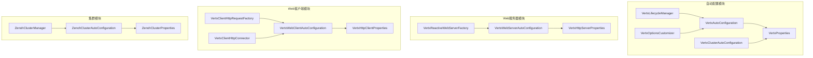
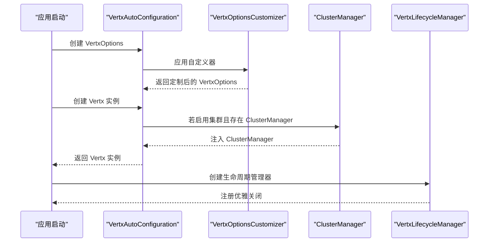
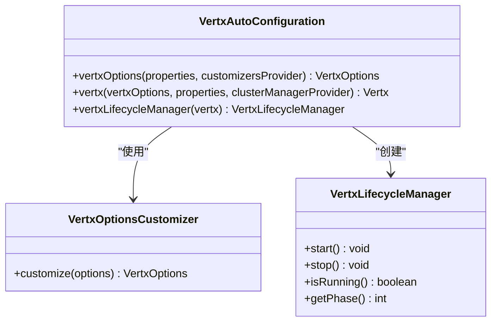
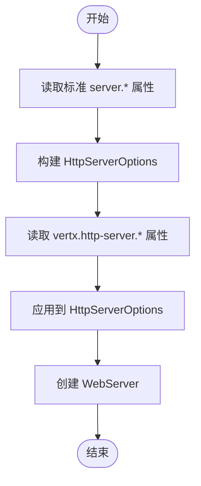
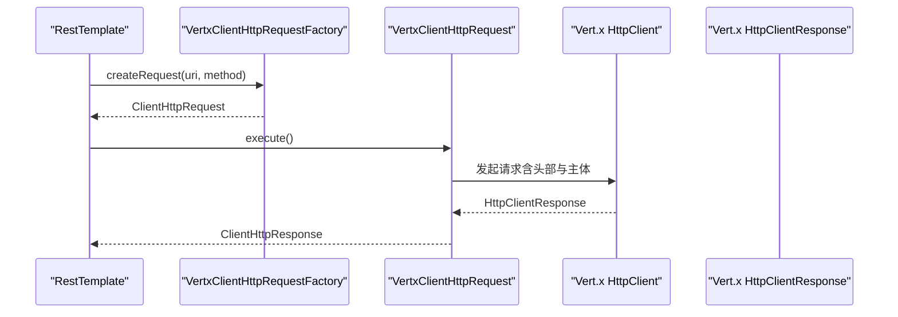
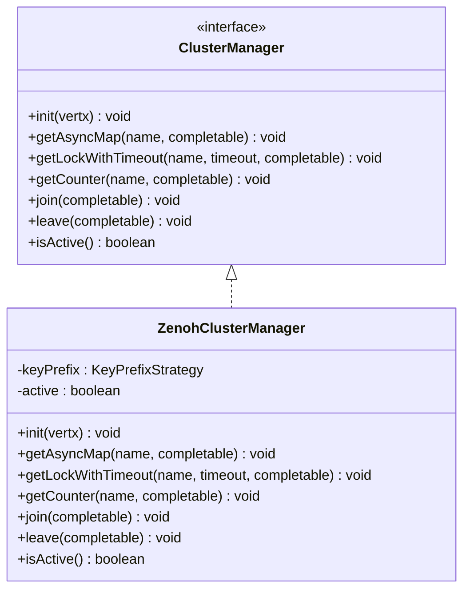
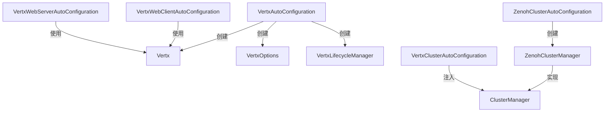

# API参考文档

<cite>
**本文档引用的文件**
- [VertxProperties.java](file://vertx-spring-boot-autoconfigure/src/main/java/com/workoss/boot/vertx/autoconfigure/VertxProperties.java)
- [VertxAutoConfiguration.java](file://vertx-spring-boot-autoconfigure/src/main/java/com/workoss/boot/vertx/autoconfigure/VertxAutoConfiguration.java)
- [VertxClusterAutoConfiguration.java](file://vertx-spring-boot-autoconfigure/src/main/java/com/workoss/boot/vertx/autoconfigure/VertxClusterAutoConfiguration.java)
- [VertxLifecycleManager.java](file://vertx-spring-boot-autoconfigure/src/main/java/com/workoss/boot/vertx/autoconfigure/VertxLifecycleManager.java)
- [VertxOptionsCustomizer.java](file://vertx-spring-boot-autoconfigure/src/main/java/com/workoss/boot/vertx/autoconfigure/VertxOptionsCustomizer.java)
- [VertxHttpServerProperties.java](file://vertx-spring-boot-web-server/src/main/java/com/workoss/boot/vertx/web/server/VertxHttpServerProperties.java)
- [VertxWebServerAutoConfiguration.java](file://vertx-spring-boot-web-server/src/main/java/com/workoss/boot/vertx/web/server/VertxWebServerAutoConfiguration.java)
- [VertxReactiveWebServerFactory.java](file://vertx-spring-boot-web-server/src/main/java/com/workoss/boot/vertx/web/server/VertxReactiveWebServerFactory.java)
- [VertxHttpClientProperties.java](file://vertx-spring-boot-web-client/src/main/java/com/workoss/boot/vertx/web/client/VertxHttpClientProperties.java)
- [VertxWebClientAutoConfiguration.java](file://vertx-spring-boot-web-client/src/main/java/com/workoss/boot/vertx/web/client/VertxWebClientAutoConfiguration.java)
- [VertxClientHttpRequestFactory.java](file://vertx-spring-boot-web-client/src/main/java/com/workoss/boot/vertx/web/client/VertxClientHttpRequestFactory.java)
- [VertxClientHttpConnector.java](file://vertx-spring-boot-web-client/src/main/java/com/workoss/boot/vertx/web/client/VertxClientHttpConnector.java)
- [ZenohClusterProperties.java](file://vertx-spring-boot-cluster-zenoh/src/main/java/com/workoss/boot/vertx/cluster/zenoh/ZenohClusterProperties.java)
- [ZenohClusterAutoConfiguration.java](file://vertx-spring-boot-cluster-zenoh/src/main/java/com/workoss/boot/vertx/cluster/zenoh/ZenohClusterAutoConfiguration.java)
- [ZenohClusterManager.java](file://vertx-spring-boot-cluster-zenoh/src/main/java/com/workoss/boot/vertx/cluster/zenoh/ZenohClusterManager.java)
</cite>

## 目录
1. [简介](#简介)
2. [项目结构](#项目结构)
3. [核心组件](#核心组件)
4. [架构总览](#架构总览)
5. [详细组件分析](#详细组件分析)
6. [依赖分析](#依赖分析)
7. [性能考虑](#性能考虑)
8. [故障排除指南](#故障排除指南)
9. [结论](#结论)
10. [附录](#附录)

## 简介
本API参考文档面向使用 Vert.x Spring Boot Starter 的开发者，系统性地梳理了配置属性、自动配置类、公共接口与使用模式。文档覆盖以下主题：
- 配置属性：VertxProperties、VertxHttpServerProperties、VertxHttpClientProperties、ZenohClusterProperties 的字段定义、类型、默认值与使用说明
- 自动配置：条件注解与Bean定义，配置生效条件与优先级
- 公共接口：方法签名、参数描述、返回值与异常处理
- 使用示例：完整配置示例与常见组合场景
- 版本兼容性与迁移指南：基于当前代码实现的兼容性说明与迁移建议

## 项目结构
该项目采用多模块结构，按功能域拆分：
- vertx-spring-boot-autoconfigure：核心自动配置与通用属性
- vertx-spring-boot-web-server：基于 Vert.x 的响应式 Web 服务器
- vertx-spring-boot-web-client：基于 Vert.x 的 HTTP 客户端（RestTemplate 与 WebClient）
- vertx-spring-boot-cluster-zenoh：基于 Zenoh 的集群管理器实现
- example：示例应用与测试

**图表来源**
- [VertxAutoConfiguration.java:21-82](file://vertx-spring-boot-autoconfigure/src/main/java/com/workoss/boot/vertx/autoconfigure/VertxAutoConfiguration.java#L21-L82)
- [VertxClusterAutoConfiguration.java:13-33](file://vertx-spring-boot-autoconfigure/src/main/java/com/workoss/boot/vertx/autoconfigure/VertxClusterAutoConfiguration.java#L13-L33)
- [VertxLifecycleManager.java:12-52](file://vertx-spring-boot-autoconfigure/src/main/java/com/workoss/boot/vertx/autoconfigure/VertxLifecycleManager.java#L12-L52)
- [VertxOptionsCustomizer.java:9-18](file://vertx-spring-boot-autoconfigure/src/main/java/com/workoss/boot/vertx/autoconfigure/VertxOptionsCustomizer.java#L9-L18)
- [VertxWebServerAutoConfiguration.java:17-30](file://vertx-spring-boot-web-server/src/main/java/com/workoss/boot/vertx/web/server/VertxWebServerAutoConfiguration.java#L17-L30)
- [VertxReactiveWebServerFactory.java:26-79](file://vertx-spring-boot-web-server/src/main/java/com/workoss/boot/vertx/web/server/VertxReactiveWebServerFactory.java#L26-L79)
- [VertxHttpClientProperties.java:8-88](file://vertx-spring-boot-web-client/src/main/java/com/workoss/boot/vertx/web/client/VertxHttpClientProperties.java#L8-L88)
- [VertxWebClientAutoConfiguration.java:16-37](file://vertx-spring-boot-web-client/src/main/java/com/workoss/boot/vertx/web/client/VertxWebClientAutoConfiguration.java#L16-L37)
- [VertxClientHttpRequestFactory.java:29-54](file://vertx-spring-boot-web-client/src/main/java/com/workoss/boot/vertx/web/client/VertxClientHttpRequestFactory.java#L29-L54)
- [VertxClientHttpConnector.java:36-98](file://vertx-spring-boot-web-client/src/main/java/com/workoss/boot/vertx/web/client/VertxClientHttpConnector.java#L36-L98)
- [ZenohClusterProperties.java:11-91](file://vertx-spring-boot-cluster-zenoh/src/main/java/com/workoss/boot/vertx/cluster/zenoh/ZenohClusterProperties.java#L11-L91)
- [ZenohClusterAutoConfiguration.java:15-26](file://vertx-spring-boot-cluster-zenoh/src/main/java/com/workoss/boot/vertx/cluster/zenoh/ZenohClusterAutoConfiguration.java#L15-L26)
- [ZenohClusterManager.java:29-159](file://vertx-spring-boot-cluster-zenoh/src/main/java/com/workoss/boot/vertx/cluster/zenoh/ZenohClusterManager.java#L29-L159)

**章节来源**
- [VertxAutoConfiguration.java:21-82](file://vertx-spring-boot-autoconfigure/src/main/java/com/workoss/boot/vertx/autoconfigure/VertxAutoConfiguration.java#L21-L82)
- [VertxWebServerAutoConfiguration.java:17-30](file://vertx-spring-boot-web-server/src/main/java/com/workoss/boot/vertx/web/server/VertxWebServerAutoConfiguration.java#L17-L30)
- [VertxWebClientAutoConfiguration.java:16-37](file://vertx-spring-boot-web-client/src/main/java/com/workoss/boot/vertx/web/client/VertxWebClientAutoConfiguration.java#L16-L37)
- [ZenohClusterAutoConfiguration.java:15-26](file://vertx-spring-boot-cluster-zenoh/src/main/java/com/workoss/boot/vertx/cluster/zenoh/ZenohClusterAutoConfiguration.java#L15-L26)

## 核心组件
本节对关键配置属性与自动配置类进行深入解析，帮助开发者快速定位与使用。

### VertxProperties（核心属性）
- 命名空间：vertx
- 主要字段
  - eventLoopPoolSize：事件循环线程数；0 表示使用默认值（CPU核心数×2）
  - workerPoolSize：工作线程池大小，默认 20
  - internalBlockingPoolSize：内部阻塞线程池大小，默认 20
  - preferNativeTransport：是否优先使用原生传输（Linux epoll、macOS kqueue），默认 true
  - virtualThreads.enabled：是否使用虚拟线程执行工作任务，默认 true
  - cluster.enabled：是否启用集群，默认 false
  - cluster.host：集群通信主机，默认 0.0.0.0
  - cluster.port：集群通信端口，0 表示自动分配
  - cluster.publicHost：NAT 后的公网主机（可选）

使用说明
- 通过 Spring Boot 配置文件或环境变量设置
- 可结合 VertxOptionsCustomizer 进一步定制 VertxOptions
- 当 cluster.enabled=true 且存在 ClusterManager Bean 时，自动配置会创建集群化的 Vert.x 实例

**章节来源**
- [VertxProperties.java:8-159](file://vertx-spring-boot-autoconfigure/src/main/java/com/workoss/boot/vertx/autoconfigure/VertxProperties.java#L8-L159)

### VertxHttpServerProperties（HTTP服务器属性）
- 命名空间：vertx.http-server
- 主要字段
  - compressionLevel：压缩等级（1-9），当 server.compression.enabled=true 时生效，默认 6
  - idleTimeout：空闲超时（秒），默认 60
  - maxHeaderSize：最大请求头大小（字节），默认 8192
  - maxChunkSize：最大分块大小（字节），默认 8192
  - maxInitialLineLength：最大初始行长度（字节），默认 4096
  - acceptBacklog：TCP 接受队列长度，默认 1024

使用说明
- 与标准 server.* 属性协同工作（端口、地址、SSL、压缩等由 Spring Boot 统一读取）
- 仅 Vert.x 特有的服务器配置在此命名空间下定义

**章节来源**
- [VertxHttpServerProperties.java:12-92](file://vertx-spring-boot-web-server/src/main/java/com/workoss/boot/vertx/web/server/VertxHttpServerProperties.java#L12-L92)

### VertxHttpClientProperties（HTTP客户端属性）
- 命名空间：vertx.http-client
- 主要字段
  - maxPoolSize：每主机连接池最大连接数，默认 5
  - connectTimeout：连接超时（毫秒），默认 60000
  - idleTimeout：空闲超时（秒），默认 30
  - readTimeout：读取超时（毫秒），默认 30000
  - keepAlive：是否启用 HTTP keep-alive，默认 true
  - pipelining：是否启用 HTTP pipelining，默认 false

使用说明
- 用于 Vert.x HttpClient 的选项构建
- 同时支持 RestTemplate（ClientHttpRequestFactory）与 WebClient（ClientHttpConnector）

**章节来源**
- [VertxHttpClientProperties.java:8-88](file://vertx-spring-boot-web-client/src/main/java/com/workoss/boot/vertx/web/client/VertxHttpClientProperties.java#L8-L88)

### ZenohClusterProperties（Zenoh集群属性）
- 命名空间：vertx.cluster.zenoh
- 主要字段
  - appName：应用名称，用于多租户隔离，默认 "default"
  - environment：环境标签（如 dev/staging/prod），默认 "default"
  - mode：Zenoh 会话模式（peer/client/router），默认 "peer"
  - connect：连接端点列表（可选）
  - listen：监听端点列表（可选）
  - configFile：Zenoh JSON5 配置文件路径（可选）

使用说明
- 仅在集群启用时生效
- 提供多租户隔离的键前缀策略

**章节来源**
- [ZenohClusterProperties.java:11-91](file://vertx-spring-boot-cluster-zenoh/src/main/java/com/workoss/boot/vertx/cluster/zenoh/ZenohClusterProperties.java#L11-L91)

## 架构总览
下图展示了自动配置如何根据条件加载核心 Vert.x Bean、Web 服务器与客户端，以及集群管理器的装配流程。

**图表来源**
- [VertxAutoConfiguration.java:28-81](file://vertx-spring-boot-autoconfigure/src/main/java/com/workoss/boot/vertx/autoconfigure/VertxAutoConfiguration.java#L28-L81)
- [VertxClusterAutoConfiguration.java:18-32](file://vertx-spring-boot-autoconfigure/src/main/java/com/workoss/boot/vertx/autoconfigure/VertxClusterAutoConfiguration.java#L18-L32)
- [VertxLifecycleManager.java:12-52](file://vertx-spring-boot-autoconfigure/src/main/java/com/workoss/boot/vertx/autoconfigure/VertxLifecycleManager.java#L12-L52)

## 详细组件分析

### 自动配置类与条件注解
- VertxAutoConfiguration
  - 条件：存在 Vert.x 类、启用 VertxProperties
  - Bean：
    - VertxOptions：根据属性与自定义器构建
    - Vertx：根据是否启用集群创建独立或集群实例
    - VertxLifecycleManager：管理 Vert.x 生命周期
- VertxClusterAutoConfiguration
  - 条件：vertx.cluster.enabled=true 且存在 ClusterManager Bean
  - Bean：VertxOptionsCustomizer，设置 EventBus 主机与端口
- VertxWebServerAutoConfiguration
  - 条件：响应式 Web 应用、存在 HttpServer 与 HttpHandler、不存在 ReactiveWebServerFactory
  - Bean：VertxReactiveWebServerFactory
- VertxWebClientAutoConfiguration
  - 条件：存在 HttpClient、启用 VertxHttpClientProperties
  - Bean：
    - VertxClientHttpRequestFactory（RestTemplate）
    - VertxClientHttpConnector（WebClient）
- ZenohClusterAutoConfiguration
  - 条件：vertx.cluster.enabled=true、存在 ClusterManager、启用 ZenohClusterProperties
  - Bean：ZenohClusterManager

优先级与生效顺序
- 集群自动配置在 VertxAutoConfiguration 之前执行，确保 ClusterManager 能被正确注入
- 当未显式提供 ClusterManager 时，ZenohClusterAutoConfiguration 会创建默认实现

**章节来源**
- [VertxAutoConfiguration.java:21-82](file://vertx-spring-boot-autoconfigure/src/main/java/com/workoss/boot/vertx/autoconfigure/VertxAutoConfiguration.java#L21-L82)
- [VertxClusterAutoConfiguration.java:13-33](file://vertx-spring-boot-autoconfigure/src/main/java/com/workoss/boot/vertx/autoconfigure/VertxClusterAutoConfiguration.java#L13-L33)
- [VertxWebServerAutoConfiguration.java:17-30](file://vertx-spring-boot-web-server/src/main/java/com/workoss/boot/vertx/web/server/VertxWebServerAutoConfiguration.java#L17-L30)
- [VertxWebClientAutoConfiguration.java:16-37](file://vertx-spring-boot-web-client/src/main/java/com/workoss/boot/vertx/web/client/VertxWebClientAutoConfiguration.java#L16-L37)
- [ZenohClusterAutoConfiguration.java:15-26](file://vertx-spring-boot-cluster-zenoh/src/main/java/com/workoss/boot/vertx/cluster/zenoh/ZenohClusterAutoConfiguration.java#L15-L26)

### Vert.x 核心 Bean 与生命周期
- VertxOptions
  - 从 VertxProperties 读取线程池大小、原生传输偏好
  - 支持 VertxOptionsCustomizer 扩展
- Vertx
  - 单机或集群模式创建
  - 日志输出创建状态
- VertxLifecycleManager
  - 实现 SmartLifecycle，在应用关闭时优雅关闭 Vert.x

**图表来源**
- [VertxOptionsCustomizer.java:9-18](file://vertx-spring-boot-autoconfigure/src/main/java/com/workoss/boot/vertx/autoconfigure/VertxOptionsCustomizer.java#L9-L18)
- [VertxAutoConfiguration.java:28-81](file://vertx-spring-boot-autoconfigure/src/main/java/com/workoss/boot/vertx/autoconfigure/VertxAutoConfiguration.java#L28-L81)
- [VertxLifecycleManager.java:12-52](file://vertx-spring-boot-autoconfigure/src/main/java/com/workoss/boot/vertx/autoconfigure/VertxLifecycleManager.java#L12-L52)

**章节来源**
- [VertxAutoConfiguration.java:28-81](file://vertx-spring-boot-autoconfigure/src/main/java/com/workoss/boot/vertx/autoconfigure/VertxAutoConfiguration.java#L28-L81)
- [VertxLifecycleManager.java:12-52](file://vertx-spring-boot-autoconfigure/src/main/java/com/workoss/boot/vertx/autoconfigure/VertxLifecycleManager.java#L12-L52)

### Web 服务器工厂与属性映射
- VertxReactiveWebServerFactory
  - 读取标准 server.* 属性（端口、地址、SSL、压缩）
  - 读取 vertx.http-server.* 属性（空闲超时、头部/分块/初始行限制、接受队列）
  - 构建 HttpServerOptions 并创建 WebServer

**图表来源**
- [VertxReactiveWebServerFactory.java:43-78](file://vertx-spring-boot-web-server/src/main/java/com/workoss/boot/vertx/web/server/VertxReactiveWebServerFactory.java#L43-L78)

**章节来源**
- [VertxReactiveWebServerFactory.java:26-79](file://vertx-spring-boot-web-server/src/main/java/com/workoss/boot/vertx/web/server/VertxReactiveWebServerFactory.java#L26-L79)

### HTTP 客户端实现
- VertxClientHttpRequestFactory（RestTemplate）
  - 基于 Vert.x HttpClient 的同步实现
  - 支持连接/空闲超时、keep-alive、pipelining
  - 异常统一包装为 IOException
- VertxClientHttpConnector（WebClient）
  - 基于 Reactor 的异步实现
  - 支持数据缓冲与响应体流式读取
  - 错误处理通过 Mono/Flux 传播

**图表来源**
- [VertxClientHttpRequestFactory.java:44-152](file://vertx-spring-boot-web-client/src/main/java/com/workoss/boot/vertx/web/client/VertxClientHttpRequestFactory.java#L44-L152)

**章节来源**
- [VertxClientHttpRequestFactory.java:29-197](file://vertx-spring-boot-web-client/src/main/java/com/workoss/boot/vertx/web/client/VertxClientHttpRequestFactory.java#L29-L197)
- [VertxClientHttpConnector.java:36-242](file://vertx-spring-boot-web-client/src/main/java/com/workoss/boot/vertx/web/client/VertxClientHttpConnector.java#L36-L242)

### 集群管理器与多租户隔离
- ZenohClusterManager
  - 实现 ClusterManager 接口，提供 AsyncMap/Lock/Counter 等分布式能力
  - 多租户隔离：通过 app-name 与 environment 组合生成键前缀
  - 节点加入/离开、注册信息维护、活跃状态管理
- ZenohClusterAutoConfiguration
  - 在集群启用时创建 ZenohClusterManager Bean
  - 读取 ZenohClusterProperties 并注入

**图表来源**
- [ZenohClusterManager.java:29-159](file://vertx-spring-boot-cluster-zenoh/src/main/java/com/workoss/boot/vertx/cluster/zenoh/ZenohClusterManager.java#L29-L159)

**章节来源**
- [ZenohClusterAutoConfiguration.java:15-26](file://vertx-spring-boot-cluster-zenoh/src/main/java/com/workoss/boot/vertx/cluster/zenoh/ZenohClusterAutoConfiguration.java#L15-L26)
- [ZenohClusterManager.java:29-243](file://vertx-spring-boot-cluster-zenoh/src/main/java/com/workoss/boot/vertx/cluster/zenoh/ZenohClusterManager.java#L29-L243)

## 依赖分析
- 模块间耦合
  - 自动配置模块为其他模块提供核心 Bean（Vertx、VertxOptions、ClusterManager）
  - Web 服务器与客户端模块通过条件注解依赖 Vert.x 类与属性
  - 集群模块在启用集群时提供 ClusterManager 实现
- 外部依赖
  - Spring Boot 自动配置与 Web 抽象（ReactiveWebServerFactory、ClientHttpRequestFactory、ClientHttpConnector）
  - Vert.x 核心与 HTTP 客户端 API

**图表来源**
- [VertxAutoConfiguration.java:28-81](file://vertx-spring-boot-autoconfigure/src/main/java/com/workoss/boot/vertx/autoconfigure/VertxAutoConfiguration.java#L28-L81)
- [VertxWebServerAutoConfiguration.java:24-29](file://vertx-spring-boot-web-server/src/main/java/com/workoss/boot/vertx/web/server/VertxWebServerAutoConfiguration.java#L24-L29)
- [VertxWebClientAutoConfiguration.java:21-36](file://vertx-spring-boot-web-client/src/main/java/com/workoss/boot/vertx/web/client/VertxWebClientAutoConfiguration.java#L21-L36)
- [ZenohClusterAutoConfiguration.java:21-25](file://vertx-spring-boot-cluster-zenoh/src/main/java/com/workoss/boot/vertx/cluster/zenoh/ZenohClusterAutoConfiguration.java#L21-L25)

**章节来源**
- [VertxAutoConfiguration.java:28-81](file://vertx-spring-boot-autoconfigure/src/main/java/com/workoss/boot/vertx/autoconfigure/VertxAutoConfiguration.java#L28-L81)
- [VertxWebServerAutoConfiguration.java:24-29](file://vertx-spring-boot-web-server/src/main/java/com/workoss/boot/vertx/web/server/VertxWebServerAutoConfiguration.java#L24-L29)
- [VertxWebClientAutoConfiguration.java:21-36](file://vertx-spring-boot-web-client/src/main/java/com/workoss/boot/vertx/web/client/VertxWebClientAutoConfiguration.java#L21-L36)
- [ZenohClusterAutoConfiguration.java:21-25](file://vertx-spring-boot-cluster-zenoh/src/main/java/com/workoss/boot/vertx/cluster/zenoh/ZenohClusterAutoConfiguration.java#L21-L25)

## 性能考虑
- 线程模型
  - eventLoopPoolSize=0 使用默认值（CPU核心数×2），可根据 CPU 与负载调优
  - workerPoolSize/internalBlockingPoolSize 影响阻塞任务与内部调度吞吐
  - virtualThreads.enabled=true 可降低线程切换开销，适合高并发轻阻塞场景
- 网络与连接
  - maxPoolSize 控制每主机连接池上限，避免过多连接导致资源争用
  - keepAlive/pipelining 提升长连接复用与管线化效率
  - idleTimeout/readTimeout/acceptBacklog 调整网络层超时与队列容量
- 集群与多租户
  - appName/environment 组合隔离共享网络下的不同应用/环境
  - 集群模式（peer/client/router）影响网络拓扑与延迟

[本节为通用指导，无需特定文件来源]

## 故障排除指南
- 无法创建 Vert.x 实例
  - 检查 VertxProperties 配置（尤其是集群启用与 ClusterManager 提供）
  - 查看日志中“创建独立/集群实例”的提示
- 客户端请求失败
  - 核对 connectTimeout/readTimeout/idleTimeout 设置
  - 对于 RestTemplate，异常统一包装为 IOException
  - 对于 WebClient，错误通过 Mono/Flux 传播，检查订阅链路
- 集群加入失败
  - 确认 vertx.cluster.enabled=true 且存在 ClusterManager Bean
  - 检查 ZenohClusterProperties 的 mode/connect/listen 配置
  - 关注日志中的加入/离开与 liveliness 订阅状态

**章节来源**
- [VertxAutoConfiguration.java:52-75](file://vertx-spring-boot-autoconfigure/src/main/java/com/workoss/boot/vertx/autoconfigure/VertxAutoConfiguration.java#L52-L75)
- [VertxClientHttpRequestFactory.java:149-151](file://vertx-spring-boot-web-client/src/main/java/com/workoss/boot/vertx/web/client/VertxClientHttpRequestFactory.java#L149-L151)
- [ZenohClusterManager.java:124-154](file://vertx-spring-boot-cluster-zenoh/src/main/java/com/workoss/boot/vertx/cluster/zenoh/ZenohClusterManager.java#L124-L154)

## 结论
本参考文档系统性地整理了 Vert.x Spring Boot Starter 的配置属性、自动配置与公共接口，提供了条件注解与 Bean 定义的生效机制说明，并给出了典型使用场景与故障排除建议。建议在生产环境中结合业务负载与网络环境，对线程池、连接池与超时参数进行针对性优化。

[本节为总结性内容，无需特定文件来源]

## 附录

### 配置属性速查表
- VertxProperties（vertx.*）
  - eventLoopPoolSize：事件循环线程数；默认 0（使用 CPU×2）
  - workerPoolSize：工作线程数；默认 20
  - internalBlockingPoolSize：内部阻塞线程数；默认 20
  - preferNativeTransport：原生传输；默认 true
  - virtualThreads.enabled：虚拟线程；默认 true
  - cluster.enabled：集群开关；默认 false
  - cluster.host：集群主机；默认 0.0.0.0
  - cluster.port：集群端口；默认 0（自动）
  - cluster.publicHost：公网主机（可选）
- VertxHttpServerProperties（vertx.http-server.*）
  - compressionLevel：压缩等级；默认 6
  - idleTimeout：空闲超时（秒）；默认 60
  - maxHeaderSize：最大头大小（字节）；默认 8192
  - maxChunkSize：最大分块大小（字节）；默认 8192
  - maxInitialLineLength：最大初始行长度（字节）；默认 4096
  - acceptBacklog：接受队列长度；默认 1024
- VertxHttpClientProperties（vertx.http-client.*）
  - maxPoolSize：每主机最大连接数；默认 5
  - connectTimeout：连接超时（毫秒）；默认 60000
  - idleTimeout：空闲超时（秒）；默认 30
  - readTimeout：读取超时（毫秒）；默认 30000
  - keepAlive：保持连接；默认 true
  - pipelining：管线化；默认 false
- ZenohClusterProperties（vertx.cluster.zenoh.*）
  - appName：应用名；默认 "default"
  - environment：环境；默认 "default"
  - mode：会话模式；默认 "peer"
  - connect：连接端点列表（可选）
  - listen：监听端点列表（可选）
  - configFile：配置文件路径（可选）

**章节来源**
- [VertxProperties.java:14-159](file://vertx-spring-boot-autoconfigure/src/main/java/com/workoss/boot/vertx/autoconfigure/VertxProperties.java#L14-L159)
- [VertxHttpServerProperties.java:18-91](file://vertx-spring-boot-web-server/src/main/java/com/workoss/boot/vertx/web/server/VertxHttpServerProperties.java#L18-L91)
- [VertxHttpClientProperties.java:14-88](file://vertx-spring-boot-web-client/src/main/java/com/workoss/boot/vertx/web/client/VertxHttpClientProperties.java#L14-L88)
- [ZenohClusterProperties.java:17-91](file://vertx-spring-boot-cluster-zenoh/src/main/java/com/workoss/boot/vertx/cluster/zenoh/ZenohClusterProperties.java#L17-L91)

### 使用示例与场景
- 单机 Vert.x + 内置 Web 服务器
  - 启用 vertx.cluster.enabled=false（默认）
  - 配置 server.port/server.address 等标准属性
  - 如需压缩，开启 server.compression.enabled=true 并设置 vertx.http-server.compressionLevel
- 集群 Vert.x + Zenoh
  - 启用 vertx.cluster.enabled=true
  - 设置 vertx.cluster.zenoh.mode/connect/listen 或 configFile
  - appName/environment 用于多租户隔离
- HTTP 客户端
  - RestTemplate：使用 VertxClientHttpRequestFactory
  - WebClient：使用 VertxClientHttpConnector
  - 调整 vertx.http-client.* 参数以适配目标服务

[本节为概念性示例，无需特定文件来源]

### 版本兼容性与迁移指南
- Vert.x 5 集群配置变更
  - 集群通过 VertxBuilder.withClusterManager() 配置，而非 EventBusOptions
  - VertxClusterAutoConfiguration 已适配该变化，仅在启用集群时应用 EventBus 主机/端口
- 迁移建议
  - 若从旧版本升级，确认 EventBusOptions 的主机/端口已迁移到 VertxOptionsCustomizer
  - 检查自定义 VertxOptionsCustomizer 实现是否仍适用

**章节来源**
- [VertxClusterAutoConfiguration.java:22-31](file://vertx-spring-boot-autoconfigure/src/main/java/com/workoss/boot/vertx/autoconfigure/VertxClusterAutoConfiguration.java#L22-L31)