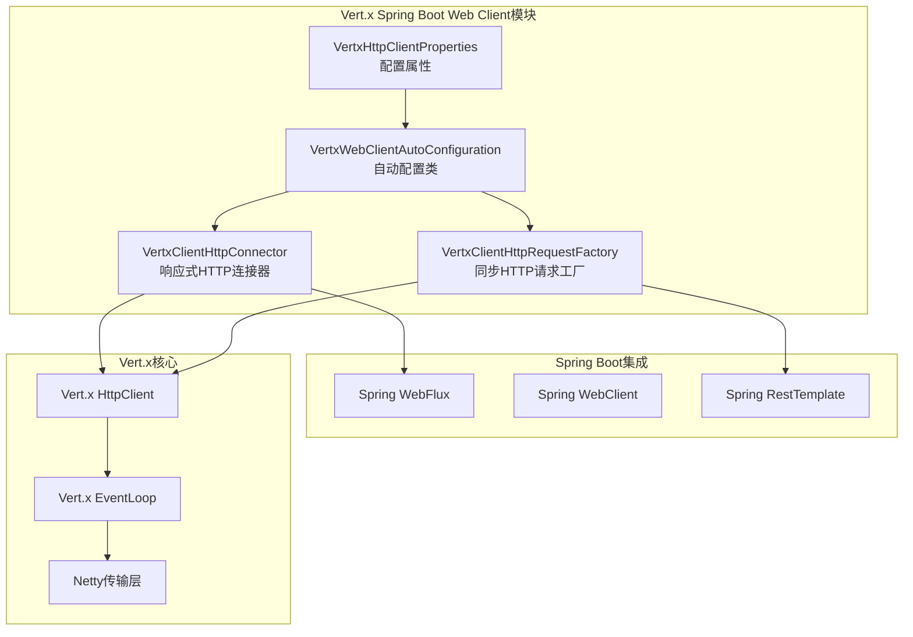
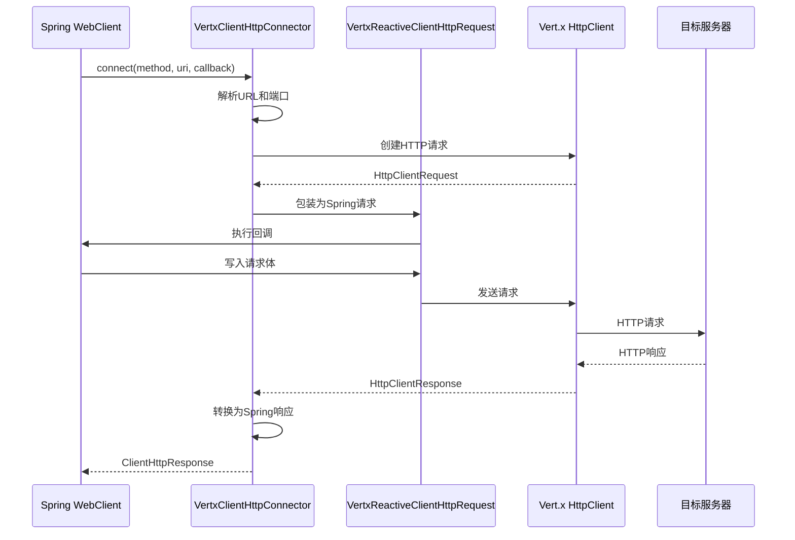
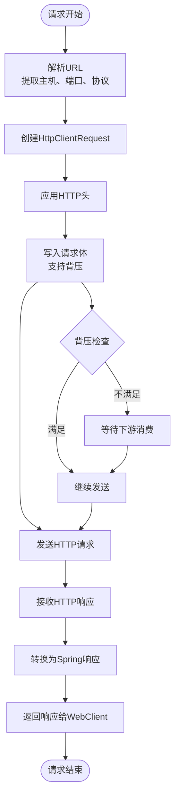
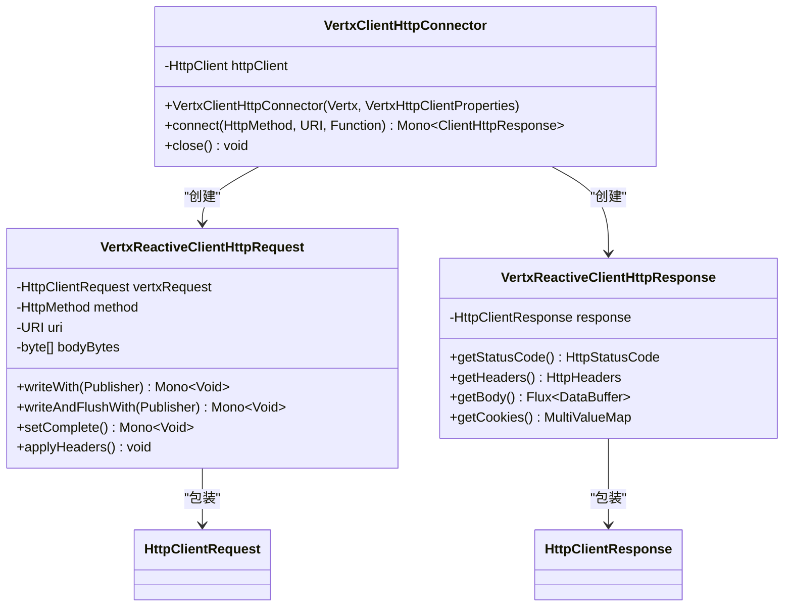
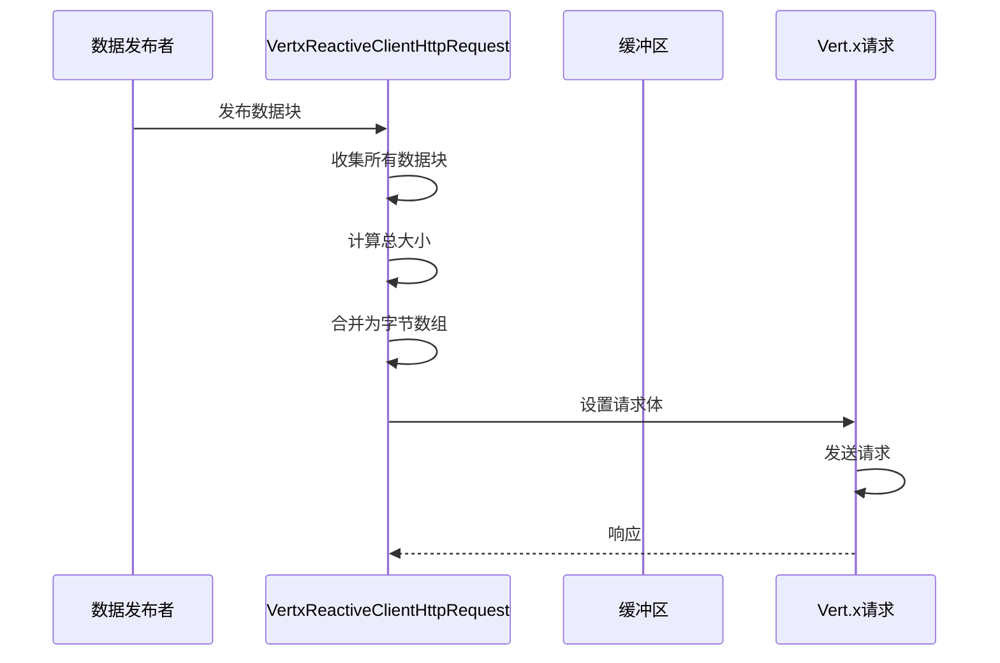
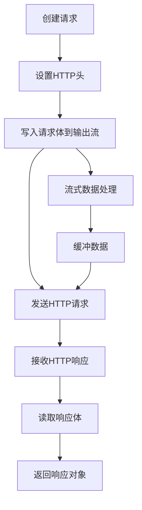
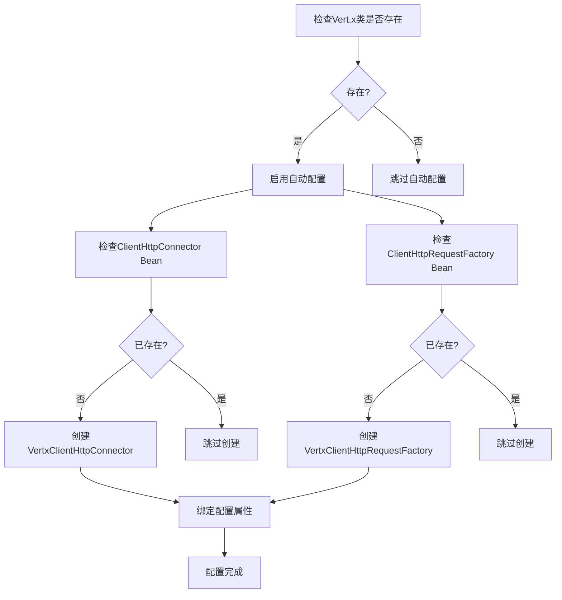
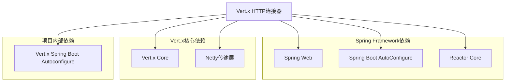

# HTTP连接器

<cite>
**本文档引用的文件**
- [VertxClientHttpConnector.java](file://vertx-spring-boot-web-client/src/main/java/com/workoss/boot/vertx/web/client/VertxClientHttpConnector.java)
- [VertxClientHttpRequestFactory.java](file://vertx-spring-boot-web-client/src/main/java/com/workoss/boot/vertx/web/client/VertxClientHttpRequestFactory.java)
- [VertxHttpClientProperties.java](file://vertx-spring-boot-web-client/src/main/java/com/workoss/boot/vertx/web/client/VertxHttpClientProperties.java)
- [VertxWebClientAutoConfiguration.java](file://vertx-spring-boot-web-client/src/main/java/com/workoss/boot/vertx/web/client/VertxWebClientAutoConfiguration.java)
- [VertxWebClientAutoConfigurationTest.java](file://vertx-spring-boot-web-client/src/test/java/com/workoss/boot/vertx/web/client/VertxWebClientAutoConfigurationTest.java)
- [pom.xml](file://vertx-spring-boot-web-client/pom.xml)
- [application.yml](file://example/vertx-spring-boot-example/src/main/resources/application.yml)
</cite>

## 目录
1. [简介](#简介)
2. [项目结构](#项目结构)
3. [核心组件](#核心组件)
4. [架构概览](#架构概览)
5. [详细组件分析](#详细组件分析)
6. [依赖关系分析](#依赖关系分析)
7. [性能考虑](#性能考虑)
8. [故障排除指南](#故障排除指南)
9. [结论](#结论)

## 简介

Vert.x HTTP连接器是一个将Vert.x的高性能异步HTTP客户端集成到Spring WebFlux中的关键组件。该连接器实现了Spring Framework的`ClientHttpConnector`接口，为Spring WebClient提供了基于Vert.x的响应式HTTP客户端实现。

该实现的核心价值在于：
- **高性能异步I/O**：利用Vert.x的事件驱动架构和非阻塞I/O模型
- **响应式编程支持**：完全兼容Spring WebFlux的响应式流处理
- **背压控制**：天然支持响应式流的背压机制
- **连接池管理**：内置连接池优化，支持连接复用和资源管理
- **自动配置**：通过Spring Boot自动配置简化使用

## 项目结构

该项目采用模块化设计，主要包含以下核心模块：



**图表来源**
- [VertxClientHttpConnector.java:1-242](file://vertx-spring-boot-web-client/src/main/java/com/workoss/boot/vertx/web/client/VertxClientHttpConnector.java#L1-L242)
- [VertxWebClientAutoConfiguration.java:1-38](file://vertx-spring-boot-web-client/src/main/java/com/workoss/boot/vertx/web/client/VertxWebClientAutoConfiguration.java#L1-L38)

**章节来源**
- [pom.xml:1-57](file://vertx-spring-boot-web-client/pom.xml#L1-L57)
- [application.yml:1-21](file://example/vertx-spring-boot-example/src/main/resources/application.yml#L1-L21)

## 核心组件

### VertxClientHttpConnector

这是整个系统的核心组件，实现了Spring Framework的`ClientHttpConnector`接口。它负责：

- **HTTP请求处理**：将Spring WebClient的请求转换为Vert.x的HTTP请求
- **连接管理**：管理Vert.x HttpClient实例和连接池
- **响应处理**：将Vert.x的响应转换为Spring的响应对象
- **生命周期管理**：提供自动关闭功能

### VertxClientHttpRequestFactory

为传统的Spring RestTemplate提供Vert.x后端支持：

- **同步请求执行**：提供阻塞式的HTTP请求执行能力
- **流式响应处理**：支持响应体的流式读取
- **资源管理**：确保HTTP连接的正确关闭

### VertxHttpClientProperties

配置属性类，定义了所有可配置的参数：

- **连接池设置**：最大连接数、连接超时等
- **网络参数**：保持连接、管道化等
- **超时配置**：连接超时、空闲超时、读取超时

### VertxWebClientAutoConfiguration

Spring Boot自动配置类：

- **条件装配**：仅在相关类存在时启用
- **Bean注册**：自动注册HTTP连接器和请求工厂
- **属性绑定**：将配置属性绑定到应用上下文

**章节来源**
- [VertxClientHttpConnector.java:36-98](file://vertx-spring-boot-web-client/src/main/java/com/workoss/boot/vertx/web/client/VertxClientHttpConnector.java#L36-L98)
- [VertxClientHttpRequestFactory.java:29-54](file://vertx-spring-boot-web-client/src/main/java/com/workoss/boot/vertx/web/client/VertxClientHttpRequestFactory.java#L29-L54)
- [VertxHttpClientProperties.java:8-89](file://vertx-spring-boot-web-client/src/main/java/com/workoss/boot/vertx/web/client/VertxHttpClientProperties.java#L8-L89)
- [VertxWebClientAutoConfiguration.java:16-37](file://vertx-spring-boot-web-client/src/main/java/com/workoss/boot/vertx/web/client/VertxWebClientAutoConfiguration.java#L16-L37)

## 架构概览

### 整体架构设计



**图表来源**
- [VertxClientHttpConnector.java:50-90](file://vertx-spring-boot-web-client/src/main/java/com/workoss/boot/vertx/web/client/VertxClientHttpConnector.java#L50-L90)

### 数据流处理



**图表来源**
- [VertxClientHttpConnector.java:140-167](file://vertx-spring-boot-web-client/src/main/java/com/workoss/boot/vertx/web/client/VertxClientHttpConnector.java#L140-L167)
- [VertxClientHttpConnector.java:212-222](file://vertx-spring-boot-web-client/src/main/java/com/workoss/boot/vertx/web/client/VertxClientHttpConnector.java#L212-L222)

## 详细组件分析

### VertxClientHttpConnector实现分析

#### 类结构设计



**图表来源**
- [VertxClientHttpConnector.java:36-242](file://vertx-spring-boot-web-client/src/main/java/com/workoss/boot/vertx/web/client/VertxClientHttpConnector.java#L36-L242)

#### 连接建立流程

连接建立过程遵循以下步骤：

1. **URL解析**：从URI中提取主机名、端口号和协议类型
2. **SSL检测**：根据协议确定是否启用SSL
3. **请求创建**：使用Vert.x HttpClient创建HTTP请求
4. **请求包装**：将Vert.x请求包装为Spring的ClientHttpRequest
5. **回调执行**：执行用户提供的请求回调函数
6. **请求发送**：发送HTTP请求并获取响应

#### 请求体处理机制



**图表来源**
- [VertxClientHttpConnector.java:140-156](file://vertx-spring-boot-web-client/src/main/java/com/workoss/boot/vertx/web/client/VertxClientHttpConnector.java#L140-L156)

**章节来源**
- [VertxClientHttpConnector.java:40-98](file://vertx-spring-boot-web-client/src/main/java/com/workoss/boot/vertx/web/client/VertxClientHttpConnector.java#L40-L98)
- [VertxClientHttpConnector.java:103-186](file://vertx-spring-boot-web-client/src/main/java/com/workoss/boot/vertx/web/client/VertxClientHttpConnector.java#L103-L186)
- [VertxClientHttpConnector.java:191-242](file://vertx-spring-boot-web-client/src/main/java/com/workoss/boot/vertx/web/client/VertxClientHttpConnector.java#L191-L242)

### VertxClientHttpRequestFactory实现分析

#### 同步请求处理



**图表来源**
- [VertxClientHttpRequestFactory.java:99-152](file://vertx-spring-boot-web-client/src/main/java/com/workoss/boot/vertx/web/client/VertxClientHttpRequestFactory.java#L99-L152)

**章节来源**
- [VertxClientHttpRequestFactory.java:59-153](file://vertx-spring-boot-web-client/src/main/java/com/workoss/boot/vertx/web/client/VertxClientHttpRequestFactory.java#L59-L153)

### 配置属性分析

#### 可配置参数详解

| 属性名称 | 默认值 | 描述 | 影响范围 |
|---------|--------|------|----------|
| maxPoolSize | 5 | 每个主机的最大连接数 | 连接池大小 |
| connectTimeout | 60000 | 连接超时时间（毫秒） | 连接建立 |
| idleTimeout | 30 | 空闲超时时间（秒） | 连接复用 |
| readTimeout | 30000 | 读取超时时间（毫秒） | 响应处理 |
| keepAlive | true | 是否启用HTTP keep-alive | 连接复用 |
| pipelining | false | 是否启用HTTP管道化 | 请求并发 |

**章节来源**
- [VertxHttpClientProperties.java:14-87](file://vertx-spring-boot-web-client/src/main/java/com/workoss/boot/vertx/web/client/VertxHttpClientProperties.java#L14-L87)

### 自动配置机制

#### 条件装配逻辑



**图表来源**
- [VertxWebClientAutoConfiguration.java:16-37](file://vertx-spring-boot-web-client/src/main/java/com/workoss/boot/vertx/web/client/VertxWebClientAutoConfiguration.java#L16-L37)

**章节来源**
- [VertxWebClientAutoConfiguration.java:16-37](file://vertx-spring-boot-web-client/src/main/java/com/workoss/boot/vertx/web/client/VertxWebClientAutoConfiguration.java#L16-L37)

## 依赖关系分析

### 外部依赖关系



**图表来源**
- [pom.xml:17-47](file://vertx-spring-boot-web-client/pom.xml#L17-L47)

### 版本兼容性

项目使用了经过精心选择的版本组合以确保兼容性：

- **Spring Boot**: 3.5.0 - 提供最新的Spring Framework特性
- **Vert.x**: 5.0.12 - 最新稳定版本，支持Netty 4.2
- **Java**: 21 - 最新的长期支持版本

**章节来源**
- [pom.xml:24-33](file://pom.xml#L24-L33)
- [pom.xml:35-53](file://pom.xml#L35-L53)

## 性能考虑

### 连接池优化

Vert.x HTTP客户端内置了高效的连接池管理：

- **连接复用**：通过keep-alive机制减少连接建立开销
- **并发控制**：maxPoolSize限制每个主机的并发连接数
- **资源回收**：idleTimeout确保长时间未使用的连接被及时回收

### 背压处理

响应式流的背压控制是该实现的重要特性：

- **数据缓冲**：请求体数据被收集到内存中，支持背压信号
- **流式响应**：响应体以Flux形式返回，支持背压传播
- **内存管理**：合理使用DataBuffer避免内存泄漏

### 性能调优建议

基于源码分析，以下是具体的性能优化建议：

1. **连接池配置**
   - 根据并发需求调整maxPoolSize
   - 合理设置connectTimeout和idleTimeout
   - 在高并发场景下考虑启用pipelining

2. **内存管理**
   - 对于大文件上传，考虑使用流式处理而非一次性加载
   - 监控DataBuffer的使用情况，避免内存溢出

3. **网络优化**
   - 在内网环境适当增加maxPoolSize
   - 对于长连接场景，合理设置keepAlive和idleTimeout

## 故障排除指南

### 常见问题诊断

#### 连接超时问题

**症状**：请求在指定时间内无法建立连接
**可能原因**：
- connectTimeout设置过小
- 目标服务器不可达
- 网络延迟过高

**解决方案**：
- 增加connectTimeout配置
- 检查网络连通性
- 考虑使用连接池预热

#### 响应超时问题

**症状**：连接建立成功但响应迟迟不到
**可能原因**：
- readTimeout设置过小
- 目标服务器处理时间过长
- 网络传输问题

**解决方案**：
- 增加readTimeout配置
- 优化目标服务器性能
- 检查网络质量

#### 内存溢出问题

**症状**：应用程序出现内存不足错误
**可能原因**：
- 大文件请求一次性加载到内存
- DataBuffer未正确释放
- 连接池过大导致内存占用过高

**解决方案**：
- 使用流式处理大文件
- 确保DataBufferUtils.release正确调用
- 调整maxPoolSize和idleTimeout

### 调试技巧

#### 日志配置

在application.yml中添加以下配置：

```yaml
logging:
  level:
    com.workoss.boot.vertx.web.client: debug
    io.vertx: debug
```

#### 性能监控

通过JVM监控工具观察以下指标：
- 连接池使用率
- 内存使用情况
- GC频率和停顿时间

**章节来源**
- [VertxWebClientAutoConfigurationTest.java:61-76](file://vertx-spring-boot-web-client/src/test/java/com/workoss/boot/vertx/web/client/VertxWebClientAutoConfigurationTest.java#L61-L76)

## 结论

Vert.x HTTP连接器为Spring WebFlux提供了高性能、响应式的HTTP客户端实现。通过巧妙的设计，它成功地将Vert.x的异步I/O模型与Spring Framework的响应式编程范式相结合。

### 主要优势

1. **高性能**：基于Vert.x的事件驱动架构，提供卓越的吞吐量
2. **响应式**：完全支持Spring WebFlux的响应式编程模型
3. **易用性**：通过Spring Boot自动配置简化了使用
4. **可扩展性**：丰富的配置选项支持各种使用场景

### 技术特色

- **连接池管理**：智能的连接复用和资源管理
- **背压控制**：天然支持响应式流的背压机制
- **类型安全**：完整的类型检查和编译时验证
- **生命周期管理**：完善的资源清理和关闭机制

### 应用建议

该连接器特别适合以下场景：
- 高并发的微服务通信
- 实时数据流处理
- 需要低延迟响应的应用
- 基于事件驱动的系统架构

通过合理的配置和调优，可以充分发挥Vert.x HTTP连接器的性能潜力，为Spring Boot应用提供强大的HTTP客户端支持。