# Web客户端模块

<cite>
**本文档引用的文件**
- [VertxWebClientAutoConfiguration.java](file://vertx-spring-boot-web-client/src/main/java/com/workoss/boot/vertx/web/client/VertxWebClientAutoConfiguration.java)
- [VertxClientHttpConnector.java](file://vertx-spring-boot-web-client/src/main/java/com/workoss/boot/vertx/web/client/VertxClientHttpConnector.java)
- [VertxClientHttpRequestFactory.java](file://vertx-spring-boot-web-client/src/main/java/com/workoss/boot/vertx/web/client/VertxClientHttpRequestFactory.java)
- [VertxHttpClientProperties.java](file://vertx-spring-boot-web-client/src/main/java/com/workoss/boot/vertx/web/client/VertxHttpClientProperties.java)
- [VertxWebClientAutoConfigurationTest.java](file://vertx-spring-boot-web-client/src/test/java/com/workoss/boot/vertx/web/client/VertxWebClientAutoConfigurationTest.java)
- [org.springframework.boot.autoconfigure.AutoConfiguration.imports](file://vertx-spring-boot-web-client/src/main/resources/META-INF/spring/org.springframework.boot.autoconfigure.AutoConfiguration.imports)
- [org.springframework.boot.autoconfigure.AutoConfiguration.imports](file://vertx-spring-boot-autoconfigure/src/main/resources/META-INF/spring/org.springframework.boot.autoconfigure.AutoConfiguration.imports)
- [application.yml](file://example/vertx-spring-boot-example/src/main/resources/application.yml)
</cite>

## 目录
1. [简介](#简介)
2. [项目结构](#项目结构)
3. [核心组件](#核心组件)
4. [架构概览](#架构概览)
5. [详细组件分析](#详细组件分析)
6. [依赖关系分析](#依赖关系分析)
7. [性能考虑](#性能考虑)
8. [故障排除指南](#故障排除指南)
9. [结论](#结论)
10. [附录](#附录)

## 简介

Vert.x Web客户端模块是一个基于Spring Boot自动配置的HTTP客户端集成解决方案，它将Vert.x的高性能异步HTTP客户端与Spring WebFlux和Spring MVC无缝集成。该模块提供了两种主要的客户端实现：用于WebFlux的反应式HTTP连接器和用于MVC的同步HTTP请求工厂。

该模块的核心价值在于：
- 提供高性能的异步HTTP客户端
- 支持WebFlux和传统MVC两种编程模型
- 简化的配置管理
- 完整的连接池和超时控制
- 透明的SSL和代理支持

## 项目结构

Vert.x Web客户端模块采用标准的Spring Boot模块结构，包含以下关键目录：

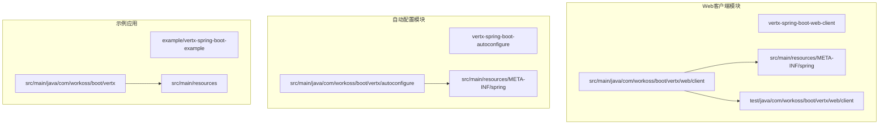

**图表来源**
- [VertxWebClientAutoConfiguration.java:1-38](file://vertx-spring-boot-web-client/src/main/java/com/workoss/boot/vertx/web/client/VertxWebClientAutoConfiguration.java#L1-L38)
- [org.springframework.boot.autoconfigure.AutoConfiguration.imports:1-2](file://vertx-spring-boot-web-client/src/main/resources/META-INF/spring/org.springframework.boot.autoconfigure.AutoConfiguration.imports#L1-L2)

**章节来源**
- [VertxWebClientAutoConfiguration.java:1-38](file://vertx-spring-boot-web-client/src/main/java/com/workoss/boot/vertx/web/client/VertxWebClientAutoConfiguration.java#L1-L38)
- [org.springframework.boot.autoconfigure.AutoConfiguration.imports:1-2](file://vertx-spring-boot-web-client/src/main/resources/META-INF/spring/org.springframework.boot.autoconfigure.AutoConfiguration.imports#L1-L2)

## 核心组件

### 自动配置类

`VertxWebClientAutoConfiguration`是整个模块的核心，负责在Spring Boot应用启动时自动配置Vert.x HTTP客户端。该类使用条件注解确保只有在存在相应依赖时才进行配置。

### HTTP连接器实现

`VertxClientHttpConnector`实现了Spring WebFlux的`ClientHttpConnector`接口，为WebClient提供反应式的HTTP连接能力。

### 请求工厂实现

`VertxClientHttpRequestFactory`实现了Spring MVC的`ClientHttpRequestFactory`接口，为RestTemplate提供同步的HTTP请求能力。

### 配置属性类

`VertxHttpClientProperties`定义了所有可配置的HTTP客户端参数，包括连接池大小、超时设置等。

**章节来源**
- [VertxWebClientAutoConfiguration.java:13-38](file://vertx-spring-boot-web-client/src/main/java/com/workoss/boot/vertx/web/client/VertxWebClientAutoConfiguration.java#L13-L38)
- [VertxClientHttpConnector.java:32-36](file://vertx-spring-boot-web-client/src/main/java/com/workoss/boot/vertx/web/client/VertxClientHttpConnector.java#L32-L36)
- [VertxClientHttpRequestFactory.java:25-29](file://vertx-spring-boot-web-client/src/main/java/com/workoss/boot/vertx/web/client/VertxClientHttpRequestFactory.java#L25-L29)
- [VertxHttpClientProperties.java:5-89](file://vertx-spring-boot-web-client/src/main/java/com/workoss/boot/vertx/web/client/VertxHttpClientProperties.java#L5-L89)

## 架构概览

该模块采用分层架构设计，通过Spring Boot的自动配置机制实现无缝集成：

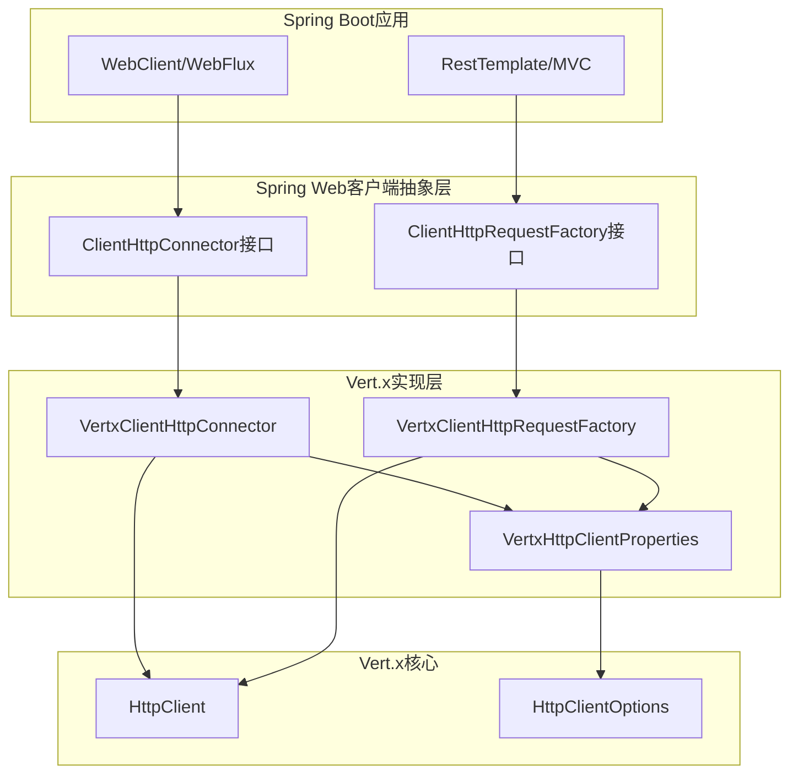

**图表来源**
- [VertxWebClientAutoConfiguration.java:21-36](file://vertx-spring-boot-web-client/src/main/java/com/workoss/boot/vertx/web/client/VertxWebClientAutoConfiguration.java#L21-L36)
- [VertxClientHttpConnector.java:36-48](file://vertx-spring-boot-web-client/src/main/java/com/workoss/boot/vertx/web/client/VertxClientHttpConnector.java#L36-L48)
- [VertxClientHttpRequestFactory.java:29-41](file://vertx-spring-boot-web-client/src/main/java/com/workoss/boot/vertx/web/client/VertxClientHttpRequestFactory.java#L29-L41)

## 详细组件分析

### 自动配置过程分析

#### 条件配置机制

自动配置类使用了多层条件注解来确保正确的配置时机：

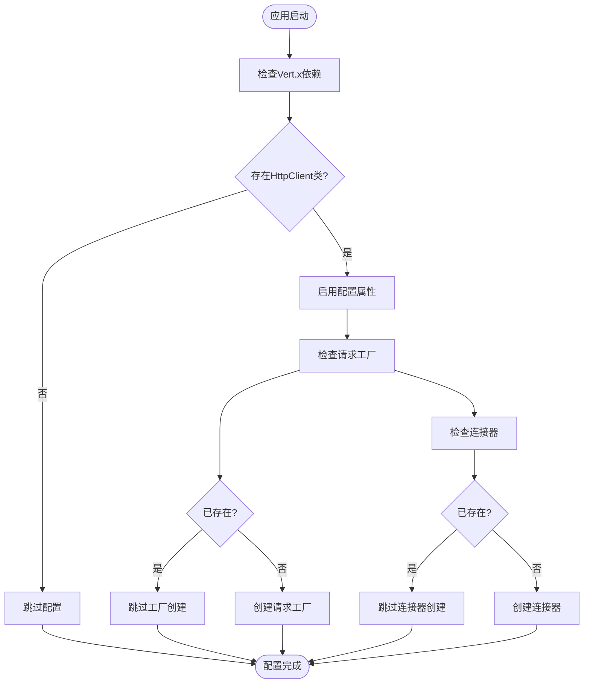

**图表来源**
- [VertxWebClientAutoConfiguration.java:16-36](file://vertx-spring-boot-web-client/src/main/java/com/workoss/boot/vertx/web/client/VertxWebClientAutoConfiguration.java#L16-L36)

#### Bean创建流程

自动配置类负责创建两个关键Bean：

1. **VertxClientHttpRequestFactory**: 用于MVC的同步HTTP请求
2. **VertxClientHttpConnector**: 用于WebFlux的反应式HTTP连接

每个Bean都通过条件注解确保不会与用户自定义的实现冲突。

**章节来源**
- [VertxWebClientAutoConfiguration.java:21-36](file://vertx-spring-boot-web-client/src/main/java/com/workoss/boot/vertx/web/client/VertxWebClientAutoConfiguration.java#L21-L36)

### VertxClientHttpConnector实现分析

#### 连接器架构

`VertxClientHttpConnector`实现了完整的反应式HTTP连接器，支持背压和异步操作：

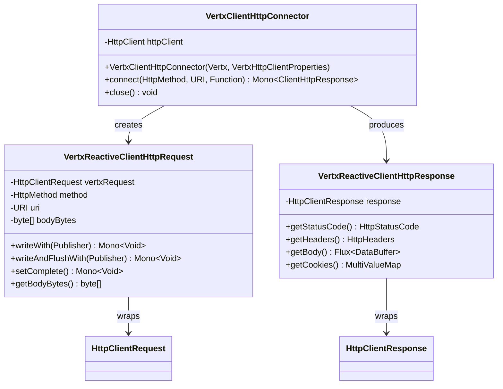

**图表来源**
- [VertxClientHttpConnector.java:36-242](file://vertx-spring-boot-web-client/src/main/java/com/workoss/boot/vertx/web/client/VertxClientHttpConnector.java#L36-L242)

#### 请求处理流程

连接器的请求处理遵循严格的异步模式：

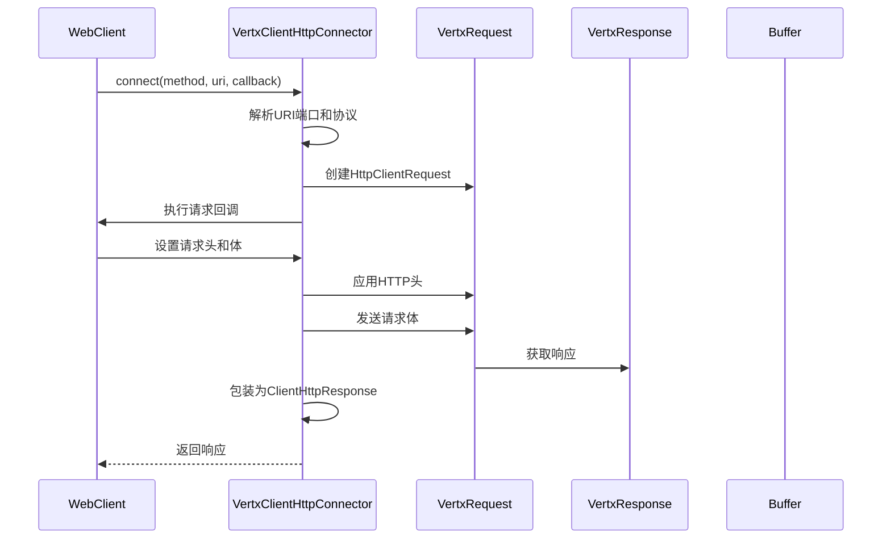

**图表来源**
- [VertxClientHttpConnector.java:50-90](file://vertx-spring-boot-web-client/src/main/java/com/workoss/boot/vertx/web/client/VertxClientHttpConnector.java#L50-L90)

#### 数据缓冲处理

连接器实现了高效的流式数据处理：

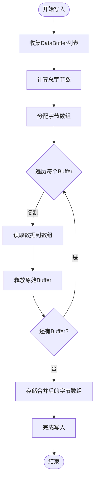

**图表来源**
- [VertxClientHttpConnector.java:140-161](file://vertx-spring-boot-web-client/src/main/java/com/workoss/boot/vertx/web/client/VertxClientHttpConnector.java#L140-L161)

**章节来源**
- [VertxClientHttpConnector.java:36-242](file://vertx-spring-boot-web-client/src/main/java/com/workoss/boot/vertx/web/client/VertxClientHttpConnector.java#L36-L242)

### VertxClientHttpRequestFactory实现分析

#### 同步请求处理

`VertxClientHttpRequestFactory`为传统的MVC应用提供同步HTTP请求能力：

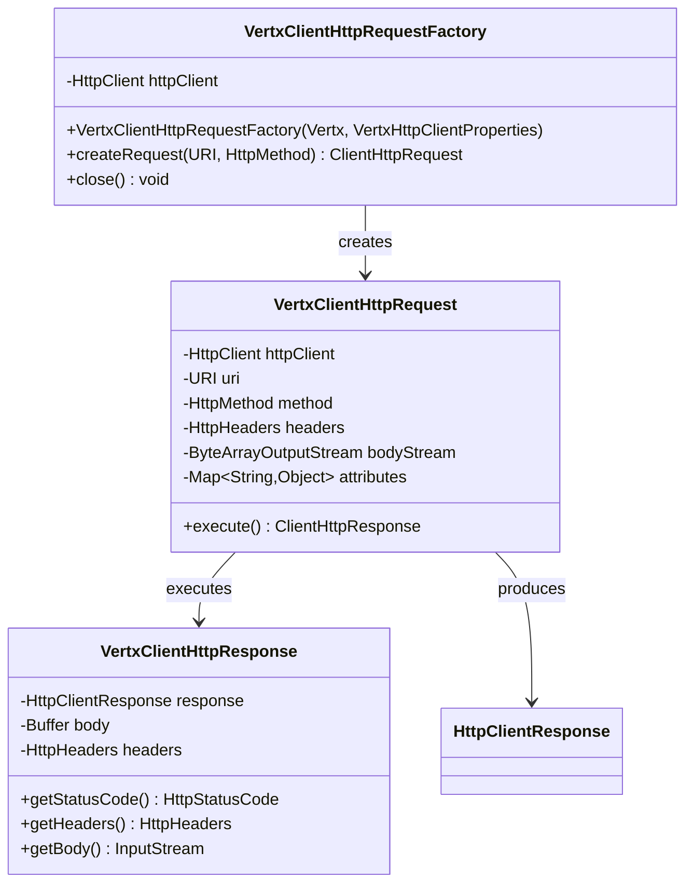

**图表来源**
- [VertxClientHttpRequestFactory.java:29-197](file://vertx-spring-boot-web-client/src/main/java/com/workoss/boot/vertx/web/client/VertxClientHttpRequestFactory.java#L29-L197)

#### 同步执行流程

同步请求的执行流程更加直接：

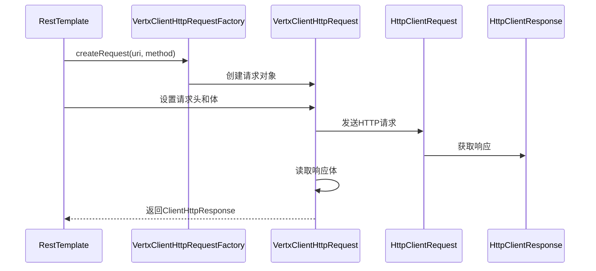

**图表来源**
- [VertxClientHttpRequestFactory.java:100-152](file://vertx-spring-boot-web-client/src/main/java/com/workoss/boot/vertx/web/client/VertxClientHttpRequestFactory.java#L100-L152)

**章节来源**
- [VertxClientHttpRequestFactory.java:29-197](file://vertx-spring-boot-web-client/src/main/java/com/workoss/boot/vertx/web/client/VertxClientHttpRequestFactory.java#L29-L197)

### VertxHttpClientProperties配置分析

#### 配置属性详解

配置类提供了全面的HTTP客户端配置选项：

| 属性名 | 类型 | 默认值 | 描述 |
|--------|------|--------|------|
| maxPoolSize | int | 5 | 每个主机的最大连接数 |
| connectTimeout | int | 60000 | 连接超时时间（毫秒） |
| idleTimeout | int | 30 | 空闲超时时间（秒） |
| readTimeout | int | 30000 | 读取超时时间（毫秒） |
| keepAlive | boolean | true | 是否启用HTTP keep-alive |
| pipelining | boolean | false | 是否启用HTTP pipelining |

#### 配置绑定机制

配置类使用Spring Boot的`@ConfigurationProperties`注解，通过`vertx.http-client`前缀进行属性绑定。

**章节来源**
- [VertxHttpClientProperties.java:8-89](file://vertx-spring-boot-web-client/src/main/java/com/workoss/boot/vertx/web/client/VertxHttpClientProperties.java#L8-L89)

## 依赖关系分析

### 模块间依赖

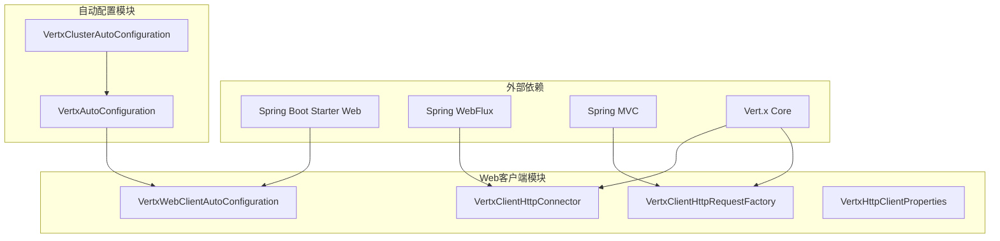

**图表来源**
- [org.springframework.boot.autoconfigure.AutoConfiguration.imports:1-2](file://vertx-spring-boot-web-client/src/main/resources/META-INF/spring/org.springframework.boot.autoconfigure.AutoConfiguration.imports#L1-L2)
- [org.springframework.boot.autoconfigure.AutoConfiguration.imports:1-3](file://vertx-spring-boot-autoconfigure/src/main/resources/META-INF/spring/org.springframework.boot.autoconfigure.AutoConfiguration.imports#L1-L3)

### Bean依赖关系

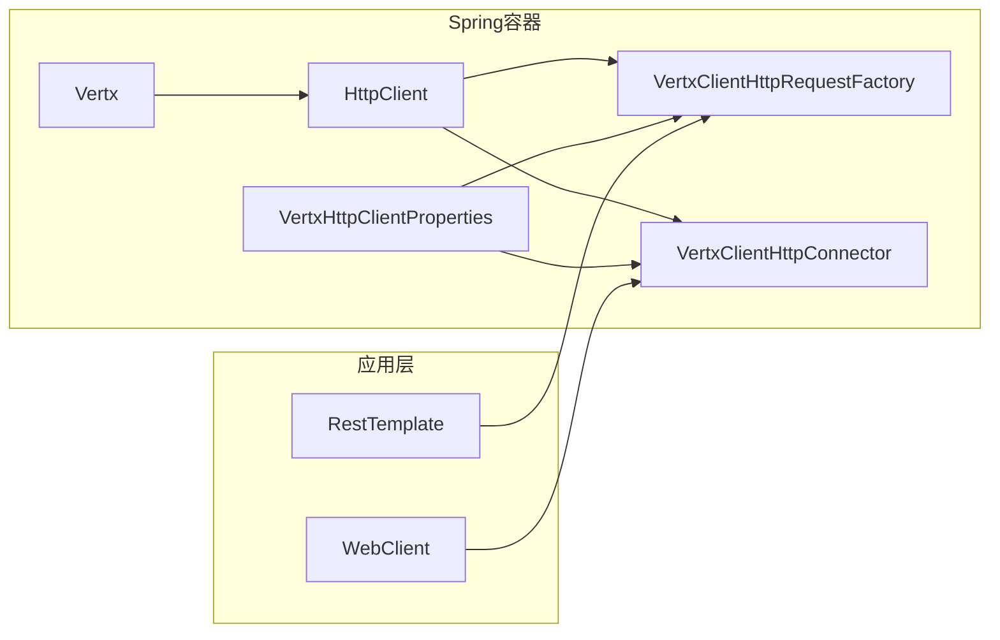

**图表来源**
- [VertxWebClientAutoConfiguration.java:21-36](file://vertx-spring-boot-web-client/src/main/java/com/workoss/boot/vertx/web/client/VertxWebClientAutoConfiguration.java#L21-L36)

**章节来源**
- [VertxWebClientAutoConfiguration.java:1-38](file://vertx-spring-boot-web-client/src/main/java/com/workoss/boot/vertx/web/client/VertxWebClientAutoConfiguration.java#L1-L38)

## 性能考虑

### 连接池优化

1. **最大连接数配置**: 通过`maxPoolSize`属性控制每个主机的连接池大小
2. **连接复用**: 启用`keepAlive`减少TCP连接建立开销
3. **空闲管理**: 使用`idleTimeout`避免长时间占用系统资源

### 超时策略

1. **连接超时**: 控制建立连接的最大等待时间
2. **读取超时**: 防止长时间阻塞响应读取
3. **超时组合**: 合理设置超时参数避免资源浪费

### 流式处理

1. **背压支持**: 反应式连接器天然支持背压机制
2. **内存效率**: 流式数据处理避免大对象内存占用
3. **CPU优化**: 异步非阻塞I/O提高CPU利用率

## 故障排除指南

### 常见问题诊断

#### 连接失败问题

**症状**: 请求超时或连接被拒绝
**排查步骤**:
1. 检查网络连通性
2. 验证目标服务器状态
3. 检查防火墙设置
4. 调整`connectTimeout`和`readTimeout`参数

#### 内存泄漏问题

**症状**: 应用内存持续增长
**排查步骤**:
1. 确认正确关闭HTTP客户端
2. 检查响应流是否正确消费
3. 验证Buffer资源释放

#### 性能问题

**症状**: 响应时间过长或吞吐量不足
**排查步骤**:
1. 分析连接池使用情况
2. 检查超时配置合理性
3. 评估pipelining效果

### 配置验证

单元测试提供了配置验证的参考：

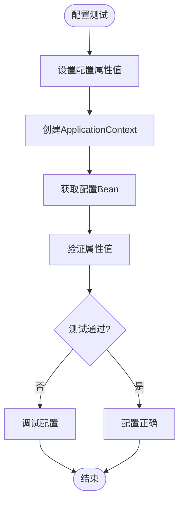

**图表来源**
- [VertxWebClientAutoConfigurationTest.java:61-76](file://vertx-spring-boot-web-client/src/test/java/com/workoss/boot/vertx/web/client/VertxWebClientAutoConfigurationTest.java#L61-L76)

**章节来源**
- [VertxWebClientAutoConfigurationTest.java:1-78](file://vertx-spring-boot-web-client/src/test/java/com/workoss/boot/vertx/web/client/VertxWebClientAutoConfigurationTest.java#L1-L78)

## 结论

Vert.x Web客户端模块成功地将高性能的异步HTTP客户端与Spring生态系统无缝集成。通过自动配置机制，开发者可以轻松获得高性能的HTTP客户端能力，同时保持Spring Boot的简洁配置体验。

该模块的主要优势包括：
- **高性能**: 基于Vert.x的异步非阻塞I/O
- **易用性**: 透明的Spring Boot自动配置
- **兼容性**: 同时支持WebFlux和MVC两种编程模型
- **可配置性**: 全面的性能调优参数

对于生产环境部署，建议根据实际业务场景调整连接池大小、超时参数和连接复用策略，以达到最佳的性能表现。

## 附录

### 使用示例

#### WebClient基本使用

```java
// GET请求示例
webClient.get()
    .uri("https://api.example.com/users/{id}", userId)
    .retrieve()
    .bodyToMono(User.class);

// POST请求示例  
webClient.post()
    .uri("https://api.example.com/users")
    .bodyValue(user)
    .retrieve()
    .bodyToMono<User>();
```

#### RestTemplate使用

```java
// 同步HTTP请求
restTemplate.getForObject(url, User.class);
restTemplate.postForObject(url, user, User.class);
```

#### 配置示例

```yaml
vertx:
  http-client:
    max-pool-size: 10
    connect-timeout: 30000
    idle-timeout: 60
    keep-alive: true
    pipelining: false
```

### 最佳实践

1. **合理配置连接池**: 根据并发需求设置合适的`maxPoolSize`
2. **监控超时设置**: 根据网络状况调整超时参数
3. **资源管理**: 确保HTTP客户端正确关闭
4. **错误处理**: 实现适当的重试和降级策略
5. **性能监控**: 定期检查连接池使用率和响应时间