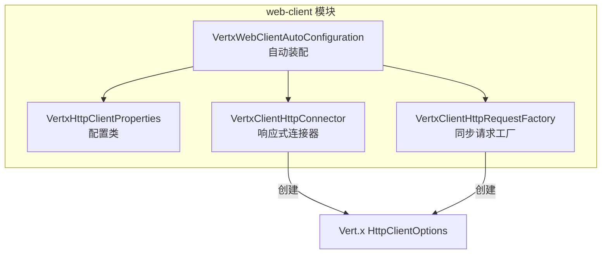
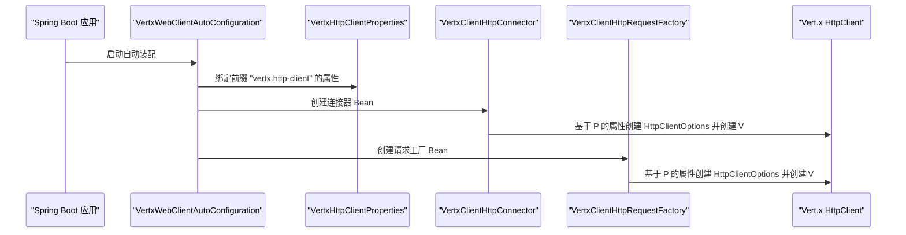
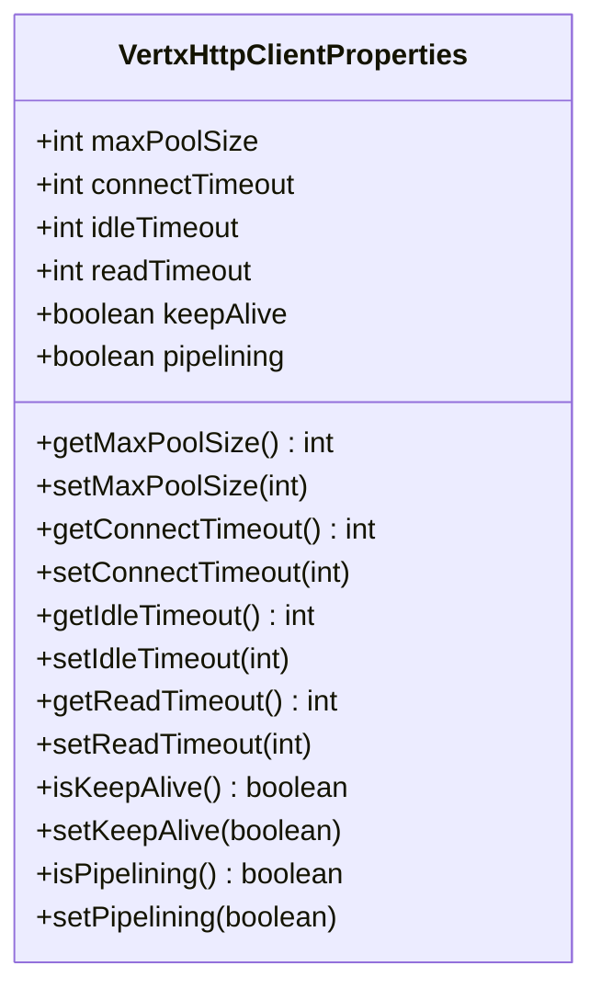
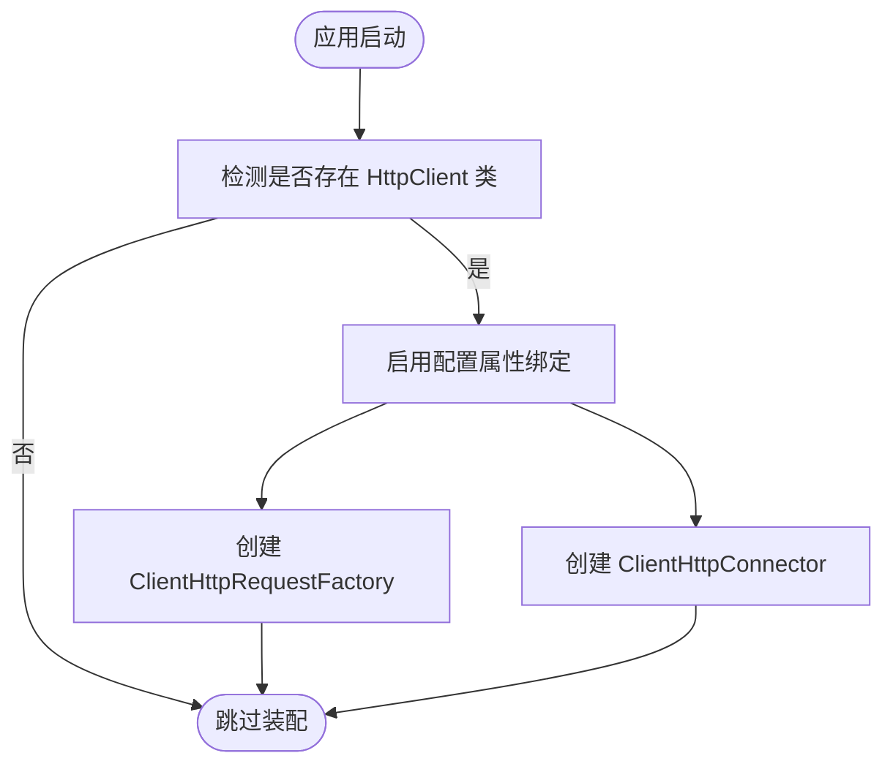
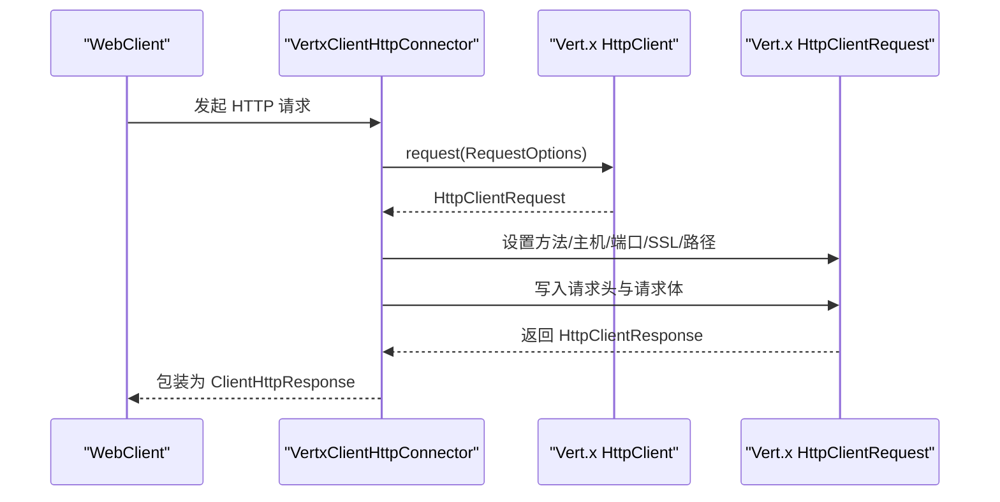
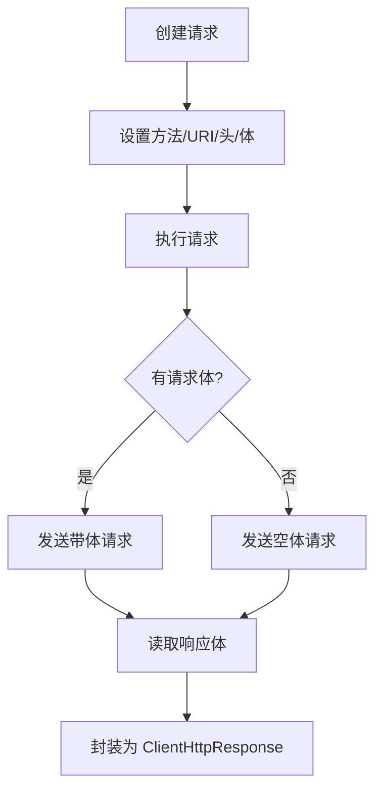
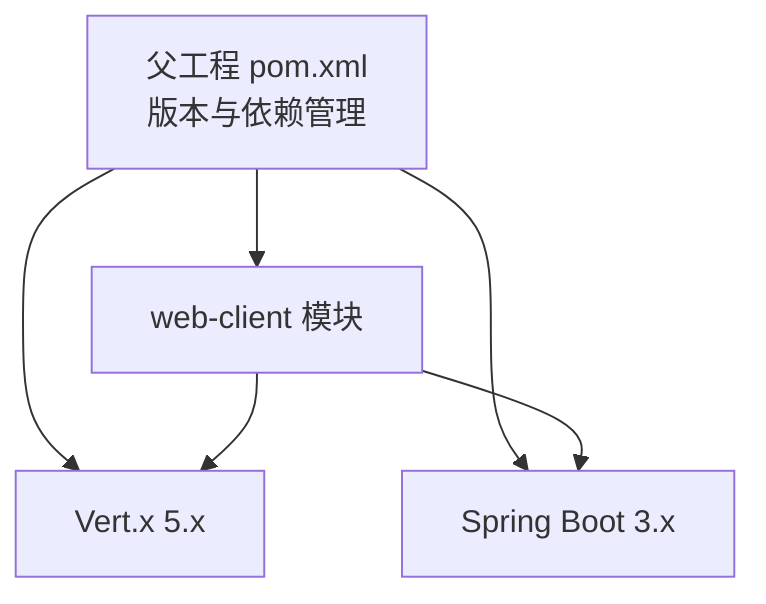

# 客户端属性

<cite>
**本文引用的文件**
- [VertxHttpClientProperties.java](file://vertx-spring-boot-web-client/src/main/java/com/workoss/boot/vertx/web/client/VertxHttpClientProperties.java)
- [VertxWebClientAutoConfiguration.java](file://vertx-spring-boot-web-client/src/main/java/com/workoss/boot/vertx/web/client/VertxWebClientAutoConfiguration.java)
- [VertxClientHttpConnector.java](file://vertx-spring-boot-web-client/src/main/java/com/workoss/boot/vertx/web/client/VertxClientHttpConnector.java)
- [VertxClientHttpRequestFactory.java](file://vertx-spring-boot-web-client/src/main/java/com/workoss/boot/vertx/web/client/VertxClientHttpRequestFactory.java)
- [VertxWebClientAutoConfigurationTest.java](file://vertx-spring-boot-web-client/src/test/java/com/workoss/boot/vertx/web/client/VertxWebClientAutoConfigurationTest.java)
- [application.yml](file://example/vertx-spring-boot-example/src/main/resources/application.yml)
- [pom.xml](file://pom.xml)
</cite>

## 目录
1. [简介](#简介)
2. [项目结构](#项目结构)
3. [核心组件](#核心组件)
4. [架构总览](#架构总览)
5. [详细组件分析](#详细组件分析)
6. [依赖分析](#依赖分析)
7. [性能考虑](#性能考虑)
8. [故障排除指南](#故障排除指南)
9. [结论](#结论)
10. [附录](#附录)

## 简介
本文件面向使用 Vert.x HTTP 客户端的开发者，系统性地文档化 VertxHttpClientProperties 配置类的全部属性与行为，涵盖连接池大小、超时设置、Keep-Alive、管线化等关键参数，并结合自动装配机制说明这些属性如何被注入到 Vert.x HttpClient 中。文档同时提供配置验证规则、属性间的相互影响、典型场景建议、最佳实践与故障排除指引，帮助在生产环境中稳定、高效地使用 HTTP 客户端。

## 项目结构
本仓库采用多模块结构，与 HTTP 客户端相关的模块位于 web-client 子模块中，核心类包括：
- 配置类：VertxHttpClientProperties
- 自动装配：VertxWebClientAutoConfiguration
- 连接器实现：VertxClientHttpConnector（响应式 WebClient）
- 请求工厂实现：VertxClientHttpRequestFactory（传统 RestTemplate）

图表来源
- [VertxWebClientAutoConfiguration.java:16-37](file://vertx-spring-boot-web-client/src/main/java/com/workoss/boot/vertx/web/client/VertxWebClientAutoConfiguration.java#L16-L37)
- [VertxHttpClientProperties.java:8-88](file://vertx-spring-boot-web-client/src/main/java/com/workoss/boot/vertx/web/client/VertxHttpClientProperties.java#L8-L88)
- [VertxClientHttpConnector.java:40-48](file://vertx-spring-boot-web-client/src/main/java/com/workoss/boot/vertx/web/client/VertxClientHttpConnector.java#L40-L48)
- [VertxClientHttpRequestFactory.java:33-41](file://vertx-spring-boot-web-client/src/main/java/com/workoss/boot/vertx/web/client/VertxClientHttpRequestFactory.java#L33-L41)

章节来源
- [pom.xml:15-22](file://pom.xml#L15-L22)
- [VertxWebClientAutoConfiguration.java:16-37](file://vertx-spring-boot-web-client/src/main/java/com/workoss/boot/vertx/web/client/VertxWebClientAutoConfiguration.java#L16-L37)

## 核心组件
本节聚焦 VertxHttpClientProperties 的属性定义、默认值与作用说明，并给出 Spring Boot 属性绑定前缀。

- 配置前缀：vertx.http-client
- 默认值与含义：
  - 最大连接池大小：用于每个主机的连接池上限，默认值参见属性定义
  - 连接超时（毫秒）：建立 TCP 连接的超时时间，默认值参见属性定义
  - 空闲超时（秒）：连接在连接池中的空闲回收时间，默认值参见属性定义
  - 读取超时（毫秒）：从对端读取数据的超时时间，默认值参见属性定义
  - Keep-Alive：是否启用 HTTP Keep-Alive，默认值参见属性定义
  - 管线化：是否启用 HTTP 管线化，默认值参见属性定义

注意：当前版本的 VertxHttpClientProperties 未直接暴露“最大连接池大小”与“读取超时”的 setter/getter，因此无法通过 Spring Boot 属性进行绑定；但自动装配逻辑会将这些属性映射到 Vert.x HttpClientOptions。请以源码为准，避免误用未暴露的属性。

章节来源
- [VertxHttpClientProperties.java:8-88](file://vertx-spring-boot-web-client/src/main/java/com/workoss/boot/vertx/web/client/VertxHttpClientProperties.java#L8-L88)
- [VertxWebClientAutoConfigurationTest.java:61-75](file://vertx-spring-boot-web-client/src/test/java/com/workoss/boot/vertx/web/client/VertxWebClientAutoConfigurationTest.java#L61-L75)

## 架构总览
下图展示了配置类如何被自动装配加载，并最终驱动 Vert.x HttpClient 的创建与使用：

图表来源
- [VertxWebClientAutoConfiguration.java:18-36](file://vertx-spring-boot-web-client/src/main/java/com/workoss/boot/vertx/web/client/VertxWebClientAutoConfiguration.java#L18-L36)
- [VertxClientHttpConnector.java:40-48](file://vertx-spring-boot-web-client/src/main/java/com/workoss/boot/vertx/web/client/VertxClientHttpConnector.java#L40-L48)
- [VertxClientHttpRequestFactory.java:33-41](file://vertx-spring-boot-web-client/src/main/java/com/workoss/boot/vertx/web/client/VertxClientHttpRequestFactory.java#L33-L41)

## 详细组件分析

### VertxHttpClientProperties 配置类
- 作用：承载 Vert.x HTTP 客户端的可配置项，支持通过 Spring Boot 属性绑定
- 前缀：vertx.http-client
- 已暴露属性（可通过配置绑定）：
  - 连接超时（毫秒）
  - 空闲超时（秒）
  - Keep-Alive
  - 管线化
- 未暴露属性（当前不可通过配置绑定）：
  - 最大连接池大小
  - 读取超时（毫秒）
- 说明：未暴露的属性不影响自动装配流程，因为自动装配仅使用已暴露的属性创建 HttpClientOptions。

图表来源
- [VertxHttpClientProperties.java:8-88](file://vertx-spring-boot-web-client/src/main/java/com/workoss/boot/vertx/web/client/VertxHttpClientProperties.java#L8-L88)

章节来源
- [VertxHttpClientProperties.java:8-88](file://vertx-spring-boot-web-client/src/main/java/com/workoss/boot/vertx/web/client/VertxHttpClientProperties.java#L8-L88)
- [VertxWebClientAutoConfigurationTest.java:61-75](file://vertx-spring-boot-web-client/src/test/java/com/workoss/boot/vertx/web/client/VertxWebClientAutoConfigurationTest.java#L61-L75)

### VertxWebClientAutoConfiguration 自动装配
- 功能：在存在 Vert.x HttpClient 类型时，启用配置属性绑定，并注册以下 Bean：
  - ClientHttpRequestFactory（若不存在）
  - ClientHttpConnector（若不存在且响应式依赖可用）
- 关键点：自动装配通过@EnableConfigurationProperties引入 VertxHttpClientProperties，从而允许外部配置覆盖默认值。

图表来源
- [VertxWebClientAutoConfiguration.java:16-37](file://vertx-spring-boot-web-client/src/main/java/com/workoss/boot/vertx/web/client/VertxWebClientAutoConfiguration.java#L16-L37)

章节来源
- [VertxWebClientAutoConfiguration.java:16-37](file://vertx-spring-boot-web-client/src/main/java/com/workoss/boot/vertx/web/client/VertxWebClientAutoConfiguration.java#L16-L37)

### VertxClientHttpConnector（响应式 WebClient）
- 作用：基于 Vert.x HttpClient 实现 Spring WebClient 的 ClientHttpConnector
- 关键映射：
  - 连接超时 → HttpClientOptions.setConnectTimeout
  - 空闲超时 → HttpClientOptions.setIdleTimeout + 单位秒
  - Keep-Alive → HttpClientOptions.setKeepAlive
  - 管线化 → HttpClientOptions.setPipelining
- 行为：根据请求 URI 的协议与端口自动选择 SSL 与默认端口（http:80 / https:443），并将请求头与请求体传递给 Vert.x HttpClient

图表来源
- [VertxClientHttpConnector.java:50-90](file://vertx-spring-boot-web-client/src/main/java/com/workoss/boot/vertx/web/client/VertxClientHttpConnector.java#L50-L90)
- [VertxClientHttpConnector.java:40-48](file://vertx-spring-boot-web-client/src/main/java/com/workoss/boot/vertx/web/client/VertxClientHttpConnector.java#L40-L48)

章节来源
- [VertxClientHttpConnector.java:40-90](file://vertx-spring-boot-web-client/src/main/java/com/workoss/boot/vertx/web/client/VertxClientHttpConnector.java#L40-L90)

### VertxClientHttpRequestFactory（RestTemplate）
- 作用：基于 Vert.x HttpClient 实现 Spring RestTemplate 的 ClientHttpRequestFactory
- 关键映射：
  - 连接超时、空闲超时、Keep-Alive、管线化同上
- 行为：在 execute() 中构建 RequestOptions，写入请求头与请求体，接收响应并封装为 ClientHttpResponse

图表来源
- [VertxClientHttpRequestFactory.java:100-152](file://vertx-spring-boot-web-client/src/main/java/com/workoss/boot/vertx/web/client/VertxClientHttpRequestFactory.java#L100-L152)
- [VertxClientHttpRequestFactory.java:33-41](file://vertx-spring-boot-web-client/src/main/java/com/workoss/boot/vertx/web/client/VertxClientHttpRequestFactory.java#L33-L41)

章节来源
- [VertxClientHttpRequestFactory.java:33-152](file://vertx-spring-boot-web-client/src/main/java/com/workoss/boot/vertx/web/client/VertxClientHttpRequestFactory.java#L33-L152)

## 依赖分析
- 模块依赖：父工程统一管理 Spring Boot 与 Vert.x 版本，确保兼容性
- 运行时依赖：web-client 模块依赖 Vert.x 与 Spring Web（响应式与同步）
- 自动装配依赖：当存在 Vert.x HttpClient 类型时才启用装配

图表来源
- [pom.xml:35-53](file://pom.xml#L35-L53)
- [pom.xml:86-107](file://pom.xml#L86-L107)

章节来源
- [pom.xml:24-33](file://pom.xml#L24-L33)
- [pom.xml:35-53](file://pom.xml#L35-L53)

## 性能考虑
- 连接池与并发
  - 当前配置类未暴露“最大连接池大小”，无法通过配置直接控制；如需精细化调优，可在运行时通过 Vert.x HttpClientOptions 手工扩展
- 超时设置
  - 连接超时：建议根据网络状况与目标服务延迟设置，避免过短导致频繁失败
  - 空闲超时：建议与业务空闲周期匹配，避免连接过早回收造成握手开销
  - 读取超时：建议根据响应体大小与网络带宽合理设置，防止长时间阻塞
- Keep-Alive
  - 开启可减少 TCP 握手与 TLS 重用成本，适合高并发短请求场景
- 管线化
  - 在单连接上顺序发送多个请求，减少 RTT，但需注意服务器支持情况与错误处理复杂度
- 建议
  - 小规模应用：保持默认值即可
  - 高并发长尾场景：适当提高连接超时与空闲超时，开启 Keep-Alive；谨慎开启管线化
  - 外部网络不稳定：增大连接与读取超时，配合重试策略

## 故障排除指南
- 属性未生效
  - 现象：设置了 vertx.http-client.* 但未体现到 HttpClientOptions
  - 原因：当前版本未暴露所有属性（如最大连接池大小、读取超时），自动装配仅映射已暴露属性
  - 处理：确认使用了已暴露的属性；如需更细粒度控制，参考运行时扩展 HttpClientOptions 的方式
- 端口与协议问题
  - 现象：请求未命中预期端口或未走 HTTPS
  - 原因：自动装配会根据 URI 协议与端口推断 SSL 与默认端口
  - 处理：确保 URI 正确包含协议与端口，或在调用侧显式指定
- 超时异常
  - 现象：连接或读取超时导致请求失败
  - 处理：根据实际网络环境调整连接/读取超时；关注空闲超时避免连接被回收
- Keep-Alive 导致资源占用
  - 现象：空闲连接过多
  - 处理：降低空闲超时或关闭 Keep-Alive；评估连接复用收益与资源消耗
- 管线化引发的错误
  - 现象：部分请求失败或乱序
  - 处理：关闭管线化，或确保后端支持管线化并具备相应容错能力

章节来源
- [VertxWebClientAutoConfigurationTest.java:61-75](file://vertx-spring-boot-web-client/src/test/java/com/workoss/boot/vertx/web/client/VertxWebClientAutoConfigurationTest.java#L61-L75)
- [VertxClientHttpConnector.java:56-61](file://vertx-spring-boot-web-client/src/main/java/com/workoss/boot/vertx/web/client/VertxClientHttpConnector.java#L56-L61)
- [VertxClientHttpRequestFactory.java:100-152](file://vertx-spring-boot-web-client/src/main/java/com/workoss/boot/vertx/web/client/VertxClientHttpRequestFactory.java#L100-L152)

## 结论
VertxHttpClientProperties 提供了对 Vert.x HTTP 客户端的关键参数绑定能力，当前版本已暴露连接超时、空闲超时、Keep-Alive、管线化等常用配置项。对于未暴露的高级参数（如最大连接池大小、读取超时），可通过运行时扩展 HttpClientOptions 实现。结合自动装配机制，开发者可以快速在 Spring Boot 应用中启用高性能的 Vert.x HTTP 客户端，并依据业务场景进行合理调优。

## 附录

### 配置属性清单与默认值
- 前缀：vertx.http-client
- 可绑定属性（默认值来自源码）：
  - 连接超时（毫秒）
  - 空闲超时（秒）
  - Keep-Alive（布尔）
  - 管线化（布尔）
- 未暴露属性（当前不可通过配置绑定）：
  - 最大连接池大小
  - 读取超时（毫秒）

章节来源
- [VertxHttpClientProperties.java:14-39](file://vertx-spring-boot-web-client/src/main/java/com/workoss/boot/vertx/web/client/VertxHttpClientProperties.java#L14-L39)

### 典型配置场景建议
- 低延迟短请求（高频小包）
  - 开启 Keep-Alive
  - 适度提高连接超时
  - 保持默认空闲超时
- 高并发长连接
  - 开启 Keep-Alive
  - 适当提高空闲超时
  - 谨慎开启管线化
- 不稳定网络
  - 提高连接与读取超时
  - 控制空闲超时，避免资源泄漏
- 外部集成（第三方 API）
  - 保持默认值，按需微调
  - 关注第三方限流与超时策略

### 验证与回归测试要点
- 使用自动装配测试验证：
  - 是否创建 ClientHttpRequestFactory 与 ClientHttpConnector
  - 属性绑定是否生效（连接超时、空闲超时、Keep-Alive、管线化）

章节来源
- [VertxWebClientAutoConfigurationTest.java:34-76](file://vertx-spring-boot-web-client/src/test/java/com/workoss/boot/vertx/web/client/VertxWebClientAutoConfigurationTest.java#L34-L76)