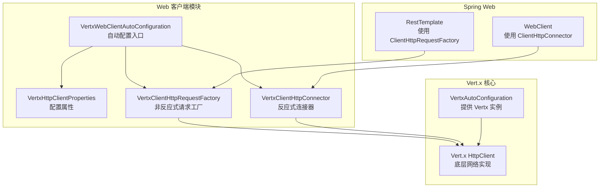
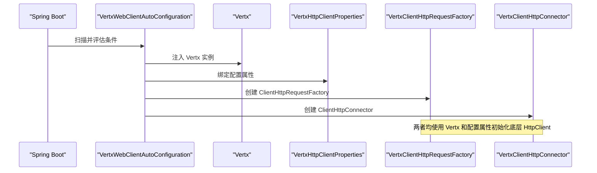
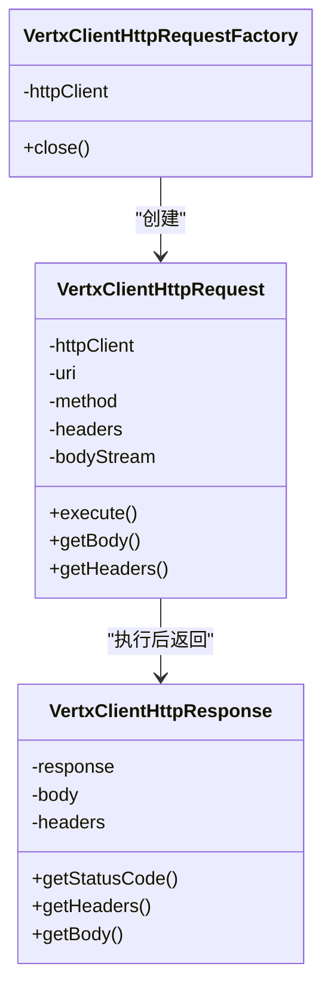
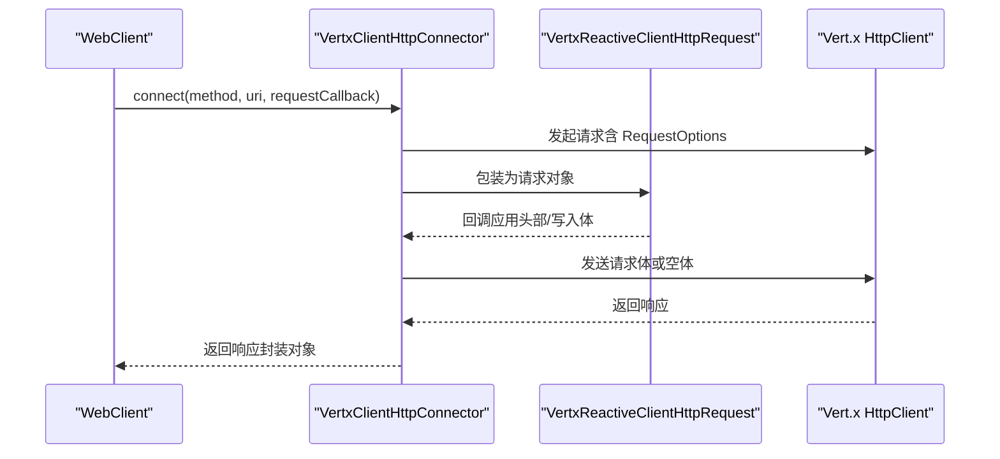
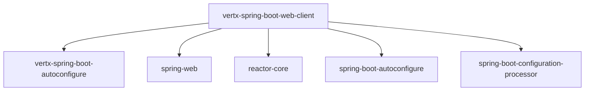

# 客户端配置

<cite>
**本文引用的文件**
- [VertxWebClientAutoConfiguration.java](file://vertx-spring-boot-web-client/src/main/java/com/workoss/boot/vertx/web/client/VertxWebClientAutoConfiguration.java)
- [VertxClientHttpConnector.java](file://vertx-spring-boot-web-client/src/main/java/com/workoss/boot/vertx/web/client/VertxClientHttpConnector.java)
- [VertxClientHttpRequestFactory.java](file://vertx-spring-boot-web-client/src/main/java/com/workoss/boot/vertx/web/client/VertxClientHttpRequestFactory.java)
- [VertxHttpClientProperties.java](file://vertx-spring-boot-web-client/src/main/java/com/workoss/boot/vertx/web/client/VertxHttpClientProperties.java)
- [org.springframework.boot.autoconfigure.AutoConfiguration.imports](file://vertx-spring-boot-web-client/src/main/resources/META-INF/spring/org.springframework.boot.autoconfigure.AutoConfiguration.imports)
- [VertxWebClientAutoConfigurationTest.java](file://vertx-spring-boot-web-client/src/test/java/com/workoss/boot/vertx/web/client/VertxWebClientAutoConfigurationTest.java)
- [VertxAutoConfiguration.java](file://vertx-spring-boot-autoconfigure/src/main/java/com/workoss/boot/vertx/autoconfigure/VertxAutoConfiguration.java)
- [pom.xml](file://vertx-spring-boot-web-client/pom.xml)
- [pom.xml](file://pom.xml)
- [application.yml](file://example/vertx-spring-boot-example/src/main/resources/application.yml)
</cite>

## 目录
1. [简介](#简介)
2. [项目结构](#项目结构)
3. [核心组件](#核心组件)
4. [架构总览](#架构总览)
5. [详细组件分析](#详细组件分析)
6. [依赖分析](#依赖分析)
7. [性能考虑](#性能考虑)
8. [故障排查指南](#故障排查指南)
9. [结论](#结论)
10. [附录](#附录)

## 简介
本文件面向使用 Spring Boot 的开发者，系统性阐述 Vert.x Web 客户端的自动配置机制与实现细节，重点围绕 VertxWebClientAutoConfiguration 的条件装配策略、Bean 创建流程、配置属性绑定以及与 Spring Web 生态的集成方式。文档同时给出启用/禁用示例、与其他 HTTP 客户端的兼容性说明，并通过图示展示关键调用链路与数据流。

## 项目结构
该模块位于 Vert.x Spring Boot Starter 项目中，负责为 Spring Web 提供基于 Vert.x 的 HTTP 客户端实现：
- 自动配置入口：VertxWebClientAutoConfiguration
- 配置属性：VertxHttpClientProperties
- HTTP 客户端实现：
  - 非反应式：VertxClientHttpRequestFactory 及其内部请求/响应适配器
  - 反应式：VertxClientHttpConnector 及其内部请求/响应适配器
- 自动注册：通过 META-INF/spring/org.springframework.boot.autoconfigure.AutoConfiguration.imports 声明自动配置类

图表来源
- [VertxWebClientAutoConfiguration.java:16-36](file://vertx-spring-boot-web-client/src/main/java/com/workoss/boot/vertx/web/client/VertxWebClientAutoConfiguration.java#L16-L36)
- [VertxClientHttpRequestFactory.java:29-41](file://vertx-spring-boot-web-client/src/main/java/com/workoss/boot/vertx/web/client/VertxClientHttpRequestFactory.java#L29-L41)
- [VertxClientHttpConnector.java:36-48](file://vertx-spring-boot-web-client/src/main/java/com/workoss/boot/vertx/web/client/VertxClientHttpConnector.java#L36-L48)
- [VertxAutoConfiguration.java:21-75](file://vertx-spring-boot-autoconfigure/src/main/java/com/workoss/boot/vertx/autoconfigure/VertxAutoConfiguration.java#L21-L75)

章节来源
- [VertxWebClientAutoConfiguration.java:16-36](file://vertx-spring-boot-web-client/src/main/java/com/workoss/boot/vertx/web/client/VertxWebClientAutoConfiguration.java#L16-L36)
- [org.springframework.boot.autoconfigure.AutoConfiguration.imports:1](file://vertx-spring-boot-web-client/src/main/resources/META-INF/spring/org.springframework.boot.autoconfigure.AutoConfiguration.imports#L1)

## 核心组件
- VertxWebClientAutoConfiguration：定义自动配置类，声明条件注解与 Bean 方法，负责在满足条件时创建 Vert.x HTTP 客户端所需的工厂与连接器。
- VertxHttpClientProperties：绑定前缀为 vertx.http-client 的配置项，用于控制连接池大小、超时、keep-alive、pipelining 等行为。
- VertxClientHttpRequestFactory：实现 Spring 的 ClientHttpRequestFactory 接口，为 RestTemplate 提供 Vert.x 底层实现。
- VertxClientHttpConnector：实现 Spring 的 ClientHttpConnector 接口，为 WebClient 提供 Vert.x 底层实现。

章节来源
- [VertxWebClientAutoConfiguration.java:16-36](file://vertx-spring-boot-web-client/src/main/java/com/workoss/boot/vertx/web/client/VertxWebClientAutoConfiguration.java#L16-L36)
- [VertxHttpClientProperties.java:8-89](file://vertx-spring-boot-web-client/src/main/java/com/workoss/boot/vertx/web/client/VertxHttpClientProperties.java#L8-L89)
- [VertxClientHttpRequestFactory.java:29-41](file://vertx-spring-boot-web-client/src/main/java/com/workoss/boot/vertx/web/client/VertxClientHttpRequestFactory.java#L29-L41)
- [VertxClientHttpConnector.java:36-48](file://vertx-spring-boot-web-client/src/main/java/com/workoss/boot/vertx/web/client/VertxClientHttpConnector.java#L36-L48)

## 架构总览
自动配置遵循 Spring Boot 条件装配机制，仅当运行时具备所需类且未存在同名 Bean 时才创建 Vert.x HTTP 客户端 Bean。配置属性通过@EnableConfigurationProperties绑定到 VertxHttpClientProperties，再由两个 Bean 使用这些属性初始化底层 HttpClient。

图表来源
- [VertxWebClientAutoConfiguration.java:16-36](file://vertx-spring-boot-web-client/src/main/java/com/workoss/boot/vertx/web/client/VertxWebClientAutoConfiguration.java#L16-L36)
- [VertxAutoConfiguration.java:21-75](file://vertx-spring-boot-autoconfigure/src/main/java/com/workoss/boot/vertx/autoconfigure/VertxAutoConfiguration.java#L21-L75)
- [VertxHttpClientProperties.java:8-89](file://vertx-spring-boot-web-client/src/main/java/com/workoss/boot/vertx/web/client/VertxHttpClientProperties.java#L8-L89)

## 详细组件分析

### 自动配置类：VertxWebClientAutoConfiguration
- 条件注解
  - @ConditionalOnClass({HttpClient.class})：确保运行时存在 Vert.x HttpClient 类型，否则不进行自动配置。
  - @EnableConfigurationProperties(VertxHttpClientProperties.class)：启用配置属性绑定。
  - @ConditionalOnMissingBean(ClientHttpRequestFactory.class)：若容器已存在 ClientHttpRequestFactory，则跳过创建 Vert.x 工厂 Bean。
  - @ConditionalOnMissingBean(ClientHttpConnector.class)：若容器已存在 ClientHttpConnector，则跳过创建 Vert.x 连接器 Bean。
  - @ConditionalOnClass(name = "org.springframework.http.client.reactive.ClientHttpConnector")：仅在存在 WebClient 所需接口时创建连接器 Bean。
- Bean 方法
  - vertxClientHttpRequestFactory：创建 VertxClientHttpRequestFactory，注入 Vertx 与 VertxHttpClientProperties。
  - vertxClientHttpConnector：创建 VertxClientHttpConnector，注入 Vertx 与 VertxHttpClientProperties。
- 触发条件与优先级
  - 当运行时具备 Vert.x HttpClient 类型且未显式提供对应 Bean 时，自动配置生效。
  - 若用户自定义了 ClientHttpRequestFactory 或 ClientHttpConnector，自动配置将回退（Back off），避免重复创建。

章节来源
- [VertxWebClientAutoConfiguration.java:16-36](file://vertx-spring-boot-web-client/src/main/java/com/workoss/boot/vertx/web/client/VertxWebClientAutoConfiguration.java#L16-L36)

### 配置属性：VertxHttpClientProperties
- 属性绑定前缀：vertx.http-client
- 关键属性
  - maxPoolSize：每主机连接池最大连接数
  - connectTimeout：连接超时（毫秒）
  - idleTimeout：空闲超时（秒）
  - readTimeout：读取超时（毫秒）
  - keepAlive：是否启用 keep-alive
  - pipelining：是否启用 HTTP 管线化
- 作用范围
  - 由自动配置类注入到两个客户端实现中，用于初始化底层 HttpClientOptions。

章节来源
- [VertxHttpClientProperties.java:8-89](file://vertx-spring-boot-web-client/src/main/java/com/workoss/boot/vertx/web/client/VertxHttpClientProperties.java#L8-L89)

### 非反应式客户端：VertxClientHttpRequestFactory
- 职责
  - 实现 ClientHttpRequestFactory，为 RestTemplate 提供请求对象。
  - 在构造时根据配置属性创建 Vert.x HttpClient。
- 请求执行流程
  - 解析 URI 端口与协议（http/https），设置默认端口。
  - 将 Spring 头部映射到 Vert.x 请求头。
  - 写入请求体（如存在），发送请求并读取响应体。
- 生命周期管理
  - 实现 AutoCloseable，在关闭时优雅释放底层 HttpClient。

图表来源
- [VertxClientHttpRequestFactory.java:29-153](file://vertx-spring-boot-web-client/src/main/java/com/workoss/boot/vertx/web/client/VertxClientHttpRequestFactory.java#L29-L153)

章节来源
- [VertxClientHttpRequestFactory.java:29-153](file://vertx-spring-boot-web-client/src/main/java/com/workoss/boot/vertx/web/client/VertxClientHttpRequestFactory.java#L29-L153)

### 反应式客户端：VertxClientHttpConnector
- 职责
  - 实现 ClientHttpConnector，为 WebClient 提供连接器。
  - 在构造时根据配置属性创建 Vert.x HttpClient。
- 连接与请求流程
  - connect：解析 URI，选择 SSL/非 SSL，构建 RequestOptions 并发起请求。
  - 请求回调：应用请求头与请求体（支持响应式数据缓冲）。
  - 响应封装：将 Vert.x 响应转换为 Spring 的 ClientHttpResponse。
- 生命周期管理
  - 实现 AutoCloseable，在关闭时优雅释放底层 HttpClient。

图表来源
- [VertxClientHttpConnector.java:50-90](file://vertx-spring-boot-web-client/src/main/java/com/workoss/boot/vertx/web/client/VertxClientHttpConnector.java#L50-L90)

章节来源
- [VertxClientHttpConnector.java:36-98](file://vertx-spring-boot-web-client/src/main/java/com/workoss/boot/vertx/web/client/VertxClientHttpConnector.java#L36-L98)

### 条件装配与回退机制
- 条件注解协同
  - @ConditionalOnClass 保证运行时环境满足；@ConditionalOnMissingBean 保证用户自定义 Bean 优先。
  - 对于 WebClient 的连接器，额外要求存在 ClientHttpConnector 接口类型，确保仅在需要时创建。
- 测试验证
  - 单元测试覆盖了自动配置创建、回退行为与配置属性绑定。

章节来源
- [VertxWebClientAutoConfigurationTest.java:34-76](file://vertx-spring-boot-web-client/src/test/java/com/workoss/boot/vertx/web/client/VertxWebClientAutoConfigurationTest.java#L34-L76)

## 依赖分析
- 模块依赖
  - 本模块依赖 vertx-spring-boot-autoconfigure 以获得 Vert.x 实例。
  - 依赖 spring-web 与 reactor-core 支持 WebClient 与响应式数据流。
  - 依赖 spring-boot-autoconfigure 与 spring-boot-configuration-processor 支持自动配置与配置属性处理。
- 版本与范围
  - 父 POM 统一管理 Spring Boot 与 Vert.x 版本，确保兼容性。

图表来源
- [pom.xml:17-53](file://vertx-spring-boot-web-client/pom.xml#L17-L53)
- [pom.xml:24-107](file://pom.xml#L24-L107)

章节来源
- [pom.xml:17-53](file://vertx-spring-boot-web-client/pom.xml#L17-L53)
- [pom.xml:24-107](file://pom.xml#L24-L107)

## 性能考虑
- 连接池与超时
  - 通过配置属性控制连接池大小、连接/空闲/读取超时，建议结合业务并发与延迟目标进行调优。
- keep-alive 与管线化
  - 启用 keep-alive 可减少握手开销；管线化可提升多请求场景吞吐，但需注意服务器支持情况。
- 响应式与阻塞
  - WebClient 使用响应式模型，适合高并发与背压场景；RestTemplate 为阻塞模型，适合简单场景或与现有同步代码集成。

## 故障排查指南
- 自动配置未生效
  - 检查是否引入了正确的 starter 或模块依赖。
  - 确认运行时是否存在 Vert.x HttpClient 类型。
  - 若已存在 ClientHttpRequestFactory 或 ClientHttpConnector，自动配置会回退。
- 配置不生效
  - 确认配置前缀为 vertx.http-client，检查 application.yml 中的键值。
  - 使用单元测试验证属性绑定是否正确。
- 连接异常
  - 检查连接超时、空闲超时与 keep-alive 设置。
  - 确认目标服务端口与协议（http/https）匹配。

章节来源
- [VertxWebClientAutoConfigurationTest.java:50-76](file://vertx-spring-boot-web-client/src/test/java/com/workoss/boot/vertx/web/client/VertxWebClientAutoConfigurationTest.java#L50-L76)
- [application.yml:16-20](file://example/vertx-spring-boot-example/src/main/resources/application.yml#L16-L20)

## 结论
VertxWebClientAutoConfiguration 通过 Spring Boot 条件装配机制，实现了对 Vert.x HTTP 客户端的无缝集成。它既支持传统的 RestTemplate，也支持现代的 WebClient，同时允许用户通过配置属性精细控制底层行为，并在存在用户自定义 Bean 时保持回退策略，确保与现有应用平滑共存。

## 附录

### 启用与禁用示例
- 启用
  - 引入模块依赖后，确保运行时具备 Vert.x HttpClient 类型，自动配置将自动创建 ClientHttpRequestFactory 与 ClientHttpConnector。
- 禁用
  - 若希望使用其他 HTTP 客户端（如 Apache HttpClient、OkHttp），只需在容器中显式注册对应的 ClientHttpRequestFactory 或 ClientHttpConnector Bean，自动配置将回退。
  - 或者通过条件排除自动配置类（在更高级别的工程中按需配置）。

章节来源
- [VertxWebClientAutoConfiguration.java:21-36](file://vertx-spring-boot-web-client/src/main/java/com/workoss/boot/vertx/web/client/VertxWebClientAutoConfiguration.java#L21-L36)
- [VertxWebClientAutoConfigurationTest.java:50-58](file://vertx-spring-boot-web-client/src/test/java/com/workoss/boot/vertx/web/client/VertxWebClientAutoConfigurationTest.java#L50-L58)

### 与其他 HTTP 客户端的兼容性
- 兼容性原则
  - Spring Web 提供统一的 ClientHttpRequestFactory 与 ClientHttpConnector 接口，只要实现这些接口即可替换底层实现。
- 替换策略
  - 通过在容器中注册自定义 Bean，即可完全接管 HTTP 客户端创建过程，自动配置将不会重复创建。
- 注意事项
  - 不同客户端的超时、连接池、SSL/TLS 等行为差异较大，切换时需重新评估配置与监控策略。