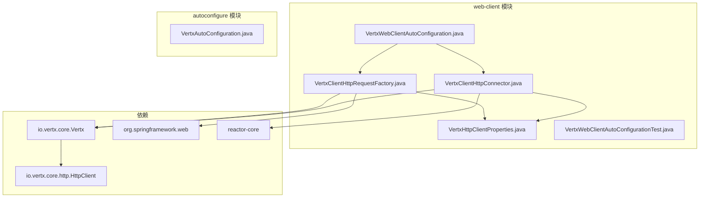
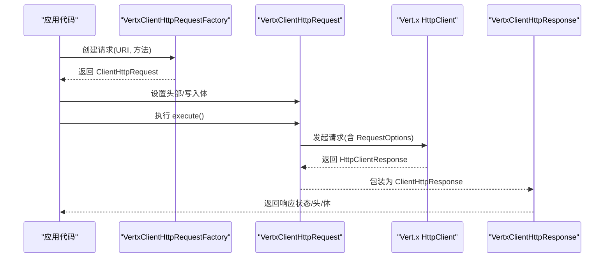
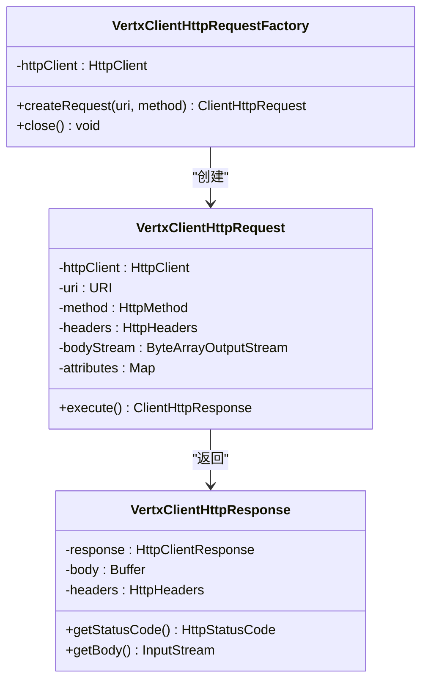
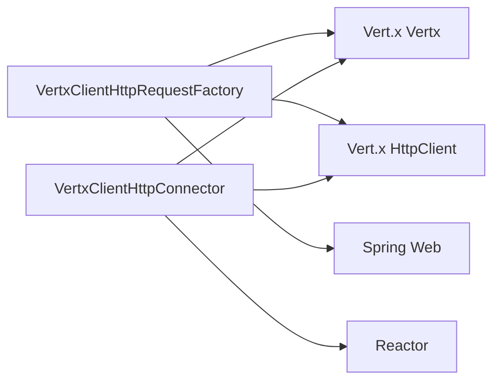

# 请求工厂

<cite>
**本文引用的文件**
- [VertxClientHttpRequestFactory.java](file://vertx-spring-boot-web-client/src/main/java/com/workoss/boot/vertx/web/client/VertxClientHttpRequestFactory.java)
- [VertxClientHttpConnector.java](file://vertx-spring-boot-web-client/src/main/java/com/workoss/boot/vertx/web/client/VertxClientHttpConnector.java)
- [VertxHttpClientProperties.java](file://vertx-spring-boot-web-client/src/main/java/com/workoss/boot/vertx/web/client/VertxHttpClientProperties.java)
- [VertxWebClientAutoConfiguration.java](file://vertx-spring-boot-web-client/src/main/java/com/workoss/boot/vertx/web/client/VertxWebClientAutoConfiguration.java)
- [VertxAutoConfiguration.java](file://vertx-spring-boot-autoconfigure/src/main/java/com/workoss/boot/vertx/autoconfigure/VertxAutoConfiguration.java)
- [VertxWebClientAutoConfigurationTest.java](file://vertx-spring-boot-web-client/src/test/java/com/workoss/boot/vertx/web/client/VertxWebClientAutoConfigurationTest.java)
- [pom.xml](file://vertx-spring-boot-web-client/pom.xml)
</cite>

## 目录
1. [简介](#简介)
2. [项目结构](#项目结构)
3. [核心组件](#核心组件)
4. [架构总览](#架构总览)
5. [详细组件分析](#详细组件分析)
6. [依赖分析](#依赖分析)
7. [性能考量](#性能考量)
8. [故障排查指南](#故障排查指南)
9. [结论](#结论)
10. [附录：使用示例与最佳实践](#附录使用示例与最佳实践)

## 简介
本文件围绕 Vert.x 请求工厂进行系统化技术文档化，重点阐述 VertxClientHttpRequestFactory 的实现机制与职责边界，包括：
- 如何创建与配置 HTTP 请求对象
- 请求参数设置、头部处理、连接配置传递与请求对象构建
- 与 Vert.x HttpClient 的交互流程（请求转换、连接选择、请求执行）
- 线程安全性与性能考量（连接池、请求复用）
- 使用示例与最佳实践（自定义配置、错误处理）

## 项目结构
该模块位于 vertx-spring-boot-web-client，主要包含以下关键文件：
- VertxClientHttpRequestFactory：面向 Spring RestTemplate 的请求工厂实现
- VertxClientHttpConnector：面向 Spring WebClient 的响应式连接器实现
- VertxHttpClientProperties：HTTP 客户端配置属性
- VertxWebClientAutoConfiguration：自动装配入口，注册请求工厂与连接器
- 测试用例验证自动装配与属性绑定

图表来源
- [VertxWebClientAutoConfiguration.java:16-37](file://vertx-spring-boot-web-client/src/main/java/com/workoss/boot/vertx/web/client/VertxWebClientAutoConfiguration.java#L16-L37)
- [VertxClientHttpRequestFactory.java:29-54](file://vertx-spring-boot-web-client/src/main/java/com/workoss/boot/vertx/web/client/VertxClientHttpRequestFactory.java#L29-L54)
- [VertxClientHttpConnector.java:36-98](file://vertx-spring-boot-web-client/src/main/java/com/workoss/boot/vertx/web/client/VertxClientHttpConnector.java#L36-L98)
- [VertxHttpClientProperties.java:8-89](file://vertx-spring-boot-web-client/src/main/java/com/workoss/boot/vertx/web/client/VertxHttpClientProperties.java#L8-L89)

章节来源
- [VertxWebClientAutoConfiguration.java:16-37](file://vertx-spring-boot-web-client/src/main/java/com/workoss/boot/vertx/web/client/VertxWebClientAutoConfiguration.java#L16-L37)
- [pom.xml:17-47](file://vertx-spring-boot-web-client/pom.xml#L17-L47)

## 核心组件
- VertxClientHttpRequestFactory：实现 Spring 的 ClientHttpRequestFactory 接口，负责创建基于 Vert.x HttpClient 的请求对象；同时实现 AutoCloseable，用于关闭底层 HttpClient。
- VertxClientHttpConnector：实现 Spring 的 ClientHttpConnector 接口，面向 WebClient 提供响应式 HTTP 连接能力。
- VertxHttpClientProperties：通过配置前缀绑定 Vert.x HttpClient 的连接超时、空闲超时、Keep-Alive、管线化等参数。
- VertxWebClientAutoConfiguration：在存在 Vert.x 类型时，自动注册上述两个组件，并优先让外部已存在的 Bean 生效。

章节来源
- [VertxClientHttpRequestFactory.java:29-54](file://vertx-spring-boot-web-client/src/main/java/com/workoss/boot/vertx/web/client/VertxClientHttpRequestFactory.java#L29-L54)
- [VertxClientHttpConnector.java:36-98](file://vertx-spring-boot-web-client/src/main/java/com/workoss/boot/vertx/web/client/VertxClientHttpConnector.java#L36-L98)
- [VertxHttpClientProperties.java:8-89](file://vertx-spring-boot-web-client/src/main/java/com/workoss/boot/vertx/web/client/VertxHttpClientProperties.java#L8-L89)
- [VertxWebClientAutoConfiguration.java:21-36](file://vertx-spring-boot-web-client/src/main/java/com/workoss/boot/vertx/web/client/VertxWebClientAutoConfiguration.java#L21-L36)

## 架构总览
下图展示了请求工厂与 Vert.x HttpClient 的交互关系，以及与 Spring Web 组件的集成路径。

图表来源
- [VertxClientHttpRequestFactory.java:44-152](file://vertx-spring-boot-web-client/src/main/java/com/workoss/boot/vertx/web/client/VertxClientHttpRequestFactory.java#L44-L152)
- [VertxClientHttpRequestFactory.java:100-152](file://vertx-spring-boot-web-client/src/main/java/com/workoss/boot/vertx/web/client/VertxClientHttpRequestFactory.java#L100-L152)

## 详细组件分析

### VertxClientHttpRequestFactory 实现机制
- 职责与边界
  - 作为 Spring RestTemplate 的 ClientHttpRequestFactory，负责将 Spring 的请求抽象转换为 Vert.x HttpClient 的实际请求。
  - 通过 VertxHttpClientProperties 将连接超时、空闲超时、Keep-Alive、管线化等配置传递给 Vert.x HttpClient。
  - 提供 AutoCloseable 接口，确保在生命周期结束时正确关闭底层 HttpClient。
- 请求创建与执行
  - createRequest：根据 URI 和方法创建内部请求对象，内部封装了 HttpClient、URI、方法、头部、体流与属性映射。
  - execute：解析 URI 的协议与端口，构造 RequestOptions 并发起请求；将 Spring 头部复制到 Vert.x 请求；根据是否有请求体决定 send(Buffer) 或 send()；最后读取响应体并包装为 ClientHttpResponse。
- 线程安全与并发
  - 工厂本身持有单个 HttpClient 实例，该实例由 Vert.x 管理，具备事件循环模型下的并发能力。
  - 单次请求的执行是同步阻塞等待完成（join），但这是对 Spring 接口的适配；在高并发场景下，建议通过连接池与合理的超时配置提升吞吐。

图表来源
- [VertxClientHttpRequestFactory.java:29-54](file://vertx-spring-boot-web-client/src/main/java/com/workoss/boot/vertx/web/client/VertxClientHttpRequestFactory.java#L29-L54)
- [VertxClientHttpRequestFactory.java:59-153](file://vertx-spring-boot-web-client/src/main/java/com/workoss/boot/vertx/web/client/VertxClientHttpRequestFactory.java#L59-L153)
- [VertxClientHttpRequestFactory.java:158-195](file://vertx-spring-boot-web-client/src/main/java/com/workoss/boot/vertx/web/client/VertxClientHttpRequestFactory.java#L158-L195)

章节来源
- [VertxClientHttpRequestFactory.java:33-46](file://vertx-spring-boot-web-client/src/main/java/com/workoss/boot/vertx/web/client/VertxClientHttpRequestFactory.java#L33-L46)
- [VertxClientHttpRequestFactory.java:100-152](file://vertx-spring-boot-web-client/src/main/java/com/workoss/boot/vertx/web/client/VertxClientHttpRequestFactory.java#L100-L152)

### VertxClientHttpConnector 实现机制（对比参考）
- 面向 WebClient 的响应式连接器，采用 Reactor 编排请求发送与响应读取。
- 与请求工厂类似，同样从 VertxHttpClientProperties 读取配置并创建 HttpClient。
- 在请求回调中收集数据缓冲区并合并为字节数组，随后发送至 Vert.x。

章节来源
- [VertxClientHttpConnector.java:40-98](file://vertx-spring-boot-web-client/src/main/java/com/workoss/boot/vertx/web/client/VertxClientHttpConnector.java#L40-L98)
- [VertxClientHttpConnector.java:140-186](file://vertx-spring-boot-web-client/src/main/java/com/workoss/boot/vertx/web/client/VertxClientHttpConnector.java#L140-L186)

### VertxHttpClientProperties 配置项
- 连接池大小、连接超时、空闲超时、读超时、Keep-Alive、管线化等。
- 通过配置前缀绑定到 Spring Boot 属性体系，便于在应用中统一配置。

章节来源
- [VertxHttpClientProperties.java:8-89](file://vertx-spring-boot-web-client/src/main/java/com/workoss/boot/vertx/web/client/VertxHttpClientProperties.java#L8-L89)

### 自动装配与生命周期
- VertxWebClientAutoConfiguration 在存在 Vert.x 类型时注册请求工厂与连接器，并遵循“外部优先”的原则（当已有对应 Bean 时不重复注册）。
- VertxAutoConfiguration 提供 Vert.x 实例与选项，确保请求工厂与连接器可获取到可用的 Vert.x 引擎。

章节来源
- [VertxWebClientAutoConfiguration.java:21-36](file://vertx-spring-boot-web-client/src/main/java/com/workoss/boot/vertx/web/client/VertxWebClientAutoConfiguration.java#L21-L36)
- [VertxAutoConfiguration.java:28-75](file://vertx-spring-boot-autoconfigure/src/main/java/com/workoss/boot/vertx/autoconfigure/VertxAutoConfiguration.java#L28-L75)

## 依赖分析
- 内部依赖
  - VertxClientHttpRequestFactory 依赖 Vert.x Vertx 与 HttpClient，以及 Spring Web 的客户端接口。
  - VertxClientHttpConnector 依赖 Vert.x HttpClient 与 Reactor。
- 外部依赖
  - 通过 Maven 依赖引入 Vert.x Core、Spring Web、Reactor 等。

图表来源
- [pom.xml:23-41](file://vertx-spring-boot-web-client/pom.xml#L23-L41)

章节来源
- [pom.xml:17-47](file://vertx-spring-boot-web-client/pom.xml#L17-L47)

## 性能考量
- 连接池与并发
  - 通过 VertxHttpClientProperties 的连接池大小与 Keep-Alive 配置影响连接复用与并发度。
  - 单次请求执行采用同步等待（join），在高并发场景下应结合合理的超时与连接池配置提升整体吞吐。
- 管线化
  - 启用管线化可在同一连接上顺序发送多个请求，减少握手开销，但需注意服务端支持情况。
- 超时与空闲
  - 连接超时与空闲超时直接影响资源占用与响应时间，应按业务场景调优。

章节来源
- [VertxHttpClientProperties.java:14-39](file://vertx-spring-boot-web-client/src/main/java/com/workoss/boot/vertx/web/client/VertxHttpClientProperties.java#L14-L39)
- [VertxClientHttpRequestFactory.java:34-40](file://vertx-spring-boot-web-client/src/main/java/com/workoss/boot/vertx/web/client/VertxClientHttpRequestFactory.java#L34-L40)

## 故障排查指南
- 自动装配验证
  - 测试用例验证了在启用自动装配后，会创建 ClientHttpRequestFactory 与 ClientHttpConnector，并且当外部已存在对应 Bean 时会回退不覆盖。
- 属性绑定验证
  - 测试用例验证了配置前缀下的属性能够正确绑定到 VertxHttpClientProperties。
- 常见问题定位
  - 若请求未生效或异常，检查 Vert.x 实例是否正确创建（由 VertxAutoConfiguration 提供）。
  - 若连接失败，检查连接超时、空闲超时与 Keep-Alive 配置是否合理。
  - 若出现阻塞或超时，确认请求执行路径是否使用了同步等待（join）。

章节来源
- [VertxWebClientAutoConfigurationTest.java:34-76](file://vertx-spring-boot-web-client/src/test/java/com/workoss/boot/vertx/web/client/VertxWebClientAutoConfigurationTest.java#L34-L76)
- [VertxAutoConfiguration.java:52-75](file://vertx-spring-boot-autoconfigure/src/main/java/com/workoss/boot/vertx/autoconfigure/VertxAutoConfiguration.java#L52-L75)

## 结论
VertxClientHttpRequestFactory 将 Spring 的 HTTP 客户端抽象与 Vert.x HttpClient 无缝对接，提供了简洁而高效的请求创建与执行机制。通过配置属性集中管理连接行为，并在自动装配机制下与 Spring Boot 生态自然融合。在高并发场景下，建议结合连接池、超时与管线化等配置优化性能，并关注请求执行路径的阻塞特性以避免线程阻塞。

## 附录：使用示例与最佳实践
- 使用示例
  - 在 Spring Boot 应用中引入 web-client 模块后，自动装配会注册 VertxClientHttpRequestFactory 与 VertxClientHttpConnector。
  - 可通过配置文件设置连接超时、空闲超时、Keep-Alive、管线化等参数。
- 最佳实践
  - 合理设置连接池大小与超时参数，避免资源耗尽或延迟过高。
  - 对于高并发场景，优先考虑使用 WebClient 与响应式连接器以获得更好的背压与异步能力。
  - 在需要与传统 RestTemplate 兼容时，使用请求工厂以获得一致的接口体验。
  - 关注请求执行的阻塞特性，必要时在业务层进行异步化改造。

章节来源
- [VertxWebClientAutoConfiguration.java:21-36](file://vertx-spring-boot-web-client/src/main/java/com/workoss/boot/vertx/web/client/VertxWebClientAutoConfiguration.java#L21-L36)
- [VertxHttpClientProperties.java:11-39](file://vertx-spring-boot-web-client/src/main/java/com/workoss/boot/vertx/web/client/VertxHttpClientProperties.java#L11-L39)