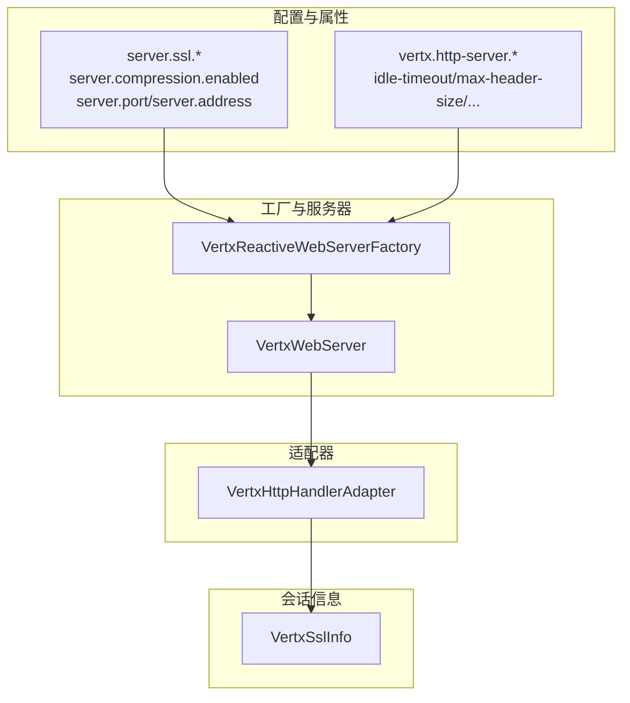
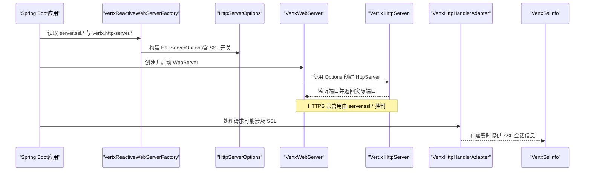
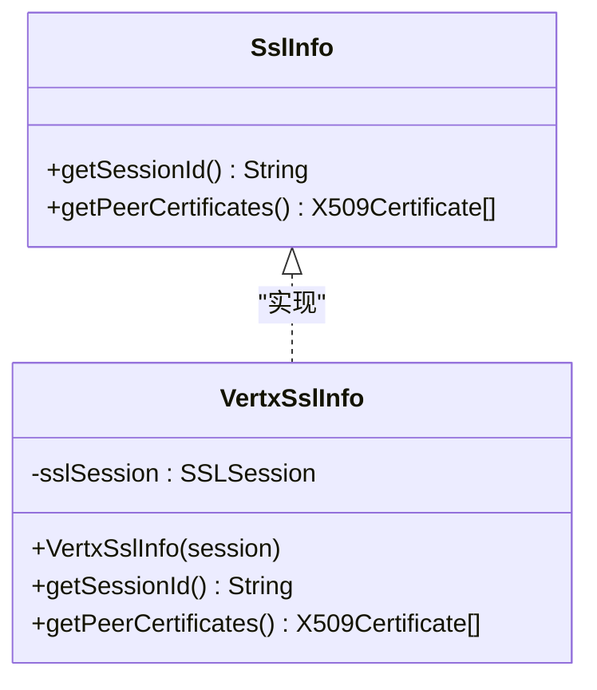
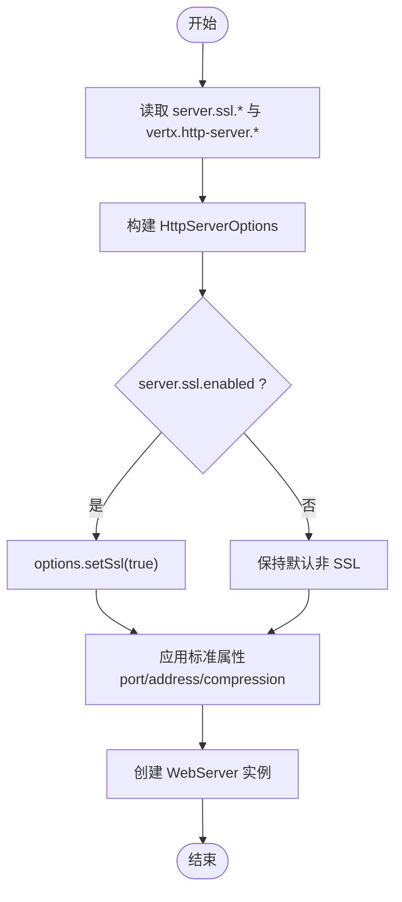
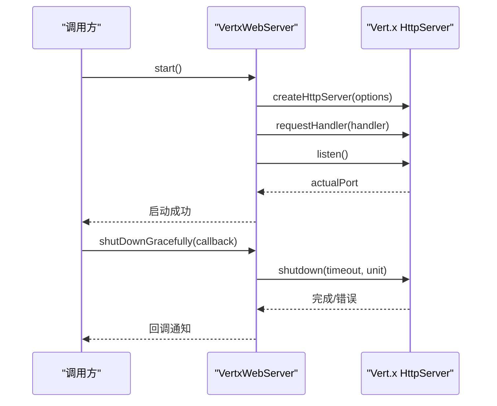
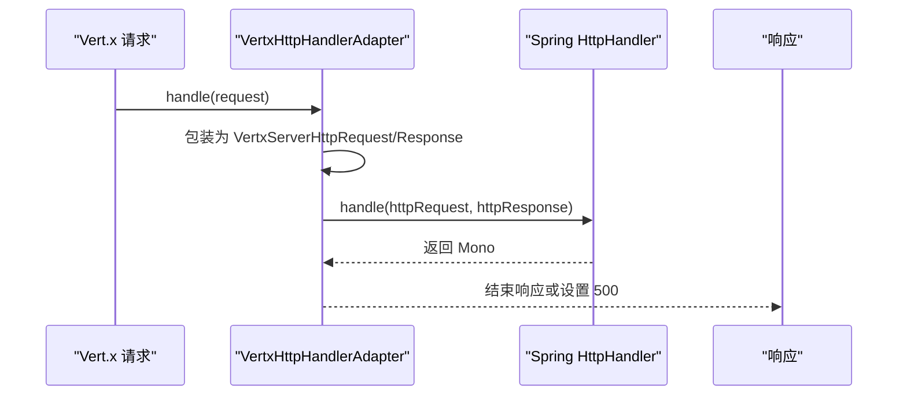
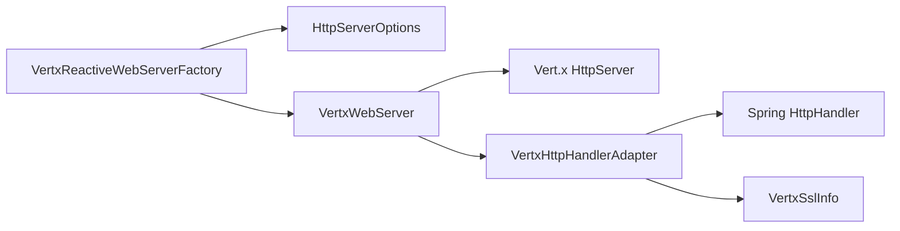

# SSL/TLS支持

<cite>
**本文引用的文件**
- [VertxSslInfo.java](file://vertx-spring-boot-web-server/src/main/java/com/workoss/boot/vertx/web/server/VertxSslInfo.java)
- [VertxReactiveWebServerFactory.java](file://vertx-spring-boot-web-server/src/main/java/com/workoss/boot/vertx/web/server/VertxReactiveWebServerFactory.java)
- [VertxWebServer.java](file://vertx-spring-boot-web-server/src/main/java/com/workoss/boot/vertx/web/server/VertxWebServer.java)
- [VertxHttpHandlerAdapter.java](file://vertx-spring-boot-web-server/src/main/java/com/workoss/boot/vertx/web/server/VertxHttpHandlerAdapter.java)
- [VertxHttpServerProperties.java](file://vertx-spring-boot-web-server/src/main/java/com/workoss/boot/vertx/web/server/VertxHttpServerProperties.java)
- [VertxWebServerAutoConfiguration.java](file://vertx-spring-boot-web-server/src/main/java/com/workoss/boot/vertx/web/server/VertxWebServerAutoConfiguration.java)
- [VertxReactiveWebServerFactoryTest.java](file://vertx-spring-boot-web-server/src/test/java/com/workoss/boot/vertx/web/server/VertxReactiveWebServerFactoryTest.java)
- [VertxWebServerAutoConfigurationTest.java](file://vertx-spring-boot-web-server/src/test/java/com/workoss/boot/vertx/web/server/VertxWebServerAutoConfigurationTest.java)
</cite>

## 目录
1. [简介](#简介)
2. [项目结构](#项目结构)
3. [核心组件](#核心组件)
4. [架构总览](#架构总览)
5. [详细组件分析](#详细组件分析)
6. [依赖分析](#依赖分析)
7. [性能考虑](#性能考虑)
8. [故障排除指南](#故障排除指南)
9. [结论](#结论)
10. [附录](#附录)

## 简介
本文件面向使用 Vert.x 作为底层 HTTP 服务器的 Spring Boot WebFlux 应用，系统性阐述 SSL/TLS 支持在该实现中的落地方式。重点覆盖以下方面：
- 基于 Spring Boot 标准 SSL 配置（server.ssl.*）对 Vert.x HttpServerOptions 的映射与启用逻辑
- VertxSslInfo 对 SSL 会话信息的封装，包括会话 ID 与对端证书的提取
- HTTPS 服务器启动流程、证书验证机制与安全最佳实践
- 性能优化建议、常见 SSL 问题排查与故障排除指南

需要特别说明的是：当前仓库中未包含具体的密钥库（JKS/PFX）、证书链或加密套件/协议版本的显式配置代码。因此，本文档侧重于“如何通过现有配置入口启用 HTTPS”以及“如何从 SSL 会话中获取必要信息”，而不直接展示密钥库路径、密码等敏感配置项。

## 项目结构
与 SSL/TLS 相关的核心代码集中在 vertx-spring-boot-web-server 模块中，采用“适配器 + 工厂 + 属性绑定”的分层设计：
- 属性绑定层：通过标准 server.ssl.* 与 vertx.http-server.* 属性驱动
- 工厂层：将属性转换为 Vert.x HttpServerOptions 并创建 WebServer
- 适配器层：将 Spring WebFlux HttpHandler 与 Vert.x 请求处理器桥接
- 会话信息层：VertxSslInfo 提供对 SSL 会话的访问能力

图表来源
- [VertxReactiveWebServerFactory.java:43-78](file://vertx-spring-boot-web-server/src/main/java/com/workoss/boot/vertx/web/server/VertxReactiveWebServerFactory.java#L43-L78)
- [VertxWebServer.java:29-51](file://vertx-spring-boot-web-server/src/main/java/com/workoss/boot/vertx/web/server/VertxWebServer.java#L29-L51)
- [VertxHttpHandlerAdapter.java:24-43](file://vertx-spring-boot-web-server/src/main/java/com/workoss/boot/vertx/web/server/VertxHttpHandlerAdapter.java#L24-L43)
- [VertxSslInfo.java:14-54](file://vertx-spring-boot-web-server/src/main/java/com/workoss/boot/vertx/web/server/VertxSslInfo.java#L14-L54)

章节来源
- [VertxReactiveWebServerFactory.java:14-79](file://vertx-spring-boot-web-server/src/main/java/com/workoss/boot/vertx/web/server/VertxReactiveWebServerFactory.java#L14-L79)
- [VertxWebServer.java:16-110](file://vertx-spring-boot-web-server/src/main/java/com/workoss/boot/vertx/web/server/VertxWebServer.java#L16-L110)
- [VertxHttpHandlerAdapter.java:9-45](file://vertx-spring-boot-web-server/src/main/java/com/workoss/boot/vertx/web/server/VertxHttpHandlerAdapter.java#L9-L45)
- [VertxSslInfo.java:11-54](file://vertx-spring-boot-web-server/src/main/java/com/workoss/boot/vertx/web/server/VertxSslInfo.java#L11-L54)

## 核心组件
- VertxReactiveWebServerFactory：负责将 Spring Boot 标准 server.ssl.* 与 vertx.http-server.* 属性映射到 Vert.x HttpServerOptions，并创建 WebServer 实例。
- VertxWebServer：基于 Vert.x HttpServer 的 WebServer 实现，负责启动、停止与优雅关闭。
- VertxHttpHandlerAdapter：将 Spring WebFlux 的 HttpHandler 适配为 Vert.x 的请求处理器。
- VertxSslInfo：实现 Spring 的 SslInfo 接口，提供会话 ID 与对端证书列表的访问。

章节来源
- [VertxReactiveWebServerFactory.java:26-79](file://vertx-spring-boot-web-server/src/main/java/com/workoss/boot/vertx/web/server/VertxReactiveWebServerFactory.java#L26-L79)
- [VertxWebServer.java:19-110](file://vertx-spring-boot-web-server/src/main/java/com/workoss/boot/vertx/web/server/VertxWebServer.java#L19-L110)
- [VertxHttpHandlerAdapter.java:13-45](file://vertx-spring-boot-web-server/src/main/java/com/workoss/boot/vertx/web/server/VertxHttpHandlerAdapter.java#L13-L45)
- [VertxSslInfo.java:14-54](file://vertx-spring-boot-web-server/src/main/java/com/workoss/boot/vertx/web/server/VertxSslInfo.java#L14-L54)

## 架构总览
下图展示了从配置到运行时的 HTTPS 启动与会话信息获取的关键交互：

图表来源
- [VertxReactiveWebServerFactory.java:43-78](file://vertx-spring-boot-web-server/src/main/java/com/workoss/boot/vertx/web/server/VertxReactiveWebServerFactory.java#L43-L78)
- [VertxWebServer.java:35-51](file://vertx-spring-boot-web-server/src/main/java/com/workoss/boot/vertx/web/server/VertxWebServer.java#L35-L51)
- [VertxHttpHandlerAdapter.java:24-43](file://vertx-spring-boot-web-server/src/main/java/com/workoss/boot/vertx/web/server/VertxHttpHandlerAdapter.java#L24-L43)
- [VertxSslInfo.java:18-53](file://vertx-spring-boot-web-server/src/main/java/com/workoss/boot/vertx/web/server/VertxSslInfo.java#L18-L53)

## 详细组件分析

### 组件一：SSL 会话信息 VertxSslInfo
- 职责：封装 javax.net.ssl.SSLSession，暴露会话 ID 与对端证书列表，供上层业务使用（如鉴权、审计）。
- 关键点：
  - 会话 ID：将字节数组格式化为十六进制字符串。
  - 对端证书：过滤出 X509Certificate 列表；若不可用则返回空。
  - 异常处理：当无法获取对端证书时静默返回空，避免影响请求处理。

图表来源
- [VertxSslInfo.java:14-54](file://vertx-spring-boot-web-server/src/main/java/com/workoss/boot/vertx/web/server/VertxSslInfo.java#L14-L54)

章节来源
- [VertxSslInfo.java:14-54](file://vertx-spring-boot-web-server/src/main/java/com/workoss/boot/vertx/web/server/VertxSslInfo.java#L14-L54)

### 组件二：HTTPS 启动与配置映射 VertxReactiveWebServerFactory
- 职责：将 Spring Boot 标准 server.ssl.* 与 vertx.http-server.* 属性映射到 Vert.x HttpServerOptions，并创建 WebServer。
- 关键点：
  - server.ssl.enabled：仅当启用时设置 HttpServerOptions.setSsl(true)。
  - 其他标准属性（server.port、server.address、server.compression.enabled）同样被读取并应用。
  - Vert.x 特定参数（如空闲超时、最大头大小、最大分片大小等）来自 vertx.http-server.*。

图表来源
- [VertxReactiveWebServerFactory.java:43-78](file://vertx-spring-boot-web-server/src/main/java/com/workoss/boot/vertx/web/server/VertxReactiveWebServerFactory.java#L43-L78)

章节来源
- [VertxReactiveWebServerFactory.java:43-78](file://vertx-spring-boot-web-server/src/main/java/com/workoss/boot/vertx/web/server/VertxReactiveWebServerFactory.java#L43-L78)

### 组件三：WebServer 启动与优雅关闭 VertxWebServer
- 职责：基于 Vert.x HttpServer 启动服务、处理停止与优雅关闭。
- 关键点：
  - 启动：创建 HttpServer 并注册请求处理器，等待监听完成并记录实际端口。
  - 停止：关闭 HttpServer；在事件循环已终止场景下进行容错处理。
  - 优雅关闭：调用 shutdown 并根据结果回调通知状态。

图表来源
- [VertxWebServer.java:35-108](file://vertx-spring-boot-web-server/src/main/java/com/workoss/boot/vertx/web/server/VertxWebServer.java#L35-L108)

章节来源
- [VertxWebServer.java:35-108](file://vertx-spring-boot-web-server/src/main/java/com/workoss/boot/vertx/web/server/VertxWebServer.java#L35-L108)

### 组件四：请求适配与会话信息获取 VertxHttpHandlerAdapter
- 职责：将 Spring WebFlux 的 HttpHandler 适配为 Vert.x 的请求处理器；在需要时可访问 SSL 会话信息。
- 关键点：
  - 将请求与响应包装为 VertxServerHttpRequest/VertxServerHttpResponse。
  - 错误处理：捕获异常并确保响应结束，避免挂起。
  - 会话信息：可通过 VertxSslInfo 访问 SSL 会话（例如会话 ID、对端证书）。

图表来源
- [VertxHttpHandlerAdapter.java:24-43](file://vertx-spring-boot-web-server/src/main/java/com/workoss/boot/vertx/web/server/VertxHttpHandlerAdapter.java#L24-L43)

章节来源
- [VertxHttpHandlerAdapter.java:24-43](file://vertx-spring-boot-web-server/src/main/java/com/workoss/boot/vertx/web/server/VertxHttpHandlerAdapter.java#L24-L43)

### 组件五：自动配置与属性绑定 VertxWebServerAutoConfiguration
- 职责：在 WebFlux 环境下自动装配 Vert.x WebServer 工厂，并绑定 vertx.http-server.* 属性。
- 关键点：
  - 条件装配：仅在响应式 Web 应用且缺少其他 ReactiveWebServerFactory 时生效。
  - 属性绑定：启用 VertxHttpServerProperties 的配置项。

章节来源
- [VertxWebServerAutoConfiguration.java:17-30](file://vertx-spring-boot-web-server/src/main/java/com/workoss/boot/vertx/web/server/VertxWebServerAutoConfiguration.java#L17-L30)

## 依赖分析
- 组件内聚与耦合：
  - VertxReactiveWebServerFactory 与 VertxWebServer 之间为组合关系，前者负责配置生成，后者负责生命周期管理。
  - VertxHttpHandlerAdapter 与 Spring HttpHandler 解耦，通过函数式订阅完成数据流桥接。
  - VertxSslInfo 与 SSL 会话解耦，仅依赖标准 JSSE 接口。
- 外部依赖：
  - Spring Boot WebFlux（HttpHandler、Ssl、Compression 等抽象）
  - Vert.x Core（Vertx、HttpServer、HttpServerOptions）

图表来源
- [VertxReactiveWebServerFactory.java:36-41](file://vertx-spring-boot-web-server/src/main/java/com/workoss/boot/vertx/web/server/VertxReactiveWebServerFactory.java#L36-L41)
- [VertxWebServer.java:29-33](file://vertx-spring-boot-web-server/src/main/java/com/workoss/boot/vertx/web/server/VertxWebServer.java#L29-L33)
- [VertxHttpHandlerAdapter.java:19-21](file://vertx-spring-boot-web-server/src/main/java/com/workoss/boot/vertx/web/server/VertxHttpHandlerAdapter.java#L19-L21)
- [VertxSslInfo.java:18-20](file://vertx-spring-boot-web-server/src/main/java/com/workoss/boot/vertx/web/server/VertxSslInfo.java#L18-L20)

## 性能考虑
- 连接复用与空闲超时：通过 vertx.http-server.idle-timeout 控制长连接空闲时间，减少资源占用。
- 压缩策略：server.compression.enabled 打开后，结合 vertx.http-server.compression-level 调整压缩强度，平衡带宽与 CPU。
- 请求体与头部限制：合理设置 max-header-size、max-chunk-size、max-initial-line-length，防止内存压力与 OOM。
- 监听队列长度：accept-backlog 影响 TCP 握手队列容量，需结合并发峰值调整。

章节来源
- [VertxHttpServerProperties.java:18-91](file://vertx-spring-boot-web-server/src/main/java/com/workoss/boot/vertx/web/server/VertxHttpServerProperties.java#L18-L91)
- [VertxReactiveWebServerFactory.java:62-75](file://vertx-spring-boot-web-server/src/main/java/com/workoss/boot/vertx/web/server/VertxReactiveWebServerFactory.java#L62-L75)

## 故障排除指南
- HTTPS 未生效
  - 检查 server.ssl.enabled 是否为 true；仅当启用时才会设置 HttpServerOptions.setSsl(true)。
  - 端口确认：启动日志输出实际端口，确保客户端访问正确端口。
- 证书相关问题
  - 对端证书不可用：VertxSslInfo.getPeerCertificates() 在异常情况下返回空，属预期行为；可在业务侧补充降级策略。
  - 会话 ID 为空：当 SSLSession 不存在或未建立时，getSessionId() 返回空。
- 启动失败
  - 查看 WebServerException 及内部异常堆栈；关注端口占用、权限不足等问题。
- 优雅关闭异常
  - 若事件循环已终止，停止阶段会进行容错处理；若出现 RejectedExecutionException，属于正常现象。

章节来源
- [VertxReactiveWebServerFactory.java:56-60](file://vertx-spring-boot-web-server/src/main/java/com/workoss/boot/vertx/web/server/VertxReactiveWebServerFactory.java#L56-L60)
- [VertxWebServer.java:35-51](file://vertx-spring-boot-web-server/src/main/java/com/workoss/boot/vertx/web/server/VertxWebServer.java#L35-L51)
- [VertxWebServer.java:73-82](file://vertx-spring-boot-web-server/src/main/java/com/workoss/boot/vertx/web/server/VertxWebServer.java#L73-L82)
- [VertxSslInfo.java:34-53](file://vertx-spring-boot-web-server/src/main/java/com/workoss/boot/vertx/web/server/VertxSslInfo.java#L34-L53)

## 结论
本实现通过标准 Spring Boot 配置与 Vert.x 选项的映射，简洁地启用了 HTTPS 能力，并提供了从 SSL 会话中提取关键信息的能力。对于证书管理、密钥库与加密套件等更细粒度的配置，当前仓库未直接提供代码实现，建议在标准 server.ssl.* 生效的前提下，结合运行环境的证书与密钥部署策略进行配置。同时，通过 Vert.x 特有的性能参数与优雅关闭机制，可进一步提升系统的稳定性与可观测性。

## 附录

### SSL 配置示例（基于现有配置入口）
以下示例展示如何通过标准属性启用 HTTPS 与相关功能（示例值仅为占位，请按实际环境替换）：
- 启用 HTTPS：server.ssl.enabled=true
- 服务器端口：server.port=8443
- 绑定地址：server.address=0.0.0.0
- 开启响应压缩：server.compression.enabled=true
- Vert.x 特定参数：
  - vertx.http-server.idle-timeout=60
  - vertx.http-server.max-header-size=8192
  - vertx.http-server.max-chunk-size=8192
  - vertx.http-server.max-initial-line-length=4096
  - vertx.http-server.accept-backlog=1024
  - vertx.http-server.compression-level=6

说明：
- 当前仓库未包含密钥库路径、证书链或加密套件/协议版本的具体配置代码。上述属性映射至 HttpServerOptions 的 SSL 开关与通用参数。
- 如需更细粒度的 SSL 配置（如密钥库类型、密码、信任链、加密套件与协议版本），请参考 Vert.x 官方文档与 Spring Boot SSL 配置扩展机制。

章节来源
- [VertxReactiveWebServerFactory.java:48-60](file://vertx-spring-boot-web-server/src/main/java/com/workoss/boot/vertx/web/server/VertxReactiveWebServerFactory.java#L48-L60)
- [VertxHttpServerProperties.java:18-91](file://vertx-spring-boot-web-server/src/main/java/com/workoss/boot/vertx/web/server/VertxHttpServerProperties.java#L18-L91)