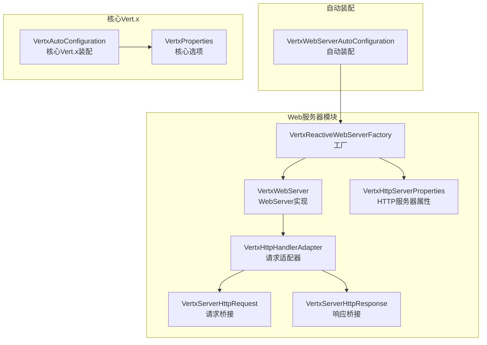
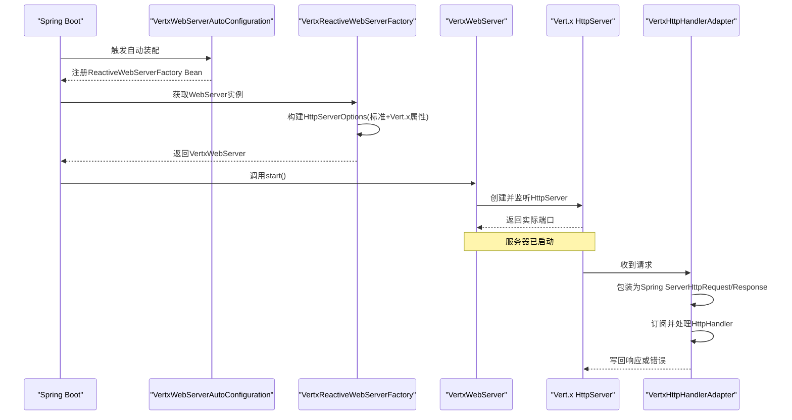
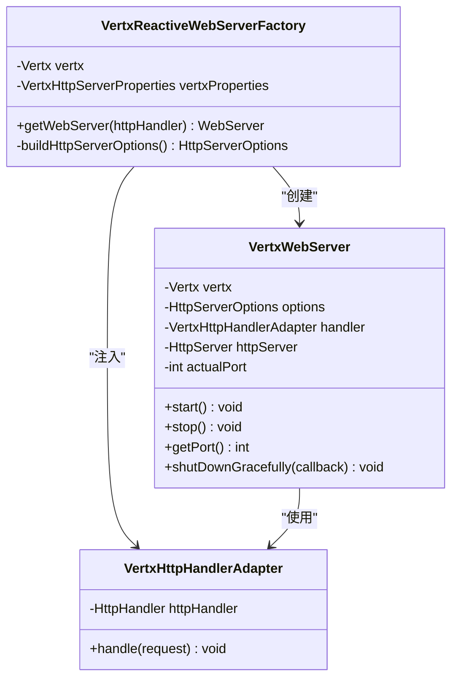
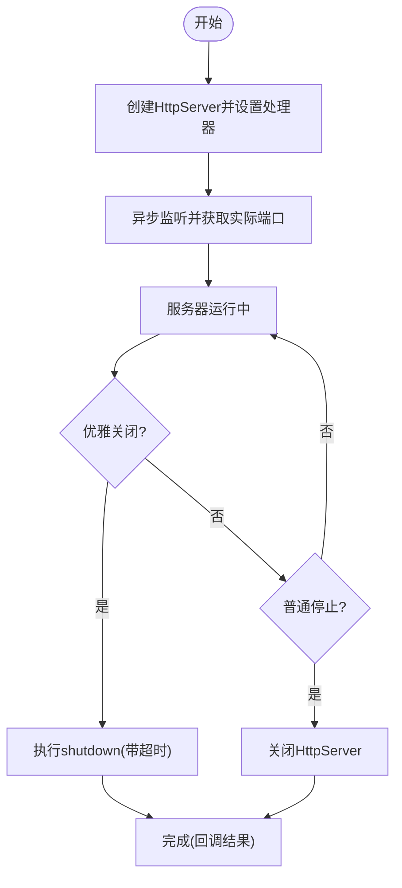
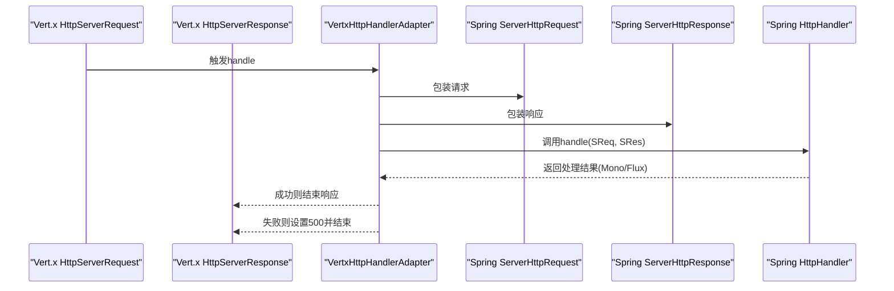
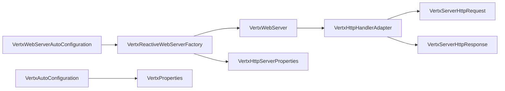

# Web服务器工厂

<cite>
**本文引用的文件**   
- [VertxReactiveWebServerFactory.java](file://vertx-spring-boot-web-server/src/main/java/com/workoss/boot/vertx/web/server/VertxReactiveWebServerFactory.java)
- [VertxWebServer.java](file://vertx-spring-boot-web-server/src/main/java/com/workoss/boot/vertx/web/server/VertxWebServer.java)
- [VertxWebServerAutoConfiguration.java](file://vertx-spring-boot-web-server/src/main/java/com/workoss/boot/vertx/web/server/VertxWebServerAutoConfiguration.java)
- [VertxHttpHandlerAdapter.java](file://vertx-spring-boot-web-server/src/main/java/com/workoss/boot/vertx/web/server/VertxHttpHandlerAdapter.java)
- [VertxHttpServerProperties.java](file://vertx-spring-boot-web-server/src/main/java/com/workoss/boot/vertx/web/server/VertxHttpServerProperties.java)
- [VertxServerHttpRequest.java](file://vertx-spring-boot-web-server/src/main/java/com/workoss/boot/vertx/web/server/VertxServerHttpRequest.java)
- [VertxServerHttpResponse.java](file://vertx-spring-boot-web-server/src/main/java/com/workoss/boot/vertx/web/server/VertxServerHttpResponse.java)
- [VertxAutoConfiguration.java](file://vertx-spring-boot-autoconfigure/src/main/java/com/workoss/boot/vertx/autoconfigure/VertxAutoConfiguration.java)
- [VertxProperties.java](file://vertx-spring-boot-autoconfigure/src/main/java/com/workoss/boot/vertx/autoconfigure/VertxProperties.java)
- [application.yml](file://example/vertx-spring-boot-example/src/main/resources/application.yml)
- [application-instance1.yml](file://example/vertx-spring-boot-example/src/main/resources/application-instance1.yml)
- [application-instance2.yml](file://example/vertx-spring-boot-example/src/main/resources/application-instance2.yml)
- [VertxReactiveWebServerFactoryTest.java](file://vertx-spring-boot-web-server/src/test/java/com/workoss/boot/vertx/web/server/VertxReactiveWebServerFactoryTest.java)
- [VertxWebServerAutoConfigurationTest.java](file://vertx-spring-boot-web-server/src/test/java/com/workoss/boot/vertx/web/server/VertxWebServerAutoConfigurationTest.java)
</cite>

## 目录
1. [简介](#简介)
2. [项目结构](#项目结构)
3. [核心组件](#核心组件)
4. [架构总览](#架构总览)
5. [详细组件分析](#详细组件分析)
6. [依赖分析](#依赖分析)
7. [性能考虑](#性能考虑)
8. [故障排查指南](#故障排查指南)
9. [结论](#结论)
10. [附录](#附录)

## 简介
本文件面向Vert.x Web服务器工厂，系统性阐述工厂模式实现与Web服务器核心能力，覆盖以下主题：
- 工厂模式：VertxReactiveWebServerFactory如何基于Spring Boot的ReactiveWebServerFactory接口创建WebServer实例，并桥接Vert.x HttpServerOptions与Spring Boot标准属性。
- 生命周期管理：VertxWebServer的启动、停止与优雅关闭流程，以及资源清理策略。
- 请求处理管道：VertxHttpHandlerAdapter如何将Spring WebFlux的HttpHandler适配到Vert.x的HttpServerRequest处理器，以及请求/响应对象的桥接。
- 性能与监控：通过VertxHttpServerProperties与VertxProperties进行参数化配置，结合日志与超时控制保障运行稳定性。
- 故障诊断：异常处理策略、事件循环终止检测与常见问题定位方法。

## 项目结构
该模块位于vertx-spring-boot-web-server中，围绕Web服务器工厂与Vert.x适配层展开；核心类包括：
- 工厂与自动装配：VertxReactiveWebServerFactory、VertxWebServerAutoConfiguration
- 服务器实现：VertxWebServer
- 处理器桥接：VertxHttpHandlerAdapter、VertxServerHttpRequest、VertxServerHttpResponse
- 配置属性：VertxHttpServerProperties（Vert.x特有）、VertxProperties（核心Vert.x选项）
- 示例与测试：示例配置文件与单元测试验证

图表来源
- [VertxReactiveWebServerFactory.java:26-41](file://vertx-spring-boot-web-server/src/main/java/com/workoss/boot/vertx/web/server/VertxReactiveWebServerFactory.java#L26-L41)
- [VertxWebServer.java:19-33](file://vertx-spring-boot-web-server/src/main/java/com/workoss/boot/vertx/web/server/VertxWebServer.java#L19-L33)
- [VertxHttpHandlerAdapter.java:13-21](file://vertx-spring-boot-web-server/src/main/java/com/workoss/boot/vertx/web/server/VertxHttpHandlerAdapter.java#L13-L21)
- [VertxHttpServerProperties.java:12-92](file://vertx-spring-boot-web-server/src/main/java/com/workoss/boot/vertx/web/server/VertxHttpServerProperties.java#L12-L92)
- [VertxWebServerAutoConfiguration.java:22-29](file://vertx-spring-boot-web-server/src/main/java/com/workoss/boot/vertx/web/server/VertxWebServerAutoConfiguration.java#L22-L29)
- [VertxAutoConfiguration.java:24-81](file://vertx-spring-boot-autoconfigure/src/main/java/com/workoss/boot/vertx/autoconfigure/VertxAutoConfiguration.java#L24-L81)
- [VertxProperties.java:8-159](file://vertx-spring-boot-autoconfigure/src/main/java/com/workoss/boot/vertx/autoconfigure/VertxProperties.java#L8-L159)

章节来源
- [VertxReactiveWebServerFactory.java:14-79](file://vertx-spring-boot-web-server/src/main/java/com/workoss/boot/vertx/web/server/VertxReactiveWebServerFactory.java#L14-L79)
- [VertxWebServer.java:16-109](file://vertx-spring-boot-web-server/src/main/java/com/workoss/boot/vertx/web/server/VertxWebServer.java#L16-L109)
- [VertxWebServerAutoConfiguration.java:14-30](file://vertx-spring-boot-web-server/src/main/java/com/workoss/boot/vertx/web/server/VertxWebServerAutoConfiguration.java#L14-L30)
- [VertxHttpHandlerAdapter.java:9-44](file://vertx-spring-boot-web-server/src/main/java/com/workoss/boot/vertx/web/server/VertxHttpHandlerAdapter.java#L9-L44)
- [VertxHttpServerProperties.java:5-92](file://vertx-spring-boot-web-server/src/main/java/com/workoss/boot/vertx/web/server/VertxHttpServerProperties.java#L5-L92)
- [VertxAutoConfiguration.java:18-82](file://vertx-spring-boot-autoconfigure/src/main/java/com/workoss/boot/vertx/autoconfigure/VertxAutoConfiguration.java#L18-L82)
- [VertxProperties.java:5-159](file://vertx-spring-boot-autoconfigure/src/main/java/com/workoss/boot/vertx/autoconfigure/VertxProperties.java#L5-L159)

## 核心组件
- 工厂：VertxReactiveWebServerFactory
  - 继承自Spring Boot的AbstractReactiveWebServerFactory，负责将标准server.*属性与Vert.x特有属性合并为HttpServerOptions，并创建VertxWebServer实例。
  - 关键点：端口、地址、SSL、压缩等标准属性由父类提供；Vert.x特有属性由VertxHttpServerProperties注入。
- 服务器：VertxWebServer
  - 实现WebServer接口，封装Vert.x HttpServer的生命周期：启动listen、停止close、优雅关闭shutdown。
  - 提供端口查询与优雅关闭回调通知。
- 适配器与桥接：VertxHttpHandlerAdapter、VertxServerHttpRequest、VertxServerHttpResponse
  - 将Spring WebFlux的HttpHandler与Vert.x的HttpServerRequest/Response桥接，支持背压、错误处理与响应写入。
- 自动装配：VertxWebServerAutoConfiguration
  - 在反应式Web环境中注册VertxReactiveWebServerFactory Bean，避免与其它ReactiveWebServerFactory冲突。
- 配置属性：VertxHttpServerProperties、VertxProperties
  - 前者定义Vert.x特有的HTTP服务器参数（如空闲超时、最大头/块大小、接受队列等）。
  - 后者定义核心Vert.x选项（事件循环线程数、工作线程池、原生传输偏好、集群与虚拟线程等）。

章节来源
- [VertxReactiveWebServerFactory.java:26-78](file://vertx-spring-boot-web-server/src/main/java/com/workoss/boot/vertx/web/server/VertxReactiveWebServerFactory.java#L26-L78)
- [VertxWebServer.java:19-108](file://vertx-spring-boot-web-server/src/main/java/com/workoss/boot/vertx/web/server/VertxWebServer.java#L19-L108)
- [VertxHttpHandlerAdapter.java:13-43](file://vertx-spring-boot-web-server/src/main/java/com/workoss/boot/vertx/web/server/VertxHttpHandlerAdapter.java#L13-L43)
- [VertxHttpServerProperties.java:12-92](file://vertx-spring-boot-web-server/src/main/java/com/workoss/boot/vertx/web/server/VertxHttpServerProperties.java#L12-L92)
- [VertxWebServerAutoConfiguration.java:22-29](file://vertx-spring-boot-web-server/src/main/java/com/workoss/boot/vertx/web/server/VertxWebServerAutoConfiguration.java#L22-L29)
- [VertxAutoConfiguration.java:24-81](file://vertx-spring-boot-autoconfigure/src/main/java/com/workoss/boot/vertx/autoconfigure/VertxAutoConfiguration.java#L24-L81)
- [VertxProperties.java:8-159](file://vertx-spring-boot-autoconfigure/src/main/java/com/workoss/boot/vertx/autoconfigure/VertxProperties.java#L8-L159)

## 架构总览
下图展示从Spring Boot自动装配到WebServer创建、请求处理与生命周期管理的整体流程。

图表来源
- [VertxWebServerAutoConfiguration.java:22-29](file://vertx-spring-boot-web-server/src/main/java/com/workoss/boot/vertx/web/server/VertxWebServerAutoConfiguration.java#L22-L29)
- [VertxReactiveWebServerFactory.java:36-41](file://vertx-spring-boot-web-server/src/main/java/com/workoss/boot/vertx/web/server/VertxReactiveWebServerFactory.java#L36-L41)
- [VertxWebServer.java:35-51](file://vertx-spring-boot-web-server/src/main/java/com/workoss/boot/vertx/web/server/VertxWebServer.java#L35-L51)
- [VertxHttpHandlerAdapter.java:23-43](file://vertx-spring-boot-web-server/src/main/java/com/workoss/boot/vertx/web/server/VertxHttpHandlerAdapter.java#L23-L43)

## 详细组件分析

### 工厂模式：VertxReactiveWebServerFactory
- 属性合并策略
  - 标准属性：端口、绑定地址、SSL开关、压缩开关由父类提供；默认端口通常为8080。
  - Vert.x特有属性：空闲超时、最大头/块/初始行长度、接受队列等来自VertxHttpServerProperties。
- 实例创建
  - 使用构建好的HttpServerOptions与VertxHttpHandlerAdapter创建VertxWebServer。
- 设计要点
  - 通过组合而非继承扩展Spring Boot标准能力，保持可插拔性。
  - 将配置解耦到独立的属性类，便于测试与定制。

图表来源
- [VertxReactiveWebServerFactory.java:26-41](file://vertx-spring-boot-web-server/src/main/java/com/workoss/boot/vertx/web/server/VertxReactiveWebServerFactory.java#L26-L41)
- [VertxWebServer.java:19-33](file://vertx-spring-boot-web-server/src/main/java/com/workoss/boot/vertx/web/server/VertxWebServer.java#L19-L33)
- [VertxHttpHandlerAdapter.java:13-21](file://vertx-spring-boot-web-server/src/main/java/com/workoss/boot/vertx/web/server/VertxHttpHandlerAdapter.java#L13-L21)

章节来源
- [VertxReactiveWebServerFactory.java:36-78](file://vertx-spring-boot-web-server/src/main/java/com/workoss/boot/vertx/web/server/VertxReactiveWebServerFactory.java#L36-L78)

### Web服务器：VertxWebServer
- 启动流程
  - 基于HttpServerOptions创建HttpServer。
  - 设置请求处理器为VertxHttpHandlerAdapter。
  - 异步监听并记录实际端口。
- 停止流程
  - 关闭HttpServer；若事件循环已终止则忽略特定异常。
- 优雅关闭
  - 调用shutdown并回调通知是否仍有活跃请求。

图表来源
- [VertxWebServer.java:35-108](file://vertx-spring-boot-web-server/src/main/java/com/workoss/boot/vertx/web/server/VertxWebServer.java#L35-L108)

章节来源
- [VertxWebServer.java:35-108](file://vertx-spring-boot-web-server/src/main/java/com/workoss/boot/vertx/web/server/VertxWebServer.java#L35-L108)

### 请求处理管道：VertxHttpHandlerAdapter与桥接对象
- 适配器职责
  - 将Vert.x的HttpServerRequest包装为Spring ServerHttpRequest，HttpServerResponse包装为Spring ServerHttpResponse。
  - 调用Spring HttpHandler处理，订阅其返回的Mono/Flux；成功时结束响应，失败时设置500并结束。
- 请求桥接
  - 支持URI构造（绝对/相对回退）、头部、Cookie、SSL信息、本地/远端地址、背压暂停/恢复。
- 响应桥接
  - 应用状态码与头部；格式化Cookie；将数据流写入Vert.x Buffer并异步写出。

图表来源
- [VertxHttpHandlerAdapter.java:23-43](file://vertx-spring-boot-web-server/src/main/java/com/workoss/boot/vertx/web/server/VertxHttpHandlerAdapter.java#L23-L43)
- [VertxServerHttpRequest.java:24-71](file://vertx-spring-boot-web-server/src/main/java/com/workoss/boot/vertx/web/server/VertxServerHttpRequest.java#L24-L71)
- [VertxServerHttpResponse.java:20-99](file://vertx-spring-boot-web-server/src/main/java/com/workoss/boot/vertx/web/server/VertxServerHttpResponse.java#L20-L99)

章节来源
- [VertxHttpHandlerAdapter.java:23-43](file://vertx-spring-boot-web-server/src/main/java/com/workoss/boot/vertx/web/server/VertxHttpHandlerAdapter.java#L23-L43)
- [VertxServerHttpRequest.java:24-118](file://vertx-spring-boot-web-server/src/main/java/com/workoss/boot/vertx/web/server/VertxServerHttpRequest.java#L24-L118)
- [VertxServerHttpResponse.java:20-111](file://vertx-spring-boot-web-server/src/main/java/com/workoss/boot/vertx/web/server/VertxServerHttpResponse.java#L20-L111)

### 自动装配与配置
- 自动装配
  - 在反应式Web应用且未存在ReactiveWebServerFactory时，注册VertxReactiveWebServerFactory。
- 核心Vert.x装配
  - 构造VertxOptions并应用自定义器；根据配置决定是否启用集群；提供VertxLifecycleManager。
- 示例配置
  - 示例应用展示了如何在不同profile下切换端口，以及如何开启集群与禁用原生传输偏好。

章节来源
- [VertxWebServerAutoConfiguration.java:22-29](file://vertx-spring-boot-web-server/src/main/java/com/workoss/boot/vertx/web/server/VertxWebServerAutoConfiguration.java#L22-L29)
- [VertxAutoConfiguration.java:24-81](file://vertx-spring-boot-autoconfigure/src/main/java/com/workoss/boot/vertx/autoconfigure/VertxAutoConfiguration.java#L24-L81)
- [application.yml:16-20](file://example/vertx-spring-boot-example/src/main/resources/application.yml#L16-L20)
- [application-instance1.yml:1-2](file://example/vertx-spring-boot-example/src/main/resources/application-instance1.yml#L1-L2)
- [application-instance2.yml:1-2](file://example/vertx-spring-boot-example/src/main/resources/application-instance2.yml#L1-L2)

## 依赖分析
- 组件内聚与耦合
  - 工厂与服务器通过Vertx实例与HttpServerOptions耦合，职责清晰：工厂负责配置与实例化，服务器负责生命周期。
  - 适配器与桥接对象与Spring WebFlux强耦合，但通过接口抽象隔离了底层实现差异。
- 外部依赖
  - Spring Boot WebFlux与Reactive WebServer接口族。
  - Vert.x核心与HTTP服务器API。
- 条件装配
  - 仅在反应式Web应用且未存在其他ReactiveWebServerFactory时生效，避免冲突。

图表来源
- [VertxWebServerAutoConfiguration.java:22-29](file://vertx-spring-boot-web-server/src/main/java/com/workoss/boot/vertx/web/server/VertxWebServerAutoConfiguration.java#L22-L29)
- [VertxReactiveWebServerFactory.java:26-41](file://vertx-spring-boot-web-server/src/main/java/com/workoss/boot/vertx/web/server/VertxReactiveWebServerFactory.java#L26-L41)
- [VertxWebServer.java:19-33](file://vertx-spring-boot-web-server/src/main/java/com/workoss/boot/vertx/web/server/VertxWebServer.java#L19-L33)
- [VertxHttpHandlerAdapter.java:13-21](file://vertx-spring-boot-web-server/src/main/java/com/workoss/boot/vertx/web/server/VertxHttpHandlerAdapter.java#L13-L21)
- [VertxHttpServerProperties.java:12-92](file://vertx-spring-boot-web-server/src/main/java/com/workoss/boot/vertx/web/server/VertxHttpServerProperties.java#L12-L92)
- [VertxAutoConfiguration.java:24-81](file://vertx-spring-boot-autoconfigure/src/main/java/com/workoss/boot/vertx/autoconfigure/VertxAutoConfiguration.java#L24-L81)
- [VertxProperties.java:8-159](file://vertx-spring-boot-autoconfigure/src/main/java/com/workoss/boot/vertx/autoconfigure/VertxProperties.java#L8-L159)

章节来源
- [VertxWebServerAutoConfiguration.java:22-29](file://vertx-spring-boot-web-server/src/main/java/com/workoss/boot/vertx/web/server/VertxWebServerAutoConfiguration.java#L22-L29)
- [VertxReactiveWebServerFactory.java:26-41](file://vertx-spring-boot-web-server/src/main/java/com/workoss/boot/vertx/web/server/VertxReactiveWebServerFactory.java#L26-L41)
- [VertxWebServer.java:19-33](file://vertx-spring-boot-web-server/src/main/java/com/workoss/boot/vertx/web/server/VertxWebServer.java#L19-L33)
- [VertxHttpHandlerAdapter.java:13-21](file://vertx-spring-boot-web-server/src/main/java/com/workoss/boot/vertx/web/server/VertxHttpHandlerAdapter.java#L13-L21)
- [VertxHttpServerProperties.java:12-92](file://vertx-spring-boot-web-server/src/main/java/com/workoss/boot/vertx/web/server/VertxHttpServerProperties.java#L12-L92)
- [VertxAutoConfiguration.java:24-81](file://vertx-spring-boot-autoconfigure/src/main/java/com/workoss/boot/vertx/autoconfigure/VertxAutoConfiguration.java#L24-L81)
- [VertxProperties.java:8-159](file://vertx-spring-boot-autoconfigure/src/main/java/com/workoss/boot/vertx/autoconfigure/VertxProperties.java#L8-L159)

## 性能考虑
- 事件循环与线程池
  - 通过VertxProperties调整事件循环线程数、工作线程池大小与内部阻塞线程池大小，以匹配CPU核数与I/O密集度。
  - 可选择启用原生传输以提升网络性能。
- HTTP服务器参数
  - 合理设置空闲超时、最大头/块/初始行长度与接受队列，避免内存占用过高或连接积压。
  - 压缩等级可在启用压缩时按需调节。
- 背压与流控
  - 请求体采用背压流，订阅时恢复读取，取消时暂停，降低高并发下的内存峰值。
- 优雅关闭与超时
  - 优雅关闭设置超时时间，确保在限定时间内完成剩余请求处理，避免强制中断导致的数据丢失。

章节来源
- [VertxProperties.java:11-87](file://vertx-spring-boot-autoconfigure/src/main/java/com/workoss/boot/vertx/autoconfigure/VertxProperties.java#L11-L87)
- [VertxHttpServerProperties.java:15-43](file://vertx-spring-boot-web-server/src/main/java/com/workoss/boot/vertx/web/server/VertxHttpServerProperties.java#L15-L43)
- [VertxWebServer.java:90-108](file://vertx-spring-boot-web-server/src/main/java/com/workoss/boot/vertx/web/server/VertxWebServer.java#L90-L108)

## 故障排查指南
- 启动失败
  - 检查端口占用与绑定地址；确认SSL配置与压缩开关一致性。
- 运行期异常
  - 适配器在错误时会设置500并结束响应；查看日志定位具体请求路径与异常栈。
- 优雅关闭异常
  - 若事件循环已终止，停止阶段会忽略特定拒绝执行异常；否则抛出WebServerException。
- 性能问题
  - 观察背压行为与响应写出速率；必要时增大工作线程池或调整HTTP参数。
- 配置验证
  - 使用测试用例思路验证属性绑定与默认值：端口、地址、压缩等级、接受队列等。

章节来源
- [VertxWebServer.java:48-82](file://vertx-spring-boot-web-server/src/main/java/com/workoss/boot/vertx/web/server/VertxWebServer.java#L48-L82)
- [VertxHttpHandlerAdapter.java:34-42](file://vertx-spring-boot-web-server/src/main/java/com/workoss/boot/vertx/web/server/VertxHttpHandlerAdapter.java#L34-L42)
- [VertxReactiveWebServerFactoryTest.java:31-86](file://vertx-spring-boot-web-server/src/test/java/com/workoss/boot/vertx/web/server/VertxReactiveWebServerFactoryTest.java#L31-L86)
- [VertxWebServerAutoConfigurationTest.java:33-87](file://vertx-spring-boot-web-server/src/test/java/com/workoss/boot/vertx/web/server/VertxWebServerAutoConfigurationTest.java#L33-L87)

## 结论
本实现以工厂模式为核心，将Spring Boot的反应式Web能力与Vert.x高性能事件驱动模型无缝衔接。通过清晰的生命周期管理、完善的请求处理管道与可调参的性能配置，既保证了易用性也兼顾了生产级稳定性。配合优雅关闭与日志监控，能够有效支撑高并发场景下的服务可用性与可观测性。

## 附录
- 示例配置参考
  - 示例应用展示了如何在不同profile下切换端口，以及如何启用集群与调整原生传输偏好。
- 测试用例参考
  - 单元测试验证了工厂属性绑定、默认值与自动装配条件。

章节来源
- [application.yml:16-20](file://example/vertx-spring-boot-example/src/main/resources/application.yml#L16-L20)
- [application-instance1.yml:1-2](file://example/vertx-spring-boot-example/src/main/resources/application-instance1.yml#L1-L2)
- [application-instance2.yml:1-2](file://example/vertx-spring-boot-example/src/main/resources/application-instance2.yml#L1-L2)
- [VertxReactiveWebServerFactoryTest.java:31-86](file://vertx-spring-boot-web-server/src/test/java/com/workoss/boot/vertx/web/server/VertxReactiveWebServerFactoryTest.java#L31-L86)
- [VertxWebServerAutoConfigurationTest.java:33-87](file://vertx-spring-boot-web-server/src/test/java/com/workoss/boot/vertx/web/server/VertxWebServerAutoConfigurationTest.java#L33-L87)