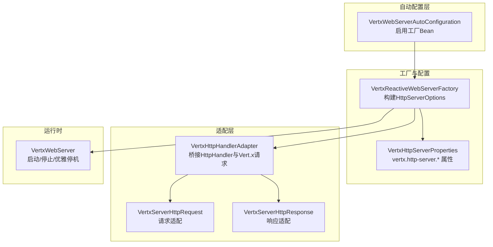
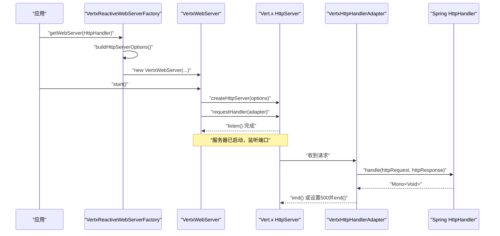
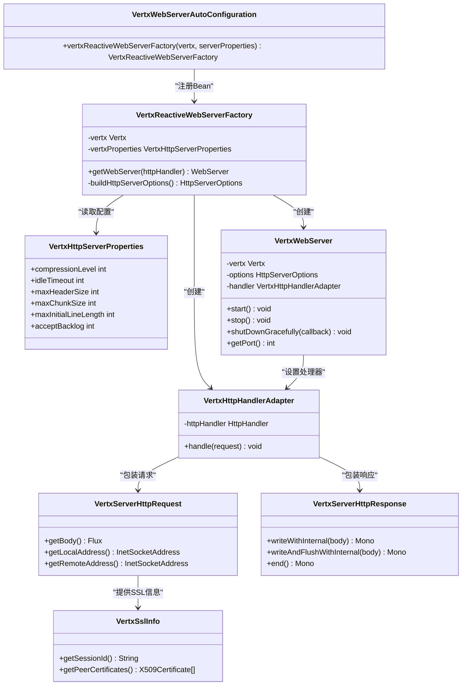
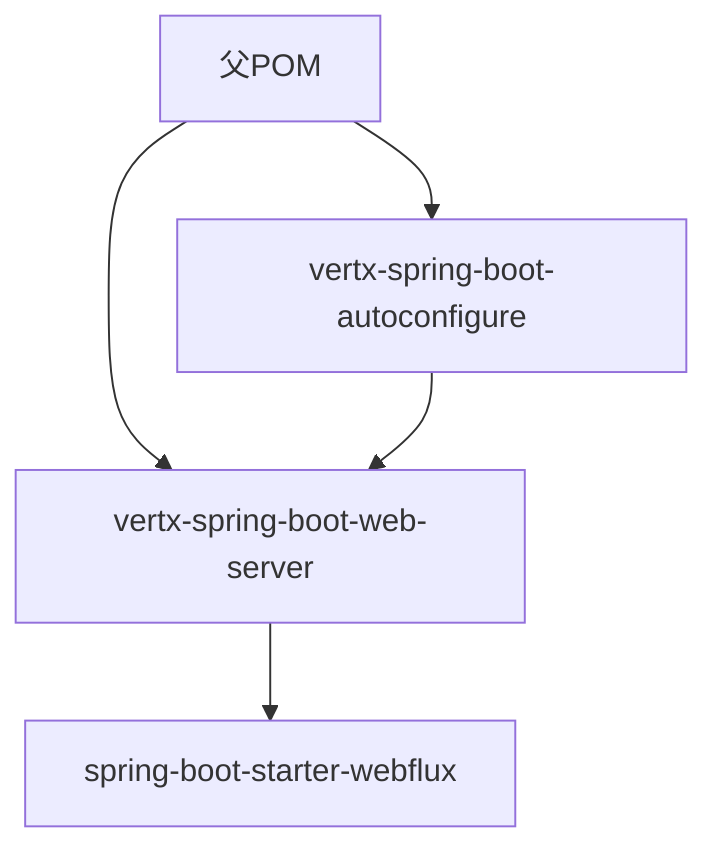

# Web服务器模块

<cite>
**本文引用的文件**
- [VertxWebServerAutoConfiguration.java](file://vertx-spring-boot-web-server/src/main/java/com/workoss/boot/vertx/web/server/VertxWebServerAutoConfiguration.java)
- [VertxReactiveWebServerFactory.java](file://vertx-spring-boot-web-server/src/main/java/com/workoss/boot/vertx/web/server/VertxReactiveWebServerFactory.java)
- [VertxHttpServerProperties.java](file://vertx-spring-boot-web-server/src/main/java/com/workoss/boot/vertx/web/server/VertxHttpServerProperties.java)
- [VertxHttpHandlerAdapter.java](file://vertx-spring-boot-web-server/src/main/java/com/workoss/boot/vertx/web/server/VertxHttpHandlerAdapter.java)
- [VertxWebServer.java](file://vertx-spring-boot-web-server/src/main/java/com/workoss/boot/vertx/web/server/VertxWebServer.java)
- [VertxServerHttpRequest.java](file://vertx-spring-boot-web-server/src/main/java/com/workoss/boot/vertx/web/server/VertxServerHttpRequest.java)
- [VertxServerHttpResponse.java](file://vertx-spring-boot-web-server/src/main/java/com/workoss/boot/vertx/web/server/VertxServerHttpResponse.java)
- [VertxSslInfo.java](file://vertx-spring-boot-web-server/src/main/java/com/workoss/boot/vertx/web/server/VertxSslInfo.java)
- [pom.xml（web-server）](file://vertx-spring-boot-web-server/pom.xml)
- [application.yml（示例）](file://example/vertx-spring-boot-example/src/main/resources/application.yml)
- [VertxWebServerAutoConfigurationTest.java](file://vertx-spring-boot-web-server/src/test/java/com/workoss/boot/vertx/web/server/VertxWebServerAutoConfigurationTest.java)
- [VertxReactiveWebServerFactoryTest.java](file://vertx-spring-boot-web-server/src/test/java/com/workoss/boot/vertx/web/server/VertxReactiveWebServerFactoryTest.java)
- [AutoConfiguration.imports（web-server）](file://vertx-spring-boot-web-server/src/main/resources/META-INF/spring/org.springframework.boot.autoconfigure.AutoConfiguration.imports)
- [AutoConfiguration.imports（autoconfigure）](file://vertx-spring-boot-autoconfigure/src/main/resources/META-INF/spring/org.springframework.boot.autoconfigure.AutoConfiguration.imports)
</cite>

## 目录
1. [简介](#简介)
2. [项目结构](#项目结构)
3. [核心组件](#核心组件)
4. [架构总览](#架构总览)
5. [详细组件分析](#详细组件分析)
6. [依赖分析](#依赖分析)
7. [性能考虑](#性能考虑)
8. [故障排查指南](#故障排查指南)
9. [结论](#结论)
10. [附录](#附录)

## 简介
本文件面向Vert.x Web服务器模块，系统性阐述自动配置机制、服务器工厂与配置类、请求处理器适配器以及底层Web服务器实现。重点覆盖以下主题：
- 自动配置类如何在WebFlux环境下启用Vert.x作为反应式Web服务器
- 配置类VertxHttpServerProperties的全部属性及其作用域
- 请求处理器适配器如何将Spring WebFlux的HandlerFunction桥接到Vert.x路由
- VertxWebServer的启动、关闭与优雅停机流程
- SSL/TLS配置要点、性能优化建议与监控指标
- 完整的Web控制器示例与错误处理策略

**更新** 包名已从`com.vertx.spring.boot`重命名为`com.workoss.boot.vertx`，体现了项目的正式化命名规范。

## 项目结构
该模块位于vertx-spring-boot-web-server子工程中，核心文件围绕"自动配置—工厂—适配器—服务器—请求/响应适配"展开，并通过Spring Boot的条件化自动装配机制接入。

**图表来源**
- [VertxWebServerAutoConfiguration.java:17-30](file://vertx-spring-boot-web-server/src/main/java/com/workoss/boot/vertx/web/server/VertxWebServerAutoConfiguration.java#L17-L30)
- [VertxReactiveWebServerFactory.java:26-78](file://vertx-spring-boot-web-server/src/main/java/com/workoss/boot/vertx/web/server/VertxReactiveWebServerFactory.java#L26-L78)
- [VertxHttpServerProperties.java:12-92](file://vertx-spring-boot-web-server/src/main/java/com/workoss/boot/vertx/web/server/VertxHttpServerProperties.java#L12-L92)
- [VertxHttpHandlerAdapter.java:13-44](file://vertx-spring-boot-web-server/src/main/java/com/workoss/boot/vertx/web/server/VertxHttpHandlerAdapter.java#L13-L44)
- [VertxServerHttpRequest.java:24-118](file://vertx-spring-boot-web-server/src/main/java/com/workoss/boot/vertx/web/server/VertxServerHttpRequest.java#L24-L118)
- [VertxServerHttpResponse.java:20-111](file://vertx-spring-boot-web-server/src/main/java/com/workoss/boot/vertx/web/server/VertxServerHttpResponse.java#L20-L111)
- [VertxWebServer.java:19-108](file://vertx-spring-boot-web-server/src/main/java/com/workoss/boot/vertx/web/server/VertxWebServer.java#L19-L108)

**章节来源**
- [AutoConfiguration.imports（web-server）:1-2](file://vertx-spring-boot-web-server/src/main/resources/META-INF/spring/org.springframework.boot.autoconfigure.AutoConfiguration.imports#L1-L2)
- [AutoConfiguration.imports（autoconfigure）:1-3](file://vertx-spring-boot-autoconfigure/src/main/resources/META-INF/spring/org.springframework.boot.autoconfigure.AutoConfiguration.imports#L1-L3)

## 核心组件
- 自动配置类：在反应式Web应用且未存在其他ReactiveWebServerFactory时，注册Vert.x服务器工厂Bean。
- 工厂类：负责将标准server.*属性与vertx.http-server.*属性合并为HttpServerOptions，并创建WebServer实例。
- 配置类：封装Vert.x特有的HTTP服务器参数，如压缩级别、空闲超时、最大头/块/初始行长度、TCP接受队列等。
- 处理器适配器：将Spring WebFlux的HttpHandler转换为Vert.x的请求处理器，完成请求/响应桥接。
- Web服务器：基于Vert.x HttpServer的实际运行时，支持启动、停止与优雅停机。
- 请求/响应适配器：将Vert.x原生请求/响应映射到Spring WebFlux抽象，确保背压与生命周期一致。
- SSL信息：在启用TLS时提供会话ID与对端证书信息。

**更新** 所有组件类的包名已更新为`com.workoss.boot.vertx.web.server`，体现了统一的命名空间。

**章节来源**
- [VertxWebServerAutoConfiguration.java:17-30](file://vertx-spring-boot-web-server/src/main/java/com/workoss/boot/vertx/web/server/VertxWebServerAutoConfiguration.java#L17-L30)
- [VertxReactiveWebServerFactory.java:26-78](file://vertx-spring-boot-web-server/src/main/java/com/workoss/boot/vertx/web/server/VertxReactiveWebServerFactory.java#L26-L78)
- [VertxHttpServerProperties.java:12-92](file://vertx-spring-boot-web-server/src/main/java/com/workoss/boot/vertx/web/server/VertxHttpServerProperties.java#L12-L92)
- [VertxHttpHandlerAdapter.java:13-44](file://vertx-spring-boot-web-server/src/main/java/com/workoss/boot/vertx/web/server/VertxHttpHandlerAdapter.java#L13-L44)
- [VertxWebServer.java:19-108](file://vertx-spring-boot-web-server/src/main/java/com/workoss/boot/vertx/web/server/VertxWebServer.java#L19-L108)
- [VertxServerHttpRequest.java:24-118](file://vertx-spring-boot-web-server/src/main/java/com/workoss/boot/vertx/web/server/VertxServerHttpRequest.java#L24-L118)
- [VertxServerHttpResponse.java:20-111](file://vertx-spring-boot-web-server/src/main/java/com/workoss/boot/vertx/web/server/VertxServerHttpResponse.java#L20-L111)
- [VertxSslInfo.java:14-54](file://vertx-spring-boot-web-server/src/main/java/com/workoss/boot/vertx/web/server/VertxSslInfo.java#L14-L54)

## 架构总览
下图展示了从Spring WebFlux到Vert.x的完整调用链路与数据流。

**图表来源**
- [VertxReactiveWebServerFactory.java:36-41](file://vertx-spring-boot-web-server/src/main/java/com/workoss/boot/vertx/web/server/VertxReactiveWebServerFactory.java#L36-L41)
- [VertxWebServer.java:35-51](file://vertx-spring-boot-web-server/src/main/java/com/workoss/boot/vertx/web/server/VertxWebServer.java#L35-L51)
- [VertxHttpHandlerAdapter.java:23-43](file://vertx-spring-boot-web-server/src/main/java/com/workoss/boot/vertx/web/server/VertxHttpHandlerAdapter.java#L23-L43)

## 详细组件分析

### 自动配置机制（VertxWebServerAutoConfiguration）
- 条件注解确保仅在反应式Web应用且不存在其他ReactiveWebServerFactory时生效
- 注册Vert.x服务器工厂Bean，注入Vert.x实例与VertxHttpServerProperties
- 通过@EnableConfigurationProperties启用配置类绑定

**更新** 自动配置类的包名已更新为`com.workoss.boot.vertx.web.server.VertxWebServerAutoConfiguration`。

**章节来源**
- [VertxWebServerAutoConfiguration.java:17-30](file://vertx-spring-boot-web-server/src/main/java/com/workoss/boot/vertx/web/server/VertxWebServerAutoConfiguration.java#L17-L30)

### 服务器工厂（VertxReactiveWebServerFactory）
- 继承AbstractReactiveWebServerFactory，复用标准server.*属性（端口、地址、SSL、压缩）
- 将标准属性与vertx.http-server.*属性合并为HttpServerOptions
- 创建VertxHttpHandlerAdapter与VertxWebServer实例

**更新** 工厂类的包名已更新为`com.workoss.boot.vertx.web.server.VertxReactiveWebServerFactory`。

**章节来源**
- [VertxReactiveWebServerFactory.java:26-78](file://vertx-spring-boot-web-server/src/main/java/com/workoss/boot/vertx/web/server/VertxReactiveWebServerFactory.java#L26-L78)

### 配置类（VertxHttpServerProperties）
- 压缩级别：当开启压缩时生效
- 空闲超时：秒级，用于keep-alive连接
- 最大头大小、最大块大小、最大初始行长度：限制HTTP解析尺寸
- 接受队列长度：TCP半连接队列容量

**更新** 配置类的包名已更新为`com.workoss.boot.vertx.web.server.VertxHttpServerProperties`。

**章节来源**
- [VertxHttpServerProperties.java:12-92](file://vertx-spring-boot-web-server/src/main/java/com/workoss/boot/vertx/web/server/VertxHttpServerProperties.java#L12-L92)

### 请求处理器适配器（VertxHttpHandlerAdapter）
- 将Vert.x的HttpServerRequest包装为Spring的ServerHttpRequest
- 将Vert.x的HttpServerResponse包装为Spring的ServerHttpResponse
- 调用HttpHandler处理后，若未结束则主动end；异常时返回500并结束

**更新** 适配器类的包名已更新为`com.workoss.boot.vertx.web.server.VertxHttpHandlerAdapter`。

**章节来源**
- [VertxHttpHandlerAdapter.java:13-44](file://vertx-spring-boot-web-server/src/main/java/com/workoss/boot/vertx/web/server/VertxHttpHandlerAdapter.java#L13-L44)

### Web服务器实现（VertxWebServer）
- 启动：创建HttpServer并设置请求处理器，监听端口
- 停止：关闭HttpServer，忽略事件循环已终止导致的拒绝执行异常
- 优雅停机：调用shutdown并回调通知结果（空闲或仍有活跃请求）

**更新** Web服务器类的包名已更新为`com.workoss.boot.vertx.web.server.VertxWebServer`。

**章节来源**
- [VertxWebServer.java:19-108](file://vertx-spring-boot-web-server/src/main/java/com/workoss/boot/vertx/web/server/VertxWebServer.java#L19-L108)

### 请求/响应适配器（VertxServerHttpRequest / VertxServerHttpResponse）
- 请求：构建URI、头部、Cookie、SSL信息；将请求体转为Flux<DataBuffer>，支持背压与取消
- 响应：应用状态码、头部、Cookie；将响应体写入并结束

**更新** 请求/响应适配器类的包名已更新为`com.workoss.boot.vertx.web.server.VertxServerHttpRequest`和`com.workoss.boot.vertx.web.server.VertxServerHttpResponse`。

**章节来源**
- [VertxServerHttpRequest.java:24-118](file://vertx-spring-boot-web-server/src/main/java/com/workoss/boot/vertx/web/server/VertxServerHttpRequest.java#L24-L118)
- [VertxServerHttpResponse.java:20-111](file://vertx-spring-boot-web-server/src/main/java/com/workoss/boot/vertx/web/server/VertxServerHttpResponse.java#L20-L111)

### SSL信息（VertxSslInfo）
- 提供会话ID十六进制字符串与对端X509证书列表（若可用）

**更新** SSL信息类的包名已更新为`com.workoss.boot.vertx.web.server.VertxSslInfo`。

**章节来源**
- [VertxSslInfo.java:14-54](file://vertx-spring-boot-web-server/src/main/java/com/workoss/boot/vertx/web/server/VertxSslInfo.java#L14-L54)

### 类关系图

**图表来源**
- [VertxWebServerAutoConfiguration.java:24-29](file://vertx-spring-boot-web-server/src/main/java/com/workoss/boot/vertx/web/server/VertxWebServerAutoConfiguration.java#L24-L29)
- [VertxReactiveWebServerFactory.java:36-41](file://vertx-spring-boot-web-server/src/main/java/com/workoss/boot/vertx/web/server/VertxReactiveWebServerFactory.java#L36-L41)
- [VertxHttpServerProperties.java:12-92](file://vertx-spring-boot-web-server/src/main/java/com/workoss/boot/vertx/web/server/VertxHttpServerProperties.java#L12-L92)
- [VertxHttpHandlerAdapter.java:13-44](file://vertx-spring-boot-web-server/src/main/java/com/workoss/boot/vertx/web/server/VertxHttpHandlerAdapter.java#L13-L44)
- [VertxWebServer.java:19-108](file://vertx-spring-boot-web-server/src/main/java/com/workoss/boot/vertx/web/server/VertxWebServer.java#L19-L108)
- [VertxServerHttpRequest.java:24-118](file://vertx-spring-boot-web-server/src/main/java/com/workoss/boot/vertx/web/server/VertxServerHttpRequest.java#L24-L118)
- [VertxServerHttpResponse.java:20-111](file://vertx-spring-boot-web-server/src/main/java/com/workoss/boot/vertx/web/server/VertxServerHttpResponse.java#L20-L111)
- [VertxSslInfo.java:14-54](file://vertx-spring-boot-web-server/src/main/java/com/workoss/boot/vertx/web/server/VertxSslInfo.java#L14-L54)

## 依赖分析
- 模块依赖：web-server依赖autoconfigure与spring-boot-starter-webflux（排除默认Netty实现）
- 运行时依赖：Vert.x核心库
- 自动装配：通过META-INF导入文件声明自动配置类

**图表来源**
- [pom.xml（web-server）:17-67](file://vertx-spring-boot-web-server/pom.xml#L17-L67)

**章节来源**
- [pom.xml（web-server）:17-67](file://vertx-spring-boot-web-server/pom.xml#L17-L67)
- [AutoConfiguration.imports（web-server）:1-2](file://vertx-spring-boot-web-server/src/main/resources/META-INF/spring/org.springframework.boot.autoconfigure.AutoConfiguration.imports#L1-L2)
- [AutoConfiguration.imports（autoconfigure）:1-3](file://vertx-spring-boot-autoconfigure/src/main/resources/META-INF/spring/org.springframework.boot.autoconfigure.AutoConfiguration.imports#L1-L3)

## 性能考虑
- 压缩策略：结合server.compression.enabled与vertx.http-server.compression-level控制压缩强度
- 连接管理：合理设置idle-timeout避免长时间占用；accept-backlog提升高并发下的半连接队列容量
- 解析限制：max-header-size、max-chunk-size、max-initial-line-length防止恶意或异常请求导致内存压力
- 背压与流控：请求体采用Flux<DataBuffer>并支持暂停/恢复，避免过载
- 事件循环：避免在Vert.x事件线程上执行阻塞操作，保持非阻塞I/O

## 故障排查指南
- 启动失败：检查端口占用与地址绑定；查看WebServerException堆栈
- 关闭异常：事件循环终止时可能出现拒绝执行异常，属于预期行为，可忽略
- 优雅停机：关注回调结果，区分空闲与仍有活跃请求
- 错误处理：适配器在异常时返回500并结束响应，便于快速定位问题

**章节来源**
- [VertxWebServer.java:48-82](file://vertx-spring-boot-web-server/src/main/java/com/workoss/boot/vertx/web/server/VertxWebServer.java#L48-L82)
- [VertxHttpHandlerAdapter.java:34-42](file://vertx-spring-boot-web-server/src/main/java/com/workoss/boot/vertx/web/server/VertxHttpHandlerAdapter.java#L34-L42)

## 结论
该模块以最小侵入的方式将Vert.x嵌入Spring WebFlux生态，通过自动配置、工厂与适配器解耦了框架差异，既保留了Spring的标准配置体验，又充分发挥Vert.x在事件驱动与高并发方面的优势。配合合理的配置与监控，可在生产环境中获得稳定、可观测且高性能的Web服务。

**更新** 包名标准化为`com.workoss.boot.vertx`，体现了项目的正式化和规范化。

## 附录

### 配置项速查（vertx.http-server.*）
- compression-level：压缩强度（1-9）
- idle-timeout：空闲超时（秒）
- max-header-size：最大请求头字节
- max-chunk-size：最大分块字节
- max-initial-line-length：最大初始行长度
- accept-backlog：TCP半连接队列长度

**章节来源**
- [VertxHttpServerProperties.java:12-92](file://vertx-spring-boot-web-server/src/main/java/com/workoss/boot/vertx/web/server/VertxHttpServerProperties.java#L12-L92)

### SSL/TLS配置示例
- 在标准server.ssl.*启用SSL后，工厂会设置HttpServerOptions为SSL模式
- 可通过VertxSslInfo获取会话ID与对端证书信息

**章节来源**
- [VertxReactiveWebServerFactory.java:56-60](file://vertx-spring-boot-web-server/src/main/java/com/workoss/boot/vertx/web/server/VertxReactiveWebServerFactory.java#L56-L60)
- [VertxSslInfo.java:22-53](file://vertx-spring-boot-web-server/src/main/java/com/workoss/boot/vertx/web/server/VertxSslInfo.java#L22-L53)

### 监控指标建议
- 启动/停止/优雅停机事件日志
- 请求处理耗时与错误率
- 连接数、活跃请求数、背压触发次数
- 压缩比与响应大小分布

### Web控制器示例与错误处理策略
- 控制器示例：参考示例应用入口类，结合WebFlux路由函数进行请求处理
- 错误处理：在适配器中统一捕获异常并返回500；业务层通过WebExceptionHandler集中处理

**章节来源**
- [application.yml（示例）:1-21](file://example/vertx-spring-boot-example/src/main/resources/application.yml#L1-L21)
- [VertxHttpHandlerAdapter.java:34-42](file://vertx-spring-boot-web-server/src/main/java/com/workoss/boot/vertx/web/server/VertxHttpHandlerAdapter.java#L34-L42)

### 测试要点
- 自动配置是否创建工厂Bean
- 当存在其他ReactiveWebServerFactory时是否回退
- vertx.http-server.*属性是否正确绑定
- 工厂继承关系与标准属性setter行为

**更新** 新增了`VertxReactiveWebServerFactoryTest.java`测试文件，提供了更全面的工厂功能测试。

**章节来源**
- [VertxWebServerAutoConfigurationTest.java:33-86](file://vertx-spring-boot-web-server/src/test/java/com/workoss/boot/vertx/web/server/VertxWebServerAutoConfigurationTest.java#L33-L86)
- [VertxReactiveWebServerFactoryTest.java:31-86](file://vertx-spring-boot-web-server/src/test/java/com/workoss/boot/vertx/web/server/VertxReactiveWebServerFactoryTest.java#L31-L86)