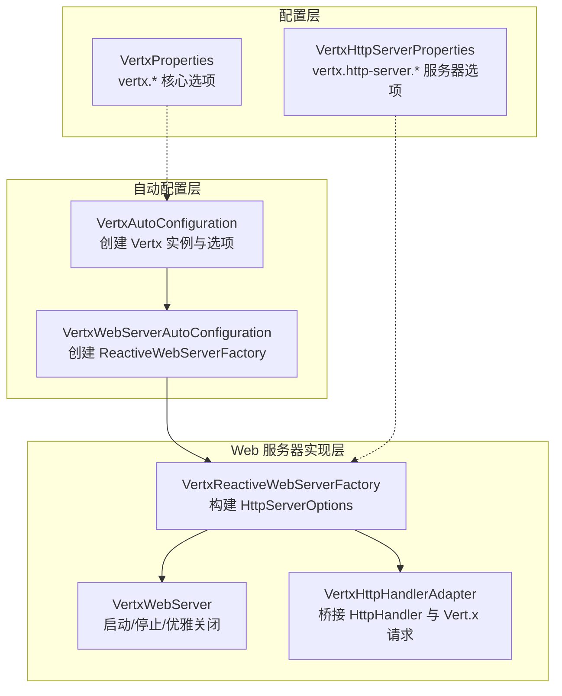
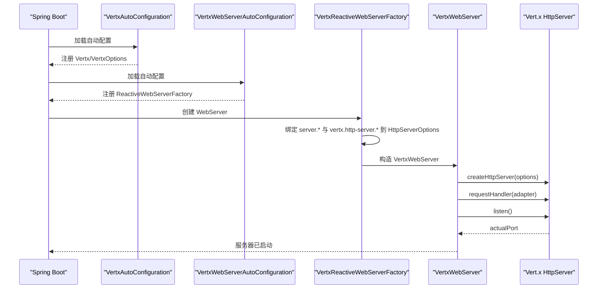
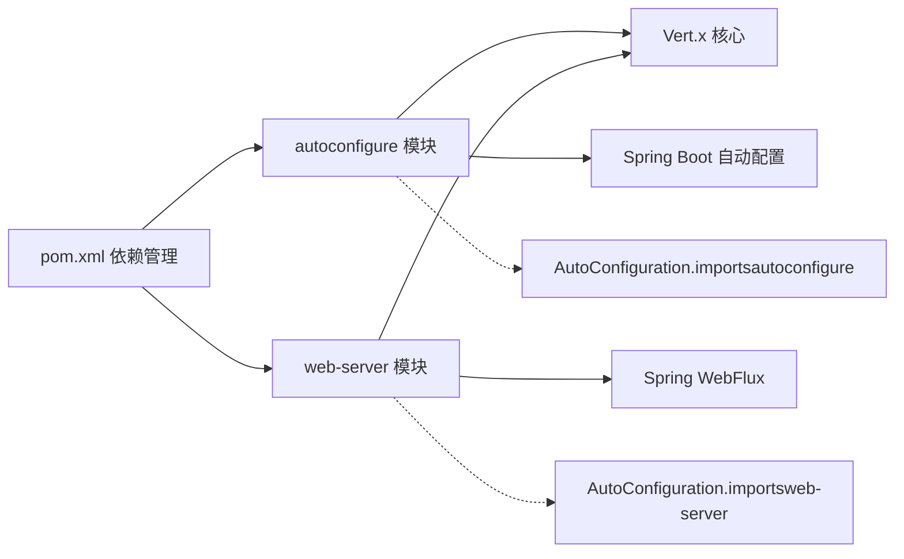

# 服务器配置

<cite>
**本文引用的文件**
- [VertxWebServerAutoConfiguration.java](file://vertx-spring-boot-web-server/src/main/java/com/workoss/boot/vertx/web/server/VertxWebServerAutoConfiguration.java)
- [VertxHttpServerProperties.java](file://vertx-spring-boot-web-server/src/main/java/com/workoss/boot/vertx/web/server/VertxHttpServerProperties.java)
- [VertxReactiveWebServerFactory.java](file://vertx-spring-boot-web-server/src/main/java/com/workoss/boot/vertx/web/server/VertxReactiveWebServerFactory.java)
- [VertxWebServer.java](file://vertx-spring-boot-web-server/src/main/java/com/workoss/boot/vertx/web/server/VertxWebServer.java)
- [VertxHttpHandlerAdapter.java](file://vertx-spring-boot-web-server/src/main/java/com/workoss/boot/vertx/web/server/VertxHttpHandlerAdapter.java)
- [VertxSslInfo.java](file://vertx-spring-boot-web-server/src/main/java/com/workoss/boot/vertx/web/server/VertxSslInfo.java)
- [VertxAutoConfiguration.java](file://vertx-spring-boot-autoconfigure/src/main/java/com/workoss/boot/vertx/autoconfigure/VertxAutoConfiguration.java)
- [VertxProperties.java](file://vertx-spring-boot-autoconfigure/src/main/java/com/workoss/boot/vertx/autoconfigure/VertxProperties.java)
- [application.yml](file://example/vertx-spring-boot-example/src/main/resources/application.yml)
- [application-instance1.yml](file://example/vertx-spring-boot-example/src/main/resources/application-instance1.yml)
- [application-instance2.yml](file://example/vertx-spring-boot-example/src/main/resources/application-instance2.yml)
- [AutoConfiguration.imports（web-server）](file://vertx-spring-boot-web-server/src/main/resources/META-INF/spring/org.springframework.boot.autoconfigure.AutoConfiguration.imports)
- [AutoConfiguration.imports（autoconfigure）](file://vertx-spring-boot-autoconfigure/src/main/resources/META-INF/spring/org.springframework.boot.autoconfigure.AutoConfiguration.imports)
- [VertxWebServerAutoConfigurationTest.java](file://vertx-spring-boot-web-server/src/test/java/com/workoss/boot/vertx/web/server/VertxWebServerAutoConfigurationTest.java)
- [pom.xml](file://pom.xml)
</cite>

## 目录
1. [简介](#简介)
2. [项目结构](#项目结构)
3. [核心组件](#核心组件)
4. [架构总览](#架构总览)
5. [详细组件分析](#详细组件分析)
6. [依赖分析](#依赖分析)
7. [性能考虑](#性能考虑)
8. [故障排查指南](#故障排查指南)
9. [结论](#结论)
10. [附录：完整配置与最佳实践](#附录完整配置与最佳实践)

## 简介
本文件面向使用 Spring Boot 与 Vert.x 集成的开发者，系统性阐述 Vert.x 嵌入式 Web 服务器在 Spring Boot 中的自动配置机制与运行时行为，重点覆盖：
- 自动配置类 VertxWebServerAutoConfiguration 的条件注解与装配流程
- WebFlux 集成路径与请求适配器
- VertxHttpServerProperties 的所有 Vert.x 特有配置项及其作用域
- 生产级性能调优与安全配置建议
- 完整配置示例与最佳实践

## 项目结构
该仓库采用多模块结构，与“服务器配置”主题直接相关的核心模块如下：
- vertx-spring-boot-autoconfigure：提供 Vert.x 核心实例与选项的自动配置
- vertx-spring-boot-web-server：提供基于 Vert.x 的 Web 服务器自动配置与实现
- example：示例应用，展示如何在不同实例中切换端口与集群开关

图表来源
- [VertxAutoConfiguration.java:21-83](file://vertx-spring-boot-autoconfigure/src/main/java/com/workoss/boot/vertx/autoconfigure/VertxAutoConfiguration.java#L21-L83)
- [VertxWebServerAutoConfiguration.java:17-30](file://vertx-spring-boot-web-server/src/main/java/com/workoss/boot/vertx/web/server/VertxWebServerAutoConfiguration.java#L17-L30)
- [VertxReactiveWebServerFactory.java:26-79](file://vertx-spring-boot-web-server/src/main/java/com/workoss/boot/vertx/web/server/VertxReactiveWebServerFactory.java#L26-L79)
- [VertxWebServer.java:19-109](file://vertx-spring-boot-web-server/src/main/java/com/workoss/boot/vertx/web/server/VertxWebServer.java#L19-L109)
- [VertxHttpHandlerAdapter.java:13-44](file://vertx-spring-boot-web-server/src/main/java/com/workoss/boot/vertx/web/server/VertxHttpHandlerAdapter.java#L13-L44)
- [VertxProperties.java:8-160](file://vertx-spring-boot-autoconfigure/src/main/java/com/workoss/boot/vertx/autoconfigure/VertxProperties.java#L8-L160)
- [VertxHttpServerProperties.java:12-92](file://vertx-spring-boot-web-server/src/main/java/com/workoss/boot/vertx/web/server/VertxHttpServerProperties.java#L12-L92)

章节来源
- [pom.xml:15-22](file://pom.xml#L15-L22)

## 核心组件
- 自动配置入口
  - VertxWebServerAutoConfiguration：在响应式 Web 应用场景下，基于条件注解装配 ReactiveWebServerFactory，并启用 VertxHttpServerProperties 绑定
- Web 服务器工厂
  - VertxReactiveWebServerFactory：从标准 server.* 属性与 Vert.x 特有 vertx.http-server.* 属性构建 HttpServerOptions，并创建 Vert.x HttpServer
- 运行时 Web 服务器
  - VertxWebServer：封装 Vert.x HttpServer 生命周期，支持优雅关闭与端口查询
- 请求适配器
  - VertxHttpHandlerAdapter：将 Spring WebFlux 的 HttpHandler 桥接到 Vert.x 的 HttpServerRequest 处理链
- SSL 信息
  - VertxSslInfo：提供 SSL 会话 ID 与对端证书信息的访问
- 核心 Vert.x 配置
  - VertxProperties：事件循环线程数、工作线程数、内部阻塞线程池、原生传输偏好、虚拟线程、集群等
- 服务器特有配置
  - VertxHttpServerProperties：压缩等级、空闲超时、最大头/块/初始行长度、TCP 接受队列长度等

章节来源
- [VertxWebServerAutoConfiguration.java:17-30](file://vertx-spring-boot-web-server/src/main/java/com/workoss/boot/vertx/web/server/VertxWebServerAutoConfiguration.java#L17-L30)
- [VertxReactiveWebServerFactory.java:26-79](file://vertx-spring-boot-web-server/src/main/java/com/workoss/boot/vertx/web/server/VertxReactiveWebServerFactory.java#L26-L79)
- [VertxWebServer.java:19-109](file://vertx-spring-boot-web-server/src/main/java/com/workoss/boot/vertx/web/server/VertxWebServer.java#L19-L109)
- [VertxHttpHandlerAdapter.java:13-44](file://vertx-spring-boot-web-server/src/main/java/com/workoss/boot/vertx/web/server/VertxHttpHandlerAdapter.java#L13-L44)
- [VertxSslInfo.java:14-54](file://vertx-spring-boot-web-server/src/main/java/com/workoss/boot/vertx/web/server/VertxSslInfo.java#L14-L54)
- [VertxProperties.java:8-160](file://vertx-spring-boot-autoconfigure/src/main/java/com/workoss/boot/vertx/autoconfigure/VertxProperties.java#L8-L160)
- [VertxHttpServerProperties.java:12-92](file://vertx-spring-boot-web-server/src/main/java/com/workoss/boot/vertx/web/server/VertxHttpServerProperties.java#L12-L92)

## 架构总览
下图展示了从 Spring Boot 启动到 Vert.x Web 服务器运行的关键交互：

图表来源
- [VertxAutoConfiguration.java:28-75](file://vertx-spring-boot-autoconfigure/src/main/java/com/workoss/boot/vertx/autoconfigure/VertxAutoConfiguration.java#L28-L75)
- [VertxWebServerAutoConfiguration.java:24-29](file://vertx-spring-boot-web-server/src/main/java/com/workoss/boot/vertx/web/server/VertxWebServerAutoConfiguration.java#L24-L29)
- [VertxReactiveWebServerFactory.java:36-41](file://vertx-spring-boot-web-server/src/main/java/com/workoss/boot/vertx/web/server/VertxReactiveWebServerFactory.java#L36-L41)
- [VertxWebServer.java:35-51](file://vertx-spring-boot-web-server/src/main/java/com/workoss/boot/vertx/web/server/VertxWebServer.java#L35-L51)

## 详细组件分析

### 自动配置类：VertxWebServerAutoConfiguration
- 条件注解
  - @ConditionalOnWebApplication(type = REACTIVE)：仅在响应式 Web 应用生效
  - @ConditionalOnClass({HttpServer.class, HttpHandler.class})：确保 Vert.x 与 WebFlux 类可用
  - @ConditionalOnMissingBean(ReactiveWebServerFactory.class)：避免与用户自定义工厂冲突
- 装配逻辑
  - 注册一个 VertxReactiveWebServerFactory Bean，注入 Vert.x 实例与 VertxHttpServerProperties
- WebFlux 集成
  - 工厂通过 HttpHandler 将 Spring WebFlux 的请求处理链接入 Vert.x HttpServer

章节来源
- [VertxWebServerAutoConfiguration.java:17-30](file://vertx-spring-boot-web-server/src/main/java/com/workoss/boot/vertx/web/server/VertxWebServerAutoConfiguration.java#L17-L30)

### Web 服务器工厂：VertxReactiveWebServerFactory
- 标准 server.* 属性映射
  - server.port → HttpServerOptions.port
  - server.address → HttpServerOptions.host
  - server.ssl.* → 启用 SSL
  - server.compression.enabled → 启用压缩并设置压缩等级（来自 Vert.x 特有属性）
- Vert.x 特有属性映射
  - vertx.http-server.idle-timeout → 空闲超时（秒）
  - vertx.http-server.max-header-size → 最大请求头大小
  - vertx.http-server.max-chunk-size → 最大分块大小
  - vertx.http-server.max-initial-line-length → 最大初始行长度
  - vertx.http-server.accept-backlog → TCP 接受队列长度
- 返回 WebServer 实现
  - 构建 HttpServerOptions 并返回 VertxWebServer

章节来源
- [VertxReactiveWebServerFactory.java:36-79](file://vertx-spring-boot-web-server/src/main/java/com/workoss/boot/vertx/web/server/VertxReactiveWebServerFactory.java#L36-L79)

### 运行时 Web 服务器：VertxWebServer
- 启动流程
  - 使用 Vertx.createHttpServer(options) 创建服务器
  - 设置 requestHandler(handlerAdapter)
  - 调用 listen() 获取 actualPort
- 停止与优雅关闭
  - stop()：关闭 HttpServer；若事件循环已终止则忽略特定异常
  - shutDownGracefully()：触发 Vert.x shutdown，回调中区分 IDLE 与 REQUESTS_ACTIVE
- 端口查询
  - getPort() 返回实际监听端口

章节来源
- [VertxWebServer.java:35-108](file://vertx-spring-boot-web-server/src/main/java/com/workoss/boot/vertx/web/server/VertxWebServer.java#L35-L108)

### 请求适配器：VertxHttpHandlerAdapter
- 作用
  - 将 Spring WebFlux 的 HttpHandler 与 Vert.x 的 HttpServerRequest 桥接
- 行为
  - 将请求封装为 VertxServerHttpRequest，响应封装为 VertxServerHttpResponse
  - 正常完成时确保响应结束；错误时返回 500 并结束响应
  - 订阅处理结果以驱动响应流

章节来源
- [VertxHttpHandlerAdapter.java:23-43](file://vertx-spring-boot-web-server/src/main/java/com/workoss/boot/vertx/web/server/VertxHttpHandlerAdapter.java#L23-L43)

### SSL 信息：VertxSslInfo
- 提供能力
  - 获取 SSL 会话 ID（字节转十六进制字符串）
  - 获取对端证书列表（过滤为 X509Certificate）
- 异常处理
  - 当无法获取对端证书时返回 null

章节来源
- [VertxSslInfo.java:22-53](file://vertx-spring-boot-web-server/src/main/java/com/workoss/boot/vertx/web/server/VertxSslInfo.java#L22-L53)

### 核心 Vert.x 配置：VertxProperties
- 关键属性
  - eventLoopPoolSize：事件循环线程数（0 表示默认值）
  - workerPoolSize：工作线程池大小
  - internalBlockingPoolSize：内部阻塞线程池大小
  - preferNativeTransport：是否优先使用原生传输（Linux epoll、macOS kqueue）
  - virtualThreads.enabled：是否启用虚拟线程（用于 worker 任务）
  - cluster.enabled/host/port/publicHost：集群通信配置
- 作用范围
  - 影响 Vert.x 实例创建与网络栈性能

章节来源
- [VertxProperties.java:11-158](file://vertx-spring-boot-autoconfigure/src/main/java/com/workoss/boot/vertx/autoconfigure/VertxProperties.java#L11-L158)

### 服务器特有配置：VertxHttpServerProperties
- 关键属性
  - compressionLevel：压缩等级（1-9），配合 server.compression.enabled 使用
  - idleTimeout：空闲超时（秒）
  - maxHeaderSize：最大请求头大小（字节）
  - maxChunkSize：最大分块大小（字节）
  - maxInitialLineLength：最大初始行长度（字节）
  - acceptBacklog：TCP 接受队列长度
- 绑定前缀
  - vertx.http-server.*

章节来源
- [VertxHttpServerProperties.java:12-92](file://vertx-spring-boot-web-server/src/main/java/com/workoss/boot/vertx/web/server/VertxHttpServerProperties.java#L12-L92)

### WebFlux 集成验证（测试）
- 测试要点
  - 自动配置创建 ReactiveWebServerFactory 与 VertxReactiveWebServerFactory
  - 当存在其他 ReactiveWebServerFactory 时，Vert.x 工厂回退
  - Vert.x 特有属性正确绑定（idle-timeout、max-header-size、compression-level、accept-backlog）
  - 工厂继承 AbstractReactiveWebServerFactory，支持标准属性 setter

章节来源
- [VertxWebServerAutoConfigurationTest.java:33-86](file://vertx-spring-boot-web-server/src/test/java/com/workoss/boot/vertx/web/server/VertxWebServerAutoConfigurationTest.java#L33-L86)

## 依赖分析
- 自动配置导入
  - web-server 模块通过 META-INF/spring 自动导入 VertxWebServerAutoConfiguration
  - autoconfigure 模块通过 META-INF/spring 自动导入 VertxAutoConfiguration 与 VertxClusterAutoConfiguration
- 模块间耦合
  - web-server 依赖 Vert.x 与 Spring WebFlux
  - autoconfigure 提供 Vert.x 核心实例与选项，被 web-server 使用
- 外部依赖
  - Spring Boot 3.5.0、Vert.x 5.0.12、Netty 4.2（由 Vert.x BOM 管控）

图表来源
- [pom.xml:35-108](file://pom.xml#L35-L108)
- [AutoConfiguration.imports（autoconfigure）:1-3](file://vertx-spring-boot-autoconfigure/src/main/resources/META-INF/spring/org.springframework.boot.autoconfigure.AutoConfiguration.imports#L1-L3)
- [AutoConfiguration.imports（web-server）:1-2](file://vertx-spring-boot-web-server/src/main/resources/META-INF/spring/org.springframework.boot.autoconfigure.AutoConfiguration.imports#L1-L2)

章节来源
- [pom.xml:35-108](file://pom.xml#L35-L108)

## 性能考虑
- 线程池与原生传输
  - eventLoopPoolSize：根据 CPU 核心数与负载调整，默认 0 由 Vert.x 决定
  - workerPoolSize：I/O 密集型可适当增大，CPU 密集型保持较小
  - internalBlockingPoolSize：阻塞操作较多时提升此值
  - preferNativeTransport：Linux/macOS 上开启可显著降低系统调用开销
- 网络参数
  - acceptBacklog：高并发短连接场景建议增大，避免连接被拒绝
  - idleTimeout：长连接或上传下载场景适当提高，避免频繁断连
  - maxHeaderSize/maxChunkSize/maxInitialLineLength：根据业务请求规模调优
- 压缩策略
  - compressionLevel：平衡 CPU 与带宽，常见 4–6
- 响应式背压与订阅
  - 确保下游处理遵循响应式背压，避免内存压力

## 故障排查指南
- 启动失败
  - 端口占用：检查 server.port 与实际占用；查看 Vert.x Web 服务器启动日志中的 actualPort
  - SSL 配置：确认 server.ssl.* 开启且证书有效
- 停止异常
  - 优雅关闭：使用 shutDownGracefully 观察回调结果（IDLE 或 REQUESTS_ACTIVE）
  - 事件循环终止：停止阶段忽略 RejectedExecutionException（事件循环已关闭）
- WebFlux 错误
  - 500 错误：检查 VertxHttpHandlerAdapter 的错误分支，定位上游异常
- 配置未生效
  - 确认属性前缀正确（server.* 与 vertx.http-server.*）
  - 单元测试验证：参考 VertxWebServerAutoConfigurationTest 的断言

章节来源
- [VertxWebServer.java:48-82](file://vertx-spring-boot-web-server/src/main/java/com/workoss/boot/vertx/web/server/VertxWebServer.java#L48-L82)
- [VertxHttpHandlerAdapter.java:34-42](file://vertx-spring-boot-web-server/src/main/java/com/workoss/boot/vertx/web/server/VertxHttpHandlerAdapter.java#L34-L42)
- [VertxWebServerAutoConfigurationTest.java:42-49](file://vertx-spring-boot-web-server/src/test/java/com/workoss/boot/vertx/web/server/VertxWebServerAutoConfigurationTest.java#L42-L49)

## 结论
Vert.x 在 Spring Boot 中的嵌入式 Web 服务器通过清晰的自动配置与职责分离，实现了高性能、低侵入的响应式服务端能力。标准 server.* 属性与 Vert.x 特有 vertx.http-server.* 属性共同构成完整的运行时配置面，结合合理的线程池与网络参数调优，可在生产环境中获得稳定与高效的性能表现。

## 附录：完整配置与最佳实践

### 配置示例（按模块组织）
- 示例应用基础配置（profiles 与集群）
  - 参考：[application.yml:5-21](file://example/vertx-spring-boot-example/src/main/resources/application.yml#L5-L21)
- 实例 1/2 端口切换
  - 参考：[application-instance1.yml:1-2](file://example/vertx-spring-boot-example/src/main/resources/application-instance1.yml#L1-L2)、[application-instance2.yml:1-2](file://example/vertx-spring-boot-example/src/main/resources/application-instance2.yml#L1-L2)
- 核心 Vert.x 选项（vertx.*）
  - 参考：[VertxProperties.java:11-158](file://vertx-spring-boot-autoconfigure/src/main/java/com/workoss/boot/vertx/autoconfigure/VertxProperties.java#L11-L158)
- 服务器特有选项（vertx.http-server.*）
  - 参考：[VertxHttpServerProperties.java:12-92](file://vertx-spring-boot-web-server/src/main/java/com/workoss/boot/vertx/web/server/VertxHttpServerProperties.java#L12-L92)

### 生产环境建议
- 线程池
  - eventLoopPoolSize：CPU 核心数 × 2（或更高，视延迟目标与连接数）
  - workerPoolSize：根据阻塞任务比例设定（如 20–128）
  - internalBlockingPoolSize：阻塞 I/O 任务较多时适度提升
  - preferNativeTransport：Linux/macOS 默认开启
- 网络参数
  - acceptBacklog：建议 1024–4096，依据峰值并发
  - idleTimeout：WebSocket/长连接场景建议 300–600 秒
  - maxHeaderSize/maxChunkSize/maxInitialLineLength：根据业务请求体/头大小调整
- 压缩
  - compressionLevel：4–6，结合内容类型与带宽权衡
- 安全
  - 启用 server.ssl.* 并配置证书与协议版本
  - 限制 TLS 版本与密码套件，禁用过时算法
  - 使用强随机源与合适的密钥长度
- 可观测性
  - 记录 Vert.x Web 服务器启动/停止与优雅关闭状态
  - 监控连接数、请求数、错误率与 GC 行为

### WebFlux 集成要点
- 请求适配
  - VertxHttpHandlerAdapter 将 HttpHandler 与 Vert.x 请求桥接，确保错误路径返回 500 并结束响应
- 优雅关闭
  - 使用 VertxWebServer.shutDownGracefully，回调区分 IDLE 与 REQUESTS_ACTIVE，便于编排停机窗口

章节来源
- [VertxHttpHandlerAdapter.java:23-43](file://vertx-spring-boot-web-server/src/main/java/com/workoss/boot/vertx/web/server/VertxHttpHandlerAdapter.java#L23-L43)
- [VertxWebServer.java:90-108](file://vertx-spring-boot-web-server/src/main/java/com/workoss/boot/vertx/web/server/VertxWebServer.java#L90-L108)