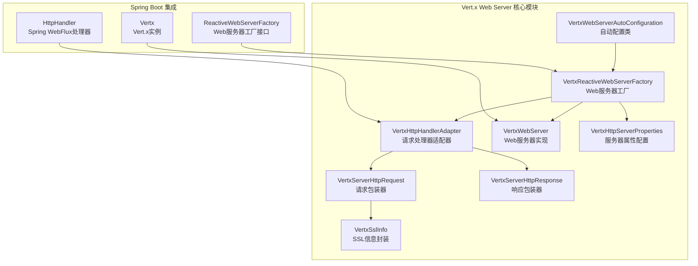
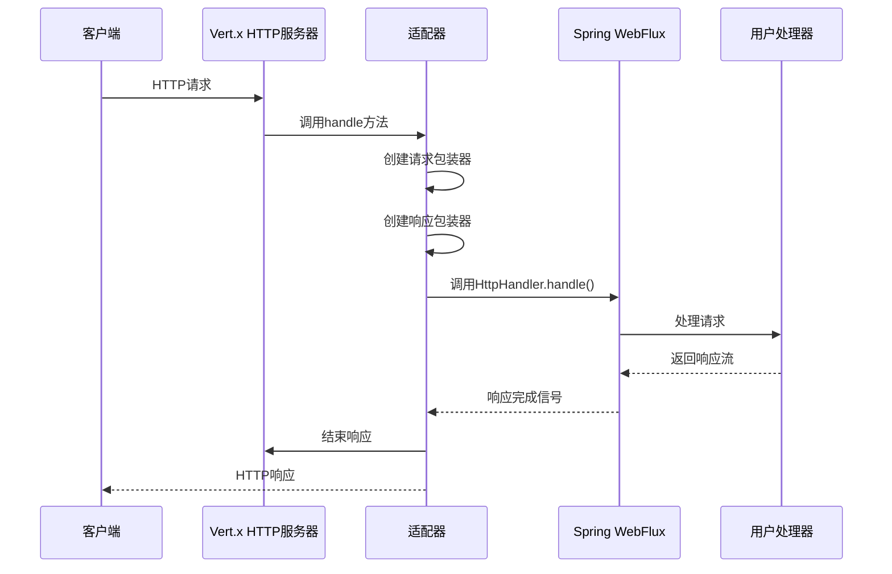
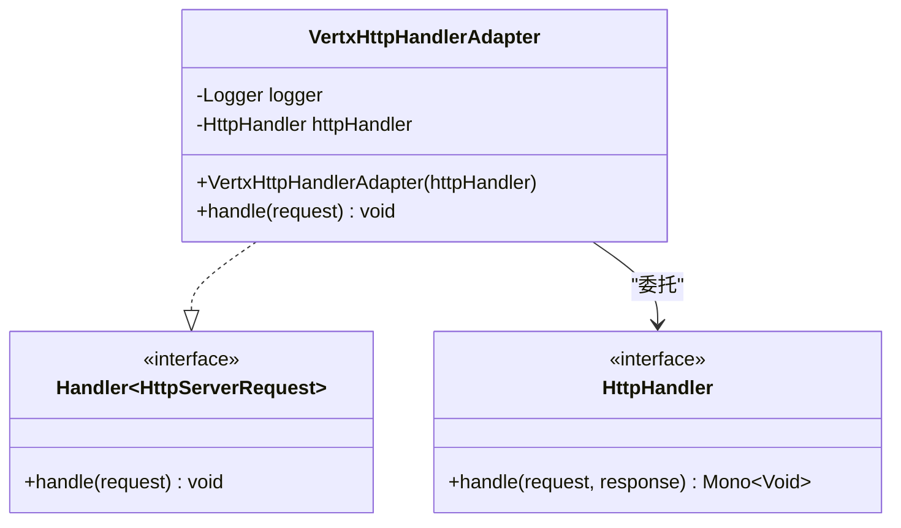
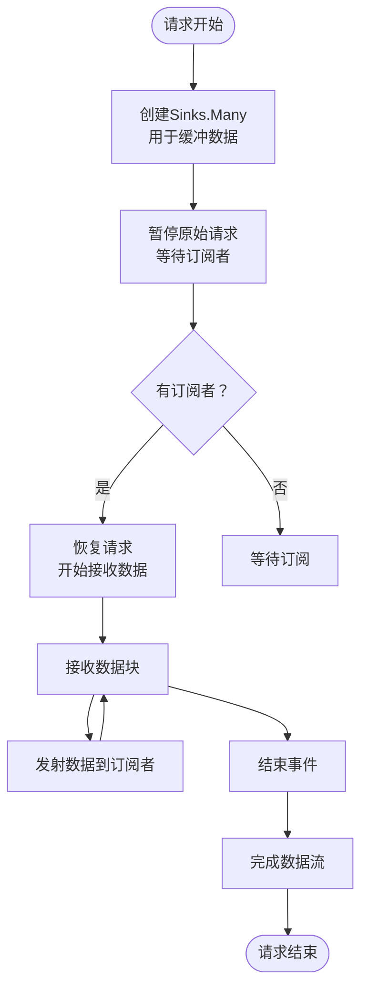
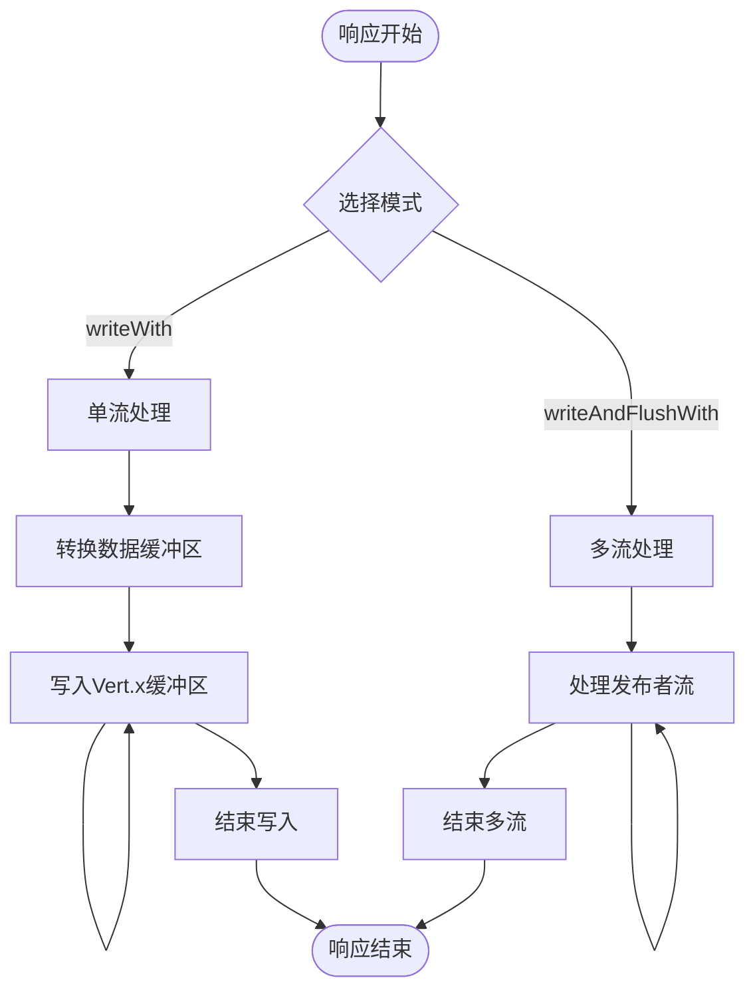
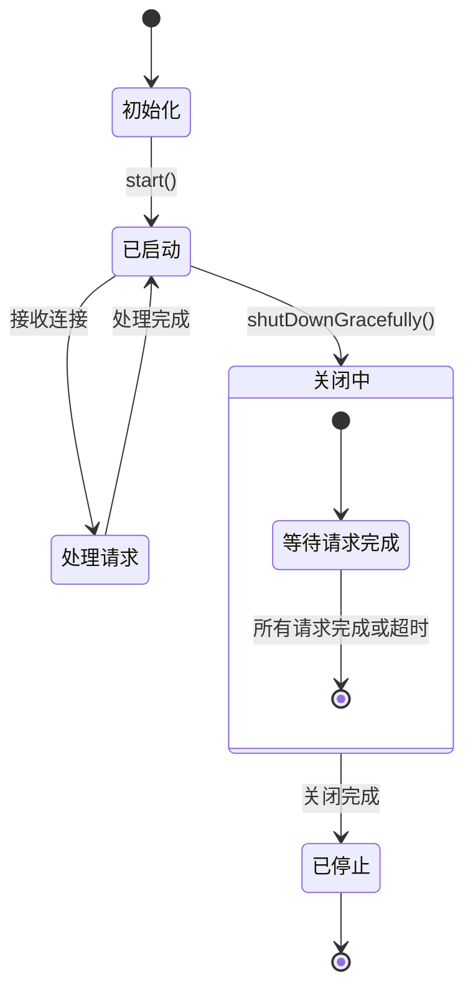
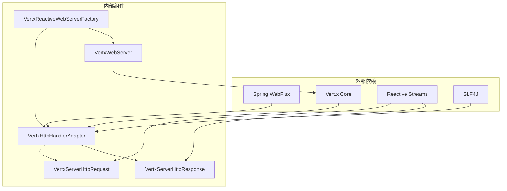

# 请求处理机制

<cite>
**本文档引用的文件**
- [VertxHttpHandlerAdapter.java](file://vertx-spring-boot-web-server/src/main/java/com/workoss/boot/vertx/web/server/VertxHttpHandlerAdapter.java)
- [VertxServerHttpRequest.java](file://vertx-spring-boot-web-server/src/main/java/com/workoss/boot/vertx/web/server/VertxServerHttpRequest.java)
- [VertxServerHttpResponse.java](file://vertx-spring-boot-web-server/src/main/java/com/workoss/boot/vertx/web/server/VertxServerHttpResponse.java)
- [VertxWebServer.java](file://vertx-spring-boot-web-server/src/main/java/com/workoss/boot/vertx/web/server/VertxWebServer.java)
- [VertxReactiveWebServerFactory.java](file://vertx-spring-boot-web-server/src/main/java/com/workoss/boot/vertx/web/server/VertxReactiveWebServerFactory.java)
- [VertxSslInfo.java](file://vertx-spring-boot-web-server/src/main/java/com/workoss/boot/vertx/web/server/VertxSslInfo.java)
- [VertxHttpServerProperties.java](file://vertx-spring-boot-web-server/src/main/java/com/workoss/boot/vertx/web/server/VertxHttpServerProperties.java)
- [VertxWebServerAutoConfiguration.java](file://vertx-spring-boot-web-server/src/main/java/com/workoss/boot/vertx/web/server/VertxWebServerAutoConfiguration.java)
- [VertxWebServerAutoConfigurationTest.java](file://vertx-spring-boot-web-server/src/test/java/com/workoss/boot/vertx/web/server/VertxWebServerAutoConfigurationTest.java)
- [VertxSpringBootExampleApplication.java](file://example/vertx-spring-boot-example/src/main/java/com/workoss/boot/vertx/VertxSpringBootExampleApplication.java)
- [application.yml](file://example/vertx-spring-boot-example/src/main/resources/application.yml)
</cite>

## 目录
1. [简介](#简介)
2. [项目结构](#项目结构)
3. [核心组件](#核心组件)
4. [架构概览](#架构概览)
5. [详细组件分析](#详细组件分析)
6. [依赖关系分析](#依赖关系分析)
7. [性能考虑](#性能考虑)
8. [故障排除指南](#故障排除指南)
9. [结论](#结论)

## 简介

本文档深入解析了Vert.x请求处理机制，重点阐述了如何通过适配器模式将Spring WebFlux的HttpHandler无缝集成到Vert.x的高性能HTTP服务器中。该实现提供了完整的请求解析、响应生成、流式处理和背压机制支持，确保在高并发场景下的稳定性和性能表现。

系统采用分层架构设计，通过适配器模式实现了Spring WebFlux与Vert.x之间的桥梁，既保持了Spring框架的生态优势，又充分发挥了Vert.x的异步非阻塞特性。

## 项目结构

Vert.x请求处理机制的核心代码位于`vertx-spring-boot-web-server`模块中，主要包含以下关键组件：

**图表来源**
- [VertxWebServerAutoConfiguration.java:1-31](file://vertx-spring-boot-web-server/src/main/java/com/workoss/boot/vertx/web/server/VertxWebServerAutoConfiguration.java#L1-L31)
- [VertxReactiveWebServerFactory.java:1-80](file://vertx-spring-boot-web-server/src/main/java/com/workoss/boot/vertx/web/server/VertxReactiveWebServerFactory.java#L1-L80)
- [VertxHttpHandlerAdapter.java:1-45](file://vertx-spring-boot-web-server/src/main/java/com/workoss/boot/vertx/web/server/VertxHttpHandlerAdapter.java#L1-L45)

**章节来源**
- [VertxWebServerAutoConfiguration.java:1-31](file://vertx-spring-boot-web-server/src/main/java/com/workoss/boot/vertx/web/server/VertxWebServerAutoConfiguration.java#L1-L31)
- [VertxReactiveWebServerFactory.java:1-80](file://vertx-spring-boot-web-server/src/main/java/com/workoss/boot/vertx/web/server/VertxReactiveWebServerFactory.java#L1-L80)

## 核心组件

### 适配器模式实现

VertxHttpHandlerAdapter是整个请求处理机制的核心适配器，它实现了Vert.x的Handler接口并桥接了Spring WebFlux的HttpHandler。该适配器采用委托模式，将Vert.x的原生HTTP请求转换为Spring WebFlux可理解的格式，并将处理结果转换回Vert.x的响应格式。

**章节来源**
- [VertxHttpHandlerAdapter.java:1-45](file://vertx-spring-boot-web-server/src/main/java/com/workoss/boot/vertx/web/server/VertxHttpHandlerAdapter.java#L1-L45)

### 请求解析组件

VertxServerHttpRequest负责将Vert.x的原生HTTP请求转换为Spring WebFlux的ServerHttpRequest。该组件实现了完整的HTTP请求解析功能，包括URL构建、头部解析、Cookie处理和SSL信息提取。

**章节来源**
- [VertxServerHttpRequest.java:1-120](file://vertx-spring-boot-web-server/src/main/java/com/workoss/boot/vertx/web/server/VertxServerHttpRequest.java#L1-L120)

### 响应生成组件

VertxServerHttpResponse负责将Spring WebFlux的响应对象转换为Vert.x的HttpServerResponse。该组件支持完整的HTTP响应生成，包括状态码设置、头部处理、Cookie设置和数据流式传输。

**章节来源**
- [VertxServerHttpResponse.java:1-112](file://vertx-spring-boot-web-server/src/main/java/com/workoss/boot/vertx/web/server/VertxServerHttpResponse.java#L1-L112)

## 架构概览

整个请求处理机制采用分层架构设计，通过适配器模式实现了Spring WebFlux与Vert.x之间的无缝集成：

**图表来源**
- [VertxHttpHandlerAdapter.java:24-43](file://vertx-spring-boot-web-server/src/main/java/com/workoss/boot/vertx/web/server/VertxHttpHandlerAdapter.java#L24-L43)
- [VertxServerHttpRequest.java:29-33](file://vertx-spring-boot-web-server/src/main/java/com/workoss/boot/vertx/web/server/VertxServerHttpRequest.java#L29-L33)
- [VertxServerHttpResponse.java:24-27](file://vertx-spring-boot-web-server/src/main/java/com/workoss/boot/vertx/web/server/VertxServerHttpResponse.java#L24-L27)

## 详细组件分析

### VertxHttpHandlerAdapter 适配器分析

#### 类结构设计

**图表来源**
- [VertxHttpHandlerAdapter.java:13-44](file://vertx-spring-boot-web-server/src/main/java/com/workoss/boot/vertx/web/server/VertxHttpHandlerAdapter.java#L13-L44)

#### 处理流程详解

适配器的核心处理流程包括三个关键步骤：

1. **请求包装**：将Vert.x的HttpServerRequest包装为Spring WebFlux的ServerHttpRequest
2. **响应创建**：创建对应的ServerHttpResponse实例
3. **异步处理**：调用Spring WebFlux处理器并处理结果

#### 错误处理策略

适配器实现了完善的错误处理机制：
- 记录详细的错误日志
- 设置适当的HTTP状态码（500）
- 确保响应正确结束

**章节来源**
- [VertxHttpHandlerAdapter.java:24-43](file://vertx-spring-boot-web-server/src/main/java/com/workoss/boot/vertx/web/server/VertxHttpHandlerAdapter.java#L24-L43)

### VertxServerHttpRequest 请求解析分析

#### 流式请求体处理

该组件实现了基于Reactive Streams的流式请求体处理，支持背压机制：

**图表来源**
- [VertxServerHttpRequest.java:52-71](file://vertx-spring-boot-web-server/src/main/java/com/workoss/boot/vertx/web/server/VertxServerHttpRequest.java#L52-L71)

#### 背压机制实现

组件通过以下机制实现背压：
- 初始暂停：避免数据过载
- 订阅时恢复：只有当有订阅者时才开始接收数据
- 取消时暂停：订阅取消时暂停数据接收
- 缓冲队列：使用Sinks.many().unicast().onBackpressureBuffer()

**章节来源**
- [VertxServerHttpRequest.java:52-71](file://vertx-spring-boot-web-server/src/main/java/com/workoss/boot/vertx/web/server/VertxServerHttpRequest.java#L52-L71)

### VertxServerHttpResponse 响应生成分析

#### 流式响应处理

响应组件支持两种流式处理模式：

1. **writeWith模式**：单流响应
2. **writeAndFlushWith模式**：多流响应（分片）

**图表来源**
- [VertxServerHttpResponse.java:87-106](file://vertx-spring-boot-web-server/src/main/java/com/workoss/boot/vertx/web/server/VertxServerHttpResponse.java#L87-L106)

#### Cookie处理机制

组件实现了完整的Cookie处理功能，支持所有标准Cookie属性：
- Max-Age：生命周期控制
- Domain：域名限制
- Path：路径限制
- Secure：安全标志
- HttpOnly：HTTP访问限制
- SameSite：跨站策略

**章节来源**
- [VertxServerHttpResponse.java:62-84](file://vertx-spring-boot-web-server/src/main/java/com/workoss/boot/vertx/web/server/VertxServerHttpResponse.java#L62-L84)

### VertxWebServer 服务器实现分析

#### 生命周期管理

服务器实现了完整的生命周期管理：
- 启动：创建HTTP服务器并绑定处理器
- 运行：监听端口接受连接
- 关闭：优雅关闭服务器
- 停止：强制停止服务器

**图表来源**
- [VertxWebServer.java:35-108](file://vertx-spring-boot-web-server/src/main/java/com/workoss/boot/vertx/web/server/VertxWebServer.java#L35-L108)

#### 优雅关闭机制

服务器支持优雅关闭，确保在关闭过程中：
- 接受新的请求但不接受新连接
- 等待现有请求完成处理
- 超时后强制关闭
- 提供关闭完成回调

**章节来源**
- [VertxWebServer.java:90-108](file://vertx-spring-boot-web-server/src/main/java/com/workoss/boot/vertx/web/server/VertxWebServer.java#L90-L108)

## 依赖关系分析

### 组件依赖关系

**图表来源**
- [VertxHttpHandlerAdapter.java:3-7](file://vertx-spring-boot-web-server/src/main/java/com/workoss/boot/vertx/web/server/VertxHttpHandlerAdapter.java#L3-L7)
- [VertxServerHttpRequest.java:3-16](file://vertx-spring-boot-web-server/src/main/java/com/workoss/boot/vertx/web/server/VertxServerHttpRequest.java#L3-L16)
- [VertxServerHttpResponse.java:3-13](file://vertx-spring-boot-web-server/src/main/java/com/workoss/boot/vertx/web/server/VertxServerHttpResponse.java#L3-L13)

### 配置依赖关系

服务器配置通过多种方式集成：
- Spring Boot标准属性：server.port, server.address等
- Vert.x特定属性：vertx.http-server.*前缀
- 自动配置：条件注解确保正确的组件装配

**章节来源**
- [VertxReactiveWebServerFactory.java:43-78](file://vertx-spring-boot-web-server/src/main/java/com/workoss/boot/vertx/web/server/VertxReactiveWebServerFactory.java#L43-L78)
- [VertxWebServerAutoConfiguration.java:17-30](file://vertx-spring-boot-web-server/src/main/java/com/workoss/boot/vertx/web/server/VertxWebServerAutoConfiguration.java#L17-L30)

## 性能考虑

### 背压处理优化

系统通过以下机制优化背压处理：
- 懒加载数据流：只有在订阅时才开始接收数据
- 缓冲队列：使用Sinks.many().unicast().onBackpressureBuffer()实现背压
- 流量控制：根据订阅者的消费速度调整数据发送速率

### 内存管理

组件实现了高效的内存管理策略：
- 数据缓冲区复用：使用DefaultDataBufferFactory进行缓冲区管理
- 及时释放：在数据处理完成后及时释放缓冲区
- 异步处理：避免阻塞操作影响整体性能

### 并发处理

系统支持高并发请求处理：
- 非阻塞I/O：基于Vert.x的异步非阻塞模型
- 线程池优化：利用Vert.x的事件循环机制
- 连接复用：支持HTTP/1.1 keep-alive连接

## 故障排除指南

### 常见问题诊断

#### 请求处理异常

当出现请求处理异常时，系统会：
1. 记录详细的错误日志
2. 设置HTTP 500状态码
3. 确保响应正确结束
4. 继续处理后续请求

**章节来源**
- [VertxHttpHandlerAdapter.java:34-42](file://vertx-spring-boot-web-server/src/main/java/com/workoss/boot/vertx/web/server/VertxHttpHandlerAdapter.java#L34-L42)

#### SSL连接问题

SSL相关的常见问题：
- 证书验证失败
- 协议版本不兼容
- 加密套件配置错误

解决方案：
- 检查SSL配置参数
- 验证证书链完整性
- 确认客户端支持的协议版本

### 性能监控

建议关注以下性能指标：
- 请求处理延迟
- 内存使用情况
- 连接池利用率
- 错误率统计

**章节来源**
- [VertxWebServerAutoConfigurationTest.java:52-67](file://vertx-spring-boot-web-server/src/test/java/com/workoss/boot/vertx/web/server/VertxWebServerAutoConfigurationTest.java#L52-L67)

## 结论

Vert.x请求处理机制通过精心设计的适配器模式，成功地将Spring WebFlux的响应式编程模型与Vert.x的高性能异步I/O能力相结合。该实现具有以下显著优势：

1. **架构清晰**：采用分层设计，职责分离明确
2. **性能优异**：充分利用Vert.x的异步非阻塞特性
3. **兼容性强**：完全兼容Spring WebFlux生态系统
4. **扩展性好**：支持灵活的配置和自定义
5. **稳定性高**：完善的错误处理和优雅关闭机制

该实现为构建高性能的响应式Web应用提供了坚实的基础，特别适合需要处理大量并发请求的微服务架构。