# 分布式功能实现

<cite>
**本文档引用的文件**
- [ZenohLock.java](file://vertx-spring-boot-cluster-zenoh/src/main/java/com/workoss/boot/vertx/cluster/zenoh/ZenohLock.java)
- [ZenohCounter.java](file://vertx-spring-boot-cluster-zenoh/src/main/java/com/workoss/boot/vertx/cluster/zenoh/ZenohCounter.java)
- [ZenohAsyncMap.java](file://vertx-spring-boot-cluster-zenoh/src/main/java/com/workoss/boot/vertx/cluster/zenoh/ZenohAsyncMap.java)
- [KeyPrefixStrategy.java](file://vertx-spring-boot-cluster-zenoh/src/main/java/com/workoss/boot/vertx/cluster/zenoh/KeyPrefixStrategy.java)
- [ZenohClusterManager.java](file://vertx-spring-boot-cluster-zenoh/src/main/java/com/workoss/boot/vertx/cluster/zenoh/ZenohClusterManager.java)
- [ZenohClusterAutoConfiguration.java](file://vertx-spring-boot-cluster-zenoh/src/main/java/com/workoss/boot/vertx/cluster/zenoh/ZenohClusterAutoConfiguration.java)
- [ZenohClusterProperties.java](file://vertx-spring-boot-cluster-zenoh/src/main/java/com/workoss/boot/vertx/cluster/zenoh/ZenohClusterProperties.java)
- [pom.xml](file://pom.xml)
- [application.yml](file://example/vertx-spring-boot-example/src/main/resources/application.yml)
</cite>

## 目录
1. [简介](#简介)
2. [项目结构](#项目结构)
3. [核心组件](#核心组件)
4. [架构概览](#架构概览)
5. [详细组件分析](#详细组件分析)
6. [依赖关系分析](#依赖关系分析)
7. [性能考虑](#性能考虑)
8. [故障处理指南](#故障处理指南)
9. [结论](#结论)
10. [附录](#附录)

## 简介

本项目实现了基于Zenoh的Vert.x分布式功能，提供了完整的集群管理、分布式锁、分布式计数器和分布式映射等核心能力。该实现采用多租户隔离策略，通过KeyPrefixStrategy确保不同应用和环境之间的数据完全隔离，同时支持节点发现、注册管理等集群管理功能。

系统基于Spring Boot自动配置机制，通过条件注解实现按需启用，配置简单且易于集成到现有Vert.x应用中。

## 项目结构

项目采用模块化设计，主要包含以下核心模块：

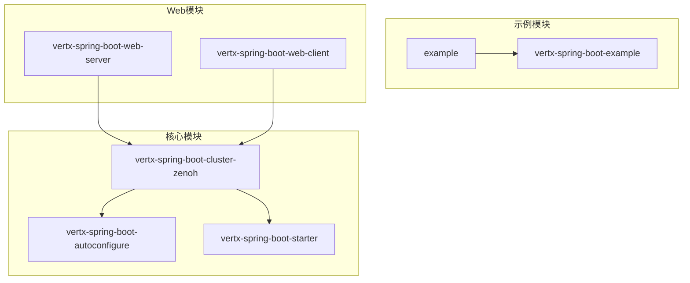

**图表来源**
- [pom.xml:15-22](file://pom.xml#L15-L22)

**章节来源**
- [pom.xml:15-22](file://pom.xml#L15-L22)

## 核心组件

### 分布式锁实现 (ZenohLock)

ZenohLock实现了Vert.x的Lock接口，采用"先写者获胜"的分布式锁机制：

- **锁获取机制**: 通过putIfAbsent操作在指定键上放置节点标识符
- **锁释放机制**: 删除锁键实现自动释放
- **超时处理**: 通过生命周期令牌实现崩溃自动释放

### 分布式计数器实现 (ZenohCounter)

ZenohCounter实现了Vert.x的Counter接口，提供原子操作能力：

- **本地缓存**: 使用AtomicLong提供本地快速访问
- **CAS重试**: 原子操作通过比较交换机制保证一致性
- **分布式同步**: 完整实现需要与Zenoh后端进行同步

### 分布式映射实现 (ZenohAsyncMap)

ZenohAsyncMap实现了Vert.x的AsyncMap接口，提供键值存储功能：

- **本地缓存**: ConcurrentHashMap提供高性能本地访问
- **TTL支持**: 支持键值对过期时间设置
- **冲突解决**: 通过版本控制和时间戳解决并发冲突

### 多租户隔离策略 (KeyPrefixStrategy)

KeyPrefixStrategy提供完整的多租户隔离机制：

- **命名空间管理**: 通过应用名和环境名构建唯一前缀
- **数据分区**: 不同应用和环境的数据完全隔离
- **安全隔离**: 防止跨应用数据访问

**章节来源**
- [ZenohLock.java:6-13](file://vertx-spring-boot-cluster-zenoh/src/main/java/com/workoss/boot/vertx/cluster/zenoh/ZenohLock.java#L6-L13)
- [ZenohCounter.java:8-12](file://vertx-spring-boot-cluster-zenoh/src/main/java/com/workoss/boot/vertx/cluster/zenoh/ZenohCounter.java#L8-L12)
- [ZenohAsyncMap.java:11-14](file://vertx-spring-boot-cluster-zenoh/src/main/java/com/workoss/boot/vertx/cluster/zenoh/ZenohAsyncMap.java#L11-L14)
- [KeyPrefixStrategy.java:3-7](file://vertx-spring-boot-cluster-zenoh/src/main/java/com/workoss/boot/vertx/cluster/zenoh/KeyPrefixStrategy.java#L3-L7)

## 架构概览

系统采用分层架构设计，从下到上分别为：

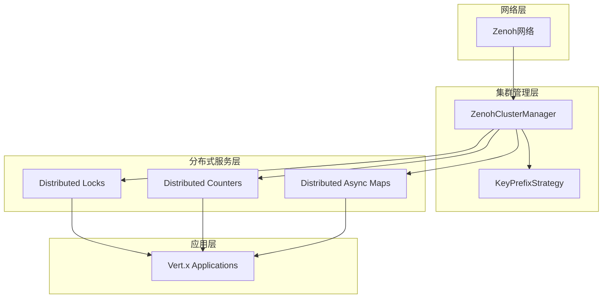

**图表来源**
- [ZenohClusterManager.java:29](file://vertx-spring-boot-cluster-zenoh/src/main/java/com/workoss/boot/vertx/cluster/zenoh/ZenohClusterManager.java#L29)
- [KeyPrefixStrategy.java:8](file://vertx-spring-boot-cluster-zenoh/src/main/java/com/workoss/boot/vertx/cluster/zenoh/KeyPrefixStrategy.java#L8)

### 组件交互流程

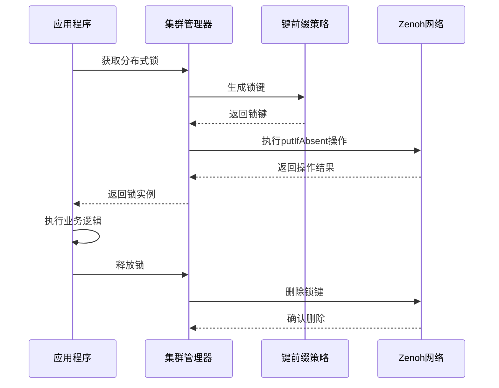

**图表来源**
- [ZenohClusterManager.java:70-72](file://vertx-spring-boot-cluster-zenoh/src/main/java/com/workoss/boot/vertx/cluster/zenoh/ZenohClusterManager.java#L70-L72)
- [ZenohLock.java:27-37](file://vertx-spring-boot-cluster-zenoh/src/main/java/com/workoss/boot/vertx/cluster/zenoh/ZenohLock.java#L27-L37)

## 详细组件分析

### 分布式锁组件分析

#### 类结构设计

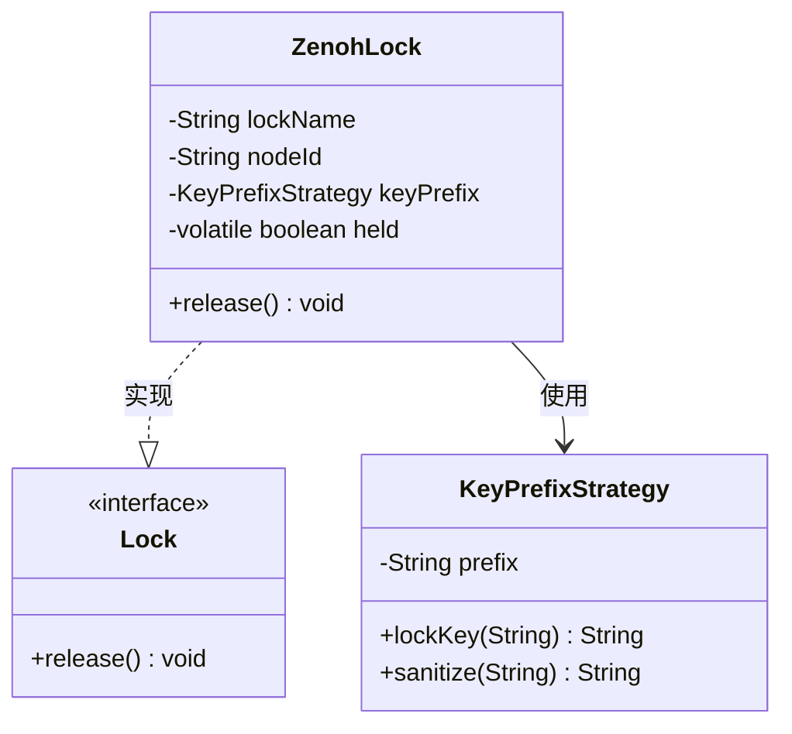

**图表来源**
- [ZenohLock.java:14](file://vertx-spring-boot-cluster-zenoh/src/main/java/com/workoss/boot/vertx/cluster/zenoh/ZenohLock.java#L14)
- [KeyPrefixStrategy.java:8](file://vertx-spring-boot-cluster-zenoh/src/main/java/com/workoss/boot/vertx/cluster/zenoh/KeyPrefixStrategy.java#L8)

#### 锁获取流程

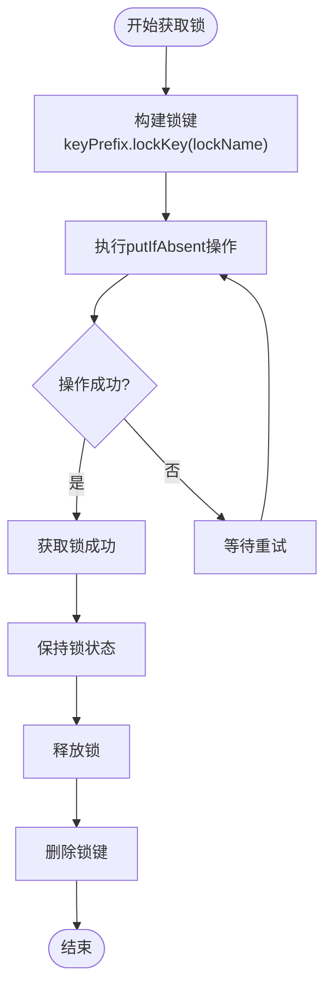

**图表来源**
- [ZenohLock.java:27-37](file://vertx-spring-boot-cluster-zenoh/src/main/java/com/workoss/boot/vertx/cluster/zenoh/ZenohLock.java#L27-L37)

**章节来源**
- [ZenohLock.java:14-38](file://vertx-spring-boot-cluster-zenoh/src/main/java/com/workoss/boot/vertx/cluster/zenoh/ZenohLock.java#L14-L38)

### 分布式计数器组件分析

#### 类结构设计

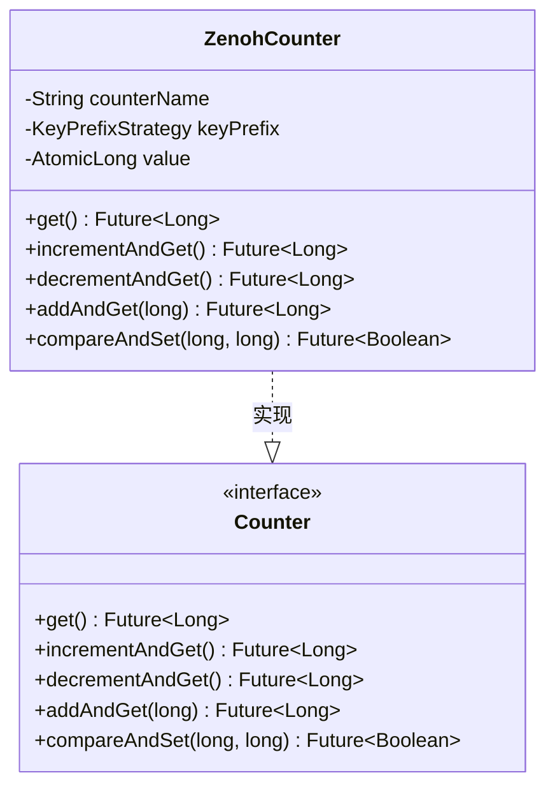

**图表来源**
- [ZenohCounter.java:13](file://vertx-spring-boot-cluster-zenoh/src/main/java/com/workoss/boot/vertx/cluster/zenoh/ZenohCounter.java#L13)

#### 计数器操作流程

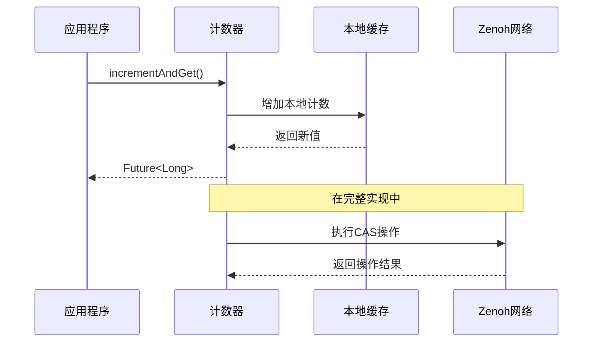

**图表来源**
- [ZenohCounter.java:32-34](file://vertx-spring-boot-cluster-zenoh/src/main/java/com/workoss/boot/vertx/cluster/zenoh/ZenohCounter.java#L32-L34)

**章节来源**
- [ZenohCounter.java:13-60](file://vertx-spring-boot-cluster-zenoh/src/main/java/com/workoss/boot/vertx/cluster/zenoh/ZenohCounter.java#L13-L60)

### 分布式映射组件分析

#### 类结构设计

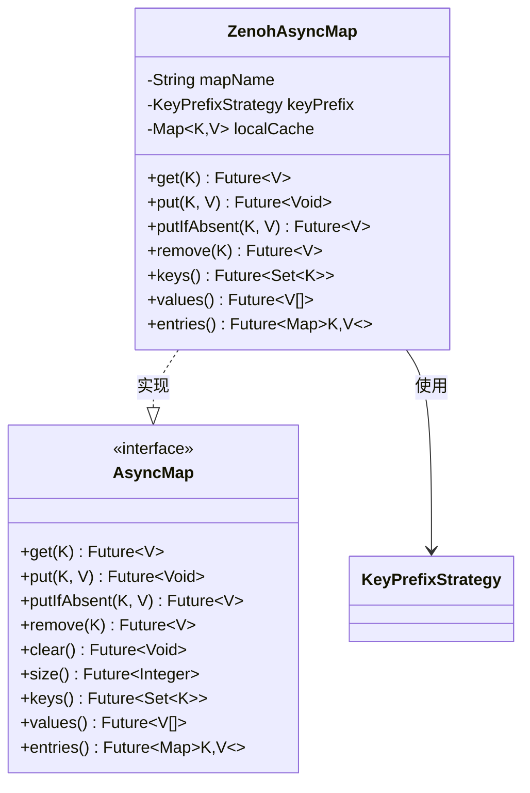

**图表来源**
- [ZenohAsyncMap.java:15](file://vertx-spring-boot-cluster-zenoh/src/main/java/com/workoss/boot/vertx/cluster/zenoh/ZenohAsyncMap.java#L15)

#### 映射操作流程

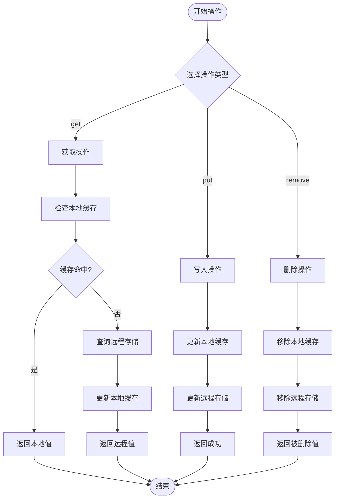

**图表来源**
- [ZenohAsyncMap.java:28-38](file://vertx-spring-boot-cluster-zenoh/src/main/java/com/workoss/boot/vertx/cluster/zenoh/ZenohAsyncMap.java#L28-L38)

**章节来源**
- [ZenohAsyncMap.java:15-109](file://vertx-spring-boot-cluster-zenoh/src/main/java/com/workoss/boot/vertx/cluster/zenoh/ZenohAsyncMap.java#L15-L109)

### 多租户隔离策略分析

#### 键前缀策略设计

```mermaid
classDiagram
class KeyPrefixStrategy {
-String prefix
+KeyPrefixStrategy(String, String)
+nodeKey(String) String
+nodeInfoKey(String) String
+mapKey(String, String) String
+counterKey(String) String
+lockKey(String) String
+registrationKey(String, String) String
+sanitize(String) String
}
class KeyPatterns {
<<pattern>>
"vertx/{app}/{env}/cluster/nodes/{nodeId}"
"vertx/{app}/{env}/cluster/nodeinfo/{nodeId}"
"vertx/{app}/{env}/cluster/maps/{mapName}/{key}"
"vertx/{app}/{env}/cluster/counters/{counterName}"
"vertx/{app}/{env}/cluster/locks/{lockName}"
"vertx/{app}/{env}/cluster/registrations/{address}/{nodeId}"
}
KeyPrefixStrategy --> KeyPatterns : 生成
```

**图表来源**
- [KeyPrefixStrategy.java:8](file://vertx-spring-boot-cluster-zenoh/src/main/java/com/workoss/boot/vertx/cluster/zenoh/KeyPrefixStrategy.java#L8)

#### 隔离机制实现

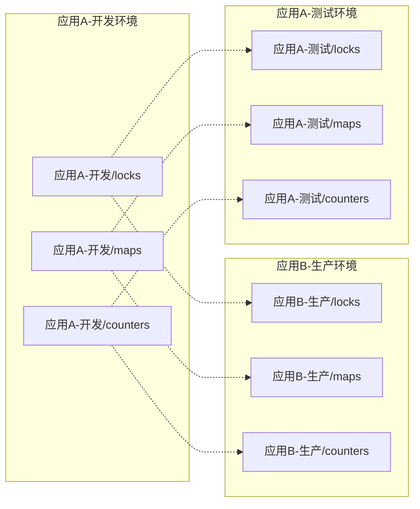

**图表来源**
- [KeyPrefixStrategy.java:12-14](file://vertx-spring-boot-cluster-zenoh/src/main/java/com/workoss/boot/vertx/cluster/zenoh/KeyPrefixStrategy.java#L12-L14)

**章节来源**
- [KeyPrefixStrategy.java:8-100](file://vertx-spring-boot-cluster-zenoh/src/main/java/com/workoss/boot/vertx/cluster/zenoh/KeyPrefixStrategy.java#L8-L100)

## 依赖关系分析

### Maven依赖关系

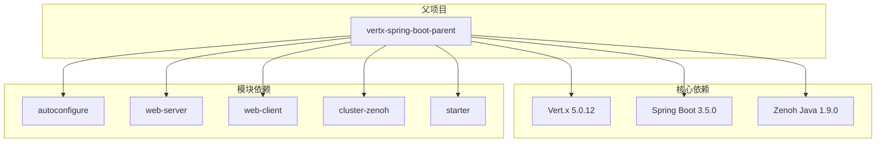

**图表来源**
- [pom.xml:35-107](file://pom.xml#L35-L107)

### Spring Boot自动配置

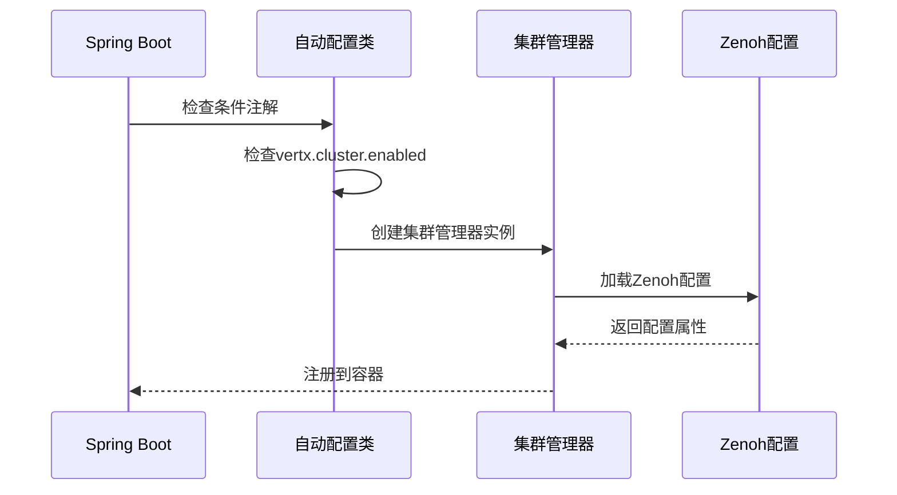

**图表来源**
- [ZenohClusterAutoConfiguration.java:15-25](file://vertx-spring-boot-cluster-zenoh/src/main/java/com/workoss/boot/vertx/cluster/zenoh/ZenohClusterAutoConfiguration.java#L15-L25)

**章节来源**
- [pom.xml:35-107](file://pom.xml#L35-L107)
- [ZenohClusterAutoConfiguration.java:15-25](file://vertx-spring-boot-cluster-zenoh/src/main/java/com/workoss/boot/vertx/cluster/zenoh/ZenohClusterAutoConfiguration.java#L15-L25)

## 性能考虑

### 缓存策略

系统采用了多层次缓存策略来优化性能：

1. **本地缓存**: 使用ConcurrentHashMap提供高并发访问
2. **TTL机制**: 支持键值对过期时间，避免缓存污染
3. **懒加载**: 远程数据按需加载到本地缓存

### 并发控制

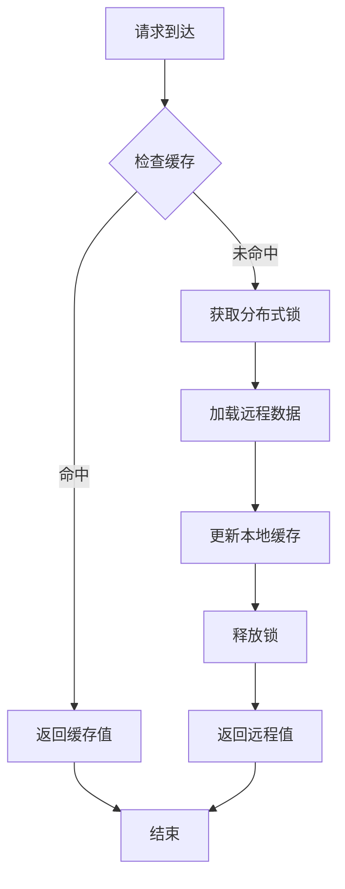

### 性能优化建议

1. **合理设置TTL**: 根据业务特点设置合适的过期时间
2. **批量操作**: 对于大量数据操作，考虑批量处理减少网络往返
3. **连接池管理**: 合理管理Zenoh会话连接，避免资源泄漏
4. **监控指标**: 建立完善的性能监控体系

## 故障处理指南

### 常见故障类型

#### 连接故障
- **症状**: 节点无法加入集群，操作超时
- **原因**: Zenoh网络连接失败
- **解决方案**: 检查网络配置，验证连接端点可达性

#### 数据不一致
- **症状**: 不同节点看到不同的数据值
- **原因**: 网络分区或延迟导致的不一致
- **解决方案**: 实施适当的重试机制和冲突解决策略

#### 锁竞争
- **症状**: 锁获取频繁失败，性能下降
- **原因**: 高并发场景下的锁竞争
- **解决方案**: 优化业务逻辑，减少锁持有时间

### 故障恢复流程

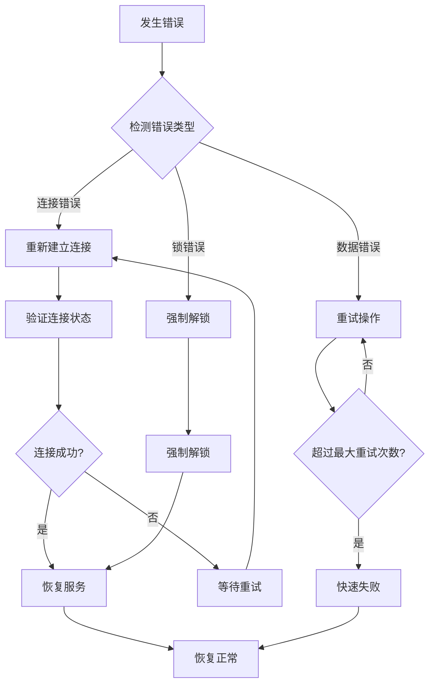

**章节来源**
- [ZenohClusterManager.java:136-139](file://vertx-spring-boot-cluster-zenoh/src/main/java/com/workoss/boot/vertx/cluster/zenoh/ZenohClusterManager.java#L136-L139)

## 结论

本项目成功实现了基于Zenoh的Vert.x分布式功能，提供了完整的集群管理、分布式锁、分布式计数器和分布式映射等核心能力。通过KeyPrefixStrategy实现了严格的多租户隔离，确保了不同应用和环境之间的数据安全。

系统的主要优势包括：
- **模块化设计**: 清晰的组件分离和职责划分
- **多租户隔离**: 完善的命名空间管理和数据分区
- **性能优化**: 多层次缓存和并发控制机制
- **易于集成**: 基于Spring Boot的自动配置机制

未来可以进一步完善的功能包括：
- 实现完整的Zenoh后端集成
- 添加更丰富的监控和诊断功能
- 优化大规模集群的性能表现

## 附录

### 配置参考

#### 应用配置示例

```yaml
vertx:
  cluster:
    enabled: true
    prefer-native-transport: false
  prefer-native-transport: false
```

#### Zenoh配置属性

| 属性名 | 类型 | 默认值 | 描述 |
|--------|------|--------|------|
| appName | String | default | 应用名称，用于多租户隔离 |
| environment | String | default | 环境标签，如dev、staging、prod |
| mode | String | peer | Zenoh会话模式（peer/client/router） |
| connect | List<String> | [] | 连接端点列表 |
| listen | List<String> | [] | 监听端点列表 |
| configFile | String | null | Zenoh配置文件路径 |

### 使用示例

#### 分布式锁使用示例

```java
// 获取分布式锁
Lock lock = vertx.eventBus().getLock("my-lock");

try {
    // 执行临界区代码
    performCriticalOperation();
} finally {
    // 释放锁
    lock.release();
}
```

#### 分布式计数器使用示例

```java
// 获取计数器
Counter counter = vertx.sharedData().getCounter("my-counter");

// 原子递增
long newValue = counter.incrementAndGet().result();

// 原子递减
long newValue = counter.decrementAndGet().result();

// 原子添加
long newValue = counter.addAndGet(10).result();
```

#### 分布式映射使用示例

```java
// 获取异步映射
AsyncMap<String, String> map = vertx.sharedData().getAsyncMap("my-map");

// 写入操作
map.put("key", "value");

// 读取操作
String value = map.get("key").result();

// 条件写入
map.putIfAbsent("key", "value");

// 删除操作
map.remove("key");
```

**章节来源**
- [application.yml:16-20](file://example/vertx-spring-boot-example/src/main/resources/application.yml#L16-L20)
- [ZenohClusterProperties.java:14-42](file://vertx-spring-boot-cluster-zenoh/src/main/java/com/workoss/boot/vertx/cluster/zenoh/ZenohClusterProperties.java#L14-L42)