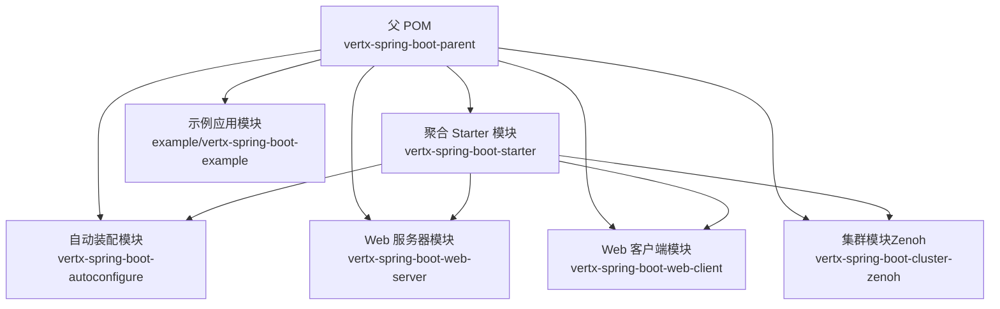
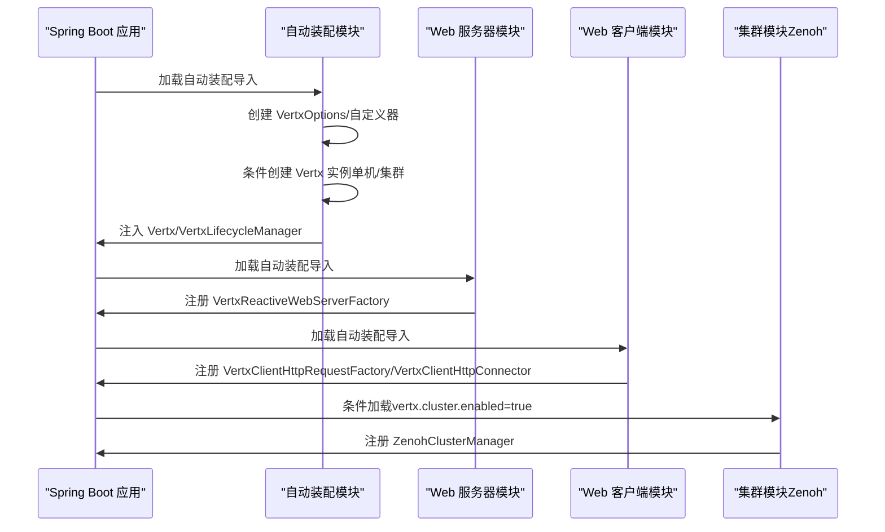
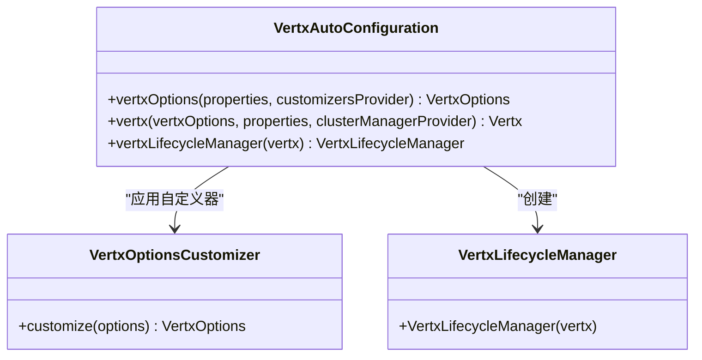
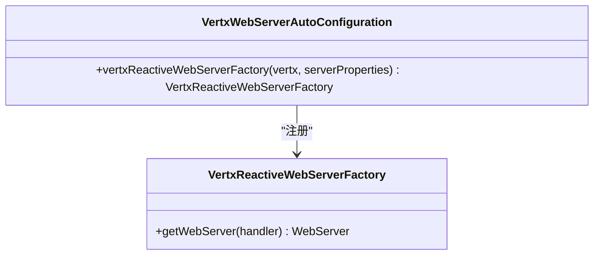
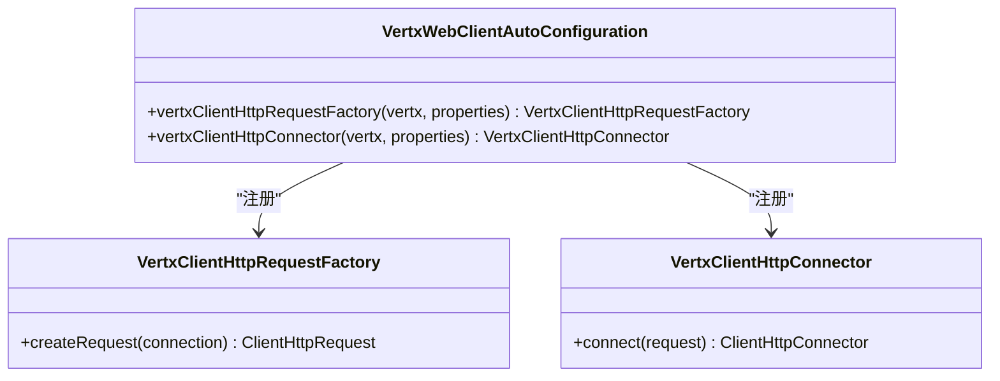
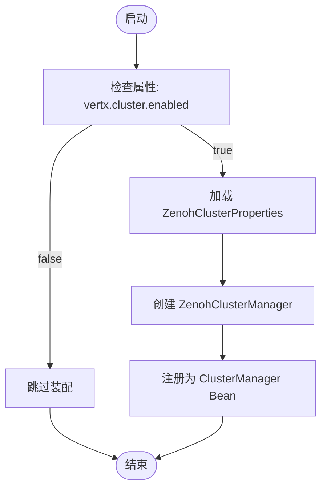
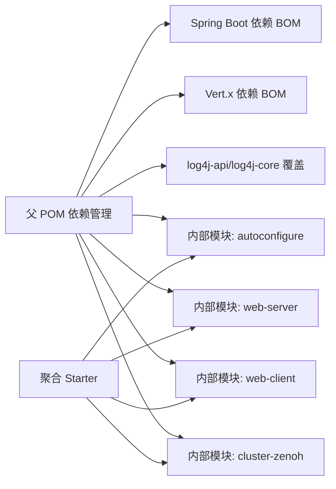

# 开发者指南

<cite>
**本文引用的文件**
- [pom.xml](file://pom.xml)
- [example/pom.xml](file://example/pom.xml)
- [vertx-spring-boot-starter/pom.xml](file://vertx-spring-boot-starter/pom.xml)
- [vertx-spring-boot-autoconfigure/pom.xml](file://vertx-spring-boot-autoconfigure/pom.xml)
- [vertx-spring-boot-web-server/pom.xml](file://vertx-spring-boot-web-server/pom.xml)
- [vertx-spring-boot-web-client/pom.xml](file://vertx-spring-boot-web-client/pom.xml)
- [vertx-spring-boot-cluster-zenoh/pom.xml](file://vertx-spring-boot-cluster-zenoh/pom.xml)
- [VertxAutoConfiguration.java](file://vertx-spring-boot-autoconfigure/src/main/java/com/workoss/boot/vertx/autoconfigure/VertxAutoConfiguration.java)
- [VertxWebServerAutoConfiguration.java](file://vertx-spring-boot-web-server/src/main/java/com/workoss/boot/vertx/web/server/VertxWebServerAutoConfiguration.java)
- [VertxWebClientAutoConfiguration.java](file://vertx-spring-boot-web-client/src/main/java/com/workoss/boot/vertx/web/client/VertxWebClientAutoConfiguration.java)
- [ZenohClusterAutoConfiguration.java](file://vertx-spring-boot-cluster-zenoh/src/main/java/com/workoss/boot/vertx/cluster/zenoh/ZenohClusterAutoConfiguration.java)
- [org.springframework.boot.autoconfigure.AutoConfiguration.imports（autoconfigure）](file://vertx-spring-boot-autoconfigure/src/main/resources/META-INF/spring/org.springframework.boot.autoconfigure.AutoConfiguration.imports)
- [org.springframework.boot.autoconfigure.AutoConfiguration.imports（web-server）](file://vertx-spring-boot-web-server/src/main/resources/META-INF/spring/org.springframework.boot.autoconfigure.AutoConfiguration.imports)
- [application.yml（示例应用）](file://example/vertx-spring-boot-example/src/main/resources/application.yml)
- [VertxAutoConfigurationTest.java](file://vertx-spring-boot-autoconfigure/src/test/java/com/workoss/boot/vertx/autoconfigure/VertxAutoConfigurationTest.java)
</cite>

## 目录
1. [简介](#简介)
2. [项目结构](#项目结构)
3. [核心组件](#核心组件)
4. [架构总览](#架构总览)
5. [详细组件分析](#详细组件分析)
6. [依赖分析](#依赖分析)
7. [性能考虑](#性能考虑)
8. [故障排查指南](#故障排查指南)
9. [结论](#结论)
10. [附录](#附录)

## 简介
本指南面向希望参与 Vert.x Spring Boot Starter 项目的开发者与维护者，覆盖开发环境准备、IDE 配置、Maven 构建与模块结构、测试策略、贡献流程、发布与版本管理、调试技巧、代码风格与最佳实践，以及新贡献者的入门路径。项目采用多模块 Maven 结构，核心围绕 Spring Boot 自动装配与 Vert.x 5 的集成，提供 Web 服务器、Web 客户端与基于 Zenoh 的集群管理能力。

## 项目结构
项目采用父子 POM 的多模块组织方式，父 POM 统一管理版本、依赖与插件；各子模块按功能拆分：自动装配、Web 服务器、Web 客户端、集群（Zenoh）、聚合 Starter，以及示例应用。

图表来源
- [pom.xml:15-22](file://pom.xml#L15-L22)
- [example/pom.xml:15-17](file://example/pom.xml#L15-L17)
- [vertx-spring-boot-starter/pom.xml:17-37](file://vertx-spring-boot-starter/pom.xml#L17-L37)

章节来源
- [pom.xml:1-139](file://pom.xml#L1-L139)
- [example/pom.xml:1-19](file://example/pom.xml#L1-L19)

## 核心组件
- 自动装配模块：负责 Vert.x 实例生命周期、选项定制、集群管理装配。
- Web 服务器模块：以 Vert.x HttpServer 替换默认 Netty，作为 Reactive Web Server 工厂。
- Web 客户端模块：提供基于 Vert.x HttpClient 的 RestTemplate 与 WebClient 支持。
- 集群模块（Zenoh）：提供基于 Zenoh 的 ClusterManager，支持多租户隔离与集群化。
- 聚合 Starter：统一引入上述模块，便于在 Spring Boot 应用中一键启用 Vert.x 生态。
- 示例应用：演示如何在实际应用中使用 Starter 并进行基础配置。

章节来源
- [vertx-spring-boot-autoconfigure/pom.xml:1-52](file://vertx-spring-boot-autoconfigure/pom.xml#L1-L52)
- [vertx-spring-boot-web-server/pom.xml:1-70](file://vertx-spring-boot-web-server/pom.xml#L1-L70)
- [vertx-spring-boot-web-client/pom.xml:1-57](file://vertx-spring-boot-web-client/pom.xml#L1-L57)
- [vertx-spring-boot-cluster-zenoh/pom.xml:1-57](file://vertx-spring-boot-cluster-zenoh/pom.xml#L1-L57)
- [vertx-spring-boot-starter/pom.xml:1-51](file://vertx-spring-boot-starter/pom.xml#L1-L51)

## 架构总览
下图展示了从 Spring Boot 启动到 Vert.x 实例创建、Web 服务器工厂装配、客户端适配器注册，以及可选集群管理装配的整体流程。

图表来源
- [org.springframework.boot.autoconfigure.AutoConfiguration.imports（autoconfigure）:1-3](file://vertx-spring-boot-autoconfigure/src/main/resources/META-INF/spring/org.springframework.boot.autoconfigure.AutoConfiguration.imports#L1-L3)
- [org.springframework.boot.autoconfigure.AutoConfiguration.imports（web-server）:1-2](file://vertx-spring-boot-web-server/src/main/resources/META-INF/spring/org.springframework.boot.autoconfigure.AutoConfiguration.imports#L1-L2)
- [VertxAutoConfiguration.java:24-82](file://vertx-spring-boot-autoconfigure/src/main/java/com/workoss/boot/vertx/autoconfigure/VertxAutoConfiguration.java#L24-L82)
- [VertxWebServerAutoConfiguration.java:22-29](file://vertx-spring-boot-web-server/src/main/java/com/workoss/boot/vertx/web/server/VertxWebServerAutoConfiguration.java#L22-L29)
- [VertxWebClientAutoConfiguration.java:19-37](file://vertx-spring-boot-web-client/src/main/java/com/workoss/boot/vertx/web/client/VertxWebClientAutoConfiguration.java#L19-L37)
- [ZenohClusterAutoConfiguration.java:15-26](file://vertx-spring-boot-cluster-zenoh/src/main/java/com/workoss/boot/vertx/cluster/zenoh/ZenohClusterAutoConfiguration.java#L15-L26)

## 详细组件分析

### 自动装配模块（Vert.x 核心）
该模块负责：
- 基于属性与自定义器创建 VertxOptions；
- 在集群开关开启时注入 ClusterManager 并创建集群化 Vert.x；
- 提供 VertxLifecycleManager 管理生命周期。

图表来源
- [VertxAutoConfiguration.java:24-82](file://vertx-spring-boot-autoconfigure/src/main/java/com/workoss/boot/vertx/autoconfigure/VertxAutoConfiguration.java#L24-L82)

章节来源
- [VertxAutoConfiguration.java:1-83](file://vertx-spring-boot-autoconfigure/src/main/java/com/workoss/boot/vertx/autoconfigure/VertxAutoConfiguration.java#L1-L83)

### Web 服务器模块（Reactive Web Server Factory）
该模块在响应式 Web 应用场景下，提供基于 Vert.x HttpServer 的 ReactiveWebServerFactory，替换默认 Netty 实现。

图表来源
- [VertxWebServerAutoConfiguration.java:22-29](file://vertx-spring-boot-web-server/src/main/java/com/workoss/boot/vertx/web/server/VertxWebServerAutoConfiguration.java#L22-L29)

章节来源
- [VertxWebServerAutoConfiguration.java:1-31](file://vertx-spring-boot-web-server/src/main/java/com/workoss/boot/vertx/web/server/VertxWebServerAutoConfiguration.java#L1-L31)

### Web 客户端模块（RestTemplate 与 WebClient）
该模块提供基于 Vert.x HttpClient 的请求工厂与连接器，用于替代默认 Reactor Netty。

图表来源
- [VertxWebClientAutoConfiguration.java:19-37](file://vertx-spring-boot-web-client/src/main/java/com/workoss/boot/vertx/web/client/VertxWebClientAutoConfiguration.java#L19-L37)

章节来源
- [VertxWebClientAutoConfiguration.java:1-38](file://vertx-spring-boot-web-client/src/main/java/com/workoss/boot/vertx/web/client/VertxWebClientAutoConfiguration.java#L1-L38)

### 集群模块（Zenoh）
当配置开启集群时，自动装配 ZenohClusterManager，作为 Vert.x 的 ClusterManager 使用。

图表来源
- [ZenohClusterAutoConfiguration.java:15-26](file://vertx-spring-boot-cluster-zenoh/src/main/java/com/workoss/boot/vertx/cluster/zenoh/ZenohClusterAutoConfiguration.java#L15-L26)

章节来源
- [ZenohClusterAutoConfiguration.java:1-27](file://vertx-spring-boot-cluster-zenoh/src/main/java/com/workoss/boot/vertx/cluster/zenoh/ZenohClusterAutoConfiguration.java#L1-L27)

### 示例应用与配置
示例应用展示了如何通过 application.yml 启用 Vert.x 集群与相关日志级别，并指定服务端口。

章节来源
- [application.yml（示例应用）:1-21](file://example/vertx-spring-boot-example/src/main/resources/application.yml#L1-L21)

## 依赖分析
- 版本与依赖管理：父 POM 使用 Spring Boot 与 Vert.x 的 BOM 管理版本，并显式覆盖日志依赖作用域，保证运行期可用。
- 模块间依赖：聚合 Starter 将自动装配、Web 服务器、Web 客户端与集群模块统一引入；各模块通过自动装配导入文件声明启用条件。
- 插件管理：编译插件与测试插件在父 POM 中集中管理，子模块继承。

图表来源
- [pom.xml:35-108](file://pom.xml#L35-L108)
- [vertx-spring-boot-starter/pom.xml:17-37](file://vertx-spring-boot-starter/pom.xml#L17-L37)

章节来源
- [pom.xml:1-139](file://pom.xml#L1-L139)
- [vertx-spring-boot-starter/pom.xml:1-51](file://vertx-spring-boot-starter/pom.xml#L1-L51)

## 性能考虑
- 事件循环与工作线程池：通过 VertxOptions 的事件循环池大小与工作线程池大小影响吞吐与延迟，建议结合压测结果调整。
- 原生传输偏好：根据部署环境选择是否启用原生传输，以获得更好的网络性能。
- 集群模式：在需要分布式共享与高可用时启用集群，注意网络与 Zenoh 配置开销。
- 客户端连接：避免默认 Netty 连接器，使用基于 Vert.x HttpClient 的连接器以保持一致的事件驱动模型。

## 故障排查指南
- 单元测试验证：自动装配模块包含针对默认 Bean 创建、属性绑定、自定义器应用与现有实例不覆盖等场景的测试，可参考其断言策略定位问题。
- 日志级别：示例应用提供了根日志级别的配置入口，便于在本地快速提升诊断信息可见性。
- 集群启用：确认配置项是否正确开启集群，且 Zenoh 可达性满足要求。

章节来源
- [VertxAutoConfigurationTest.java:1-96](file://vertx-spring-boot-autoconfigure/src/test/java/com/workoss/boot/vertx/autoconfigure/VertxAutoConfigurationTest.java#L1-L96)
- [application.yml（示例应用）:1-21](file://example/vertx-spring-boot-example/src/main/resources/application.yml#L1-L21)

## 结论
本指南从环境准备、构建与模块结构、自动装配与集成点、测试策略、贡献与发布流程、调试与性能优化等方面，为 Vert.x Spring Boot Starter 项目提供了系统化的开发参考。建议在本地先运行示例应用，再逐步扩展到更复杂的场景与集群拓扑。

## 附录

### 开发环境设置
- JDK：使用与项目匹配的 Java 版本（由父 POM 属性定义），确保 IDE 项目 SDK 与 Maven 编译目标一致。
- IDE：IntelliJ IDEA 或 Eclipse，启用注解处理器与测试框架支持。
- Maven：使用项目自带的插件与依赖管理，避免在子模块中重复声明版本。

章节来源
- [pom.xml:24-33](file://pom.xml#L24-L33)

### Maven 设置与依赖管理
- 父 POM 已集中管理版本与插件，子模块仅需声明坐标与必要依赖。
- 聚合 Starter 将各模块统一引入，便于在业务应用中直接使用。

章节来源
- [pom.xml:35-108](file://pom.xml#L35-L108)
- [vertx-spring-boot-starter/pom.xml:17-37](file://vertx-spring-boot-starter/pom.xml#L17-L37)

### 测试策略与环境搭建
- 单元测试：使用 Spring Boot Test 与 ApplicationContextRunner，覆盖默认 Bean 创建、属性绑定、自定义器与现有实例保护等场景。
- 集成测试：可在示例应用基础上扩展，验证 Web 服务器工厂与客户端适配器的协同行为。
- 性能测试：建议在本地或容器环境中使用标准压测工具，结合 Vert.x 事件循环与集群配置进行对比评估。

章节来源
- [VertxAutoConfigurationTest.java:1-96](file://vertx-spring-boot-autoconfigure/src/test/java/com/workoss/boot/vertx/autoconfigure/VertxAutoConfigurationTest.java#L1-L96)

### 代码贡献流程
- 分支管理：建议采用功能分支开发，主分支仅合并通过 CI 的稳定变更。
- 提交规范：遵循清晰的提交信息格式，描述变更目的与影响范围。
- Pull Request：在发起 PR 前完成本地测试与文档更新，确保 CI 通过后再合入。

### 发布与版本管理
- 版本策略：父 POM 中定义了当前快照版本，建议在发布前统一升级版本并同步子模块版本。
- 发布流程：在 CI 环境中执行全量构建与测试，通过后打标签并推送至远程仓库。

章节来源
- [pom.xml:8-10](file://pom.xml#L8-L10)

### 调试技巧与开发工具
- 使用示例应用快速复现问题，结合日志级别定位异常。
- 在自动装配模块中增加必要的日志输出，观察 Bean 创建顺序与条件判断。
- 利用 IDE 断点与单元测试隔离问题范围。

章节来源
- [application.yml（示例应用）:1-21](file://example/vertx-spring-boot-example/src/main/resources/application.yml#L1-L21)
- [VertxAutoConfiguration.java:26-82](file://vertx-spring-boot-autoconfigure/src/main/java/com/workoss/boot/vertx/autoconfigure/VertxAutoConfiguration.java#L26-L82)

### 代码风格与最佳实践
- 保持模块职责单一，避免跨模块耦合。
- 在自动装配中优先使用条件注解，确保按需启用。
- 对外暴露的配置项应提供合理的默认值与清晰的文档说明。

### 新贡献者入门
- 克隆仓库并在本地执行构建，确保环境可用。
- 运行示例应用，熟悉 Starter 的基本用法与配置项。
- 阅读自动装配与 Web 服务器/客户端模块的类图与序列图，理解集成点。
- 从最小改动开始提交 PR，配合单元测试与变更说明。