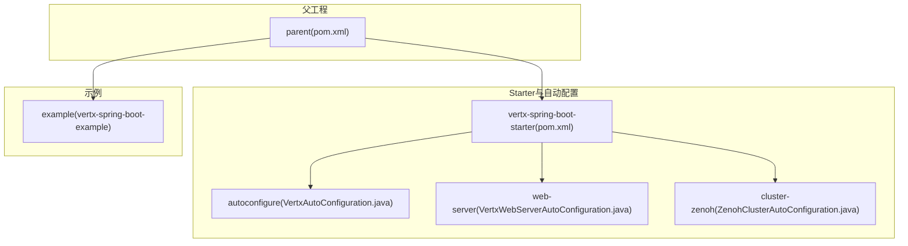
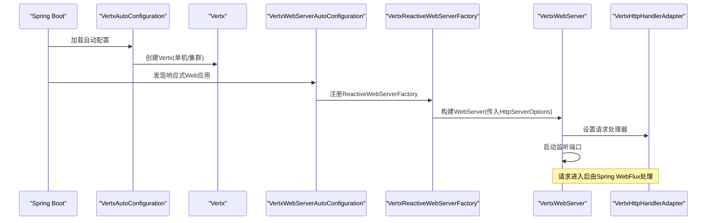
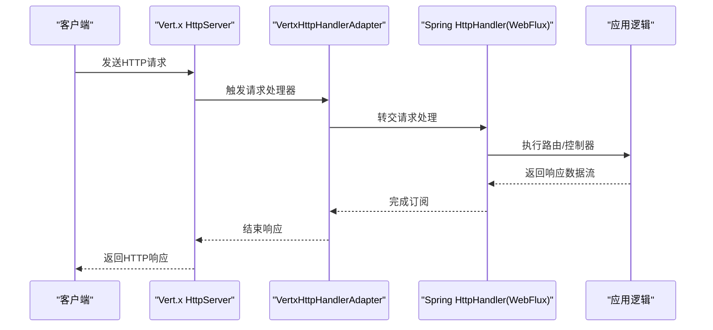
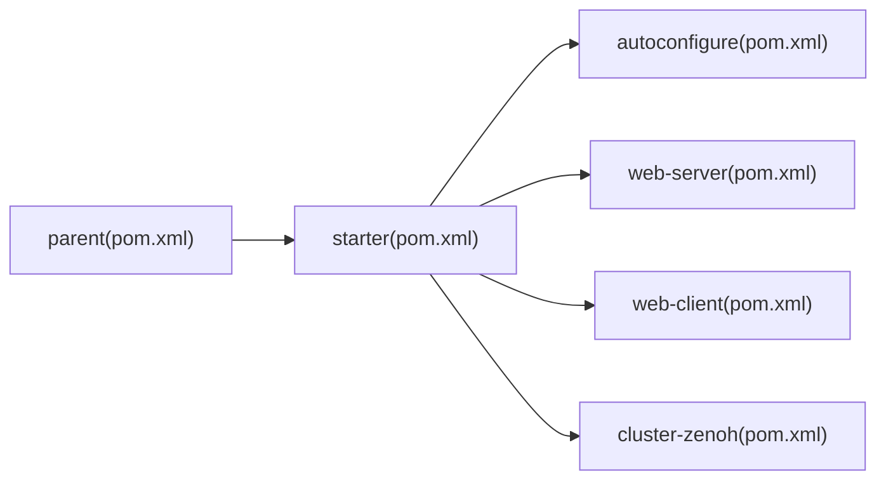

# 快速开始

<cite>
**本文引用的文件**
- [pom.xml](file://pom.xml)
- [vertx-spring-boot-starter/pom.xml](file://vertx-spring-boot-starter/pom.xml)
- [example/vertx-spring-boot-example/pom.xml](file://example/vertx-spring-boot-example/pom.xml)
- [example/vertx-spring-boot-example/src/main/resources/application.yml](file://example/vertx-spring-boot-example/src/main/resources/application.yml)
- [example/vertx-spring-boot-example/src/main/java/com/workoss/boot/vertx/VertxSpringBootExampleApplication.java](file://example/vertx-spring-boot-example/src/main/java/com/workoss/boot/vertx/VertxSpringBootExampleApplication.java)
- [vertx-spring-boot-autoconfigure/src/main/java/com/workoss/boot/vertx/autoconfigure/VertxAutoConfiguration.java](file://vertx-spring-boot-autoconfigure/src/main/java/com/workoss/boot/vertx/autoconfigure/VertxAutoConfiguration.java)
- [vertx-spring-boot-autoconfigure/src/main/java/com/workoss/boot/vertx/autoconfigure/VertxProperties.java](file://vertx-spring-boot-autoconfigure/src/main/java/com/workoss/boot/vertx/autoconfigure/VertxProperties.java)
- [vertx-spring-boot-web-server/src/main/java/com/workoss/boot/vertx/web/server/VertxWebServerAutoConfiguration.java](file://vertx-spring-boot-web-server/src/main/java/com/workoss/boot/vertx/web/server/VertxWebServerAutoConfiguration.java)
- [vertx-spring-boot-web-server/src/main/java/com/workoss/boot/vertx/web/server/VertxReactiveWebServerFactory.java](file://vertx-spring-boot-web-server/src/main/java/com/workoss/boot/vertx/web/server/VertxReactiveWebServerFactory.java)
- [vertx-spring-boot-web-server/src/main/java/com/workoss/boot/vertx/web/server/VertxHttpHandlerAdapter.java](file://vertx-spring-boot-web-server/src/main/java/com/workoss/boot/vertx/web/server/VertxHttpHandlerAdapter.java)
- [vertx-spring-boot-web-server/src/main/java/com/workoss/boot/vertx/web/server/VertxWebServer.java](file://vertx-spring-boot-web-server/src/main/java/com/workoss/boot/vertx/web/server/VertxWebServer.java)
- [vertx-spring-boot-autoconfigure/src/main/resources/META-INF/spring/org.springframework.boot.autoconfigure.AutoConfiguration.imports](file://vertx-spring-boot-autoconfigure/src/main/resources/META-INF/spring/org.springframework.boot.autoconfigure.AutoConfiguration.imports)
- [vertx-spring-boot-starter/src/main/resources/META-INF/spring/org.springframework.boot.autoconfigure.AutoConfiguration.imports](file://vertx-spring-boot-starter/src/main/resources/META-INF/spring/org.springframework.boot.autoconfigure.AutoConfiguration.imports)
</cite>

## 目录
1. [简介](#简介)
2. [项目结构](#项目结构)
3. [核心组件](#核心组件)
4. [架构总览](#架构总览)
5. [详细组件分析](#详细组件分析)
6. [依赖分析](#依赖分析)
7. [性能考虑](#性能考虑)
8. [故障排查指南](#故障排查指南)
9. [结论](#结论)
10. [附录](#附录)

## 简介
本指南面向希望在Spring Boot应用中快速集成Vert.x作为嵌入式Web服务器与集群能力的开发者。你将学会：
- 环境要求：Java 21+、Maven
- 如何通过Maven引入Vert.x Spring Boot Starter
- 在Spring Boot项目中启用Vert.x服务器与WebFlux响应式栈
- 基于示例工程的Hello World级Web控制器与HTTP请求处理
- application.yml中的基础配置项说明
- 常见配置错误与解决方案

## 项目结构
该仓库采用多模块聚合结构，核心模块包括：
- parent：统一版本与依赖管理（含Spring Boot 3.5、Vert.x 5、Zenoh Java）
- vertx-spring-boot-starter：Starter聚合模块，引入自动配置、Web服务器、Web客户端、集群
- vertx-spring-boot-autoconfigure：核心自动配置（Vert.x实例、生命周期、集群）
- vertx-spring-boot-web-server：基于Vert.x的Reactive Web服务器工厂与适配器
- vertx-spring-boot-web-client：WebClient与HTTP连接器自动配置
- vertx-spring-boot-cluster-zenoh：基于Zenoh的集群管理器自动配置
- example：示例工程，演示Starter的最小可用用法

图表来源
- [pom.xml:15-22](file://pom.xml#L15-L22)
- [vertx-spring-boot-starter/pom.xml:17-47](file://vertx-spring-boot-starter/pom.xml#L17-L47)
- [vertx-spring-boot-autoconfigure/src/main/java/com/workoss/boot/vertx/autoconfigure/VertxAutoConfiguration.java:21](file://vertx-spring-boot-autoconfigure/src/main/java/com/workoss/boot/vertx/autoconfigure/VertxAutoConfiguration.java#L21)
- [vertx-spring-boot-web-server/src/main/java/com/workoss/boot/vertx/web/server/VertxWebServerAutoConfiguration.java:17](file://vertx-spring-boot-web-server/src/main/java/com/workoss/boot/vertx/web/server/VertxWebServerAutoConfiguration.java#L17)

章节来源
- [pom.xml:15-22](file://pom.xml#L15-L22)
- [vertx-spring-boot-starter/pom.xml:17-47](file://vertx-spring-boot-starter/pom.xml#L17-L47)

## 核心组件
- 自动配置入口
  - Vert.x核心自动配置：负责创建VertxOptions、构建Vert.x实例（单机或集群），以及注册生命周期管理器
  - Web服务器自动配置：在响应式Web应用中提供ReactiveWebServerFactory，将Spring WebFlux的HttpHandler桥接到Vert.x
- 配置属性
  - VertxProperties：集中定义事件循环线程数、工作线程池大小、内部阻塞线程池、是否优先原生传输、虚拟线程开关、集群参数等
- Web服务器实现
  - VertxReactiveWebServerFactory：读取标准server.*与vertx.http-server.*配置，构建HttpServerOptions并创建Vert.x WebServer
  - VertxWebServer：封装Vert.x HttpServer的启动、停止与优雅关闭
  - VertxHttpHandlerAdapter：将Spring的HttpHandler适配为Vert.x的请求处理器

章节来源
- [vertx-spring-boot-autoconfigure/src/main/java/com/workoss/boot/vertx/autoconfigure/VertxAutoConfiguration.java:21-82](file://vertx-spring-boot-autoconfigure/src/main/java/com/workoss/boot/vertx/autoconfigure/VertxAutoConfiguration.java#L21-L82)
- [vertx-spring-boot-autoconfigure/src/main/java/com/workoss/boot/vertx/autoconfigure/VertxProperties.java:8-160](file://vertx-spring-boot-autoconfigure/src/main/java/com/workoss/boot/vertx/autoconfigure/VertxProperties.java#L8-L160)
- [vertx-spring-boot-web-server/src/main/java/com/workoss/boot/vertx/web/server/VertxWebServerAutoConfiguration.java:17-29](file://vertx-spring-boot-web-server/src/main/java/com/workoss/boot/vertx/web/server/VertxWebServerAutoConfiguration.java#L17-L29)
- [vertx-spring-boot-web-server/src/main/java/com/workoss/boot/vertx/web/server/VertxReactiveWebServerFactory.java:26-79](file://vertx-spring-boot-web-server/src/main/java/com/workoss/boot/vertx/web/server/VertxReactiveWebServerFactory.java#L26-L79)
- [vertx-spring-boot-web-server/src/main/java/com/workoss/boot/vertx/web/server/VertxWebServer.java:19-110](file://vertx-spring-boot-web-server/src/main/java/com/workoss/boot/vertx/web/server/VertxWebServer.java#L19-L110)
- [vertx-spring-boot-web-server/src/main/java/com/workoss/boot/vertx/web/server/VertxHttpHandlerAdapter.java:13-44](file://vertx-spring-boot-web-server/src/main/java/com/workoss/boot/vertx/web/server/VertxHttpHandlerAdapter.java#L13-L44)

## 架构总览
下图展示了从Spring Boot启动到Vert.x嵌入式Web服务器运行的关键流程。

图表来源
- [vertx-spring-boot-autoconfigure/src/main/java/com/workoss/boot/vertx/autoconfigure/VertxAutoConfiguration.java:52-75](file://vertx-spring-boot-autoconfigure/src/main/java/com/workoss/boot/vertx/autoconfigure/VertxAutoConfiguration.java#L52-L75)
- [vertx-spring-boot-web-server/src/main/java/com/workoss/boot/vertx/web/server/VertxWebServerAutoConfiguration.java:24-29](file://vertx-spring-boot-web-server/src/main/java/com/workoss/boot/vertx/web/server/VertxWebServerAutoConfiguration.java#L24-L29)
- [vertx-spring-boot-web-server/src/main/java/com/workoss/boot/vertx/web/server/VertxReactiveWebServerFactory.java:36-41](file://vertx-spring-boot-web-server/src/main/java/com/workoss/boot/vertx/web/server/VertxReactiveWebServerFactory.java#L36-L41)
- [vertx-spring-boot-web-server/src/main/java/com/workoss/boot/vertx/web/server/VertxWebServer.java:35-51](file://vertx-spring-boot-web-server/src/main/java/com/workoss/boot/vertx/web/server/VertxWebServer.java#L35-L51)
- [vertx-spring-boot-web-server/src/main/java/com/workoss/boot/vertx/web/server/VertxHttpHandlerAdapter.java:23-43](file://vertx-spring-boot-web-server/src/main/java/com/workoss/boot/vertx/web/server/VertxHttpHandlerAdapter.java#L23-L43)

## 详细组件分析

### 环境与安装
- 环境要求
  - Java：21+
  - 构建工具：Maven
- 版本与依赖管理
  - 父POM统一管理Spring Boot 3.5、Vert.x 5、Zenoh Java等版本
  - 使用BOM导入顺序：先Vert.x再Spring Boot，以满足Netty版本兼容性
- Maven坐标
  - Starter坐标：com.workoss.boot.vertx:vertx-spring-boot-starter
  - 示例工程坐标：com.workoss.boot.vertx:vertx-spring-boot-example

章节来源
- [pom.xml:24-53](file://pom.xml#L24-L53)
- [vertx-spring-boot-starter/pom.xml:17-47](file://vertx-spring-boot-starter/pom.xml#L17-L47)

### 添加Starter依赖（Maven）
- 在你的Spring Boot项目中引入Starter，即可自动激活：
  - Vert.x核心自动配置
  - Vert.x Web服务器自动配置
  - Vert.x WebClient自动配置
  - Zenoh集群自动配置
- Starter会排除默认的Reactor Netty，改由Vert.x提供非阻塞I/O

章节来源
- [vertx-spring-boot-starter/pom.xml:17-47](file://vertx-spring-boot-starter/pom.xml#L17-L47)
- [vertx-spring-boot-starter/src/main/resources/META-INF/spring/org.springframework.boot.autoconfigure.AutoConfiguration.imports:1-6](file://vertx-spring-boot-starter/src/main/resources/META-INF/spring/org.springframework.boot.autoconfigure.AutoConfiguration.imports#L1-L6)

### Hello World示例（最小可用）
- 示例工程已提供可直接运行的引导类与基础配置
- 运行方式
  - 使用Maven插件打包并运行示例工程
  - 或直接运行引导类的main方法
- 访问路径
  - 默认端口可在配置文件中设置；示例工程使用8081端口
- 处理链路
  - Spring WebFlux的HttpHandler经由适配器桥接至Vert.x HttpServer
  - 请求到达后由Spring WebFlux处理，最终返回响应

图表来源
- [vertx-spring-boot-web-server/src/main/java/com/workoss/boot/vertx/web/server/VertxHttpHandlerAdapter.java:23-43](file://vertx-spring-boot-web-server/src/main/java/com/workoss/boot/vertx/web/server/VertxHttpHandlerAdapter.java#L23-L43)
- [vertx-spring-boot-web-server/src/main/java/com/workoss/boot/vertx/web/server/VertxWebServer.java:35-51](file://vertx-spring-boot-web-server/src/main/java/com/workoss/boot/vertx/web/server/VertxWebServer.java#L35-L51)

章节来源
- [example/vertx-spring-boot-example/src/main/java/com/workoss/boot/vertx/VertxSpringBootExampleApplication.java:6-13](file://example/vertx-spring-boot-example/src/main/java/com/workoss/boot/vertx/VertxSpringBootExampleApplication.java#L6-L13)
- [example/vertx-spring-boot-example/src/main/resources/application.yml:3-21](file://example/vertx-spring-boot-example/src/main/resources/application.yml#L3-L21)

### application.yml 配置要点
- 服务器端口与地址
  - server.port：监听端口，默认8080（由抽象基类提供）
  - server.address：绑定地址
- 日志级别
  - logging.level.root：根日志级别
- Vert.x核心配置
  - vertx.prefer-native-transport：是否优先原生传输（Linux epoll、macOS kqueue）
  - vertx.cluster.enabled：是否启用集群模式
- Vert.x HTTP服务器配置
  - vertx.http-server.*：如空闲超时、最大头大小、最大分块大小、初始行长度、接受队列长度等（由Web服务器工厂读取）

章节来源
- [example/vertx-spring-boot-example/src/main/resources/application.yml:3-21](file://example/vertx-spring-boot-example/src/main/resources/application.yml#L3-L21)
- [vertx-spring-boot-web-server/src/main/java/com/workoss/boot/vertx/web/server/VertxReactiveWebServerFactory.java:43-78](file://vertx-spring-boot-web-server/src/main/java/com/workoss/boot/vertx/web/server/VertxReactiveWebServerFactory.java#L43-L78)

### 配置属性模型（VertxProperties）
- 关键字段
  - eventLoopPoolSize：事件循环线程数（0表示使用默认值）
  - workerPoolSize：工作线程池大小
  - internalBlockingPoolSize：内部阻塞线程池大小
  - preferNativeTransport：是否优先原生传输
  - virtualThreads.enabled：是否启用虚拟线程（用于worker任务）
  - cluster.enabled/host/port/publicHost：集群通信参数
- 作用范围
  - 通过@EnableConfigurationProperties启用，供自动配置读取

章节来源
- [vertx-spring-boot-autoconfigure/src/main/java/com/workoss/boot/vertx/autoconfigure/VertxProperties.java:8-160](file://vertx-spring-boot-autoconfigure/src/main/java/com/workoss/boot/vertx/autoconfigure/VertxProperties.java#L8-L160)

### 自动配置与Web服务器工厂
- 自动配置
  - 创建VertxOptions并应用自定义化器
  - 按配置决定是否构建集群实例
  - 注册生命周期管理器
- Web服务器工厂
  - 读取server.*与vertx.http-server.*配置
  - 构建HttpServerOptions并创建Vert.x WebServer
  - 将Spring HttpHandler适配为Vert.x请求处理器

章节来源
- [vertx-spring-boot-autoconfigure/src/main/java/com/workoss/boot/vertx/autoconfigure/VertxAutoConfiguration.java:28-81](file://vertx-spring-boot-autoconfigure/src/main/java/com/workoss/boot/vertx/autoconfigure/VertxAutoConfiguration.java#L28-L81)
- [vertx-spring-boot-web-server/src/main/java/com/workoss/boot/vertx/web/server/VertxWebServerAutoConfiguration.java:24-29](file://vertx-spring-boot-web-server/src/main/java/com/workoss/boot/vertx/web/server/VertxWebServerAutoConfiguration.java#L24-L29)
- [vertx-spring-boot-web-server/src/main/java/com/workoss/boot/vertx/web/server/VertxReactiveWebServerFactory.java:36-78](file://vertx-spring-boot-web-server/src/main/java/com/workoss/boot/vertx/web/server/VertxReactiveWebServerFactory.java#L36-L78)

## 依赖分析
- 版本与BOM
  - 先导入Vert.x依赖BOM，再导入Spring Boot依赖BOM，确保Netty版本满足Vert.x 5需求
  - 内部模块版本与父工程保持一致
- Starter依赖
  - 聚合了自动配置、Web服务器、Web客户端、集群模块
  - 排除了默认Reactor Netty，使用Vert.x作为底层网络栈

图表来源
- [pom.xml:35-108](file://pom.xml#L35-L108)
- [vertx-spring-boot-starter/pom.xml:17-47](file://vertx-spring-boot-starter/pom.xml#L17-L47)

章节来源
- [pom.xml:35-108](file://pom.xml#L35-L108)
- [vertx-spring-boot-starter/pom.xml:17-47](file://vertx-spring-boot-starter/pom.xml#L17-L47)

## 性能考虑
- 线程池规模
  - eventLoopPoolSize：默认按CPU核数*2，可根据CPU密集型/IO密集型场景调整
  - workerPoolSize/internalBlockingPoolSize：根据并发任务量与阻塞操作比例调优
- 原生传输
  - preferNativeTransport=true可提升Linux/macOS下的网络性能
- 压缩与超时
  - 合理设置压缩级别与空闲超时，平衡带宽与资源占用
- 虚拟线程
  - 在支持JDK 21+的环境中启用虚拟线程，有助于提升高并发下的吞吐

## 故障排查指南
- 端口冲突
  - 现象：启动失败，提示端口被占用
  - 解决：修改server.port或释放占用端口
- Netty/传输兼容性问题
  - 现象：启动阶段出现Netty版本不匹配异常
  - 解决：确保父POM中Vert.x BOM在Spring Boot BOM之前导入
- 未启用响应式Web
  - 现象：未看到Vert.x Web服务器启动
  - 解决：确认项目包含spring-boot-starter-webflux或使用Starter聚合模块
- 集群未生效
  - 现象：vertx.cluster.enabled=true但未发现集群节点
  - 解决：检查集群host/port/publicHost配置，确保网络连通
- 响应未结束
  - 现象：偶发无响应或超时
  - 解决：确认Spring WebFlux响应已正确完成订阅，避免背压与未结束的响应

章节来源
- [example/vertx-spring-boot-example/src/main/resources/application.yml:3-21](file://example/vertx-spring-boot-example/src/main/resources/application.yml#L3-L21)
- [pom.xml:37-53](file://pom.xml#L37-L53)
- [vertx-spring-boot-web-server/src/main/java/com/workoss/boot/vertx/web/server/VertxHttpHandlerAdapter.java:29-42](file://vertx-spring-boot-web-server/src/main/java/com/workoss/boot/vertx/web/server/VertxHttpHandlerAdapter.java#L29-L42)

## 结论
通过引入Vert.x Spring Boot Starter，你可以以最小成本在Spring Boot中获得高性能的响应式Web服务器与集群能力。建议从示例工程入手，结合application.yml的基础配置，逐步扩展到业务控制器与集群部署。

## 附录

### A. Maven坐标与版本
- Starter坐标：com.workoss.boot.vertx:vertx-spring-boot-starter
- 父工程版本与依赖由父POM统一管理

章节来源
- [vertx-spring-boot-starter/pom.xml:7-11](file://vertx-spring-boot-starter/pom.xml#L7-L11)
- [pom.xml:30-32](file://pom.xml#L30-L32)

### B. 自动配置导入清单
- Starter与自动配置模块均通过Spring Import机制声明自动配置类，确保在应用启动时被加载

章节来源
- [vertx-spring-boot-autoconfigure/src/main/resources/META-INF/spring/org.springframework.boot.autoconfigure.AutoConfiguration.imports:1-3](file://vertx-spring-boot-autoconfigure/src/main/resources/META-INF/spring/org.springframework.boot.autoconfigure.AutoConfiguration.imports#L1-L3)
- [vertx-spring-boot-starter/src/main/resources/META-INF/spring/org.springframework.boot.autoconfigure.AutoConfiguration.imports:1-6](file://vertx-spring-boot-starter/src/main/resources/META-INF/spring/org.springframework.boot.autoconfigure.AutoConfiguration.imports#L1-L6)