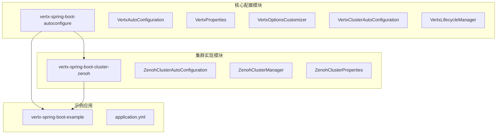
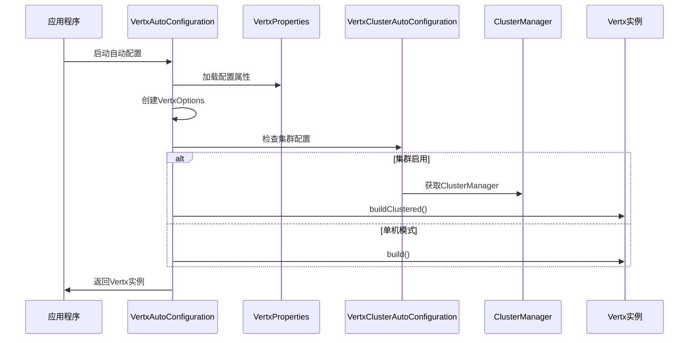
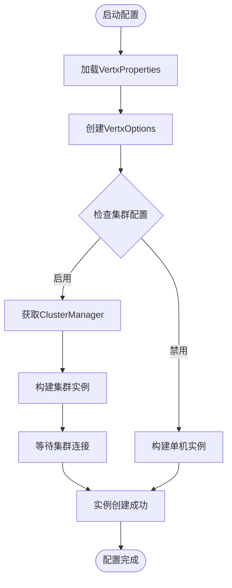
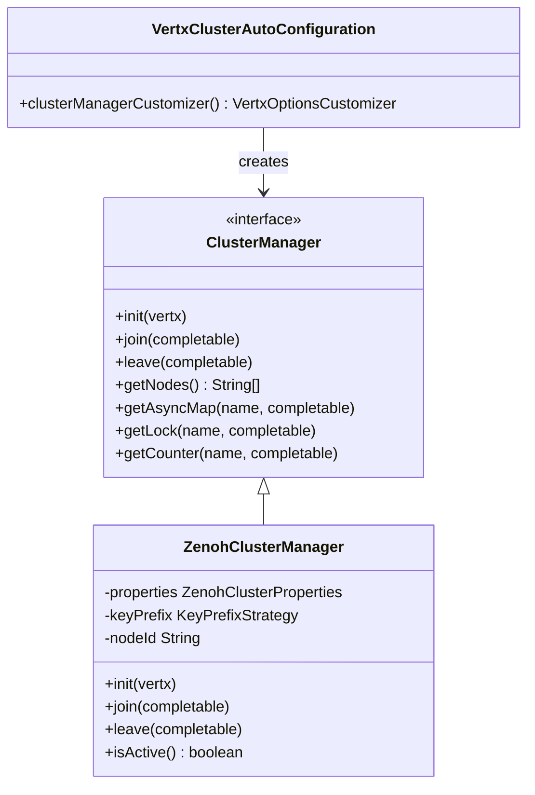
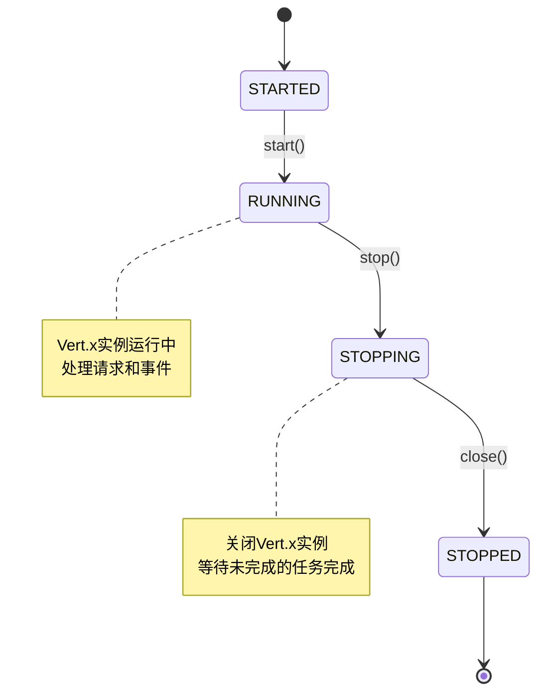
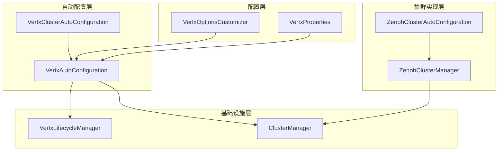

# Vert.x实例配置

<cite>
**本文档引用的文件**
- [VertxAutoConfiguration.java](file://vertx-spring-boot-autoconfigure/src/main/java/com/workoss/boot/vertx/autoconfigure/VertxAutoConfiguration.java)
- [VertxProperties.java](file://vertx-spring-boot-autoconfigure/src/main/java/com/workoss/boot/vertx/autoconfigure/VertxProperties.java)
- [VertxOptionsCustomizer.java](file://vertx-spring-boot-autoconfigure/src/main/java/com/workoss/boot/vertx/autoconfigure/VertxOptionsCustomizer.java)
- [VertxClusterAutoConfiguration.java](file://vertx-spring-boot-autoconfigure/src/main/java/com/workoss/boot/vertx/autoconfigure/VertxClusterAutoConfiguration.java)
- [VertxLifecycleManager.java](file://vertx-spring-boot-autoconfigure/src/main/java/com/workoss/boot/vertx/autoconfigure/VertxLifecycleManager.java)
- [ZenohClusterAutoConfiguration.java](file://vertx-spring-boot-cluster-zenoh/src/main/java/com/workoss/boot/vertx/cluster/zenoh/ZenohClusterAutoConfiguration.java)
- [ZenohClusterManager.java](file://vertx-spring-boot-cluster-zenoh/src/main/java/com/workoss/boot/vertx/cluster/zenoh/ZenohClusterManager.java)
- [ZenohClusterProperties.java](file://vertx-spring-boot-cluster-zenoh/src/main/java/com/workoss/boot/vertx/cluster/zenoh/ZenohClusterProperties.java)
- [application.yml](file://example/vertx-spring-boot-example/src/main/resources/application.yml)
- [org.springframework.boot.autoconfigure.AutoConfiguration.imports](file://vertx-spring-boot-autoconfigure/src/main/resources/META-INF/spring/org.springframework.boot.autoconfigure.AutoConfiguration.imports)
- [org.springframework.boot.autoconfigure.AutoConfiguration.imports](file://vertx-spring-boot-cluster-zenoh/src/main/resources/META-INF/spring/org.springframework.boot.autoconfigure.AutoConfiguration.imports)
- [VertxAutoConfigurationTest.java](file://vertx-spring-boot-autoconfigure/src/test/java/com/workoss/boot/vertx/autoconfigure/VertxAutoConfigurationTest.java)
</cite>

## 目录
1. [简介](#简介)
2. [项目结构](#项目结构)
3. [核心组件](#核心组件)
4. [架构概览](#架构概览)
5. [详细组件分析](#详细组件分析)
6. [依赖关系分析](#依赖关系分析)
7. [性能考虑](#性能考虑)
8. [故障排除指南](#故障排除指南)
9. [结论](#结论)
10. [附录](#附录)

## 简介

本文件为Vert.x实例配置功能创建详细的技术文档，深入解释VertxAutoConfiguration中Vert.x实例的创建过程，包括单机模式和集群模式的区别。详细说明VertxOptions的配置参数，如eventLoopPoolSize、workerPoolSize、internalBlockingPoolSize等关键属性的作用和配置方法。解释集群配置的启用条件和ClusterManager的集成机制。提供不同部署场景下的实例配置最佳实践，包括性能调优建议和资源分配策略。包含具体的配置示例和常见配置错误的解决方案。

## 项目结构

该项目采用模块化设计，主要包含以下核心模块：



**图表来源**
- [VertxAutoConfiguration.java:1-83](file://vertx-spring-boot-autoconfigure/src/main/java/com/workoss/boot/vertx/autoconfigure/VertxAutoConfiguration.java#L1-L83)
- [ZenohClusterAutoConfiguration.java:1-27](file://vertx-spring-boot-cluster-zenoh/src/main/java/com/workoss/boot/vertx/cluster/zenoh/ZenohClusterAutoConfiguration.java#L1-L27)

**章节来源**
- [org.springframework.boot.autoconfigure.AutoConfiguration.imports:1-3](file://vertx-spring-boot-autoconfigure/src/main/resources/META-INF/spring/org.springframework.boot.autoconfigure.AutoConfiguration.imports#L1-L3)
- [org.springframework.boot.autoconfigure.AutoConfiguration.imports:1-2](file://vertx-spring-boot-cluster-zenoh/src/main/resources/META-INF/spring/org.springframework.boot.autoconfigure.AutoConfiguration.imports#L1-L2)

## 核心组件

### VertxAutoConfiguration - 自动配置核心

VertxAutoConfiguration是整个Vert.x实例配置的核心类，负责：
- 创建VertxOptions Bean
- 创建Vertx实例（支持单机和集群模式）
- 管理Vert.x生命周期

### VertxProperties - 配置属性定义

VertxProperties类定义了所有可配置的Vert.x属性：
- **eventLoopPoolSize**: 事件循环线程数量，默认0（使用CPU核心数*2）
- **workerPoolSize**: 工作线程池大小，默认20
- **internalBlockingPoolSize**: 内部阻塞线程池大小，默认20
- **preferNativeTransport**: 是否优先使用原生传输，默认true
- **virtualThreads**: 虚拟线程设置
- **cluster**: 集群配置

### VertxOptionsCustomizer - 配置定制接口

VertxOptionsCustomizer是一个函数式接口，允许外部扩展自定义VertxOptions配置。

**章节来源**
- [VertxAutoConfiguration.java:24-82](file://vertx-spring-boot-autoconfigure/src/main/java/com/workoss/boot/vertx/autoconfigure/VertxAutoConfiguration.java#L24-L82)
- [VertxProperties.java:8-160](file://vertx-spring-boot-autoconfigure/src/main/java/com/workoss/boot/vertx/autoconfigure/VertxProperties.java#L8-L160)
- [VertxOptionsCustomizer.java:1-19](file://vertx-spring-boot-autoconfigure/src/main/java/com/workoss/boot/vertx/autoconfigure/VertxOptionsCustomizer.java#L1-L19)

## 架构概览



**图表来源**
- [VertxAutoConfiguration.java:52-75](file://vertx-spring-boot-autoconfigure/src/main/java/com/workoss/boot/vertx/autoconfigure/VertxAutoConfiguration.java#L52-L75)
- [VertxClusterAutoConfiguration.java:13-32](file://vertx-spring-boot-autoconfigure/src/main/java/com/workoss/boot/vertx/autoconfigure/VertxClusterAutoConfiguration.java#L13-L32)

## 详细组件分析

### Vertx实例创建流程



**图表来源**
- [VertxAutoConfiguration.java:28-75](file://vertx-spring-boot-autoconfigure/src/main/java/com/workoss/boot/vertx/autoconfigure/VertxAutoConfiguration.java#L28-L75)

### 配置参数详解

#### 事件循环线程池 (eventLoopPoolSize)

- **作用**: 控制Vert.x事件循环线程的数量
- **默认值**: 0（表示使用CPU核心数*2）
- **配置方式**: 
  - YAML: `vertx.event-loop-pool-size: 4`
  - Java: `vertxProperties.setEventLoopPoolSize(4)`
- **性能影响**: 
  - 增加线程数提高并发处理能力但增加上下文切换开销
  - 减少线程数降低内存占用但可能成为瓶颈

#### 工作线程池 (workerPoolSize)

- **作用**: 处理阻塞操作的工作线程池
- **默认值**: 20
- **配置方式**: `vertx.worker-pool-size: 50`
- **最佳实践**: 
  - CPU密集型任务：与事件循环线程数相当
  - IO密集型任务：可适当增大
  - 受限环境：根据可用内存调整

#### 内部阻塞线程池 (internalBlockingPoolSize)

- **作用**: 处理内部阻塞操作的专用线程池
- **默认值**: 20
- **配置方式**: `vertx.internal-blocking-pool-size: 25`
- **使用场景**: 
  - 文件系统操作
  - 数据库连接
  - 其他阻塞I/O操作

#### 原生传输偏好 (preferNativeTransport)

- **作用**: 是否优先使用原生网络传输
- **默认值**: true
- **平台支持**: Linux(epoll)、macOS(kqueue)
- **配置方式**: `vertx.prefer-native-transport: false`

**章节来源**
- [VertxProperties.java:11-29](file://vertx-spring-boot-autoconfigure/src/main/java/com/workoss/boot/vertx/autoconfigure/VertxProperties.java#L11-L29)
- [VertxAutoConfiguration.java:34-39](file://vertx-spring-boot-autoconfigure/src/main/java/com/workoss/boot/vertx/autoconfigure/VertxAutoConfiguration.java#L34-L39)

### 集群配置机制

#### 启用条件

集群配置通过以下条件启用：
1. `vertx.cluster.enabled=true`
2. 存在ClusterManager Bean
3. Vert.x版本兼容性

#### ClusterManager集成



**图表来源**
- [ZenohClusterManager.java:29-243](file://vertx-spring-boot-cluster-zenoh/src/main/java/com/workoss/boot/vertx/cluster/zenoh/ZenohClusterManager.java#L29-L243)
- [VertxClusterAutoConfiguration.java:19-32](file://vertx-spring-boot-autoconfigure/src/main/java/com/workoss/boot/vertx/autoconfigure/VertxClusterAutoConfiguration.java#L19-L32)

#### Zenoh集群管理器

ZenohClusterManager提供了完整的集群管理功能：
- **多租户隔离**: 通过应用名称和环境标识实现完全隔离
- **节点发现**: 自动发现和管理集群节点
- **共享数据**: 支持AsyncMap、Lock、Counter等分布式组件
- **生命周期管理**: 完整的加入/离开集群流程

**章节来源**
- [ZenohClusterAutoConfiguration.java:15-25](file://vertx-spring-boot-cluster-zenoh/src/main/java/com/workoss/boot/vertx/cluster/zenoh/ZenohClusterAutoConfiguration.java#L15-L25)
- [ZenohClusterManager.java:124-154](file://vertx-spring-boot-cluster-zenoh/src/main/java/com/workoss/boot/vertx/cluster/zenoh/ZenohClusterManager.java#L124-L154)

### 生命周期管理

VertxLifecycleManager确保Vert.x实例与Spring应用上下文的生命周期同步：



**图表来源**
- [VertxLifecycleManager.java:12-52](file://vertx-spring-boot-autoconfigure/src/main/java/com/workoss/boot/vertx/autoconfigure/VertxLifecycleManager.java#L12-L52)

**章节来源**
- [VertxLifecycleManager.java:12-52](file://vertx-spring-boot-autoconfigure/src/main/java/com/workoss/boot/vertx/autoconfigure/VertxLifecycleManager.java#L12-L52)

## 依赖关系分析



**图表来源**
- [VertxAutoConfiguration.java:24-82](file://vertx-spring-boot-autoconfigure/src/main/java/com/workoss/boot/vertx/autoconfigure/VertxAutoConfiguration.java#L24-L82)
- [VertxClusterAutoConfiguration.java:13-32](file://vertx-spring-boot-autoconfigure/src/main/java/com/workoss/boot/vertx/autoconfigure/VertxClusterAutoConfiguration.java#L13-L32)

**章节来源**
- [org.springframework.boot.autoconfigure.AutoConfiguration.imports:1-3](file://vertx-spring-boot-autoconfigure/src/main/resources/META-INF/spring/org.springframework.boot.autoconfigure.AutoConfiguration.imports#L1-L3)

## 性能考虑

### 线程池配置优化

#### CPU密集型应用
- **eventLoopPoolSize**: 与CPU核心数相等
- **workerPoolSize**: CPU核心数的1-2倍
- **internalBlockingPoolSize**: workerPoolSize的1/2

#### IO密集型应用
- **eventLoopPoolSize**: CPU核心数的1-2倍
- **workerPoolSize**: CPU核心数的3-5倍
- **internalBlockingPoolSize**: workerPoolSize的1/2

#### 内存受限环境
- **eventLoopPoolSize**: CPU核心数
- **workerPoolSize**: 10-20
- **internalBlockingPoolSize**: 10-15

### 原生传输优化

启用原生传输可以显著提升网络性能：
- **Linux**: epoll提供更好的高并发性能
- **macOS**: kqueue优化了文件描述符管理
- **Windows**: 默认使用NIO，性能相对较低

### 虚拟线程支持

虚拟线程在Java 21+中提供更好的并发性能：
- **启用条件**: Java版本>=21且`virtualThreads.enabled=true`
- **适用场景**: 大量轻量级并发任务
- **性能收益**: 减少线程切换开销，提高吞吐量

## 故障排除指南

### 常见配置错误

#### 集群配置不生效

**问题症状**:
- 集群模式下仍使用单机配置
- 日志显示单机模式启动

**解决方案**:
1. 确认集群配置已启用
   ```yaml
   vertx:
     cluster:
       enabled: true
   ```

2. 检查ClusterManager Bean是否正确注册
   - 确保依赖正确引入
   - 检查自动配置类是否加载

3. 验证网络连通性
   - 确认集群端口可达
   - 检查防火墙设置

#### 线程池配置不当

**问题症状**:
- 应用响应缓慢
- 内存使用过高
- 线程饥饿现象

**诊断步骤**:
1. 使用JVM监控工具检查线程状态
2. 分析GC日志确认内存压力
3. 监控CPU使用率确认是否存在线程争用

**解决方案**:
1. 调整线程池大小到合理范围
2. 使用性能测试工具验证配置效果
3. 根据实际负载逐步优化

#### 原生传输问题

**问题症状**:
- 网络性能不如预期
- 在某些平台上出现兼容性问题

**解决方案**:
1. 检查操作系统支持情况
2. 尝试禁用原生传输进行对比测试
3. 更新到支持的Vert.x版本

### 调试技巧

#### 启用详细日志

```yaml
logging:
  level:
    com.workoss.boot.vertx: debug
    io.vertx: debug
```

#### 性能监控

使用以下指标监控Vert.x实例性能：
- 事件循环队列长度
- 工作线程池利用率
- 集群节点数量
- 网络I/O统计

**章节来源**
- [VertxAutoConfigurationTest.java:16-94](file://vertx-spring-boot-autoconfigure/src/test/java/com/workoss/boot/vertx/autoconfigure/VertxAutoConfigurationTest.java#L16-L94)

## 结论

Vert.x实例配置系统提供了灵活而强大的自动配置机制，支持从简单的单机部署到复杂的集群环境。通过合理的配置参数调优和集群管理器选择，可以在不同部署场景下获得最佳的性能表现。

关键要点：
- **配置灵活性**: 支持多种配置方式（YAML、Java、自定义）
- **集群支持**: 完整的集群管理器集成机制
- **性能优化**: 提供详细的性能调优指导
- **故障排除**: 完善的问题诊断和解决方案

建议在生产环境中：
1. 进行充分的性能测试和基准测试
2. 建立完善的监控和告警机制
3. 制定详细的配置变更流程
4. 定期评估和优化配置参数

## 附录

### 配置示例

#### 基础单机配置
```yaml
vertx:
  event-loop-pool-size: 4
  worker-pool-size: 20
  internal-blocking-pool-size: 20
  prefer-native-transport: true
```

#### 集群配置示例
```yaml
vertx:
  cluster:
    enabled: true
    host: 0.0.0.0
    port: 0
  prefer-native-transport: false
```

#### Zenoh集群配置
```yaml
vertx:
  cluster:
    enabled: true
  cluster.zenoh:
    app-name: my-app
    environment: production
    mode: peer
    connect:
      - tcp/localhost:7447
```

### 最佳实践清单

- **开发环境**: 简单配置，便于调试
- **测试环境**: 接近生产配置，但资源有限
- **生产环境**: 经过充分测试的优化配置
- **监控**: 始终启用性能监控和日志记录
- **备份**: 定期备份配置文件和环境变量