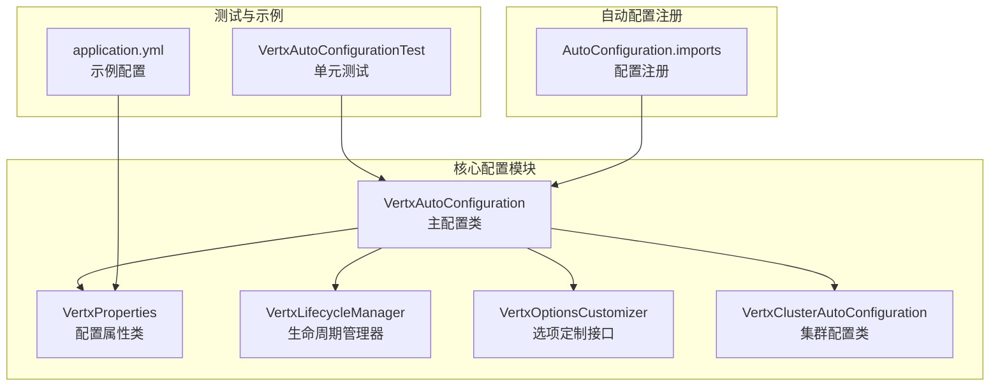
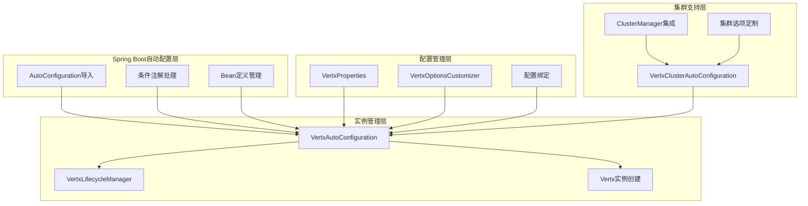
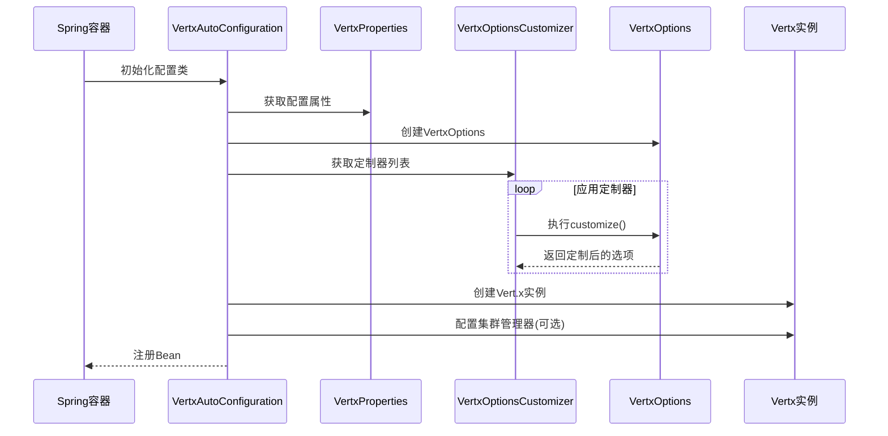
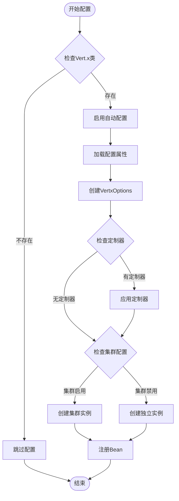
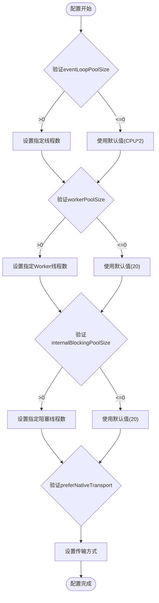
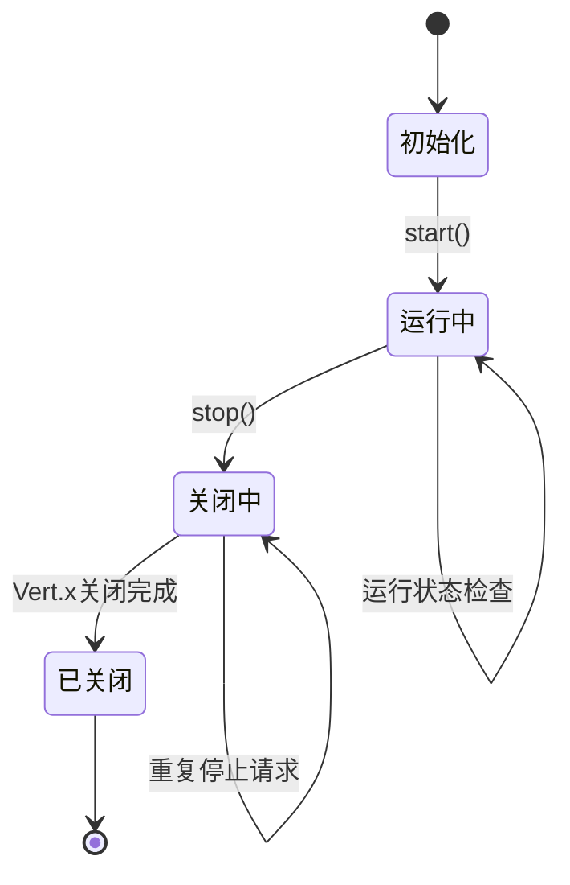
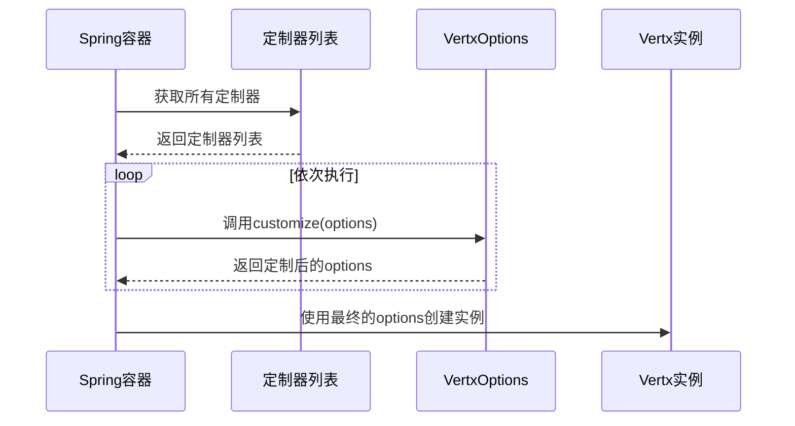
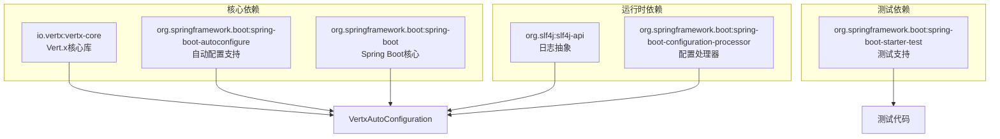

# 核心配置模块

<cite>
**本文档引用的文件**
- [VertxAutoConfiguration.java](file://vertx-spring-boot-autoconfigure/src/main/java/com/workoss/boot/vertx/autoconfigure/VertxAutoConfiguration.java)
- [VertxProperties.java](file://vertx-spring-boot-autoconfigure/src/main/java/com/workoss/boot/vertx/autoconfigure/VertxProperties.java)
- [VertxLifecycleManager.java](file://vertx-spring-boot-autoconfigure/src/main/java/com/workoss/boot/vertx/autoconfigure/VertxLifecycleManager.java)
- [VertxOptionsCustomizer.java](file://vertx-spring-boot-autoconfigure/src/main/java/com/workoss/boot/vertx/autoconfigure/VertxOptionsCustomizer.java)
- [VertxClusterAutoConfiguration.java](file://vertx-spring-boot-autoconfigure/src/main/java/com/workoss/boot/vertx/autoconfigure/VertxClusterAutoConfiguration.java)
- [VertxAutoConfigurationTest.java](file://vertx-spring-boot-autoconfigure/src/test/java/com/workoss/boot/vertx/autoconfigure/VertxAutoConfigurationTest.java)
- [application.yml](file://example/vertx-spring-boot-example/src/main/resources/application.yml)
- [pom.xml](file://pom.xml)
- [org.springframework.boot.autoconfigure.AutoConfiguration.imports](file://vertx-spring-boot-autoconfigure/src/main/resources/META-INF/spring/org.springframework.boot.autoconfigure.AutoConfiguration.imports)
</cite>

## 目录
1. [简介](#简介)
2. [项目结构](#项目结构)
3. [核心组件](#核心组件)
4. [架构概览](#架构概览)
5. [详细组件分析](#详细组件分析)
6. [依赖分析](#依赖分析)
7. [性能考虑](#性能考虑)
8. [故障排除指南](#故障排除指南)
9. [结论](#结论)
10. [附录](#附录)

## 简介

Vert.x核心配置模块是Vert.x Spring Boot集成的基础组件，负责Vert.x实例的自动配置、生命周期管理和性能优化。该模块提供了完整的配置体系，包括事件循环线程池、worker线程池、虚拟线程支持以及集群配置等功能。

本模块基于Spring Boot自动配置机制，通过条件注解和Bean定义实现了无缝的Vert.x集成。它支持多种部署场景，从单机模式到集群模式，并提供了灵活的扩展点以满足不同应用的需求。

## 项目结构

Vert.x核心配置模块位于`vertx-spring-boot-autoconfigure`子模块中，采用标准的Spring Boot模块结构：



**图表来源**
- [VertxAutoConfiguration.java:1-83](file://vertx-spring-boot-autoconfigure/src/main/java/com/workoss/boot/vertx/autoconfigure/VertxAutoConfiguration.java#L1-L83)
- [VertxProperties.java:1-160](file://vertx-spring-boot-autoconfigure/src/main/java/com/workoss/boot/vertx/autoconfigure/VertxProperties.java#L1-L160)

**章节来源**
- [pom.xml:15-22](file://pom.xml#L15-L22)
- [org.springframework.boot.autoconfigure.AutoConfiguration.imports:1-3](file://vertx-spring-boot-autoconfigure/src/main/resources/META-INF/spring/org.springframework.boot.autoconfigure.AutoConfiguration.imports#L1-L3)

## 核心组件

### VertxAutoConfiguration - 主配置类

主配置类负责Vert.x实例的创建和配置管理，采用条件注解确保在适当的环境下启用功能。

**关键特性：**
- 自动检测Vert.x类的存在
- 启用配置属性绑定
- 提供默认Bean定义
- 支持条件性Bean创建

**Bean定义策略：**
- `VertxOptions`: 基于配置属性创建Vert.x选项
- `Vertx`: 创建Vert.x实例（支持集群模式）
- `VertxLifecycleManager`: 管理Vert.x生命周期

**章节来源**
- [VertxAutoConfiguration.java:18-83](file://vertx-spring-boot-autoconfigure/src/main/java/com/workoss/boot/vertx/autoconfigure/VertxAutoConfiguration.java#L18-L83)

### VertxProperties - 配置属性类

配置属性类提供了完整的Vert.x配置参数映射，支持Spring Boot的类型安全配置。

**主要配置类别：**

#### 基础配置
- `eventLoopPoolSize`: 事件循环线程池大小（默认：0，表示使用CPU核心数*2）
- `workerPoolSize`: Worker线程池大小（默认：20）
- `internalBlockingPoolSize`: 内部阻塞线程池大小（默认：20）
- `preferNativeTransport`: 是否优先使用原生传输（默认：true）

#### 虚拟线程配置
- `virtualThreads.enabled`: 是否启用虚拟线程（默认：true）

#### 集群配置
- `cluster.enabled`: 集群功能开关（默认：false）
- `cluster.host`: 集群通信主机地址（默认："0.0.0.0"）
- `cluster.port`: 集群通信端口（默认：0，表示自动分配）
- `cluster.publicHost`: 公共主机地址（用于NAT环境）

**章节来源**
- [VertxProperties.java:11-87](file://vertx-spring-boot-autoconfigure/src/main/java/com/workoss/boot/vertx/autoconfigure/VertxProperties.java#L11-L87)
- [VertxProperties.java:89-158](file://vertx-spring-boot-autoconfigure/src/main/java/com/workoss/boot/vertx/autoconfigure/VertxProperties.java#L89-L158)

### VertxLifecycleManager - 生命周期管理器

生命周期管理器实现了SmartLifecycle接口，确保Vert.x实例与Spring应用上下文的生命周期同步。

**核心功能：**
- 启动时标记运行状态
- 关闭时优雅关闭Vert.x实例
- 设置合适的关闭阶段（在Web服务器之后，其他Bean之前）

**关闭流程：**
1. 检查运行状态
2. 记录关闭日志
3. 调用Vert.x关闭方法
4. 等待关闭完成
5. 更新运行状态

**章节来源**
- [VertxLifecycleManager.java:8-53](file://vertx-spring-boot-autoconfigure/src/main/java/com/workoss/boot/vertx/autoconfigure/VertxLifecycleManager.java#L8-L53)

### VertxOptionsCustomizer - 选项定制接口

这是一个函数式接口，允许外部扩展定制Vert.x选项。

**使用场景：**
- 添加SSL配置
- 配置事件总线选项
- 设置自定义集群管理器
- 应用特定的性能调优

**实现模式：**
```java
@Bean
public VertxOptionsCustomizer myCustomizer() {
    return options -> {
        // 自定义配置逻辑
        return options;
    };
}
```

**章节来源**
- [VertxOptionsCustomizer.java:5-19](file://vertx-spring-boot-autoconfigure/src/main/java/com/workoss/boot/vertx/autoconfigure/VertxOptionsCustomizer.java#L5-L19)

## 架构概览

Vert.x核心配置模块采用分层架构设计，确保了良好的可扩展性和维护性：



**图表来源**
- [org.springframework.boot.autoconfigure.AutoConfiguration.imports:1-3](file://vertx-spring-boot-autoconfigure/src/main/resources/META-INF/spring/org.springframework.boot.autoconfigure.AutoConfiguration.imports#L1-L3)
- [VertxAutoConfiguration.java:21-24](file://vertx-spring-boot-autoconfigure/src/main/java/com/workoss/boot/vertx/autoconfigure/VertxAutoConfiguration.java#L21-L24)

## 详细组件分析

### VertxAutoConfiguration 实现分析

#### Bean创建流程



**图表来源**
- [VertxAutoConfiguration.java:28-75](file://vertx-spring-boot-autoconfigure/src/main/java/com/workoss/boot/vertx/autoconfigure/VertxAutoConfiguration.java#L28-L75)

#### 条件配置逻辑



**图表来源**
- [VertxAutoConfiguration.java:22-24](file://vertx-spring-boot-autoconfigure/src/main/java/com/workoss/boot/vertx/autoconfigure/VertxAutoConfiguration.java#L22-L24)
- [VertxAutoConfiguration.java:52-75](file://vertx-spring-boot-autoconfigure/src/main/java/com/workoss/boot/vertx/autoconfigure/VertxAutoConfiguration.java#L52-L75)

**章节来源**
- [VertxAutoConfiguration.java:28-75](file://vertx-spring-boot-autoconfigure/src/main/java/com/workoss/boot/vertx/autoconfigure/VertxAutoConfiguration.java#L28-L75)

### VertxProperties 配置详解

#### 配置属性映射表

| 属性名称 | 类型 | 默认值 | 描述 |
|---------|------|--------|------|
| `eventLoopPoolSize` | int | 0 | 事件循环线程池大小，0表示使用CPU核心数*2 |
| `workerPoolSize` | int | 20 | Worker线程池大小 |
| `internalBlockingPoolSize` | int | 20 | 内部阻塞线程池大小 |
| `preferNativeTransport` | boolean | true | 是否优先使用原生网络传输 |
| `virtualThreads.enabled` | boolean | true | 是否启用虚拟线程 |
| `cluster.enabled` | boolean | false | 集群功能开关 |
| `cluster.host` | String | "0.0.0.0" | 集群通信主机地址 |
| `cluster.port` | int | 0 | 集群通信端口，0表示自动分配 |
| `cluster.publicHost` | String | null | 公共主机地址 |

#### 配置验证逻辑



**图表来源**
- [VertxAutoConfiguration.java:34-39](file://vertx-spring-boot-autoconfigure/src/main/java/com/workoss/boot/vertx/autoconfigure/VertxAutoConfiguration.java#L34-L39)

**章节来源**
- [VertxProperties.java:11-87](file://vertx-spring-boot-autoconfigure/src/main/java/com/workoss/boot/vertx/autoconfigure/VertxProperties.java#L11-L87)

### VertxLifecycleManager 生命周期管理

#### 生命周期状态转换



**图表来源**
- [VertxLifecycleManager.java:23-51](file://vertx-spring-boot-autoconfigure/src/main/java/com/workoss/boot/vertx/autoconfigure/VertxLifecycleManager.java#L23-L51)

#### 关闭阶段协调

生命周期管理器设置了特殊的关闭阶段值，确保正确的关闭顺序：

- **启动阶段**: 0（最早启动）
- **关闭阶段**: `Integer.MAX_VALUE - 1`（在大多数Bean之前关闭）

这种设计确保了：
1. Vert.x实例在Web服务器之后启动
2. Vert.x实例在其他Bean之前关闭
3. 优雅地释放资源

**章节来源**
- [VertxLifecycleManager.java:47-51](file://vertx-spring-boot-autoconfigure/src/main/java/com/workoss/boot/vertx/autoconfigure/VertxLifecycleManager.java#L47-L51)

### VertxOptionsCustomizer 扩展点分析

#### 定制器执行流程



**图表来源**
- [VertxAutoConfiguration.java:42-47](file://vertx-spring-boot-autoconfigure/src/main/java/com/workoss/boot/vertx/autoconfigure/VertxAutoConfiguration.java#L42-L47)

#### 常见定制场景

1. **SSL配置定制**
   - 设置SSL证书路径
   - 配置SSL协议版本
   - 启用TLS加密

2. **事件总线定制**
   - 配置事件总线主机和端口
   - 设置消息序列化器
   - 配置集群管理器

3. **性能调优定制**
   - 调整线程池大小
   - 配置内存限制
   - 设置超时参数

**章节来源**
- [VertxOptionsCustomizer.java:11-17](file://vertx-spring-boot-autoconfigure/src/main/java/com/workoss/boot/vertx/autoconfigure/VertxOptionsCustomizer.java#L11-L17)

## 依赖分析

### 外部依赖关系



**图表来源**
- [pom.xml:17-48](file://vertx-spring-boot-autoconfigure/pom.xml#L17-L48)

### 版本兼容性

模块使用了以下关键版本：
- **Java**: 21
- **Spring Boot**: 3.5.0
- **Vert.x**: 5.0.12
- **Zenoh Java**: 1.9.0

这些版本确保了与现代Spring Boot生态系统的兼容性，同时利用了Vert.x 5的新特性和改进。

**章节来源**
- [pom.xml:24-33](file://pom.xml#L24-L33)

## 性能考虑

### 线程池配置优化

#### 事件循环线程池
- **默认行为**: `eventLoopPoolSize = 0` 表示使用CPU核心数*2
- **适用场景**: I/O密集型应用
- **调优建议**: 
  - 生产环境通常不需要调整
  - 只在特殊情况下手动设置

#### Worker线程池
- **默认大小**: 20个线程
- **适用场景**: CPU密集型任务
- **调优建议**:
  - 监控任务队列长度
  - 根据CPU核心数和任务性质调整
  - 避免过度配置导致上下文切换开销

#### 内部阻塞线程池
- **默认大小**: 20个线程
- **适用场景**: 阻塞操作
- **调优建议**:
  - 与Worker线程池大小保持平衡
  - 避免长时间阻塞操作

### 虚拟线程支持

虚拟线程（Virtual Threads）提供了更好的并发性能：

**启用条件**: `virtualThreads.enabled = true`
**优势**:
- 更低的内存占用
- 更好的并发性能
- 简化的并发编程模型

**注意事项**:
- 需要JDK 21+支持
- 并非所有场景都适用
- 需要测试验证性能提升

### 原生传输优化

**启用条件**: `preferNativeTransport = true`
**支持平台**:
- Linux: epoll
- macOS: kqueue
- Windows: nio

**性能收益**:
- 更高的网络I/O性能
- 更低的CPU使用率
- 更好的连接管理

## 故障排除指南

### 常见配置问题

#### 1. 端口冲突问题

**症状**: 集群启动失败，端口被占用
**解决方案**:
- 检查`cluster.port`配置
- 设置为0让系统自动分配端口
- 在Docker环境中使用动态端口映射

#### 2. 网络接口绑定问题

**症状**: Vert.x无法绑定到指定IP地址
**解决方案**:
- 检查`cluster.host`配置
- 使用"0.0.0.0"绑定所有接口
- 在容器环境中使用正确的网络配置

#### 3. 线程池耗尽问题

**症状**: 应用响应缓慢，任务排队
**解决方案**:
- 监控线程池使用情况
- 调整`workerPoolSize`和`internalBlockingPoolSize`
- 优化业务逻辑减少阻塞操作

### 调试和监控

#### 日志配置
启用详细的Vert.x日志以帮助诊断问题：

```yaml
logging:
  level:
    io.vertx: debug
    com.workoss.boot.vertx: debug
```

#### 性能监控指标
- 线程池利用率
- 事件循环负载
- 内存使用情况
- 网络I/O统计

**章节来源**
- [VertxAutoConfigurationTest.java:16-94](file://vertx-spring-boot-autoconfigure/src/test/java/com/workoss/boot/vertx/autoconfigure/VertxAutoConfigurationTest.java#L16-L94)

## 结论

Vert.x核心配置模块提供了完整而灵活的Vert.x集成解决方案。通过精心设计的配置体系、优雅的生命周期管理和丰富的扩展点，该模块能够满足从简单应用到复杂集群的各种需求。

**主要优势**:
1. **自动化程度高**: 几乎零配置即可运行
2. **灵活性强**: 支持各种定制化需求
3. **性能优化**: 提供合理的默认配置
4. **易于维护**: 清晰的架构和完善的测试覆盖

**最佳实践建议**:
- 使用默认配置作为起点
- 根据实际负载进行微调
- 在生产环境启用原生传输
- 合理配置线程池大小
- 建立完善的监控和告警机制

## 附录

### 配置示例

#### 基础配置示例
```yaml
# 基础配置
vertx:
  event-loop-pool-size: 0
  worker-pool-size: 20
  internal-blocking-pool-size: 20
  prefer-native-transport: true
```

#### 集群配置示例
```yaml
# 集群配置
vertx:
  cluster:
    enabled: true
    host: 0.0.0.0
    port: 0
    public-host: ${PUBLIC_HOST:}
```

#### 虚拟线程配置示例
```yaml
# 虚拟线程配置
vertx:
  virtual-threads:
    enabled: true
```

### 性能调优建议

#### 线程池调优步骤
1. **监控当前使用情况**
   - 观察线程池利用率
   - 分析任务等待时间
   
2. **根据负载特征调整**
   - I/O密集型: 增加Worker线程
   - CPU密集型: 保持默认或适当减少
   
3. **验证调优效果**
   - 监控响应时间和吞吐量
   - 确认资源使用合理

#### 内存优化策略
- 合理设置线程池大小避免内存浪费
- 监控堆内存使用情况
- 配置适当的垃圾回收参数