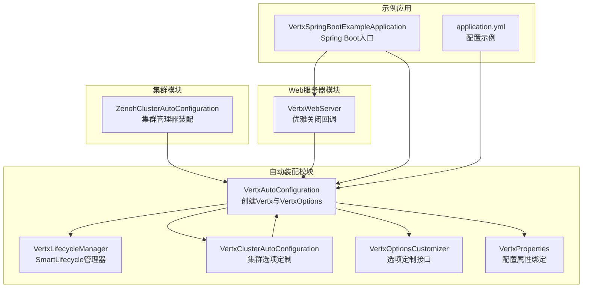
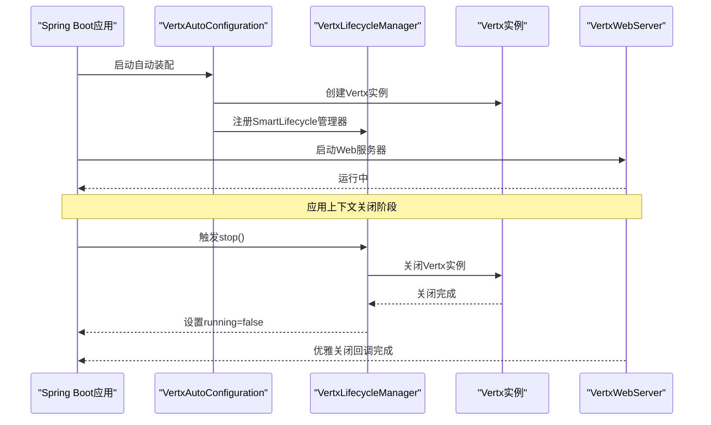
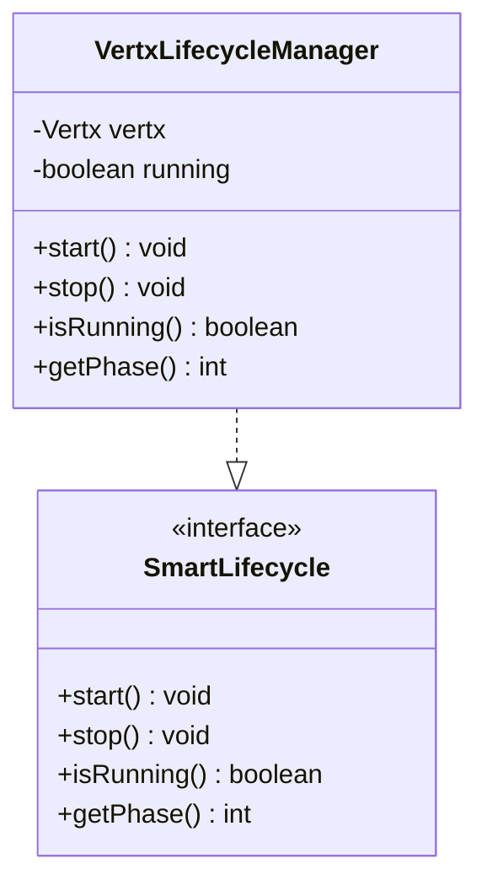
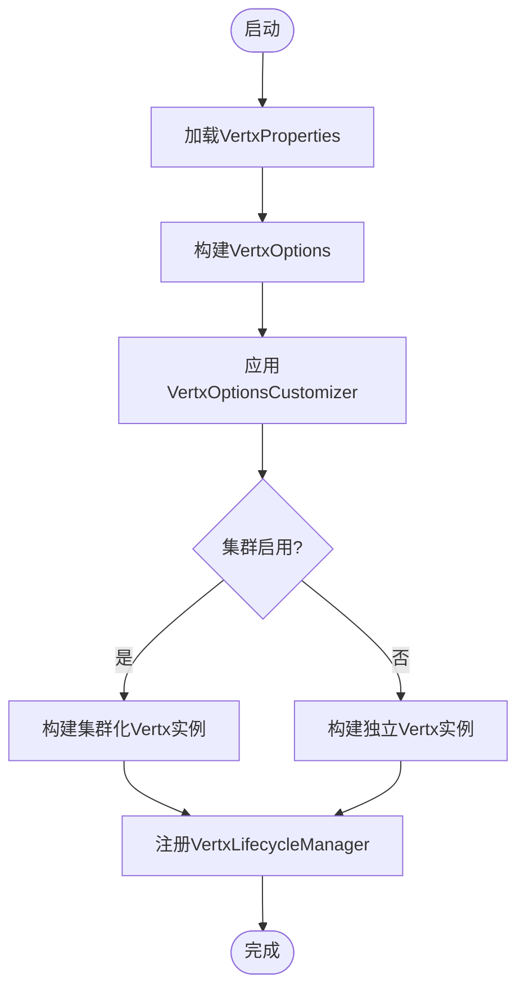
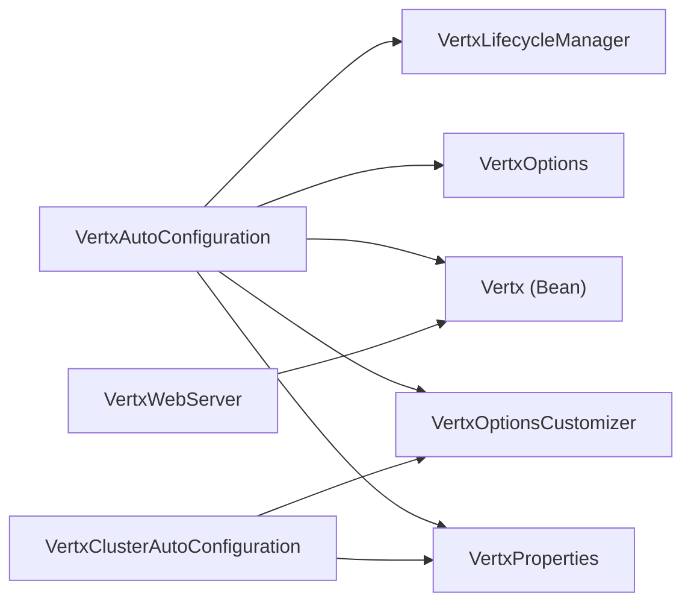

# 生命周期管理

<cite>
**本文引用的文件**
- [VertxLifecycleManager.java](file://vertx-spring-boot-autoconfigure/src/main/java/com/workoss/boot/vertx/autoconfigure/VertxLifecycleManager.java)
- [VertxAutoConfiguration.java](file://vertx-spring-boot-autoconfigure/src/main/java/com/workoss/boot/vertx/autoconfigure/VertxAutoConfiguration.java)
- [VertxOptionsCustomizer.java](file://vertx-spring-boot-autoconfigure/src/main/java/com/workoss/boot/vertx/autoconfigure/VertxOptionsCustomizer.java)
- [VertxProperties.java](file://vertx-spring-boot-autoconfigure/src/main/java/com/workoss/boot/vertx/autoconfigure/VertxProperties.java)
- [VertxClusterAutoConfiguration.java](file://vertx-spring-boot-autoconfigure/src/main/java/com/workoss/boot/vertx/autoconfigure/VertxClusterAutoConfiguration.java)
- [org.springframework.boot.autoconfigure.AutoConfiguration.imports](file://vertx-spring-boot-autoconfigure/src/main/resources/META-INF/spring/org.springframework.boot.autoconfigure.AutoConfiguration.imports)
- [VertxWebServer.java](file://vertx-spring-boot-web-server/src/main/java/com/workoss/boot/vertx/web/server/VertxWebServer.java)
- [VertxSpringBootExampleApplication.java](file://example/vertx-spring-boot-example/src/main/java/com/workoss/boot/vertx/VertxSpringBootExampleApplication.java)
- [application.yml](file://example/vertx-spring-boot-example/src/main/resources/application.yml)
- [VertxAutoConfigurationTest.java](file://vertx-spring-boot-autoconfigure/src/test/java/com/workoss/boot/vertx/autoconfigure/VertxAutoConfigurationTest.java)
</cite>

## 目录
1. [简介](#简介)
2. [项目结构](#项目结构)
3. [核心组件](#核心组件)
4. [架构总览](#架构总览)
5. [详细组件分析](#详细组件分析)
6. [依赖关系分析](#依赖关系分析)
7. [性能考量](#性能考量)
8. [故障排查指南](#故障排查指南)
9. [结论](#结论)
10. [附录](#附录)

## 简介
本文件围绕Vert.x在Spring Boot环境中的生命周期管理进行深入技术说明，重点解析VertxLifecycleManager的实现原理，涵盖以下主题：
- Vert.x实例的启动、运行状态监控与优雅关闭机制
- 生命周期回调的注册与执行时机
- 资源清理与连接关闭流程
- 与Spring Boot应用生命周期的集成（SmartLifecycle）
- 自定义生命周期钩子的实现方法与最佳实践
- 异常情况下的恢复策略与故障处理机制

## 项目结构
该仓库采用多模块结构，围绕Vert.x与Spring Boot的自动装配展开：
- vertx-spring-boot-autoconfigure：核心自动装配与生命周期管理
- vertx-spring-boot-web-server：基于Vert.x的Web服务器实现
- vertx-spring-boot-cluster-zenoh：基于Zenoh的集群管理器
- example：示例应用，演示如何启用集群与配置参数

图表来源
- [VertxAutoConfiguration.java:1-83](file://vertx-spring-boot-autoconfigure/src/main/java/com/workoss/boot/vertx/autoconfigure/VertxAutoConfiguration.java#L1-L83)
- [VertxLifecycleManager.java:1-53](file://vertx-spring-boot-autoconfigure/src/main/java/com/workoss/boot/vertx/autoconfigure/VertxLifecycleManager.java#L1-L53)
- [VertxClusterAutoConfiguration.java:1-34](file://vertx-spring-boot-autoconfigure/src/main/java/com/workoss/boot/vertx/autoconfigure/VertxClusterAutoConfiguration.java#L1-L34)
- [VertxOptionsCustomizer.java:1-19](file://vertx-spring-boot-autoconfigure/src/main/java/com/workoss/boot/vertx/autoconfigure/VertxOptionsCustomizer.java#L1-L19)
- [VertxProperties.java:1-160](file://vertx-spring-boot-autoconfigure/src/main/java/com/workoss/boot/vertx/autoconfigure/VertxProperties.java#L1-L160)
- [VertxWebServer.java:73-109](file://vertx-spring-boot-web-server/src/main/java/com/workoss/boot/vertx/web/server/VertxWebServer.java#L73-L109)
- [ZenohClusterAutoConfiguration.java:1-27](file://vertx-spring-boot-cluster-zenoh/src/main/java/com/workoss/boot/vertx/cluster/zenoh/ZenohClusterAutoConfiguration.java#L1-L27)
- [VertxSpringBootExampleApplication.java:1-14](file://example/vertx-spring-boot-example/src/main/java/com/workoss/boot/vertx/VertxSpringBootExampleApplication.java#L1-L14)
- [application.yml:1-21](file://example/vertx-spring-boot-example/src/main/resources/application.yml#L1-L21)

章节来源
- [VertxAutoConfiguration.java:1-83](file://vertx-spring-boot-autoconfigure/src/main/java/com/workoss/boot/vertx/autoconfigure/VertxAutoConfiguration.java#L1-L83)
- [org.springframework.boot.autoconfigure.AutoConfiguration.imports:1-3](file://vertx-spring-boot-autoconfigure/src/main/resources/META-INF/spring/org.springframework.boot.autoconfigure.AutoConfiguration.imports#L1-L3)

## 核心组件
本节聚焦于生命周期管理的关键组件及其职责：
- VertxAutoConfiguration：负责创建Vertx实例、VertxOptions，并注册VertxLifecycleManager
- VertxLifecycleManager：实现SmartLifecycle，确保在Spring上下文关闭时优雅关闭Vert.x
- VertxOptionsCustomizer：提供对VertxOptions的扩展定制能力
- VertxProperties：绑定配置前缀“vertx”的属性到Java对象
- VertxClusterAutoConfiguration：当启用集群时，向VertxOptions注入集群相关设置
- VertxWebServer：提供优雅关闭回调，与VertxLifecycleManager形成协同

章节来源
- [VertxAutoConfiguration.java:21-82](file://vertx-spring-boot-autoconfigure/src/main/java/com/workoss/boot/vertx/autoconfigure/VertxAutoConfiguration.java#L21-L82)
- [VertxLifecycleManager.java:12-52](file://vertx-spring-boot-autoconfigure/src/main/java/com/workoss/boot/vertx/autoconfigure/VertxLifecycleManager.java#L12-L52)
- [VertxOptionsCustomizer.java:8-18](file://vertx-spring-boot-autoconfigure/src/main/java/com/workoss/boot/vertx/autoconfigure/VertxOptionsCustomizer.java#L8-L18)
- [VertxProperties.java:8-160](file://vertx-spring-boot-autoconfigure/src/main/java/com/workoss/boot/vertx/autoconfigure/VertxProperties.java#L8-L160)
- [VertxClusterAutoConfiguration.java:13-33](file://vertx-spring-boot-autoconfigure/src/main/java/com/workoss/boot/vertx/autoconfigure/VertxClusterAutoConfiguration.java#L13-L33)
- [VertxWebServer.java:73-109](file://vertx-spring-boot-web-server/src/main/java/com/workoss/boot/vertx/web/server/VertxWebServer.java#L73-L109)

## 架构总览
下图展示了从Spring Boot启动到优雅关闭的完整生命周期流程，以及各组件之间的交互关系。

图表来源
- [VertxAutoConfiguration.java:52-81](file://vertx-spring-boot-autoconfigure/src/main/java/com/workoss/boot/vertx/autoconfigure/VertxAutoConfiguration.java#L52-L81)
- [VertxLifecycleManager.java:23-40](file://vertx-spring-boot-autoconfigure/src/main/java/com/workoss/boot/vertx/autoconfigure/VertxLifecycleManager.java#L23-L40)
- [VertxWebServer.java:90-109](file://vertx-spring-boot-web-server/src/main/java/com/workoss/boot/vertx/web/server/VertxWebServer.java#L90-L109)

## 详细组件分析

### VertxLifecycleManager 实现原理
- 角色定位：实现SmartLifecycle，作为Spring管理的生命周期组件，负责在应用上下文关闭时优雅关闭Vert.x实例
- 关键行为
  - start：标记running=true，记录启动日志
  - stop：若处于运行状态，则调用Vertx.close()并等待完成，随后记录成功日志
  - isRunning：返回当前运行状态
  - getPhase：设置关闭阶段为Integer.MAX_VALUE-1，确保在Web服务器之后、其他Bean之前关闭
- 与Spring Boot的集成
  - 通过@AutoConfiguration自动装配，由VertxAutoConfiguration注册为Bean
  - 通过SmartLifecycle接口参与Spring的生命周期管理

图表来源
- [VertxLifecycleManager.java:12-52](file://vertx-spring-boot-autoconfigure/src/main/java/com/workoss/boot/vertx/autoconfigure/VertxLifecycleManager.java#L12-L52)

章节来源
- [VertxLifecycleManager.java:12-52](file://vertx-spring-boot-autoconfigure/src/main/java/com/workoss/boot/vertx/autoconfigure/VertxLifecycleManager.java#L12-L52)

### VertxAutoConfiguration 配置与装配
- VertxOptions Bean
  - 从VertxProperties读取配置项（事件循环池大小、工作线程池大小、内部阻塞池大小、是否优先原生传输等）
  - 支持通过VertxOptionsCustomizer列表对VertxOptions进行扩展定制
- Vertx Bean
  - 当vertx.cluster.enabled为true时，使用ClusterManager构建集群化Vertx实例；否则创建独立实例
  - 使用CompletableFuture.join()等待异步构建完成
- VertxLifecycleManager Bean
  - 将Vertx实例注入到管理器中，注册为SmartLifecycle Bean

图表来源
- [VertxAutoConfiguration.java:28-75](file://vertx-spring-boot-autoconfigure/src/main/java/com/workoss/boot/vertx/autoconfigure/VertxAutoConfiguration.java#L28-L75)
- [VertxProperties.java:8-160](file://vertx-spring-boot-autoconfigure/src/main/java/com/workoss/boot/vertx/autoconfigure/VertxProperties.java#L8-L160)
- [VertxOptionsCustomizer.java:8-18](file://vertx-spring-boot-autoconfigure/src/main/java/com/workoss/boot/vertx/autoconfigure/VertxOptionsCustomizer.java#L8-L18)

章节来源
- [VertxAutoConfiguration.java:28-75](file://vertx-spring-boot-autoconfigure/src/main/java/com/workoss/boot/vertx/autoconfigure/VertxAutoConfiguration.java#L28-L75)
- [VertxProperties.java:8-160](file://vertx-spring-boot-autoconfigure/src/main/java/com/workoss/boot/vertx/autoconfigure/VertxProperties.java#L8-L160)
- [VertxOptionsCustomizer.java:8-18](file://vertx-spring-boot-autoconfigure/src/main/java/com/workoss/boot/vertx/autoconfigure/VertxOptionsCustomizer.java#L8-L18)

### VertxClusterAutoConfiguration 集群配置
- 在vertx.cluster.enabled=true且存在ClusterManager Bean时生效
- 通过VertxOptionsCustomizer向VertxOptions注入EventBus的host/port设置
- 与VertxAutoConfiguration配合，确保集群模式下的网络参数正确传递

章节来源
- [VertxClusterAutoConfiguration.java:13-33](file://vertx-spring-boot-autoconfigure/src/main/java/com/workoss/boot/vertx/autoconfigure/VertxClusterAutoConfiguration.java#L13-L33)

### VertxWebServer 优雅关闭回调
- 提供shutDownGracefully方法，调用Vert.x HTTP服务器的shutdown并等待完成
- 通过回调通知请求活动或空闲状态，便于上层系统做出决策

章节来源
- [VertxWebServer.java:90-109](file://vertx-spring-boot-web-server/src/main/java/com/workoss/boot/vertx/web/server/VertxWebServer.java#L90-L109)

### 示例应用与配置
- 示例应用入口类VertxSpringBootExampleApplication用于启动Spring Boot应用
- application.yml展示如何启用集群与设置原生传输偏好

章节来源
- [VertxSpringBootExampleApplication.java:7-11](file://example/vertx-spring-boot-example/src/main/java/com/workoss/boot/vertx/VertxSpringBootExampleApplication.java#L7-L11)
- [application.yml:16-20](file://example/vertx-spring-boot-example/src/main/resources/application.yml#L16-L20)

## 依赖关系分析
- 组件耦合
  - VertxAutoConfiguration依赖Vertx、VertxOptions、VertxOptionsCustomizer、ClusterManager、VertxProperties
  - VertxLifecycleManager依赖Vertx与SmartLifecycle
  - VertxClusterAutoConfiguration依赖VertxOptionsCustomizer与VertxProperties
  - VertxWebServer依赖Vertx HTTP服务器
- 外部依赖
  - Spring Boot自动装配机制
  - Vert.x核心库（Vertx、VertxOptions、VertxBuilder）

图表来源
- [VertxAutoConfiguration.java:28-81](file://vertx-spring-boot-autoconfigure/src/main/java/com/workoss/boot/vertx/autoconfigure/VertxAutoConfiguration.java#L28-L81)
- [VertxClusterAutoConfiguration.java:18-32](file://vertx-spring-boot-autoconfigure/src/main/java/com/workoss/boot/vertx/autoconfigure/VertxClusterAutoConfiguration.java#L18-L32)
- [VertxWebServer.java:73-109](file://vertx-spring-boot-web-server/src/main/java/com/workoss/boot/vertx/web/server/VertxWebServer.java#L73-L109)

章节来源
- [VertxAutoConfiguration.java:28-81](file://vertx-spring-boot-autoconfigure/src/main/java/com/workoss/boot/vertx/autoconfigure/VertxAutoConfiguration.java#L28-L81)
- [VertxClusterAutoConfiguration.java:18-32](file://vertx-spring-boot-autoconfigure/src/main/java/com/workoss/boot/vertx/autoconfigure/VertxClusterAutoConfiguration.java#L18-L32)
- [VertxWebServer.java:73-109](file://vertx-spring-boot-web-server/src/main/java/com/workoss/boot/vertx/web/server/VertxWebServer.java#L73-L109)

## 性能考量
- 线程池配置
  - 事件循环池大小、工作线程池大小、内部阻塞池大小均可通过配置属性调整，以适配不同负载场景
- 原生传输偏好
  - prefer-native-transport可提升网络I/O性能，但需结合运行平台特性评估
- 集群模式
  - 集群化部署会引入额外的网络开销与同步成本，应根据业务需求权衡
- 关闭阶段
  - VertxLifecycleManager的关闭阶段设置为接近最大值，确保在Web服务器之后、其他Bean之前关闭，避免资源竞争

章节来源
- [VertxProperties.java:14-71](file://vertx-spring-boot-autoconfigure/src/main/java/com/workoss/boot/vertx/autoconfigure/VertxProperties.java#L14-L71)
- [VertxAutoConfiguration.java:42-47](file://vertx-spring-boot-autoconfigure/src/main/java/com/workoss/boot/vertx/autoconfigure/VertxAutoConfiguration.java#L42-L47)
- [VertxLifecycleManager.java:48-51](file://vertx-spring-boot-autoconfigure/src/main/java/com/workoss/boot/vertx/autoconfigure/VertxLifecycleManager.java#L48-L51)

## 故障排查指南
- 优雅关闭失败
  - 检查VertxLifecycleManager的stop逻辑是否被调用（SmartLifecycle生命周期）
  - 确认Vertx.close()的CompletableFuture已完成，避免阻塞
- Web服务器与Vert.x关闭顺序问题
  - VertxWebServer提供优雅关闭回调，确保HTTP请求处理完成后再关闭Vert.x
- 集群连接异常
  - 若启用集群，检查EventBus host/port配置是否正确
  - 确保ClusterManager可用且网络连通
- 日志与断点
  - 利用日志输出定位启动与关闭阶段的问题
  - 可参考单元测试验证默认Bean创建与属性绑定

章节来源
- [VertxLifecycleManager.java:29-40](file://vertx-spring-boot-autoconfigure/src/main/java/com/workoss/boot/vertx/autoconfigure/VertxLifecycleManager.java#L29-L40)
- [VertxWebServer.java:90-109](file://vertx-spring-boot-web-server/src/main/java/com/workoss/boot/vertx/web/server/VertxWebServer.java#L90-L109)
- [VertxClusterAutoConfiguration.java:24-29](file://vertx-spring-boot-autoconfigure/src/main/java/com/workoss/boot/vertx/autoconfigure/VertxClusterAutoConfiguration.java#L24-L29)
- [VertxAutoConfigurationTest.java:16-23](file://vertx-spring-boot-autoconfigure/src/test/java/com/workoss/boot/vertx/autoconfigure/VertxAutoConfigurationTest.java#L16-L23)

## 结论
VertxLifecycleManager通过实现SmartLifecycle，将Vert.x实例的生命周期与Spring Boot应用生命周期紧密耦合，实现了优雅关闭与资源清理。结合VertxAutoConfiguration的配置装配、VertxOptionsCustomizer的扩展能力以及VertxWebServer的优雅关闭回调，整体方案具备良好的可维护性与可扩展性。在集群场景下，VertxClusterAutoConfiguration进一步完善了网络参数的注入与管理。

## 附录
- 自定义生命周期钩子
  - 通过实现VertxOptionsCustomizer接口，在VertxOptions构建阶段注入自定义配置
  - 通过条件注解控制自动装配的启用与禁用
- 最佳实践
  - 明确关闭阶段顺序，避免资源竞争
  - 在集群环境中合理配置EventBus网络参数
  - 使用日志与单元测试验证关键路径

章节来源
- [VertxOptionsCustomizer.java:8-18](file://vertx-spring-boot-autoconfigure/src/main/java/com/workoss/boot/vertx/autoconfigure/VertxOptionsCustomizer.java#L8-L18)
- [VertxClusterAutoConfiguration.java:13-33](file://vertx-spring-boot-autoconfigure/src/main/java/com/workoss/boot/vertx/autoconfigure/VertxClusterAutoConfiguration.java#L13-L33)
- [VertxAutoConfigurationTest.java:51-61](file://vertx-spring-boot-autoconfigure/src/test/java/com/workoss/boot/vertx/autoconfigure/VertxAutoConfigurationTest.java#L51-L61)