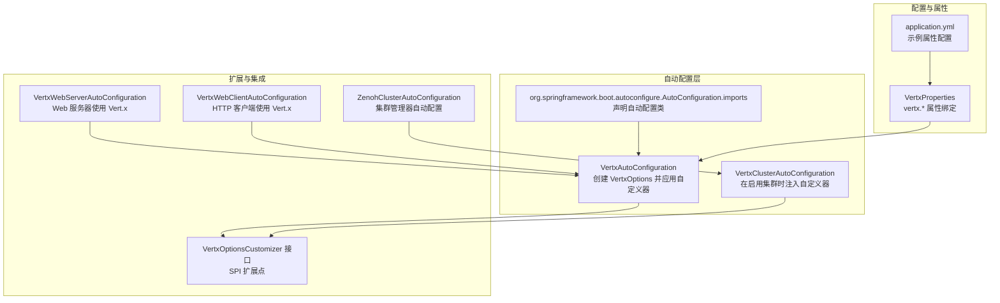
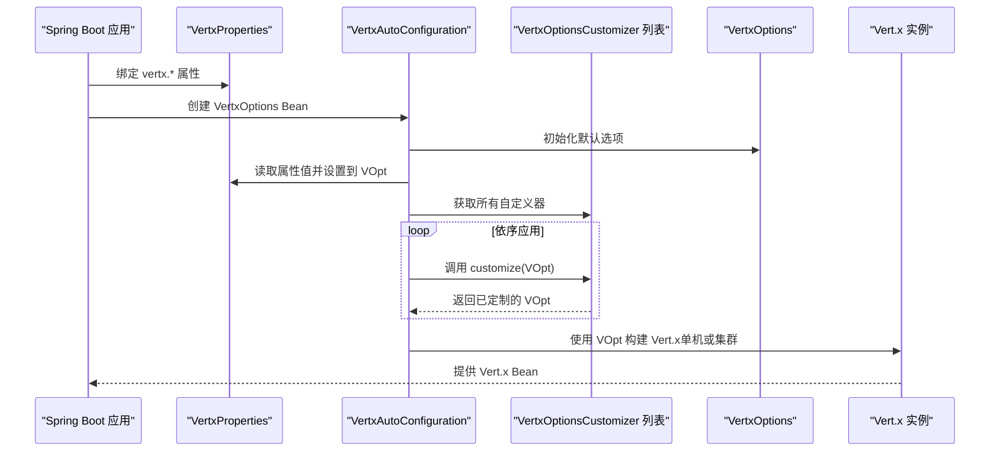
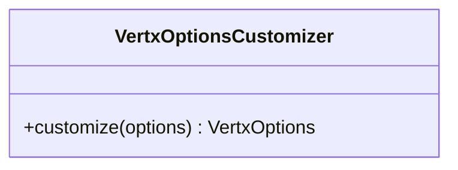
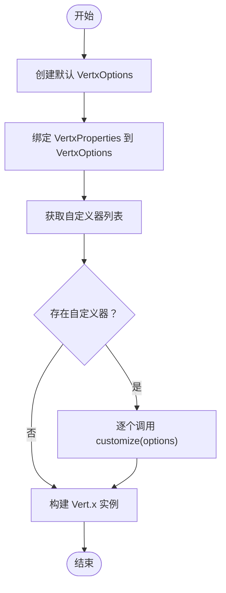
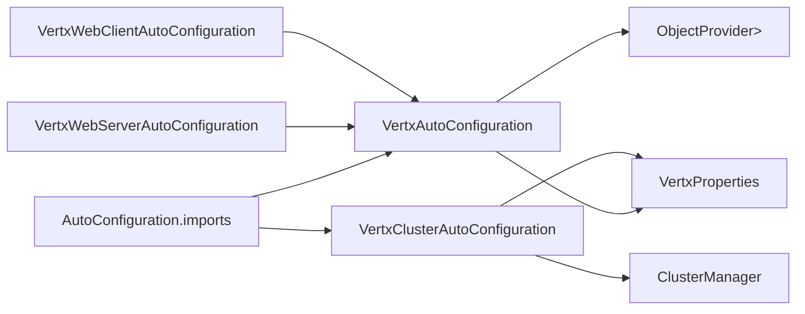

# 选项自定义器

<cite>
**本文引用的文件**
- [VertxOptionsCustomizer.java](file://vertx-spring-boot-autoconfigure/src/main/java/com/workoss/boot/vertx/autoconfigure/VertxOptionsCustomizer.java)
- [VertxAutoConfiguration.java](file://vertx-spring-boot-autoconfigure/src/main/java/com/workoss/boot/vertx/autoconfigure/VertxAutoConfiguration.java)
- [VertxProperties.java](file://vertx-spring-boot-autoconfigure/src/main/java/com/workoss/boot/vertx/autoconfigure/VertxProperties.java)
- [VertxClusterAutoConfiguration.java](file://vertx-spring-boot-autoconfigure/src/main/java/com/workoss/boot/vertx/autoconfigure/VertxClusterAutoConfiguration.java)
- [org.springframework.boot.autoconfigure.AutoConfiguration.imports（自动配置导入）](file://vertx-spring-boot-autoconfigure/src/main/resources/META-INF/spring/org.springframework.boot.autoconfigure.AutoConfiguration.imports)
- [VertxAutoConfigurationTest.java](file://vertx-spring-boot-autoconfigure/src/test/java/com/workoss/boot/vertx/autoconfigure/VertxAutoConfigurationTest.java)
- [application.yml（示例应用配置）](file://example/vertx-spring-boot-example/src/main/resources/application.yml)
- [VertxWebServerAutoConfiguration.java](file://vertx-spring-boot-web-server/src/main/java/com/workoss/boot/vertx/web/server/VertxWebServerAutoConfiguration.java)
- [VertxWebClientAutoConfiguration.java](file://vertx-spring-boot-web-client/src/main/java/com/workoss/boot/vertx/web/client/VertxWebClientAutoConfiguration.java)
- [ZenohClusterAutoConfiguration.java](file://vertx-spring-boot-cluster-zenoh/src/main/java/com/workoss/boot/vertx/cluster/zenoh/ZenohClusterAutoConfiguration.java)
</cite>

## 目录
1. [简介](#简介)
2. [项目结构](#项目结构)
3. [核心组件](#核心组件)
4. [架构总览](#架构总览)
5. [详细组件分析](#详细组件分析)
6. [依赖分析](#依赖分析)
7. [性能考虑](#性能考虑)
8. [故障排查指南](#故障排查指南)
9. [结论](#结论)
10. [附录](#附录)

## 简介
本文件围绕“选项自定义器”功能展开，系统性阐述 VertxOptionsCustomizer 接口的设计理念、在 Spring Boot 自动配置中的集成方式、以及通过 SPI 机制扩展 Vert.x 配置的路径。文档重点说明：
- 自定义器的注册与执行流程
- 多个自定义器的执行顺序与覆盖规则
- 与标准配置（属性绑定）的冲突处理
- 实战示例：网络配置、安全设置、性能参数的定制化
- 扩展 Vert.x 功能的最佳实践与常见使用模式

## 项目结构
该仓库采用多模块组织，核心与自定义器相关的模块如下：
- vertx-spring-boot-autoconfigure：提供 Vert.x 核心自动配置、选项自定义器接口、属性绑定与生命周期管理
- vertx-spring-boot-web-server：基于 Vert.x 的响应式 Web 服务器自动配置
- vertx-spring-boot-web-client：基于 Vert.x 的 HTTP 客户端自动配置
- vertx-spring-boot-cluster-zenoh：基于 Zenoh 的集群管理器自动配置（演示如何通过自定义器影响事件总线选项）
- example/vertx-spring-boot-example：示例应用，展示属性驱动的配置

图表来源
- [VertxAutoConfiguration.java:21-82](file://vertx-spring-boot-autoconfigure/src/main/java/com/workoss/boot/vertx/autoconfigure/VertxAutoConfiguration.java#L21-L82)
- [VertxClusterAutoConfiguration.java:13-33](file://vertx-spring-boot-autoconfigure/src/main/java/com/workoss/boot/vertx/autoconfigure/VertxClusterAutoConfiguration.java#L13-L33)
- [org.springframework.boot.autoconfigure.AutoConfiguration.imports:1-3](file://vertx-spring-boot-autoconfigure/src/main/resources/META-INF/spring/org.springframework.boot.autoconfigure.AutoConfiguration.imports#L1-L3)
- [VertxProperties.java:8-160](file://vertx-spring-boot-autoconfigure/src/main/java/com/workoss/boot/vertx/autoconfigure/VertxProperties.java#L8-L160)
- [application.yml:16-20](file://example/vertx-spring-boot-example/src/main/resources/application.yml#L16-L20)
- [VertxWebServerAutoConfiguration.java:17-30](file://vertx-spring-boot-web-server/src/main/java/com/workoss/boot/vertx/web/server/VertxWebServerAutoConfiguration.java#L17-L30)
- [VertxWebClientAutoConfiguration.java:16-37](file://vertx-spring-boot-web-client/src/main/java/com/workoss/boot/vertx/web/client/VertxWebClientAutoConfiguration.java#L16-L37)
- [ZenohClusterAutoConfiguration.java:15-26](file://vertx-spring-boot-cluster-zenoh/src/main/java/com/workoss/boot/vertx/cluster/zenoh/ZenohClusterAutoConfiguration.java#L15-L26)

章节来源
- [org.springframework.boot.autoconfigure.AutoConfiguration.imports:1-3](file://vertx-spring-boot-autoconfigure/src/main/resources/META-INF/spring/org.springframework.boot.autoconfigure.AutoConfiguration.imports#L1-L3)
- [VertxAutoConfiguration.java:21-82](file://vertx-spring-boot-autoconfigure/src/main/java/com/workoss/boot/vertx/autoconfigure/VertxAutoConfiguration.java#L21-L82)
- [VertxProperties.java:8-160](file://vertx-spring-boot-autoconfigure/src/main/java/com/workoss/boot/vertx/autoconfigure/VertxProperties.java#L8-L160)

## 核心组件
- VertxOptionsCustomizer 接口：函数式回调接口，用于在 Vert.x 实例创建前对 VertxOptions 进行定制。该接口是 SPI 扩展点，允许第三方模块或业务代码以声明式方式参与配置。
- VertxAutoConfiguration：核心自动配置类，负责：
  - 将 VertxProperties 绑定到 VertxOptions
  - 从容器中收集所有 VertxOptionsCustomizer 实例并依次应用
  - 构建并返回最终的 VertxOptions
  - 基于是否启用集群，选择构建单机或集群化的 Vert.x 实例
- VertxProperties：提供 vertx.* 前缀的配置属性映射，如事件循环池大小、工作线程池大小、原生传输偏好、虚拟线程开关、集群配置等。
- VertxClusterAutoConfiguration：当启用集群时，提供一个 VertxOptionsCustomizer，用于设置事件总线的主机与端口等选项。

章节来源
- [VertxOptionsCustomizer.java:5-18](file://vertx-spring-boot-autoconfigure/src/main/java/com/workoss/boot/vertx/autoconfigure/VertxOptionsCustomizer.java#L5-L18)
- [VertxAutoConfiguration.java:28-75](file://vertx-spring-boot-autoconfigure/src/main/java/com/workoss/boot/vertx/autoconfigure/VertxAutoConfiguration.java#L28-L75)
- [VertxProperties.java:8-160](file://vertx-spring-boot-autoconfigure/src/main/java/com/workoss/boot/vertx/autoconfigure/VertxProperties.java#L8-L160)
- [VertxClusterAutoConfiguration.java:18-32](file://vertx-spring-boot-autoconfigure/src/main/java/com/workoss/boot/vertx/autoconfigure/VertxClusterAutoConfiguration.java#L18-L32)

## 架构总览
下图展示了“选项自定义器”的运行时架构：属性绑定生成初始 VertxOptions，随后按顺序应用所有自定义器，最终由自动配置创建 Vert.x 实例。

图表来源
- [VertxAutoConfiguration.java:28-75](file://vertx-spring-boot-autoconfigure/src/main/java/com/workoss/boot/vertx/autoconfigure/VertxAutoConfiguration.java#L28-L75)
- [VertxProperties.java:8-160](file://vertx-spring-boot-autoconfigure/src/main/java/com/workoss/boot/vertx/autoconfigure/VertxProperties.java#L8-L160)

## 详细组件分析

### VertxOptionsCustomizer 接口
- 设计理念：以函数式回调的方式，允许任意数量的扩展模块在不直接耦合的情况下修改 VertxOptions。该接口是 SPI 扩展点，便于第三方模块或业务代码注入自定义逻辑。
- 典型用途：
  - 设置事件总线主机/端口（结合集群启用）
  - 调整线程池大小、原生传输偏好、虚拟线程开关
  - 注入 SSL/TLS 或其他网络/安全相关配置（通过 VertxOptions 的相应字段）

图表来源
- [VertxOptionsCustomizer.java:9-17](file://vertx-spring-boot-autoconfigure/src/main/java/com/workoss/boot/vertx/autoconfigure/VertxOptionsCustomizer.java#L9-L17)

章节来源
- [VertxOptionsCustomizer.java:5-18](file://vertx-spring-boot-autoconfigure/src/main/java/com/workoss/boot/vertx/autoconfigure/VertxOptionsCustomizer.java#L5-L18)

### VertxAutoConfiguration：选项装配与实例创建
- 选项装配流程：
  - 创建默认 VertxOptions
  - 将 VertxProperties 中的属性写入 VertxOptions
  - 从容器获取所有 VertxOptionsCustomizer 实例并依次调用 customize 方法
  - 返回最终的 VertxOptions
- 实例创建流程：
  - 若未显式提供 Vert.x Bean，则根据是否启用集群，分别构建单机或集群化的 Vert.x 实例
  - 提供 VertxLifecycleManager Bean，用于生命周期管理

图表来源
- [VertxAutoConfiguration.java:28-75](file://vertx-spring-boot-autoconfigure/src/main/java/com/workoss/boot/vertx/autoconfigure/VertxAutoConfiguration.java#L28-L75)

章节来源
- [VertxAutoConfiguration.java:28-75](file://vertx-spring-boot-autoconfigure/src/main/java/com/workoss/boot/vertx/autoconfigure/VertxAutoConfiguration.java#L28-L75)

### VertxProperties：属性绑定与默认值
- 提供以下关键配置项：
  - 事件循环池大小、工作线程池大小、内部阻塞线程池大小
  - 是否优先使用原生传输
  - 虚拟线程开关
  - 集群开关、主机、端口、公网主机等
- 默认值策略：部分字段提供合理默认值，未设置的属性不会覆盖已有值（例如事件循环池大小为 0 表示使用默认）

章节来源
- [VertxProperties.java:8-160](file://vertx-spring-boot-autoconfigure/src/main/java/com/workoss/boot/vertx/autoconfigure/VertxProperties.java#L8-L160)

### VertxClusterAutoConfiguration：集群启用时的自定义器
- 当 vertx.cluster.enabled=true 且容器中存在 ClusterManager Bean 时，自动注册一个 VertxOptionsCustomizer
- 该自定义器负责设置 EventBusOptions 的主机与端口，从而影响事件总线的网络绑定

章节来源
- [VertxClusterAutoConfiguration.java:18-32](file://vertx-spring-boot-autoconfigure/src/main/java/com/workoss/boot/vertx/autoconfigure/VertxClusterAutoConfiguration.java#L18-L32)

### Web 服务器与客户端：如何消费 Vert.x 选项
- Web 服务器自动配置：通过 @ConditionalOnMissingBean 注入 VertxReactiveWebServerFactory，依赖已装配好的 Vert.x 实例
- Web 客户端自动配置：注入基于 Vert.x 的请求工厂与 HTTP 连接器，同样依赖 Vert.x 实例

章节来源
- [VertxWebServerAutoConfiguration.java:24-29](file://vertx-spring-boot-web-server/src/main/java/com/workoss/boot/vertx/web/server/VertxWebServerAutoConfiguration.java#L24-L29)
- [VertxWebClientAutoConfiguration.java:21-36](file://vertx-spring-boot-web-client/src/main/java/com/workoss/boot/vertx/web/client/VertxWebClientAutoConfiguration.java#L21-L36)

### 示例应用：属性驱动的配置
- 示例应用的 application.yml 展示了如何启用集群与关闭原生传输偏好等配置

章节来源
- [application.yml:16-20](file://example/vertx-spring-boot-example/src/main/resources/application.yml#L16-L20)

## 依赖分析
- 自动配置导入：通过 META-INF/spring/org.springframework.boot.autoconfigure.AutoConfiguration.imports 声明自动配置类，确保 Spring Boot 在启动时加载核心自动配置与集群自动配置
- 组件耦合：
  - VertxAutoConfiguration 依赖 VertxProperties 与 ObjectProvider<List<VertxOptionsCustomizer>>
  - VertxClusterAutoConfiguration 依赖 ClusterManager Bean 与 VertxProperties
  - Web 模块仅依赖 Vert.x 实例，不直接参与选项定制

图表来源
- [org.springframework.boot.autoconfigure.AutoConfiguration.imports:1-3](file://vertx-spring-boot-autoconfigure/src/main/resources/META-INF/spring/org.springframework.boot.autoconfigure.AutoConfiguration.imports#L1-L3)
- [VertxAutoConfiguration.java:28-75](file://vertx-spring-boot-autoconfigure/src/main/java/com/workoss/boot/vertx/autoconfigure/VertxAutoConfiguration.java#L28-L75)
- [VertxClusterAutoConfiguration.java:18-32](file://vertx-spring-boot-autoconfigure/src/main/java/com/workoss/boot/vertx/autoconfigure/VertxClusterAutoConfiguration.java#L18-L32)
- [VertxWebServerAutoConfiguration.java:24-29](file://vertx-spring-boot-web-server/src/main/java/com/workoss/boot/vertx/web/server/VertxWebServerAutoConfiguration.java#L24-L29)
- [VertxWebClientAutoConfiguration.java:21-36](file://vertx-spring-boot-web-client/src/main/java/com/workoss/boot/vertx/web/client/VertxWebClientAutoConfiguration.java#L21-L36)

章节来源
- [org.springframework.boot.autoconfigure.AutoConfiguration.imports:1-3](file://vertx-spring-boot-autoconfigure/src/main/resources/META-INF/spring/org.springframework.boot.autoconfigure.AutoConfiguration.imports#L1-L3)
- [VertxAutoConfiguration.java:28-75](file://vertx-spring-boot-autoconfigure/src/main/java/com/workoss/boot/vertx/autoconfigure/VertxAutoConfiguration.java#L28-L75)
- [VertxClusterAutoConfiguration.java:18-32](file://vertx-spring-boot-autoconfigure/src/main/java/com/workoss/boot/vertx/autoconfigure/VertxClusterAutoConfiguration.java#L18-L32)

## 性能考虑
- 线程池规模：通过 VertxProperties 调整事件循环池与工作线程池大小，避免过小导致背压，过大导致上下文切换开销增加
- 原生传输：在 Linux/macOS 上启用 epoll/kqueue 可提升网络 I/O 性能；在特定容器或平台需谨慎评估
- 虚拟线程：启用虚拟线程可降低阻塞任务的线程占用，但需关注与传统线程模型的兼容性
- 集群网络：事件总线的主机与端口应与部署环境一致，避免不必要的网络延迟或连接失败

## 故障排查指南
- 自定义器未生效
  - 确认自定义器 Bean 已被容器发现（可通过 @Bean 或 @Component 注册）
  - 确认自定义器在 VertxAutoConfiguration 执行之前已被注册
- 选项被覆盖
  - 属性绑定与自定义器的覆盖顺序：先绑定属性，再依次应用自定义器。若自定义器最后设置某字段，将覆盖之前的值
- 集群配置无效
  - 确认 vertx.cluster.enabled=true 且存在 ClusterManager Bean
  - 确认自定义器正确设置了 EventBusOptions 的主机与端口
- 单元测试参考
  - 测试用例展示了属性绑定、自定义器应用与现有 Vert.x Bean 不被覆盖的行为

章节来源
- [VertxAutoConfigurationTest.java:16-94](file://vertx-spring-boot-autoconfigure/src/test/java/com/workoss/boot/vertx/autoconfigure/VertxAutoConfigurationTest.java#L16-L94)

## 结论
VertxOptionsCustomizer 通过函数式回调与 Spring Bean 容器实现了对 Vert.x 配置的灵活扩展。配合属性绑定与自动配置，既保证了易用性，又提供了强大的可定制能力。在实际工程中，建议：
- 将通用的配置逻辑下沉为独立的自定义器 Bean，便于复用与测试
- 明确自定义器的职责边界，避免过度耦合
- 在集群场景下，优先通过自定义器设置事件总线网络参数
- 结合性能指标与监控，持续优化线程池与传输层配置

## 附录

### 实现示例与最佳实践
- 自定义网络配置
  - 通过自定义器设置事件总线主机与端口（适用于集群场景）
  - 参考：[VertxClusterAutoConfiguration.java:18-32](file://vertx-spring-boot-autoconfigure/src/main/java/com/workoss/boot/vertx/autoconfigure/VertxClusterAutoConfiguration.java#L18-L32)
- 自定义安全设置
  - 在自定义器中设置 SSL/TLS 相关选项（通过 VertxOptions 对应字段）
  - 注意：具体字段名请参考 Vert.x 文档与版本
- 自定义性能参数
  - 调整事件循环池大小、工作线程池大小、原生传输偏好、虚拟线程开关
  - 参考：[VertxProperties.java:8-160](file://vertx-spring-boot-autoconfigure/src/main/java/com/workoss/boot/vertx/autoconfigure/VertxProperties.java#L8-L160)
- 冲突处理与覆盖规则
  - 属性绑定先于自定义器执行；自定义器之间按注册顺序依次覆盖
  - 如需严格控制顺序，可在自定义器上使用 @DependsOn 或调整 Bean 定义顺序
- 常见使用模式
  - 将不同维度的配置拆分为多个自定义器，便于组合与测试
  - 在测试环境中通过 @TestConfiguration 注入自定义器，验证行为