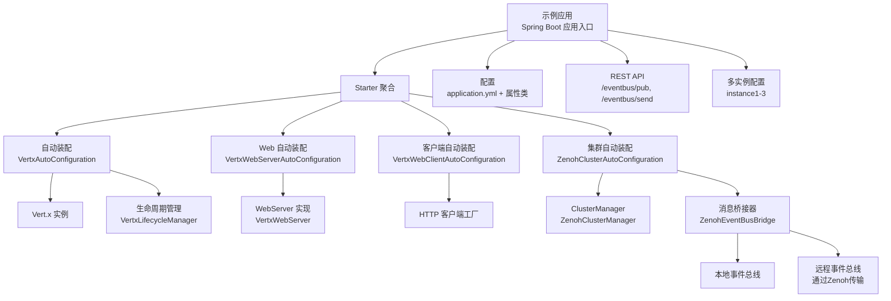
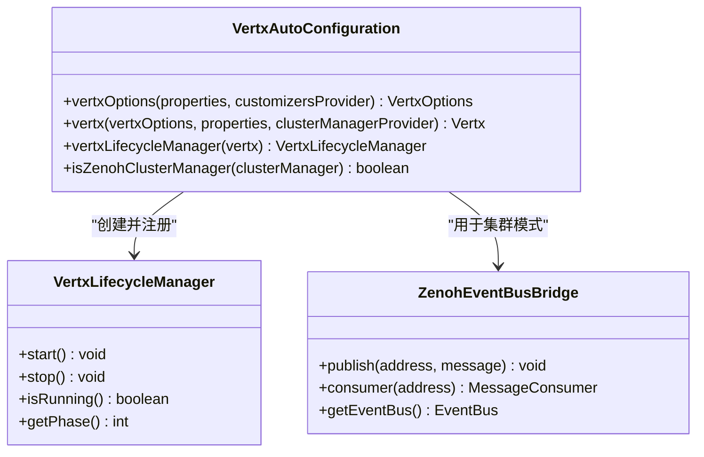
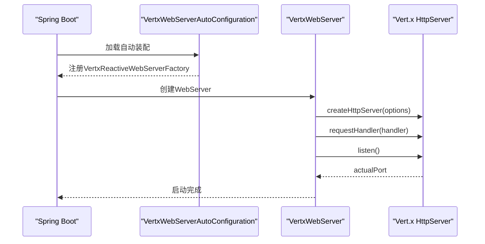
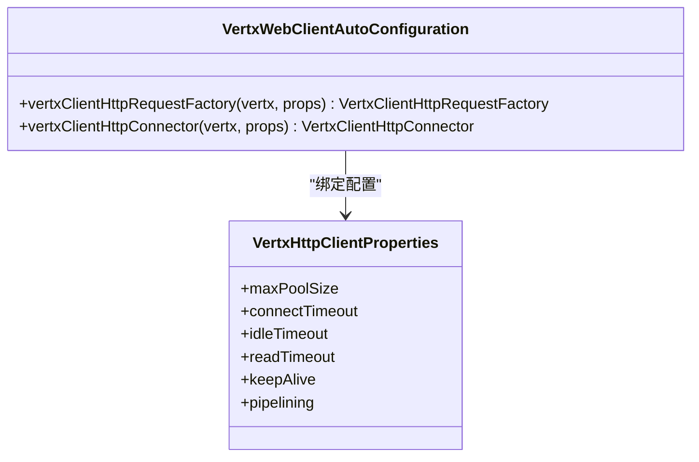
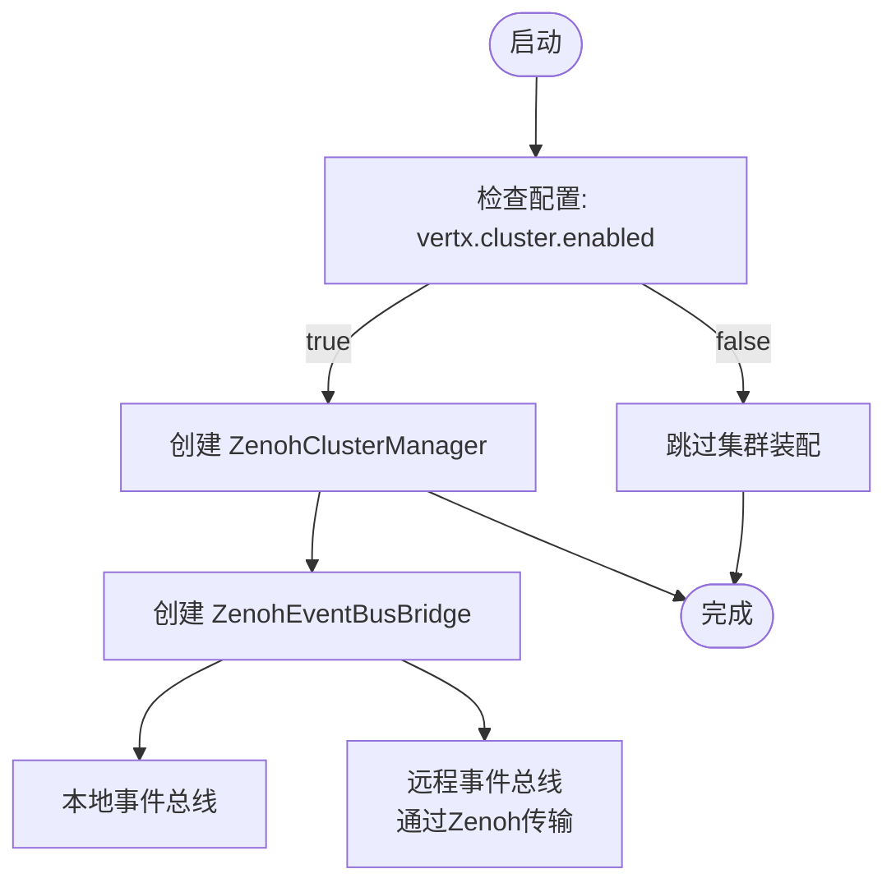
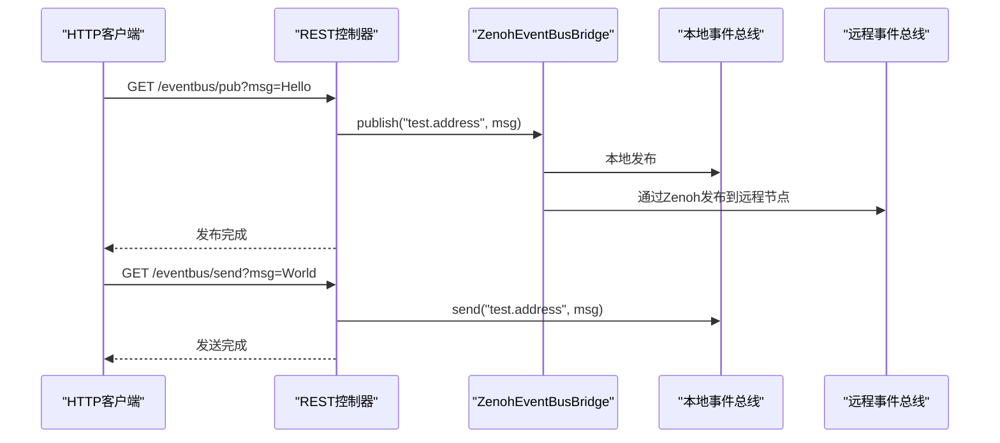
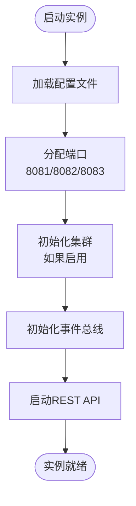
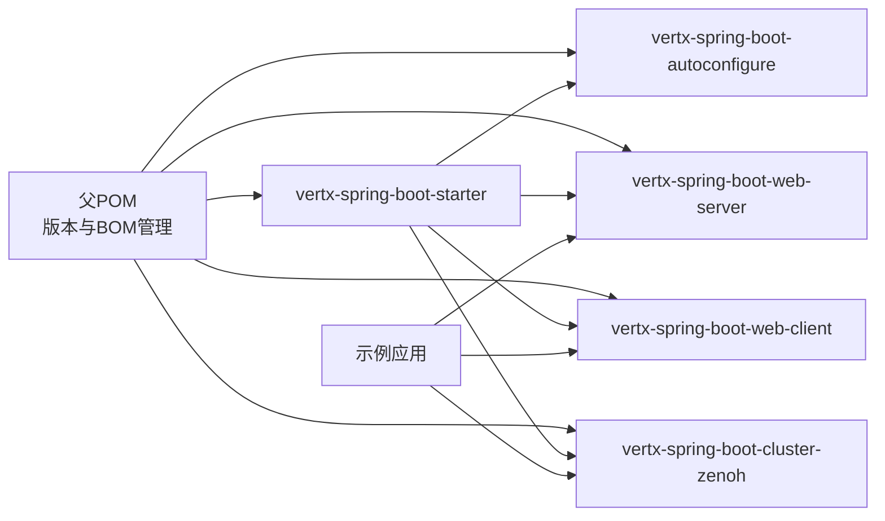

# 示例和最佳实践

<cite>
**本文引用的文件**
- [pom.xml](file://pom.xml)
- [VertxSpringBootExampleApplication.java](file://example/vertx-spring-boot-example/src/main/java/com/workoss/boot/vertx/VertxSpringBootExampleApplication.java)
- [application.yml](file://example/vertx-spring-boot-example/src/main/resources/application.yml)
- [application-instance1.yml](file://example/vertx-spring-boot-example/src/main/resources/application-instance1.yml)
- [application-instance2.yml](file://example/vertx-spring-boot-example/src/main/resources/application-instance2.yml)
- [application-instance3.yml](file://example/vertx-spring-boot-example/src/main/resources/application-instance3.yml)
- [VertxSpringBootExampleApplicationTests.java](file://example/vertx-spring-boot-example/src/test/java/com/workoss/boot/vertx/VertxSpringBootExampleApplicationTests.java)
- [pom.xml](file://example/vertx-spring-boot-example/pom.xml)
- [VertxAutoConfiguration.java](file://vertx-spring-boot-autoconfigure/src/main/java/com/workoss/boot/vertx/autoconfigure/VertxAutoConfiguration.java)
- [VertxProperties.java](file://vertx-spring-boot-autoconfigure/src/main/java/com/workoss/boot/vertx/autoconfigure/VertxProperties.java)
- [VertxOptionsCustomizer.java](file://vertx-spring-boot-autoconfigure/src/main/java/com/workoss/boot/vertx/autoconfigure/VertxOptionsCustomizer.java)
- [VertxLifecycleManager.java](file://vertx-spring-boot-autoconfigure/src/main/java/com/workoss/boot/vertx/autoconfigure/VertxLifecycleManager.java)
- [VertxWebServerAutoConfiguration.java](file://vertx-spring-boot-web-server/src/main/java/com/workoss/boot/vertx/web/server/VertxWebServerAutoConfiguration.java)
- [VertxHttpServerProperties.java](file://vertx-spring-boot-web-server/src/main/java/com/workoss/boot/vertx/web/server/VertxHttpServerProperties.java)
- [VertxWebServer.java](file://vertx-spring-boot-web-server/src/main/java/com/workoss/boot/vertx/web/server/VertxWebServer.java)
- [VertxWebClientAutoConfiguration.java](file://vertx-spring-boot-web-client/src/main/java/com/workoss/boot/vertx/web/client/VertxWebClientAutoConfiguration.java)
- [VertxHttpClientProperties.java](file://vertx-spring-boot-web-client/src/main/java/com/workoss/boot/vertx/web/client/VertxHttpClientProperties.java)
- [ZenohClusterAutoConfiguration.java](file://vertx-spring-boot-cluster-zenoh/src/main/java/com/workoss/boot/vertx/cluster/zenoh/ZenohClusterAutoConfiguration.java)
- [ZenohClusterProperties.java](file://vertx-spring-boot-cluster-zenoh/src/main/java/com/workoss/boot/vertx/cluster/zenoh/ZenohClusterProperties.java)
- [ZenohEventBusBridge.java](file://vertx-spring-boot-cluster-zenoh/src/main/java/com/workoss/boot/vertx/cluster/zenoh/ZenohEventBusBridge.java)
- [vertx-spring-boot-starter pom.xml](file://vertx-spring-boot-starter/pom.xml)
- [example pom.xml](file://example/vertx-spring-boot-example/pom.xml)
</cite>

## 更新摘要
**变更内容**
- 新增完整的示例应用程序实现，包含REST控制器和消息传递功能
- 添加多实例配置文件，展示本地和分布式消息传递
- 更新架构图以反映新的消息传递桥接机制
- 增强消息传递最佳实践和配置指南

## 目录
1. [简介](#简介)
2. [项目结构](#项目结构)
3. [核心组件](#核心组件)
4. [架构总览](#架构总览)
5. [详细组件分析](#详细组件分析)
6. [REST控制器与消息传递示例](#rest控制器与消息传递示例)
7. [多实例配置与部署](#多实例配置与部署)
8. [依赖分析](#依赖分析)
9. [性能考虑](#性能考虑)
10. [故障排除指南](#故障排除指南)
11. [结论](#结论)
12. [附录：示例与最佳实践清单](#附录示例与最佳实践清单)

## 简介
本指南面向希望在Spring Boot中使用Vert.x作为嵌入式反应式Web服务器与集群能力的开发者，提供从零到一的完整示例与最佳实践。内容覆盖：
- 示例应用的启动与运行
- Web控制器、REST API、WebSocket处理与集群应用的实现思路
- **新增**：REST控制器与消息传递功能的完整示例
- **新增**：多实例配置文件展示本地和分布式消息传递
- 配置项详解与调优建议（线程池、网络、压缩、超时等）
- 代码组织、架构设计与开发规范
- 单元测试、集成测试与性能测试方法
- 生产部署与监控建议
- 不同使用场景的配置模板与取舍说明

## 项目结构
该仓库采用多模块聚合结构，核心模块如下：
- vertx-spring-boot-autoconfigure：自动装配核心，负责创建与生命周期管理Vert.x实例
- vertx-spring-boot-web-server：基于Vert.x的Web服务器自动装配与适配
- vertx-spring-boot-web-client：基于Vert.x的HTTP客户端自动装配
- vertx-spring-boot-cluster-zenoh：基于Zenoh的集群管理器自动装配
- vertx-spring-boot-starter：聚合starter，简化引入
- **新增**：example：示例应用，演示如何启用集群、日志与Actuator，包含REST控制器和消息传递功能

```mermaid
graph TB
subgraph "示例应用"
EX_APP["示例应用<br/>VertxSpringBootExampleApplication.java"]
EX_CFG["示例配置<br/>application.yml"]
EX_INST1["实例配置1<br/>application-instance1.yml"]
EX_INST2["实例配置2<br/>application-instance2.yml"]
EX_INST3["实例配置3<br/>application-instance3.yml"]
REST_CTRL["REST控制器<br/>消息发布/订阅"]
EVENT_BUS["事件总线<br/>本地与分布式消息传递"]
end
subgraph "Starter 聚合"
ST["vertx-spring-boot-starter"]
END
subgraph "自动装配"
AC["VertxAutoConfiguration.java"]
WSA["VertxWebServerAutoConfiguration.java"]
WCA["VertxWebClientAutoConfiguration.java"]
ZCA["ZenohClusterAutoConfiguration.java"]
end
subgraph "属性配置"
VP["VertxProperties.java"]
VHP["VertxHttpServerProperties.java"]
VCP["VertxHttpClientProperties.java"]
ZCP["ZenohClusterProperties.java"]
end
EX_APP --> ST
ST --> AC
ST --> WSA
ST --> WCA
ST --> ZCA
AC --> VP
WSA --> VHP
WCA --> VCP
ZCA --> ZCP
EX_APP --> EX_CFG
EX_APP --> REST_CTRL
EX_APP --> EVENT_BUS
EX_APP --> EX_INST1
EX_APP --> EX_INST2
EX_APP --> EX_INST3
```

**图表来源**
- [VertxSpringBootExampleApplication.java:1-56](file://example/vertx-spring-boot-example/src/main/java/com/workoss/boot/vertx/VertxSpringBootExampleApplication.java#L1-L56)
- [application.yml:1-35](file://example/vertx-spring-boot-example/src/main/resources/application.yml#L1-L35)
- [application-instance1.yml:1-2](file://example/vertx-spring-boot-example/src/main/resources/application-instance1.yml#L1-L2)
- [application-instance2.yml:1-2](file://example/vertx-spring-boot-example/src/main/resources/application-instance2.yml#L1-L2)
- [application-instance3.yml:1-2](file://example/vertx-spring-boot-example/src/main/resources/application-instance3.yml#L1-L2)

**章节来源**
- [pom.xml:15-22](file://pom.xml#L15-L22)
- [example pom.xml:15-96](file://example/vertx-spring-boot-example/pom.xml#L15-L96)
- [vertx-spring-boot-starter pom.xml:17-47](file://vertx-spring-boot-starter/pom.xml#L17-L47)

## 核心组件
- 自动装配与实例创建
  - 通过自动装配创建Vert.x实例，支持本地与集群两种模式；可注入自定义选项定制器
  - 生命周期管理确保优雅关闭
- Web服务器
  - 基于Vert.x HttpServer的WebServer实现，支持优雅停机
  - 提供HTTP服务器专属配置（压缩等级、空闲超时、最大头/块大小、TCP接受队列等）
- Web客户端
  - 提供Spring Web Reactive与传统同步HTTP客户端的Vert.x后端
  - 支持连接池大小、超时、keep-alive、管线化等配置
- **新增**：消息传递与桥接
  - 基于事件总线的本地消息传递
  - **新增**：ZenohEventBusBridge实现跨节点消息传递
  - 支持本地降级和分布式广播
- 集群（Zenoh）
  - 在启用集群时自动装配Zenoh ClusterManager
  - 支持应用名/环境隔离、会话模式、连接/监听端点、JSON5配置文件

**章节来源**
- [VertxAutoConfiguration.java:28-81](file://vertx-spring-boot-autoconfigure/src/main/java/com/workoss/boot/vertx/autoconfigure/VertxAutoConfiguration.java#L28-L81)
- [VertxLifecycleManager.java:12-52](file://vertx-spring-boot-autoconfigure/src/main/java/com/workoss/boot/vertx/autoconfigure/VertxLifecycleManager.java#L12-L52)
- [VertxWebServer.java:19-110](file://vertx-spring-boot-web-server/src/main/java/com/workoss/boot/vertx/web/server/VertxWebServer.java#L19-L110)
- [VertxHttpServerProperties.java:12-93](file://vertx-spring-boot-web-server/src/main/java/com/workoss/boot/vertx/web/server/VertxHttpServerProperties.java#L12-L93)
- [VertxWebClientAutoConfiguration.java:16-37](file://vertx-spring-boot-web-client/src/main/java/com/workoss/boot/vertx/web/client/VertxWebClientAutoConfiguration.java#L16-L37)
- [VertxHttpClientProperties.java:8-89](file://vertx-spring-boot-web-client/src/main/java/com/workoss/boot/vertx/web/client/VertxHttpClientProperties.java#L8-L89)
- [ZenohClusterAutoConfiguration.java:15-26](file://vertx-spring-boot-cluster-zenoh/src/main/java/com/workoss/boot/vertx/cluster/zenoh/ZenohClusterAutoConfiguration.java#L15-L26)
- [ZenohClusterProperties.java:11-92](file://vertx-spring-boot-cluster-zenoh/src/main/java/com/workoss/boot/vertx/cluster/zenoh/ZenohClusterProperties.java#L11-L92)
- [ZenohEventBusBridge.java:1-80](file://vertx-spring-boot-cluster-zenoh/src/main/java/com/workoss/boot/vertx/cluster/zenoh/ZenohEventBusBridge.java#L1-L80)

## 架构总览
下图展示了示例应用如何通过Starter引入各模块，并由自动装配创建核心组件，最终启动Web服务与集群。**新增**：消息传递桥接机制支持本地和分布式消息传递。



**图表来源**
- [VertxSpringBootExampleApplication.java:6-56](file://example/vertx-spring-boot-example/src/main/java/com/workoss/boot/vertx/VertxSpringBootExampleApplication.java#L6-L56)
- [application.yml:3-35](file://example/vertx-spring-boot-example/src/main/resources/application.yml#L3-L35)
- [vertx-spring-boot-starter pom.xml:17-47](file://vertx-spring-boot-starter/pom.xml#L17-L47)
- [VertxAutoConfiguration.java:52-81](file://vertx-spring-boot-autoconfigure/src/main/java/com/workoss/boot/vertx/autoconfigure/VertxAutoConfiguration.java#L52-L81)
- [VertxWebServerAutoConfiguration.java:24-29](file://vertx-spring-boot-web-server/src/main/java/com/workoss/boot/vertx/web/server/VertxWebServerAutoConfiguration.java#L24-L29)
- [VertxWebClientAutoConfiguration.java:21-36](file://vertx-spring-boot-web-client/src/main/java/com/workoss/boot/vertx/web/client/VertxWebClientAutoConfiguration.java#L21-L36)
- [ZenohClusterAutoConfiguration.java:21-25](file://vertx-spring-boot-cluster-zenoh/src/main/java/com/workoss/boot/vertx/cluster/zenoh/ZenohClusterAutoConfiguration.java#L21-L25)
- [ZenohEventBusBridge.java:20-80](file://vertx-spring-boot-cluster-zenoh/src/main/java/com/workoss/boot/vertx/cluster/zenoh/ZenohEventBusBridge.java#L20-L80)

## 详细组件分析

### 自动装配与生命周期
- 创建策略
  - 当未显式声明时，自动创建VertxOptions与Vert.x实例
  - 若启用集群，则注入ClusterManager并构建集群实例
  - **新增**：检测Zenoh集群管理器，创建本地事件总线并通过桥接器处理跨节点通信
  - 可通过自定义选项定制器对VertxOptions进行扩展
- 生命周期
  - 实现SmartLifecycle，在上下文关闭时优雅关闭Vert.x事件循环



**图表来源**
- [VertxAutoConfiguration.java:28-100](file://vertx-spring-boot-autoconfigure/src/main/java/com/workoss/boot/vertx/autoconfigure/VertxAutoConfiguration.java#L28-L100)
- [VertxLifecycleManager.java:12-52](file://vertx-spring-boot-autoconfigure/src/main/java/com/workoss/boot/vertx/autoconfigure/VertxLifecycleManager.java#L12-L52)
- [ZenohEventBusBridge.java:20-80](file://vertx-spring-boot-cluster-zenoh/src/main/java/com/workoss/boot/vertx/cluster/zenoh/ZenohEventBusBridge.java#L20-L80)

**章节来源**
- [VertxAutoConfiguration.java:28-100](file://vertx-spring-boot-autoconfigure/src/main/java/com/workoss/boot/vertx/autoconfigure/VertxAutoConfiguration.java#L28-L100)
- [VertxOptionsCustomizer.java:8-18](file://vertx-spring-boot-autoconfigure/src/main/java/com/workoss/boot/vertx/autoconfigure/VertxOptionsCustomizer.java#L8-L18)
- [VertxLifecycleManager.java:12-52](file://vertx-spring-boot-autoconfigure/src/main/java/com/workoss/boot/vertx/autoconfigure/VertxLifecycleManager.java#L12-L52)

### Web服务器与HTTP配置
- WebServer实现
  - 使用Vert.x HttpServer作为底层，注册请求处理器
  - 支持优雅停机，按超时关闭连接并回调结果
- HTTP服务器专属配置
  - 压缩等级、空闲超时、最大头/块/初始行长度、TCP接受队列



**图表来源**
- [VertxWebServerAutoConfiguration.java:24-29](file://vertx-spring-boot-web-server/src/main/java/com/workoss/boot/vertx/web/server/VertxWebServerAutoConfiguration.java#L24-L29)
- [VertxWebServer.java:35-71](file://vertx-spring-boot-web-server/src/main/java/com/workoss/boot/vertx/web/server/VertxWebServer.java#L35-L71)

**章节来源**
- [VertxWebServer.java:19-110](file://vertx-spring-boot-web-server/src/main/java/com/workoss/boot/vertx/web/server/VertxWebServer.java#L19-L110)
- [VertxHttpServerProperties.java:12-93](file://vertx-spring-boot-web-server/src/main/java/com/workoss/boot/vertx/web/server/VertxHttpServerProperties.java#L12-L93)

### HTTP客户端与配置
- 客户端自动装配
  - 提供同步与响应式两种HTTP客户端工厂
- 关键配置
  - 连接池大小、连接/读取超时、空闲超时、keep-alive、管线化



**图表来源**
- [VertxWebClientAutoConfiguration.java:21-36](file://vertx-spring-boot-web-client/src/main/java/com/workoss/boot/vertx/web/client/VertxWebClientAutoConfiguration.java#L21-L36)
- [VertxHttpClientProperties.java:8-89](file://vertx-spring-boot-web-client/src/main/java/com/workoss/boot/vertx/web/client/VertxHttpClientProperties.java#L8-L89)

**章节来源**
- [VertxWebClientAutoConfiguration.java:16-37](file://vertx-spring-boot-web-client/src/main/java/com/workoss/boot/vertx/web/client/VertxWebClientAutoConfiguration.java#L16-L37)
- [VertxHttpClientProperties.java:8-89](file://vertx-spring-boot-web-client/src/main/java/com/workoss/boot/vertx/web/client/VertxHttpClientProperties.java#L8-L89)

### 集群（Zenoh）与配置
- 激活条件
  - 当vertx.cluster.enabled=true时自动装配
- 配置项
  - 应用名/环境、会话模式、连接/监听端点、JSON5配置文件路径



**图表来源**
- [ZenohClusterAutoConfiguration.java:15-26](file://vertx-spring-boot-cluster-zenoh/src/main/java/com/workoss/boot/vertx/cluster/zenoh/ZenohClusterAutoConfiguration.java#L15-L26)
- [ZenohClusterProperties.java:11-92](file://vertx-spring-boot-cluster-zenoh/src/main/java/com/workoss/boot/vertx/cluster/zenoh/ZenohClusterProperties.java#L11-L92)
- [ZenohEventBusBridge.java:20-80](file://vertx-spring-boot-cluster-zenoh/src/main/java/com/workoss/boot/vertx/cluster/zenoh/ZenohEventBusBridge.java#L20-L80)

**章节来源**
- [ZenohClusterAutoConfiguration.java:15-26](file://vertx-spring-boot-cluster-zenoh/src/main/java/com/workoss/boot/vertx/cluster/zenoh/ZenohClusterAutoConfiguration.java#L15-L26)
- [ZenohClusterProperties.java:11-92](file://vertx-spring-boot-cluster-zenoh/src/main/java/com/workoss/boot/vertx/cluster/zenoh/ZenohClusterProperties.java#L11-L92)

## REST控制器与消息传递示例

### REST控制器实现
示例应用包含一个完整的REST控制器，提供消息发布的HTTP接口：

- **GET /eventbus/pub**：发布消息到事件总线，支持本地和分布式传递
- **GET /eventbus/send**：发送消息到事件总线，本地传递
- **@PostConstruct**：初始化事件总线消费者，订阅指定地址的消息



**图表来源**
- [VertxSpringBootExampleApplication.java:32-54](file://example/vertx-spring-boot-example/src/main/java/com/workoss/boot/vertx/VertxSpringBootExampleApplication.java#L32-L54)
- [ZenohEventBusBridge.java:36-56](file://vertx-spring-boot-cluster-zenoh/src/main/java/com/workoss/boot/vertx/cluster/zenoh/ZenohEventBusBridge.java#L36-L56)

### 事件总线桥接机制
**新增**：ZenohEventBusBridge提供透明的消息传递桥接：

- **本地传递**：所有消息首先通过本地事件总线传递
- **分布式传递**：同时通过Zenoh将消息发布到远程节点
- **降级机制**：当集群不可用时，自动降级为纯本地传递
- **透明使用**：对外API保持一致，内部自动选择传递方式

**章节来源**
- [VertxSpringBootExampleApplication.java:17-56](file://example/vertx-spring-boot-example/src/main/java/com/workoss/boot/vertx/VertxSpringBootExampleApplication.java#L17-L56)
- [ZenohEventBusBridge.java:1-80](file://vertx-spring-boot-cluster-zenoh/src/main/java/com/workoss/boot/vertx/cluster/zenoh/ZenohEventBusBridge.java#L1-L80)

## 多实例配置与部署

### 多实例配置文件
示例应用提供了三个独立的配置文件，展示如何在同一台机器上运行多个Vert.x实例：

- **application-instance1.yml**：端口8081
- **application-instance2.yml**：端口8082  
- **application-instance3.yml**：端口8083

每个实例都继承基础配置，但有不同的端口设置，便于测试分布式消息传递。

### 实例启动流程


**图表来源**
- [application-instance1.yml:1-2](file://example/vertx-spring-boot-example/src/main/resources/application-instance1.yml#L1-L2)
- [application-instance2.yml:1-2](file://example/vertx-spring-boot-example/src/main/resources/application-instance2.yml#L1-L2)
- [application-instance3.yml:1-2](file://example/vertx-spring-boot-example/src/main/resources/application-instance3.yml#L1-L2)

### 分布式消息传递测试
通过启动多个实例，可以验证分布式消息传递功能：

1. **启动实例1**：`spring.profiles.active=instance1`
2. **启动实例2**：`spring.profiles.active=instance2`  
3. **启动实例3**：`spring.profiles.active=instance3`

然后使用以下命令测试消息传递：

```bash
# 在实例1中发布消息
curl "http://localhost:8081/eventbus/pub?msg=Hello%20from%20Instance1"

# 在实例2中发布消息  
curl "http://localhost:8082/eventbus/pub?msg=Hello%20from%20Instance2"

# 在实例3中发布消息
curl "http://localhost:8083/eventbus/pub?msg=Hello%20from%20Instance3"
```

**章节来源**
- [application.yml:1-35](file://example/vertx-spring-boot-example/src/main/resources/application.yml#L1-L35)
- [application-instance1.yml:1-2](file://example/vertx-spring-boot-example/src/main/resources/application-instance1.yml#L1-L2)
- [application-instance2.yml:1-2](file://example/vertx-spring-boot-example/src/main/resources/application-instance2.yml#L1-L2)
- [application-instance3.yml:1-2](file://example/vertx-spring-boot-example/src/main/resources/application-instance3.yml#L1-L2)

## 依赖分析
- 版本与BOM
  - 通过Vert.x与Spring Boot BOM统一版本，避免冲突
  - 显式覆盖日志依赖作用域，保证编译期可用
- Starter聚合
  - Starter整合自动装配、Web服务器、Web客户端与集群模块
- **新增**：示例应用依赖
  - 引入WebFlux与Actuator，便于演示与监控
  - 包含Netty DNS解析器和Lombok支持
  - 提供完整的测试框架支持



**图表来源**
- [pom.xml:35-108](file://pom.xml#L35-L108)
- [vertx-spring-boot-starter pom.xml:17-47](file://vertx-spring-boot-starter/pom.xml#L17-L47)
- [example pom.xml:15-96](file://example/vertx-spring-boot-example/pom.xml#L15-L96)

**章节来源**
- [pom.xml:35-108](file://pom.xml#L35-L108)
- [vertx-spring-boot-starter pom.xml:17-47](file://vertx-spring-boot-starter/pom.xml#L17-L47)
- [example pom.xml:15-96](file://example/vertx-spring-boot-example/pom.xml#L15-L96)

## 性能考虑
- 线程池与虚拟线程
  - 事件循环线程数默认按CPU核数*2，可根据I/O密集型工作负载调整
  - 工作线程池与内部阻塞线程池需结合业务阻塞操作量配置
  - 虚拟线程默认开启，适合大量轻量任务；若存在长阻塞任务，应谨慎评估
- 网络与传输
  - 建议优先使用原生传输（epoll/kqueue），在Linux/macOS上可获得更好吞吐
  - 合理设置TCP接受队列、空闲超时与最大头/块大小，避免内存与连接积压
- HTTP客户端
  - 连接池大小与超时需与上游服务能力匹配，避免连接耗尽或资源浪费
  - 管线化在高延迟网络可能收益有限，建议按场景验证
- **新增**：消息传递性能
  - 本地消息传递延迟最低，适合高频短消息
  - 分布式消息传递通过Zenoh传输，延迟取决于网络状况
  - 消息桥接器提供透明降级，确保系统稳定性
- 集群
  - 连接/监听端点与会话模式需与部署拓扑一致，避免脑裂或分区
  - 多租户隔离可通过应用名/环境参数区分

**章节来源**
- [VertxProperties.java:11-80](file://vertx-spring-boot-autoconfigure/src/main/java/com/workoss/boot/vertx/autoconfigure/VertxProperties.java#L11-L80)
- [VertxHttpServerProperties.java:15-44](file://vertx-spring-boot-web-server/src/main/java/com/workoss/boot/vertx/web/server/VertxHttpServerProperties.java#L15-L44)
- [VertxHttpClientProperties.java:11-40](file://vertx-spring-boot-web-client/src/main/java/com/workoss/boot/vertx/web/client/VertxHttpClientProperties.java#L11-L40)
- [ZenohClusterProperties.java:14-42](file://vertx-spring-boot-cluster-zenoh/src/main/java/com/workoss/boot/vertx/cluster/zenoh/ZenohClusterProperties.java#L14-L42)
- [ZenohEventBusBridge.java:36-56](file://vertx-spring-boot-cluster-zenoh/src/main/java/com/workoss/boot/vertx/cluster/zenoh/ZenohEventBusBridge.java#L36-L56)

## 故障排除指南
- 启动失败（无法创建集群实例）
  - 检查集群启用开关与ClusterManager是否成功注入
  - 核对连接/监听端点与网络连通性
  - **新增**：验证ZenohEventBusBridge是否正确初始化
- Web服务器启动失败
  - 端口占用或权限不足；确认server.port与系统限制
  - 优雅停机期间的异常通常可忽略，除非伴随事件循环已终止错误
- 客户端连接超时/读取超时
  - 上游服务压力或网络抖动；适当增大超时或连接池
- **新增**：消息传递问题
  - 分布式消息未到达：检查Zenoh连接配置和网络连通性
  - 本地消息正常但分布式消息异常：验证事件总线桥接器状态
  - 多实例间通信失败：确认实例配置文件和端口设置
- 日志与监控
  - 示例应用引入了Log4j2与Actuator，便于定位问题与观察指标

**章节来源**
- [VertxAutoConfiguration.java:58-74](file://vertx-spring-boot-autoconfigure/src/main/java/com/workoss/boot/vertx/autoconfigure/VertxAutoConfiguration.java#L58-L74)
- [VertxWebServer.java:48-82](file://vertx-spring-boot-web-server/src/main/java/com/workoss/boot/vertx/web/server/VertxWebServer.java#L48-L82)
- [example pom.xml:39-62](file://example/vertx-spring-boot-example/pom.xml#L39-L62)
- [ZenohEventBusBridge.java:44-56](file://vertx-spring-boot-cluster-zenoh/src/main/java/com/workoss/boot/vertx/cluster/zenoh/ZenohEventBusBridge.java#L44-L56)

## 结论
本指南基于实际源码梳理了Vert.x Spring Boot Starter的自动装配机制、Web服务器与客户端配置、集群管理以及**新增的**示例应用的运行方式。通过REST控制器和消息传递功能，开发者可以快速理解和使用Vert.x的分布式消息传递能力。示例应用展示了本地和分布式消息传递的完整实现，包括多实例配置和桥接机制。通过合理配置线程池、网络参数、客户端连接策略和消息传递桥接，可在不同负载与部署环境下获得稳定与高性能表现。建议在开发阶段充分使用示例工程与Actuator监控，在生产环境结合日志与指标体系进行持续优化。

## 附录：示例与最佳实践清单
- **新增**：示例应用
  - 启动类与基础配置参考示例模块
  - 启用集群、日志与Actuator，便于演示与运维
  - **新增**：REST控制器提供消息发布/订阅接口
  - **新增**：多实例配置文件展示分布式部署
- **新增**：消息传递最佳实践
  - 本地消息传递：使用标准事件总线，延迟最低
  - 分布式消息传递：通过ZenohEventBusBridge实现跨节点通信
  - 降级机制：集群不可用时自动切换到本地传递
  - 地址命名：使用清晰的地址前缀区分功能模块
- 最佳实践
  - 线程池：根据CPU与I/O特性调整事件循环与工作线程数量
  - 网络：启用原生传输，合理设置空闲超时与缓冲上限
  - 客户端：按上游服务能力配置连接池与超时，必要时启用管线化
  - 集群：明确连接/监听端点与会话模式，使用应用名/环境隔离
  - **新增**：多实例：使用不同的端口和配置文件，便于测试和部署
  - 测试：使用响应式测试工具链进行集成与性能测试
  - 部署：结合容器平台的健康检查与优雅停机策略

**章节来源**
- [VertxSpringBootExampleApplication.java:6-56](file://example/vertx-spring-boot-example/src/main/java/com/workoss/boot/vertx/VertxSpringBootExampleApplication.java#L6-L56)
- [application.yml:3-35](file://example/vertx-spring-boot-example/src/main/resources/application.yml#L3-L35)
- [application-instance1.yml:1-2](file://example/vertx-spring-boot-example/src/main/resources/application-instance1.yml#L1-L2)
- [application-instance2.yml:1-2](file://example/vertx-spring-boot-example/src/main/resources/application-instance2.yml#L1-L2)
- [application-instance3.yml:1-2](file://example/vertx-spring-boot-example/src/main/resources/application-instance3.yml#L1-L2)
- [VertxProperties.java:11-80](file://vertx-spring-boot-autoconfigure/src/main/java/com/workoss/boot/vertx/autoconfigure/VertxProperties.java#L11-L80)
- [VertxHttpServerProperties.java:15-44](file://vertx-spring-boot-web-server/src/main/java/com/workoss/boot/vertx/web/server/VertxHttpServerProperties.java#L15-L44)
- [VertxHttpClientProperties.java:11-40](file://vertx-spring-boot-web-client/src/main/java/com/workoss/boot/vertx/web/client/VertxHttpClientProperties.java#L11-L40)
- [ZenohClusterProperties.java:14-42](file://vertx-spring-boot-cluster-zenoh/src/main/java/com/workoss/boot/vertx/cluster/zenoh/ZenohClusterProperties.java#L14-L42)
- [ZenohEventBusBridge.java:36-56](file://vertx-spring-boot-cluster-zenoh/src/main/java/com/workoss/boot/vertx/cluster/zenoh/ZenohEventBusBridge.java#L36-L56)