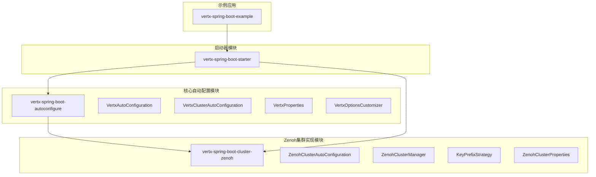
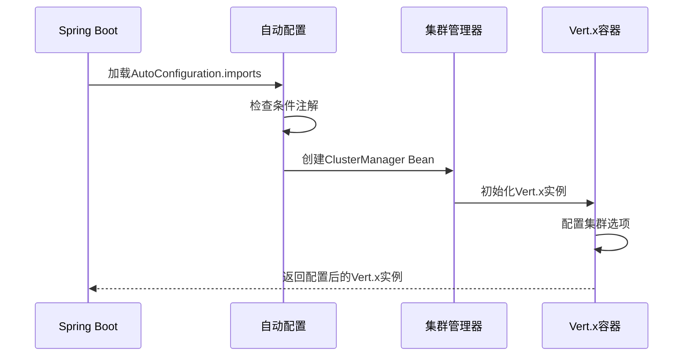
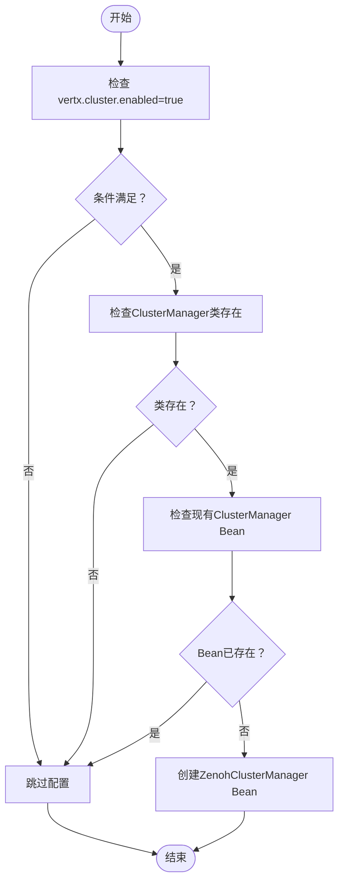
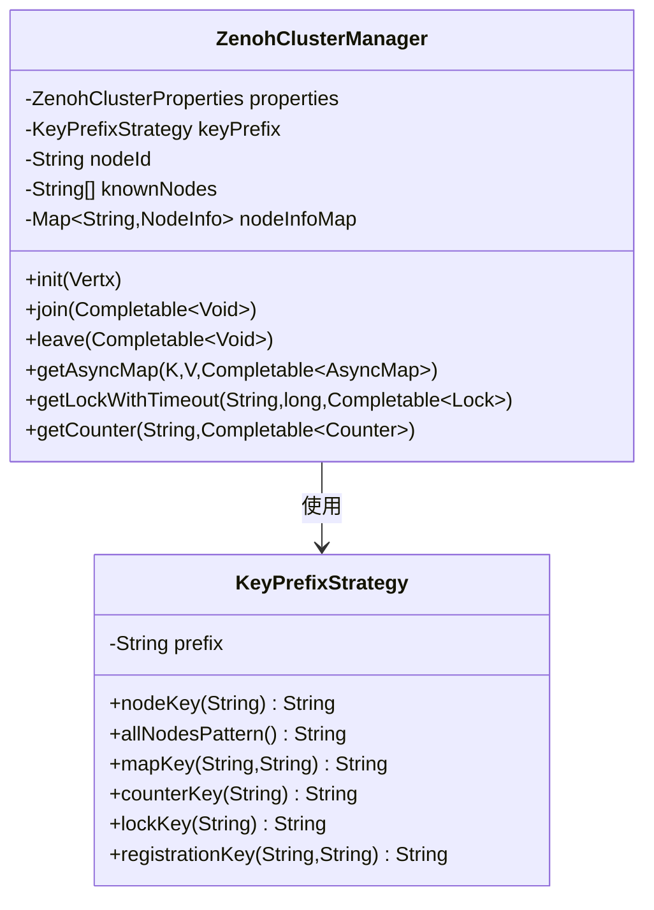
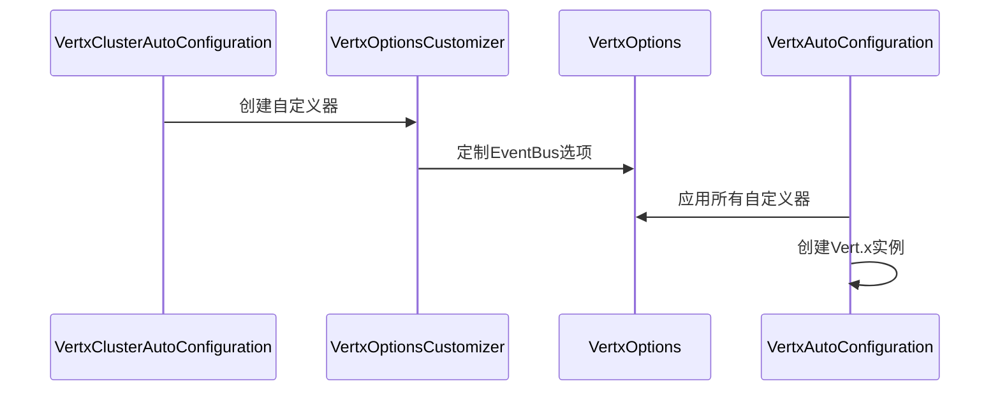
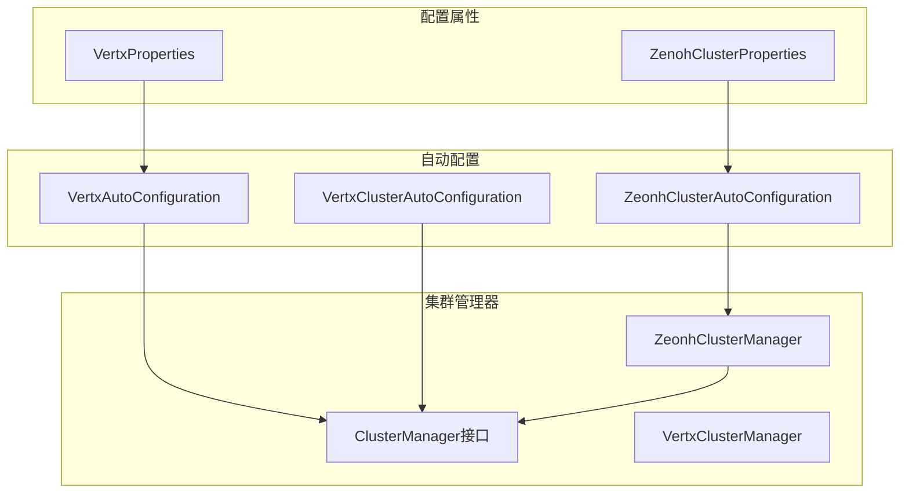
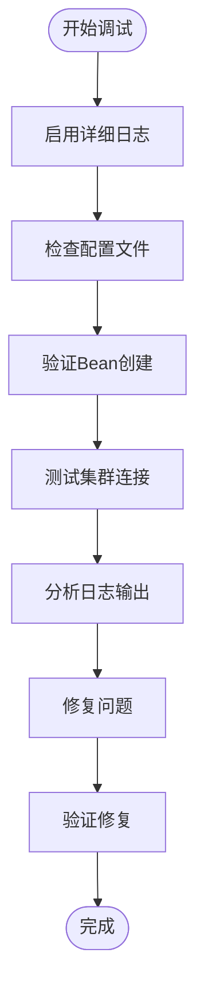

# Zenoh集成机制

<cite>
**本文档引用的文件**
- [VertxClusterAutoConfiguration.java](file://vertx-spring-boot-autoconfigure/src/main/java/com/workoss/boot/vertx/autoconfigure/VertxClusterAutoConfiguration.java)
- [ZenohClusterAutoConfiguration.java](file://vertx-spring-boot-cluster-zenoh/src/main/java/com/workoss/boot/vertx/cluster/zenoh/ZenohClusterAutoConfiguration.java)
- [ZenohClusterManager.java](file://vertx-spring-boot-cluster-zenoh/src/main/java/com/workoss/boot/vertx/cluster/zenoh/ZenohClusterManager.java)
- [VertxAutoConfiguration.java](file://vertx-spring-boot-autoconfigure/src/main/java/com/workoss/boot/vertx/autoconfigure/VertxAutoConfiguration.java)
- [ZenohClusterProperties.java](file://vertx-spring-boot-cluster-zenoh/src/main/java/com/workoss/boot/vertx/cluster/zenoh/ZenohClusterProperties.java)
- [KeyPrefixStrategy.java](file://vertx-spring-boot-cluster-zenoh/src/main/java/com/workoss/boot/vertx/cluster/zenoh/KeyPrefixStrategy.java)
- [VertxProperties.java](file://vertx-spring-boot-autoconfigure/src/main/java/com/workoss/boot/vertx/autoconfigure/VertxProperties.java)
- [VertxOptionsCustomizer.java](file://vertx-spring-boot-autoconfigure/src/main/java/com/workoss/boot/vertx/autoconfigure/VertxOptionsCustomizer.java)
- [AutoConfiguration.imports（自动配置导入）](file://vertx-spring-boot-autoconfigure/src/main/resources/META-INF/spring/org.springframework.boot.autoconfigure.AutoConfiguration.imports)
- [AutoConfiguration.imports（Zenoh模块）](file://vertx-spring-boot-cluster-zenoh/src/main/resources/META-INF/spring/org.springframework.boot.autoconfigure.AutoConfiguration.imports)
- [AutoConfiguration.imports（Starter模块）](file://vertx-spring-boot-starter/src/main/resources/META-INF/spring/org.springframework.boot.autoconfigure.AutoConfiguration.imports)
- [application.yml](file://example/vertx-spring-boot-example/src/main/resources/application.yml)
</cite>

## 目录
1. [简介](#简介)
2. [项目结构](#项目结构)
3. [核心组件](#核心组件)
4. [架构概览](#架构概览)
5. [详细组件分析](#详细组件分析)
6. [依赖分析](#依赖分析)
7. [性能考虑](#性能考虑)
8. [故障排除指南](#故障排除指南)
9. [结论](#结论)
10. [附录](#附录)

## 简介
本文件详细阐述了基于Spring Boot的Vert.x集群管理器自动配置机制，重点分析了Zenoh集成的实现细节。该系统通过条件注解驱动的自动配置，实现了对不同集群管理器的无缝切换，并提供了多租户隔离能力。

## 项目结构
该项目采用模块化设计，主要包含以下核心模块：



**图表来源**
- [AutoConfiguration.imports（自动配置导入）:1-3](file://vertx-spring-boot-autoconfigure/src/main/resources/META-INF/spring/org.springframework.boot.autoconfigure.AutoConfiguration.imports#L1-L3)
- [AutoConfiguration.imports（Starter模块）:1-6](file://vertx-spring-boot-starter/src/main/resources/META-INF/spring/org.springframework.boot.autoconfigure.AutoConfiguration.imports#L1-L6)

**章节来源**
- [AutoConfiguration.imports（自动配置导入）:1-3](file://vertx-spring-boot-autoconfigure/src/main/resources/META-INF/spring/org.springframework.boot.autoconfigure.AutoConfiguration.imports#L1-L3)
- [AutoConfiguration.imports（Zenoh模块）:1-2](file://vertx-spring-boot-cluster-zenoh/src/main/resources/META-INF/spring/org.springframework.boot.autoconfigure.AutoConfiguration.imports#L1-L2)
- [AutoConfiguration.imports（Starter模块）:1-6](file://vertx-spring-boot-starter/src/main/resources/META-INF/spring/org.springframework.boot.autoconfigure.AutoConfiguration.imports#L1-L6)

## 核心组件
本系统的核心组件围绕Spring Boot自动配置机制构建，主要包括：

### 条件注解体系
系统使用多种条件注解来控制自动配置的激活时机：
- `@ConditionalOnProperty`: 基于配置属性的条件判断
- `@ConditionalOnClass`: 基于类路径检测的条件判断
- `@ConditionalOnBean`: 基于Bean存在性的条件判断
- `@ConditionalOnMissingBean`: 基于Bean缺失的条件判断

### 配置属性体系
- `vertx.cluster.enabled`: 控制集群功能的启用状态
- `vertx.cluster.host/port`: 集群通信的网络配置
- `vertx.cluster.zenoh.*`: Zenoh特定的配置参数

**章节来源**
- [VertxClusterAutoConfiguration.java:14-15](file://vertx-spring-boot-autoconfigure/src/main/java/com/workoss/boot/vertx/autoconfigure/VertxClusterAutoConfiguration.java#L14-L15)
- [ZenohClusterAutoConfiguration.java:16-17](file://vertx-spring-boot-cluster-zenoh/src/main/java/com/workoss/boot/vertx/cluster/zenoh/ZenohClusterAutoConfiguration.java#L16-L17)
- [VertxProperties.java:105-158](file://vertx-spring-boot-autoconfigure/src/main/java/com/workoss/boot/vertx/autoconfigure/VertxProperties.java#L105-L158)

## 架构概览
系统采用分层架构设计，通过自动配置机制实现松耦合的组件集成：



**图表来源**
- [VertxAutoConfiguration.java:52-75](file://vertx-spring-boot-autoconfigure/src/main/java/com/workoss/boot/vertx/autoconfigure/VertxAutoConfiguration.java#L52-L75)
- [ZenohClusterAutoConfiguration.java:21-25](file://vertx-spring-boot-cluster-zenoh/src/main/java/com/workoss/boot/vertx/cluster/zenoh/ZenohClusterAutoConfiguration.java#L21-L25)

## 详细组件分析

### ZenohClusterAutoConfiguration 分析
该组件是Zenoh集群集成的核心，负责在满足条件时创建ZenohClusterManager Bean。

#### 条件注解解析


**图表来源**
- [ZenohClusterAutoConfiguration.java:15-25](file://vertx-spring-boot-cluster-zenoh/src/main/java/com/workoss/boot/vertx/cluster/zenoh/ZenohClusterAutoConfiguration.java#L15-L25)

#### Bean创建流程
1. **条件验证**: 确保`vertx.cluster.enabled=true`
2. **类路径检查**: 验证ClusterManager接口可用性
3. **Bean冲突检测**: 避免与现有集群管理器冲突
4. **实例化**: 创建ZenohClusterManager实例

**章节来源**
- [ZenohClusterAutoConfiguration.java:15-25](file://vertx-spring-boot-cluster-zenoh/src/main/java/com/workoss/boot/vertx/cluster/zenoh/ZenohClusterAutoConfiguration.java#L15-L25)

### ZenohClusterManager 实现分析
ZenohClusterManager实现了Vert.x的ClusterManager SPI接口，提供完整的集群管理功能。

#### 多租户隔离机制


**图表来源**
- [ZenohClusterManager.java:29-52](file://vertx-spring-boot-cluster-zenoh/src/main/java/com/workoss/boot/vertx/cluster/zenoh/ZenohClusterManager.java#L29-L52)
- [KeyPrefixStrategy.java:8-14](file://vertx-spring-boot-cluster-zenoh/src/main/java/com/workoss/boot/vertx/cluster/zenoh/KeyPrefixStrategy.java#L8-L14)

#### 生命周期管理
ZenohClusterManager实现了完整的生命周期管理：
- **初始化阶段**: 设置Vert.x实例和节点标识
- **加入集群**: 建立Zenoh会话，声明存活令牌
- **运行阶段**: 订阅节点变更，维护节点列表
- **离开集群**: 清理资源，关闭会话

**章节来源**
- [ZenohClusterManager.java:54-154](file://vertx-spring-boot-cluster-zenoh/src/main/java/com/workoss/boot/vertx/cluster/zenoh/ZenohClusterManager.java#L54-L154)

### VertxClusterAutoConfiguration 分析
该组件负责将ClusterManager集成到Vert.x配置中。

#### 配置定制机制


**图表来源**
- [VertxClusterAutoConfiguration.java:18-32](file://vertx-spring-boot-autoconfigure/src/main/java/com/workoss/boot/vertx/autoconfigure/VertxClusterAutoConfiguration.java#L18-L32)
- [VertxAutoConfiguration.java:28-50](file://vertx-spring-boot-autoconfigure/src/main/java/com/workoss/boot/vertx/autoconfigure/VertxAutoConfiguration.java#L28-L50)

**章节来源**
- [VertxClusterAutoConfiguration.java:18-32](file://vertx-spring-boot-autoconfigure/src/main/java/com/workoss/boot/vertx/autoconfigure/VertxClusterAutoConfiguration.java#L18-L32)

## 依赖分析

### 自动配置加载顺序
系统通过AutoConfiguration.imports文件控制自动配置的加载顺序：

```mermaid
graph LR
subgraph "加载顺序"
A[vertx-spring-boot-starter] --> B[vertx-spring-boot-autoconfigure]
B --> C[vertx-spring-boot-cluster-zenoh]
end
subgraph "@AutoConfiguration注解"
D[@AutoConfiguration(before=...)] --> E[明确前置顺序]
F[@AutoConfiguration] --> G[默认顺序]
end
```

**图表来源**
- [AutoConfiguration.imports（Starter模块）:1-6](file://vertx-spring-boot-starter/src/main/resources/META-INF/spring/org.springframework.boot.autoconfigure.AutoConfiguration.imports#L1-L6)
- [VertxClusterAutoConfiguration.java:13](file://vertx-spring-boot-autoconfigure/src/main/java/com/workoss/boot/vertx/autoconfigure/VertxClusterAutoConfiguration.java#L13)

### 组件间依赖关系


**图表来源**
- [VertxProperties.java:8](file://vertx-spring-boot-autoconfigure/src/main/java/com/workoss/boot/vertx/autoconfigure/VertxProperties.java#L8)
- [ZenohClusterProperties.java:11](file://vertx-spring-boot-cluster-zenoh/src/main/java/com/workoss/boot/vertx/cluster/zenoh/ZenohClusterProperties.java#L11)

**章节来源**
- [AutoConfiguration.imports（自动配置导入）:1-3](file://vertx-spring-boot-autoconfigure/src/main/resources/META-INF/spring/org.springframework.boot.autoconfigure.AutoConfiguration.imports#L1-L3)
- [AutoConfiguration.imports（Starter模块）:1-6](file://vertx-spring-boot-starter/src/main/resources/META-INF/spring/org.springframework.boot.autoconfigure.AutoConfiguration.imports#L1-L6)

## 性能考虑
系统在设计时充分考虑了性能优化：

### 连接池配置
- **事件循环线程**: 默认CPU核心数×2，可按需调整
- **工作线程**: 默认20个，支持虚拟线程
- **内部阻塞线程**: 默认20个，用于阻塞操作

### 集群通信优化
- **原生传输优先**: 在Linux/macOS上优先使用epoll/kqueue
- **多租户隔离**: 通过键前缀策略避免命名冲突
- **异步操作**: 所有集群操作采用CompletableFuture模式

## 故障排除指南

### 常见问题诊断
1. **集群未启用**
   - 检查`vertx.cluster.enabled=true`配置
   - 验证类路径中存在ClusterManager接口

2. **Bean冲突**
   - 确认没有重复的ClusterManager Bean定义
   - 检查是否存在其他集群管理器实现

3. **连接失败**
   - 验证Zenoh网络连通性
   - 检查防火墙设置和端口配置

### 调试方法


**章节来源**
- [application.yml:16-20](file://example/vertx-spring-boot-example/src/main/resources/application.yml#L16-L20)

### 排错步骤
1. **启用详细日志**: 将日志级别设置为DEBUG
2. **验证配置**: 检查application.yml中的集群配置
3. **监控Bean创建**: 确认ZenohClusterManager Bean成功创建
4. **测试连接**: 验证与Zenoh网络的连通性

## 结论
该Zenoh集成机制通过精心设计的自动配置体系，实现了对Vert.x集群管理器的无缝集成。系统具有以下特点：

- **灵活的条件配置**: 通过多种条件注解实现精确的激活控制
- **多租户隔离**: 提供安全的多应用环境隔离机制
- **可扩展架构**: 支持轻松切换不同的集群管理器实现
- **完善的生命周期管理**: 从创建到销毁的完整生命周期支持

## 附录

### 配置参考
- `vertx.cluster.enabled`: 启用集群功能
- `vertx.cluster.host/port`: 集群通信地址和端口
- `vertx.cluster.zenoh.appName`: 应用名称（多租户隔离）
- `vertx.cluster.zenoh.environment`: 环境标签（dev/staging/prod）

### 兼容性说明
系统设计时充分考虑了与现有Vert.x集群管理器的兼容性，支持：
- 自定义ClusterManager实现
- 多种集群后端（Zookeeper、Redis等）
- 动态切换集群管理器