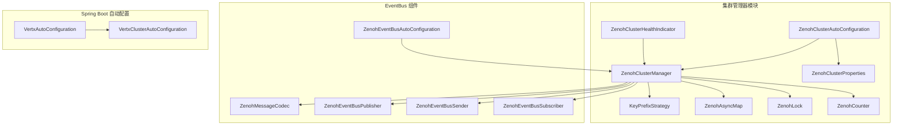
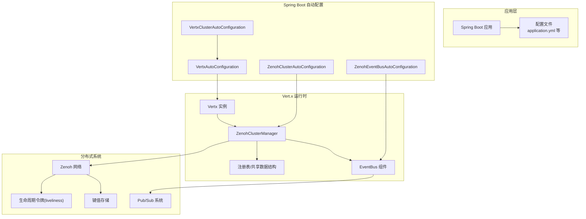
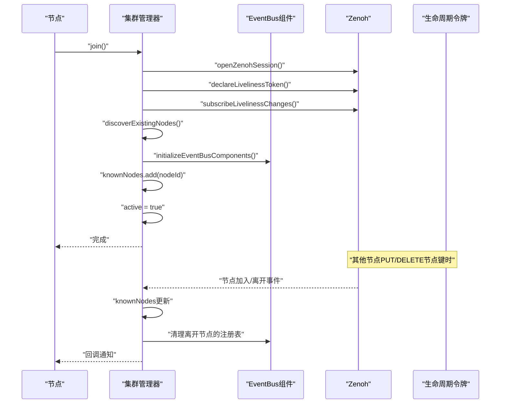
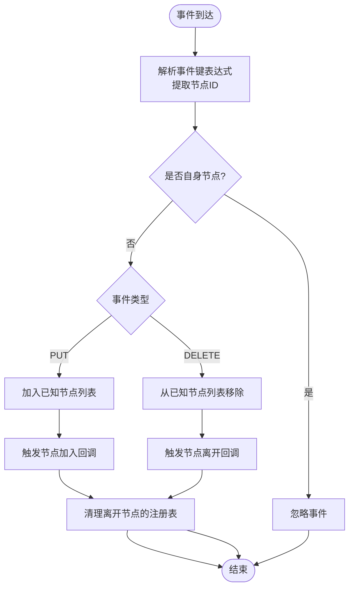
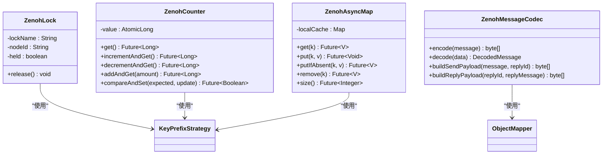
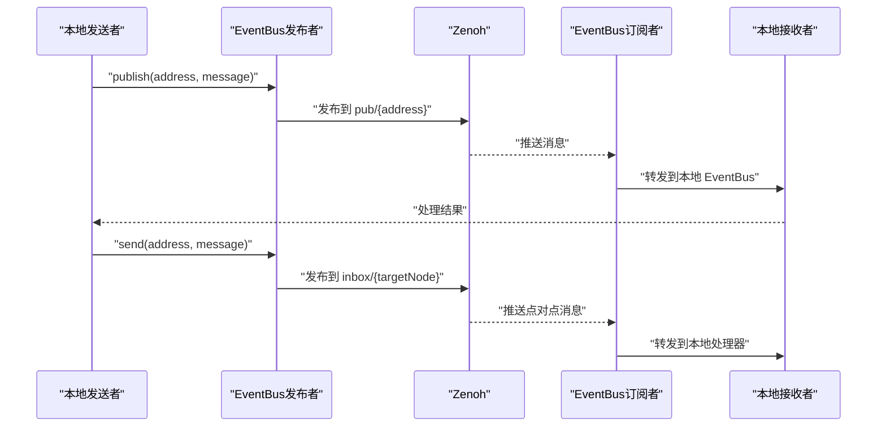
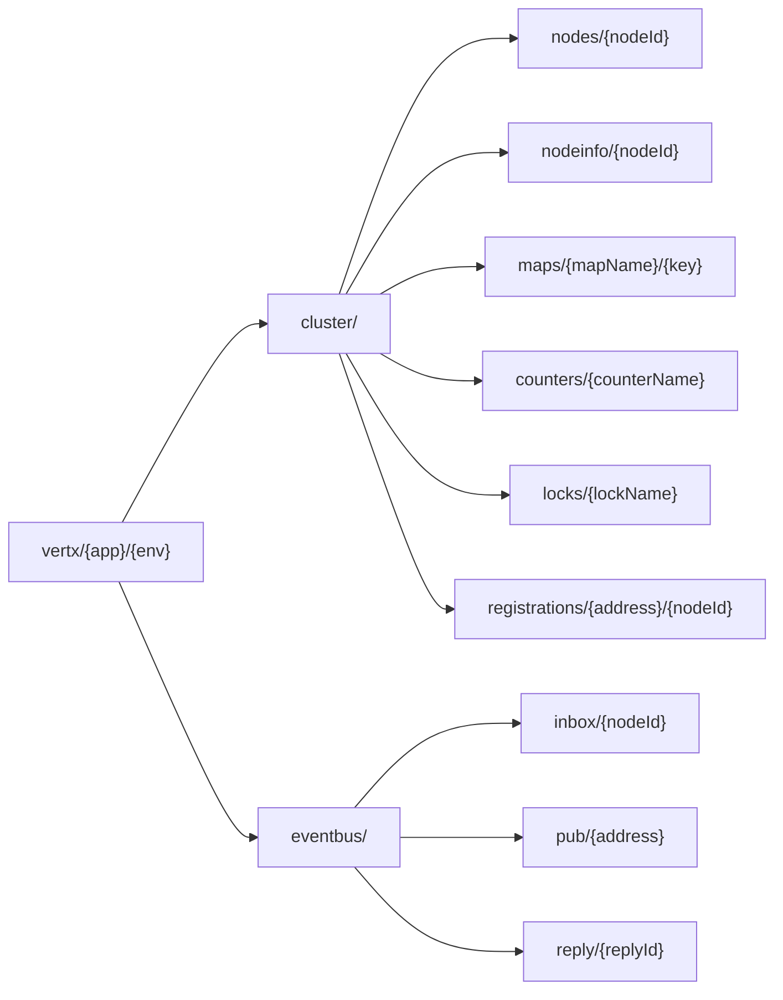
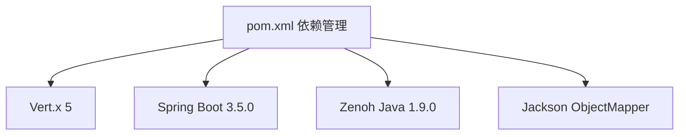

# 集群管理器实现

<cite>
**本文档引用的文件**
- [ZenohClusterManager.java](file://vertx-spring-boot-cluster-zenoh/src/main/java/com/workoss/boot/vertx/cluster/zenoh/ZenohClusterManager.java)
- [KeyPrefixStrategy.java](file://vertx-spring-boot-cluster-zenoh/src/main/java/com/workoss/boot/vertx/cluster/zenoh/KeyPrefixStrategy.java)
- [ZenohAsyncMap.java](file://vertx-spring-boot-cluster-zenoh/src/main/java/com/workoss/boot/vertx/cluster/zenoh/ZenohAsyncMap.java)
- [ZenohLock.java](file://vertx-spring-boot-cluster-zenoh/src/main/java/com/workoss/boot/vertx/cluster/zenoh/ZenohLock.java)
- [ZenohCounter.java](file://vertx-spring-boot-cluster-zenoh/src/main/java/com/workoss/boot/vertx/cluster/zenoh/ZenohCounter.java)
- [ZenohClusterAutoConfiguration.java](file://vertx-spring-boot-cluster-zenoh/src/main/java/com/workoss/boot/vertx/cluster/zenoh/ZenohClusterAutoConfiguration.java)
- [ZenohClusterProperties.java](file://vertx-spring-boot-cluster-zenoh/src/main/java/com/workoss/boot/vertx/cluster/zenoh/ZenohClusterProperties.java)
- [ZenohEventBusPublisher.java](file://vertx-spring-boot-cluster-zenoh/src/main/java/com/workoss/boot/vertx/cluster/zenoh/ZenohEventBusPublisher.java)
- [ZenohEventBusSender.java](file://vertx-spring-boot-cluster-zenoh/src/main/java/com/workoss/boot/vertx/cluster/zenoh/ZenohEventBusSender.java)
- [ZenohEventBusSubscriber.java](file://vertx-spring-boot-cluster-zenoh/src/main/java/com/workoss/boot/vertx/cluster/zenoh/ZenohEventBusSubscriber.java)
- [ZenohMessageCodec.java](file://vertx-spring-boot-cluster-zenoh/src/main/java/com/workoss/boot/vertx/cluster/zenoh/ZenohMessageCodec.java)
- [ZenohEventBusAutoConfiguration.java](file://vertx-spring-boot-cluster-zenoh/src/main/java/com/workoss/boot/vertx/cluster/zenoh/ZenohEventBusAutoConfiguration.java)
- [ZenohClusterHealthIndicator.java](file://vertx-spring-boot-cluster-zenoh/src/main/java/com/workoss/boot/vertx/cluster/zenoh/ZenohClusterHealthIndicator.java)
- [VertxClusterAutoConfiguration.java](file://vertx-spring-boot-autoconfigure/src/main/java/com/workoss/boot/vertx/autoconfigure/VertxClusterAutoConfiguration.java)
- [VertxAutoConfiguration.java](file://vertx-spring-boot-autoconfigure/src/main/java/com/workoss/boot/vertx/autoconfigure/VertxAutoConfiguration.java)
- [application.yml](file://example/vertx-spring-boot-example/src/main/resources/application.yml)
- [application-instance1.yml](file://example/vertx-spring-boot-example/src/main/resources/application-instance1.yml)
- [application-instance2.yml](file://example/vertx-spring-boot-example/src/main/resources/application-instance2.yml)
- [pom.xml](file://pom.xml)
</cite>

## 更新摘要
**所做更改**
- 完全重构了 ZenohClusterManager 实现，新增 490 行代码
- 新增完整的 EventBus 集成组件：Publisher、Sender、Subscriber 和 MessageCodec
- 更新了节点发现机制，增加了现有节点主动发现功能
- 增强了生命周期管理，包括 EventBus 组件的初始化和清理
- 完善了分布式协调机制的实现细节
- 更新了多租户隔离和键空间设计

## 目录
1. [简介](#简介)
2. [项目结构](#项目结构)
3. [核心组件](#核心组件)
4. [架构概览](#架构概览)
5. [详细组件分析](#详细组件分析)
6. [依赖关系分析](#依赖关系分析)
7. [性能考虑](#性能考虑)
8. [故障排查指南](#故障排查指南)
9. [结论](#结论)
10. [附录](#附录)

## 简介
本文件为 ZenohClusterManager 的技术文档，系统阐述基于 Zenoh 的 Vert.x 集群管理器实现。内容涵盖集群管理器对 Vert.x ClusterManager 接口的完整实现、与 Zenoh 的深度集成策略、节点发现机制、成员管理算法、集群状态同步流程、集群事件处理（节点加入/离开/故障检测）、分布式协调机制（锁、计数器、共享数据结构）以及新增的 EventBus 集成、性能特征、扩展性、监控与调试方法，并给出故障恢复与数据一致性保障的实现要点。

## 项目结构
该模块位于 `vertx-spring-boot-cluster-zenoh`，经过完全重构后包含以下关键类：
- 集群管理器：负责节点生命周期、注册表、共享数据结构提供，以及完整的 EventBus 集成
- 键前缀策略：统一多租户隔离的键空间规划
- 分布式数据结构：异步 Map、分布式锁、计数器
- EventBus 组件：消息编解码器、发布者、发送者、订阅者
- 自动配置：Spring Boot 条件化装配，启用时自动注入集群管理器和 EventBus 桥接

**图表来源**
- [ZenohClusterManager.java:41-491](file://vertx-spring-boot-cluster-zenoh/src/main/java/com/workoss/boot/vertx/cluster/zenoh/ZenohClusterManager.java#L41-L491)
- [KeyPrefixStrategy.java:11-154](file://vertx-spring-boot-cluster-zenoh/src/main/java/com/workoss/boot/vertx/cluster/zenoh/KeyPrefixStrategy.java#L11-L154)
- [ZenohAsyncMap.java:26-269](file://vertx-spring-boot-cluster-zenoh/src/main/java/com/workoss/boot/vertx/cluster/zenoh/ZenohAsyncMap.java#L26-L269)
- [ZenohLock.java:19-69](file://vertx-spring-boot-cluster-zenoh/src/main/java/com/workoss/boot/vertx/cluster/zenoh/ZenohLock.java#L19-L69)
- [ZenohCounter.java:27-149](file://vertx-spring-boot-cluster-zenoh/src/main/java/com/workoss/boot/vertx/cluster/zenoh/ZenohCounter.java#L27-L149)
- [ZenohClusterAutoConfiguration.java:22-36](file://vertx-spring-boot-cluster-zenoh/src/main/java/com/workoss/boot/vertx/cluster/zenoh/ZenohClusterAutoConfiguration.java#L22-L36)
- [ZenohClusterProperties.java:11-92](file://vertx-spring-boot-cluster-zenoh/src/main/java/com/workoss/boot/vertx/cluster/zenoh/ZenohClusterProperties.java#L11-L92)
- [ZenohClusterHealthIndicator.java:12-48](file://vertx-spring-boot-cluster-zenoh/src/main/java/com/workoss/boot/vertx/cluster/zenoh/ZenohClusterHealthIndicator.java#L12-L48)
- [ZenohMessageCodec.java:30-308](file://vertx-spring-boot-cluster-zenoh/src/main/java/com/workoss/boot/vertx/cluster/zenoh/ZenohMessageCodec.java#L30-L308)
- [ZenohEventBusPublisher.java:28-129](file://vertx-spring-boot-cluster-zenoh/src/main/java/com/workoss/boot/vertx/cluster/zenoh/ZenohEventBusPublisher.java#L28-L129)
- [ZenohEventBusSender.java:23-133](file://vertx-spring-boot-cluster-zenoh/src/main/java/com/workoss/boot/vertx/cluster/zenoh/ZenohEventBusSender.java#L23-L133)
- [ZenohEventBusSubscriber.java:16-134](file://vertx-spring-boot-cluster-zenoh/src/main/java/com/workoss/boot/vertx/cluster/zenoh/ZenohEventBusSubscriber.java#L16-L134)
- [ZenohEventBusAutoConfiguration.java:14-30](file://vertx-spring-boot-cluster-zenoh/src/main/java/com/workoss/boot/vertx/cluster/zenoh/ZenohEventBusAutoConfiguration.java#L14-L30)

**章节来源**
- [pom.xml:15-22](file://pom.xml#L15-L22)

## 核心组件
- 集群管理器（ZenohClusterManager）
  - 完整实现 Vert.x ClusterManager 接口，提供节点信息、节点列表、注册表、异步 Map、分布式锁、计数器等能力
  - 集成完整的 EventBus 功能，包括发布、发送、订阅和消息编解码
  - 使用 KeyPrefixStrategy 构建多租户隔离的键空间
  - 维护本地已知节点列表、节点信息映射、注册表映射
  - 提供节点加入/离开、活跃状态查询、监听器设置等能力
  - 管理 EventBus 组件的生命周期：初始化、运行和清理
- 键前缀策略（KeyPrefixStrategy）
  - 规范所有集群相关键的命名空间：`vertx/{app}/{env}/cluster/...`
  - 提供节点、节点信息、异步 Map、计数器、锁、注册表等键生成方法
  - 新增 EventBus 相关键空间：inbox、pub、reply 等
- 异步 Map（ZenohAsyncMap）
  - 基于本地缓存的 AsyncMap 实现，支持 Java 序列化存储
  - 提供完整的 KV 操作与 TTL 支持
  - 支持批量读取和本地缓存一致性
- 分布式锁（ZenohLock）
  - 基于"先写者获胜"策略的分布式锁，键值存储当前持有者节点 ID
  - 通过生命周期令牌实现崩溃自动释放
  - 支持锁的获取和释放操作
- 计数器（ZenohCounter）
  - 基于本地 AtomicLong 的 Counter 实现，支持 Zenoh 同步
  - 提供标准的原子操作接口，支持分布式一致性
  - 支持从 Zenoh 加载初始值和发布更新
- EventBus 组件
  - 消息编解码器（ZenohMessageCodec）：JSON 编解码和消息格式化
  - 发布者（ZenohEventBusPublisher）：广播消息发布，支持缓存 Publisher 和 KeyExpr
  - 发送者（ZenohEventBusSender）：点对点消息发送，支持轮询选择目标节点
  - 订阅者（ZenohEventBusSubscriber）：远程消息订阅，支持 pub 和 inbox 两种模式
- 自动配置（ZenohClusterAutoConfiguration）
  - 当配置开关开启且未存在其他 ClusterManager Bean 时，自动创建 ZenohClusterManager
  - 提供健康指示器的自动配置
- Vert.x 集成（VertxClusterAutoConfiguration / VertxAutoConfiguration）
  - 在 Vert.x 5 中通过 VertxBuilder 注入 ClusterManager
  - 条件化启用集群模式并配置 EventBus 网络参数

**章节来源**
- [ZenohClusterManager.java:41-491](file://vertx-spring-boot-cluster-zenoh/src/main/java/com/workoss/boot/vertx/cluster/zenoh/ZenohClusterManager.java#L41-L491)
- [KeyPrefixStrategy.java:11-154](file://vertx-spring-boot-cluster-zenoh/src/main/java/com/workoss/boot/vertx/cluster/zenoh/KeyPrefixStrategy.java#L11-L154)
- [ZenohAsyncMap.java:26-269](file://vertx-spring-boot-cluster-zenoh/src/main/java/com/workoss/boot/vertx/cluster/zenoh/ZenohAsyncMap.java#L26-L269)
- [ZenohLock.java:19-69](file://vertx-spring-boot-cluster-zenoh/src/main/java/com/workoss/boot/vertx/cluster/zenoh/ZenohLock.java#L19-L69)
- [ZenohCounter.java:27-149](file://vertx-spring-boot-cluster-zenoh/src/main/java/com/workoss/boot/vertx/cluster/zenoh/ZenohCounter.java#L27-L149)
- [ZenohMessageCodec.java:30-308](file://vertx-spring-boot-cluster-zenoh/src/main/java/com/workoss/boot/vertx/cluster/zenoh/ZenohMessageCodec.java#L30-L308)
- [ZenohEventBusPublisher.java:28-129](file://vertx-spring-boot-cluster-zenoh/src/main/java/com/workoss/boot/vertx/cluster/zenoh/ZenohEventBusPublisher.java#L28-L129)
- [ZenohEventBusSender.java:23-133](file://vertx-spring-boot-cluster-zenoh/src/main/java/com/workoss/boot/vertx/cluster/zenoh/ZenohEventBusSender.java#L23-L133)
- [ZenohEventBusSubscriber.java:16-134](file://vertx-spring-boot-cluster-zenoh/src/main/java/com/workoss/boot/vertx/cluster/zenoh/ZenohEventBusSubscriber.java#L16-L134)
- [ZenohClusterAutoConfiguration.java:22-36](file://vertx-spring-boot-cluster-zenoh/src/main/java/com/workoss/boot/vertx/cluster/zenoh/ZenohClusterAutoConfiguration.java#L22-L36)
- [VertxClusterAutoConfiguration.java:13-32](file://vertx-spring-boot-autoconfigure/src/main/java/com/workoss/boot/vertx/autoconfigure/VertxClusterAutoConfiguration.java#L13-L32)
- [VertxAutoConfiguration.java:58-82](file://vertx-spring-boot-autoconfigure/src/main/java/com/workoss/boot/vertx/autoconfigure/VertxAutoConfiguration.java#L58-L82)

## 架构概览
下图展示重构后的 ZenohClusterManager 与 Vert.x、Spring Boot、Zenoh 的整体交互关系，包括新增的 EventBus 集成：

**图表来源**
- [ZenohClusterAutoConfiguration.java:22-36](file://vertx-spring-boot-cluster-zenoh/src/main/java/com/workoss/boot/vertx/cluster/zenoh/ZenohClusterAutoConfiguration.java#L22-L36)
- [ZenohEventBusAutoConfiguration.java:14-30](file://vertx-spring-boot-cluster-zenoh/src/main/java/com/workoss/boot/vertx/cluster/zenoh/ZenohEventBusAutoConfiguration.java#L14-L30)
- [VertxClusterAutoConfiguration.java:13-32](file://vertx-spring-boot-autoconfigure/src/main/java/com/workoss/boot/vertx/autoconfigure/VertxClusterAutoConfiguration.java#L13-L32)
- [VertxAutoConfiguration.java:58-82](file://vertx-spring-boot-autoconfigure/src/main/java/com/workoss/boot/vertx/autoconfigure/VertxAutoConfiguration.java#L58-L82)
- [ZenohClusterManager.java:41-491](file://vertx-spring-boot-cluster-zenoh/src/main/java/com/workoss/boot/vertx/cluster/zenoh/ZenohClusterManager.java#L41-L491)

## 详细组件分析

### 节点发现与成员管理
- 节点标识与初始化
  - 每个节点在构造时生成唯一节点 ID
  - 初始化阶段记录节点信息并写入本地映射
- 加入集群
  - 打开会话、声明生命周期令牌、订阅全量节点变更
  - 调用 `initializeEventBusComponents()` 初始化 EventBus 组件
  - 将自身节点 ID 加入已知节点列表，标记为活跃
- 离开集群
  - 调用 `cleanupEventBusComponents()` 清理 EventBus 组件
  - 关闭会话、移除自身节点 ID、标记为非活跃
- 节点变更监听
  - 订阅节点键空间模式，根据 PUT/DELETE 事件触发节点加入/离开回调
  - 自动清理已离开节点的注册表和节点信息

**图表来源**
- [ZenohClusterManager.java:160-200](file://vertx-spring-boot-cluster-zenoh/src/main/java/com/workoss/boot/vertx/cluster/zenoh/ZenohClusterManager.java#L160-L200)
- [ZenohClusterManager.java:308-342](file://vertx-spring-boot-cluster-zenoh/src/main/java/com/workoss/boot/vertx/cluster/zenoh/ZenohClusterManager.java#L308-L342)
- [ZenohClusterManager.java:349-399](file://vertx-spring-boot-cluster-zenoh/src/main/java/com/workoss/boot/vertx/cluster/zenoh/ZenohClusterManager.java#L349-L399)

**章节来源**
- [ZenohClusterManager.java:160-200](file://vertx-spring-boot-cluster-zenoh/src/main/java/com/workoss/boot/vertx/cluster/zenoh/ZenohClusterManager.java#L160-L200)
- [ZenohClusterManager.java:308-342](file://vertx-spring-boot-cluster-zenoh/src/main/java/com/workoss/boot/vertx/cluster/zenoh/ZenohClusterManager.java#L308-L342)
- [ZenohClusterManager.java:349-399](file://vertx-spring-boot-cluster-zenoh/src/main/java/com/workoss/boot/vertx/cluster/zenoh/ZenohClusterManager.java#L349-L399)

### 集群状态同步与事件处理
- 节点信息同步
  - 节点加入时发布节点信息到专用键空间
  - 其他节点可通过 getNodeInfo 获取对应节点信息
- 注册表同步
  - addRegistration/removeRegistration 维护本地注册表
  - getRegistrations 返回指定地址的注册信息列表
  - 自动清理离开节点的注册信息
- 事件处理流程
  - 订阅节点键空间模式，解析事件来源节点 ID
  - 对于自身节点忽略，其他节点根据事件类型更新本地状态并触发回调
- 新增：现有节点发现
  - 使用 `discoverExistingNodes()` 方法主动查询已存在的生命周期令牌
  - 解决 Zenoh 生命周期订阅只接收订阅后事件的问题

**图表来源**
- [ZenohClusterManager.java:313-340](file://vertx-spring-boot-cluster-zenoh/src/main/java/com/workoss/boot/vertx/cluster/zenoh/ZenohClusterManager.java#L313-L340)
- [ZenohClusterManager.java:333-338](file://vertx-spring-boot-cluster-zenoh/src/main/java/com/workoss/boot/vertx/cluster/zenoh/ZenohClusterManager.java#L333-L338)

**章节来源**
- [ZenohClusterManager.java:126-157](file://vertx-spring-boot-cluster-zenoh/src/main/java/com/workoss/boot/vertx/cluster/zenoh/ZenohClusterManager.java#L126-L157)
- [ZenohClusterManager.java:208-250](file://vertx-spring-boot-cluster-zenoh/src/main/java/com/workoss/boot/vertx/cluster/zenoh/ZenohClusterManager.java#L208-L250)
- [ZenohClusterManager.java:349-399](file://vertx-spring-boot-cluster-zenoh/src/main/java/com/workoss/boot/vertx/cluster/zenoh/ZenohClusterManager.java#L349-L399)

### 分布式协调机制
- 分布式锁（ZenohLock）
  - 锁键采用"先写者获胜"策略：PUT 成功即获得锁
  - 释放时删除锁键，允许其他节点竞争
  - 结合生命周期令牌，节点崩溃时自动释放
- 计数器（ZenohCounter）
  - 本地 AtomicLong 作为基础计数器，支持 Zenoh 同步
  - 创建时尝试从 Zenoh 加载当前值
  - 每次本地更新后发布到 Zenoh 保持分布式一致性
  - 提供完整的原子操作接口
- 异步 Map（ZenohAsyncMap）
  - 本地缓存 + Zenoh 同步的混合实现
  - 支持 Java 对象序列化存储
  - 提供 TTL 支持和批量操作
  - 支持条件写入和本地缓存一致性

**图表来源**
- [ZenohLock.java:19-69](file://vertx-spring-boot-cluster-zenoh/src/main/java/com/workoss/boot/vertx/cluster/zenoh/ZenohLock.java#L19-L69)
- [ZenohCounter.java:27-149](file://vertx-spring-boot-cluster-zenoh/src/main/java/com/workoss/boot/vertx/cluster/zenoh/ZenohCounter.java#L27-L149)
- [ZenohAsyncMap.java:26-269](file://vertx-spring-boot-cluster-zenoh/src/main/java/com/workoss/boot/vertx/cluster/zenoh/ZenohAsyncMap.java#L26-L269)
- [ZenohMessageCodec.java:30-308](file://vertx-spring-boot-cluster-zenoh/src/main/java/com/workoss/boot/vertx/cluster/zenoh/ZenohMessageCodec.java#L30-L308)

**章节来源**
- [ZenohLock.java:19-69](file://vertx-spring-boot-cluster-zenoh/src/main/java/com/workoss/boot/vertx/cluster/zenoh/ZenohLock.java#L19-L69)
- [ZenohCounter.java:27-149](file://vertx-spring-boot-cluster-zenoh/src/main/java/com/workoss/boot/vertx/cluster/zenoh/ZenohCounter.java#L27-L149)
- [ZenohAsyncMap.java:26-269](file://vertx-spring-boot-cluster-zenoh/src/main/java/com/workoss/boot/vertx/cluster/zenoh/ZenohAsyncMap.java#L26-L269)

### EventBus 集成机制
- 消息编解码器（ZenohMessageCodec）
  - JSON 格式编码 Vert.x EventBus 消息
  - 支持简单消息和完整 Message 对象编码
  - 提供发送请求和回复响应的特殊编码格式
- 发布者（ZenohEventBusPublisher）
  - 广播消息发布到指定地址
  - 缓存 Publisher 和 KeyExpr 实例提高性能
  - 支持简单发布和完整消息发布
- 发送者（ZenohEventBusSender）
  - 点对点消息发送到远程节点
  - 基于轮询算法选择目标节点
  - 支持请求-响应模式的消息转发
- 订阅者（ZenohEventBusSubscriber）
  - 订阅远程发布的消息
  - 支持 pub（广播）和 inbox（点对点）两种模式
  - 将远程消息转发到本地 EventBus

**图表来源**
- [ZenohEventBusPublisher.java:47-73](file://vertx-spring-boot-cluster-zenoh/src/main/java/com/workoss/boot/vertx/cluster/zenoh/ZenohEventBusPublisher.java#L47-L73)
- [ZenohEventBusSender.java:48-84](file://vertx-spring-boot-cluster-zenoh/src/main/java/com/workoss/boot/vertx/cluster/zenoh/ZenohEventBusSender.java#L48-L84)
- [ZenohEventBusSubscriber.java:65-125](file://vertx-spring-boot-cluster-zenoh/src/main/java/com/workoss/boot/vertx/cluster/zenoh/ZenohEventBusSubscriber.java#L65-L125)

**章节来源**
- [ZenohMessageCodec.java:76-106](file://vertx-spring-boot-cluster-zenoh/src/main/java/com/workoss/boot/vertx/cluster/zenoh/ZenohMessageCodec.java#L76-L106)
- [ZenohEventBusPublisher.java:47-73](file://vertx-spring-boot-cluster-zenoh/src/main/java/com/workoss/boot/vertx/cluster/zenoh/ZenohEventBusPublisher.java#L47-L73)
- [ZenohEventBusSender.java:48-84](file://vertx-spring-boot-cluster-zenoh/src/main/java/com/workoss/boot/vertx/cluster/zenoh/ZenohEventBusSender.java#L48-L84)
- [ZenohEventBusSubscriber.java:65-125](file://vertx-spring-boot-cluster-zenoh/src/main/java/com/workoss/boot/vertx/cluster/zenoh/ZenohEventBusSubscriber.java#L65-L125)

### 多租户隔离与键空间设计
- 键前缀策略
  - 统一前缀：`vertx/{app}/{env}/cluster/...`
  - 支持节点、节点信息、异步 Map、计数器、锁、注册表等子域
  - 新增 EventBus 键空间：`vertx/{app}/{env}/eventbus/...`
  - 对非法字符进行转义，确保键表达式安全
- 配置驱动
  - 通过属性对象设置应用名、环境、连接/监听端点、会话模式等
  - Spring Boot 自动装配在启用时注入集群管理器和 EventBus 组件

**图表来源**
- [KeyPrefixStrategy.java:26-128](file://vertx-spring-boot-cluster-zenoh/src/main/java/com/workoss/boot/vertx/cluster/zenoh/KeyPrefixStrategy.java#L26-L128)
- [ZenohClusterProperties.java:11-92](file://vertx-spring-boot-cluster-zenoh/src/main/java/com/workoss/boot/vertx/cluster/zenoh/ZenohClusterProperties.java#L11-L92)

**章节来源**
- [KeyPrefixStrategy.java:11-154](file://vertx-spring-boot-cluster-zenoh/src/main/java/com/workoss/boot/vertx/cluster/zenoh/KeyPrefixStrategy.java#L11-L154)
- [ZenohClusterProperties.java:11-92](file://vertx-spring-boot-cluster-zenoh/src/main/java/com/workoss/boot/vertx/cluster/zenoh/ZenohClusterProperties.java#L11-L92)

## 依赖关系分析
- 模块依赖
  - 项目使用 Maven 管理依赖，Vert.x 与 Spring Boot 版本由 BOM 统一管理
  - 引入 Zenoh Java SDK 以支持后端交互
  - 新增 Jackson ObjectMapper 用于 JSON 编解码
- 运行时依赖
  - Spring Boot 自动配置在启用集群时注入 ClusterManager 和 EventBus 组件
  - Vert.x 5 通过 VertxBuilder.withClusterManager() 设置集群管理器

**图表来源**
- [pom.xml:35-107](file://pom.xml#L35-L107)

**章节来源**
- [pom.xml:35-107](file://pom.xml#L35-L107)
- [VertxAutoConfiguration.java:58-82](file://vertx-spring-boot-autoconfigure/src/main/java/com/workoss/boot/vertx/autoconfigure/VertxAutoConfiguration.java#L58-L82)
- [VertxClusterAutoConfiguration.java:13-32](file://vertx-spring-boot-autoconfigure/src/main/java/com/workoss/boot/vertx/autoconfigure/VertxClusterAutoConfiguration.java#L13-L32)

## 性能考虑
- 本地缓存优先
  - 异步 Map、计数器、EventBus 组件当前使用本地缓存，减少网络往返，提升读写性能
  - EventBus 发布者缓存 Publisher 和 KeyExpr 实例，避免重复创建
  - 建议在分布式实现中引入本地缓存 + 渐进式同步策略
- 键空间设计
  - 统一前缀与模式匹配有利于高效订阅与查询
  - 合理划分子域可降低热点冲突
  - EventBus 键空间分离广播和点对点消息，避免不必要的负载
- 生命周期令牌
  - 利用 Zenoh 生命周期令牌实现快速故障检测，降低超时等待
  - 新增的现有节点发现机制通过主动查询解决订阅延迟问题
- 并发控制
  - 已使用并发容器维护节点列表与注册表，避免锁竞争
  - EventBus 组件使用 ConcurrentHashMap 实现线程安全
- 可扩展性
  - 通过配置属性支持不同部署场景（peer/client/router）
  - 多租户隔离避免跨应用干扰
  - EventBus 组件支持水平扩展和负载均衡

## 故障排查指南
- 启动与配置
  - 确认配置开关已启用：`vertx.cluster.enabled=true`
  - 检查应用名与环境配置，确保键空间隔离正确
  - 验证 Zenoh 连接端点和会话模式配置
- 日志定位
  - 关注集群管理器日志中的节点加入/离开、会话打开/关闭、错误异常
  - EventBus 组件日志显示消息发布/接收状态
- 常见问题
  - 无法加入集群：检查连接/监听端点与会话模式配置
  - 节点不感知：确认生命周期订阅是否成功、键空间模式是否匹配
  - 数据不一致：检查本地缓存与后端同步策略
  - EventBus 消息丢失：验证发布者和订阅者是否正确初始化
  - 性能问题：检查 EventBus 组件的缓存配置和网络延迟

**章节来源**
- [application.yml:29-35](file://example/vertx-spring-boot-example/src/main/resources/application.yml#L29-L35)
- [ZenohClusterManager.java:160-200](file://vertx-spring-boot-cluster-zenoh/src/main/java/com/workoss/boot/vertx/cluster/zenoh/ZenohClusterManager.java#L160-L200)
- [ZenohEventBusPublisher.java:47-73](file://vertx-spring-boot-cluster-zenoh/src/main/java/com/workoss/boot/vertx/cluster/zenoh/ZenohEventBusPublisher.java#L47-L73)

## 结论
ZenohClusterManager 经过完全重构后，通过清晰的键空间设计与 Spring Boot 条件化装配，实现了对 Vert.x 集群管理接口的完整覆盖。新版本不仅包含了原有的集群管理功能，还新增了完整的 EventBus 集成，包括消息编解码、发布、发送和订阅机制。当前版本以本地缓存为核心，预留了与 Zenoh 后端交互的扩展点；生命周期令牌与模式订阅提供了高效的节点发现与故障检测能力。建议在生产环境中逐步替换为分布式实现，并结合监控指标与日志进行持续优化。

## 附录
- 示例配置
  - 应用级配置示例展示了如何启用集群与设置端口
- 版本信息
  - 项目统一管理 Vert.x 与 Spring Boot 版本，确保兼容性
- EventBus 集成
  - 新增的 EventBus 组件提供了完整的跨节点通信能力
  - 支持广播和点对点两种消息传递模式

**章节来源**
- [application-instance1.yml:1-2](file://example/vertx-spring-boot-example/src/main/resources/application-instance1.yml#L1-L2)
- [application-instance2.yml:1-2](file://example/vertx-spring-boot-example/src/main/resources/application-instance2.yml#L1-L2)
- [pom.xml:24-33](file://pom.xml#L24-L33)