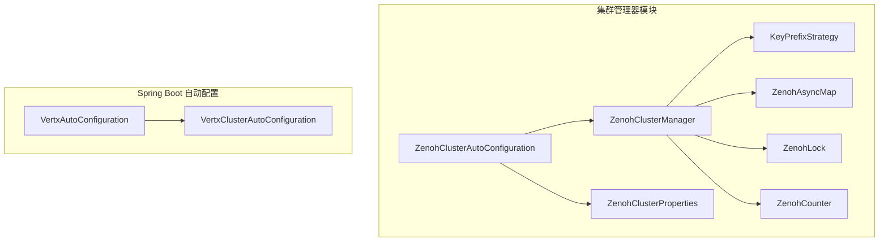
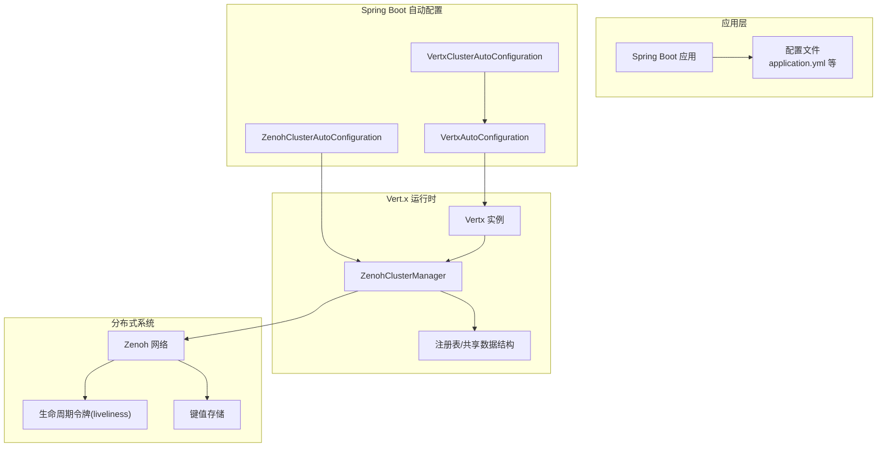
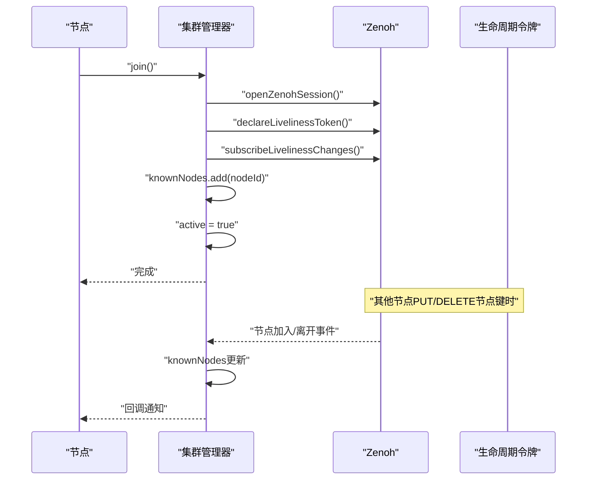
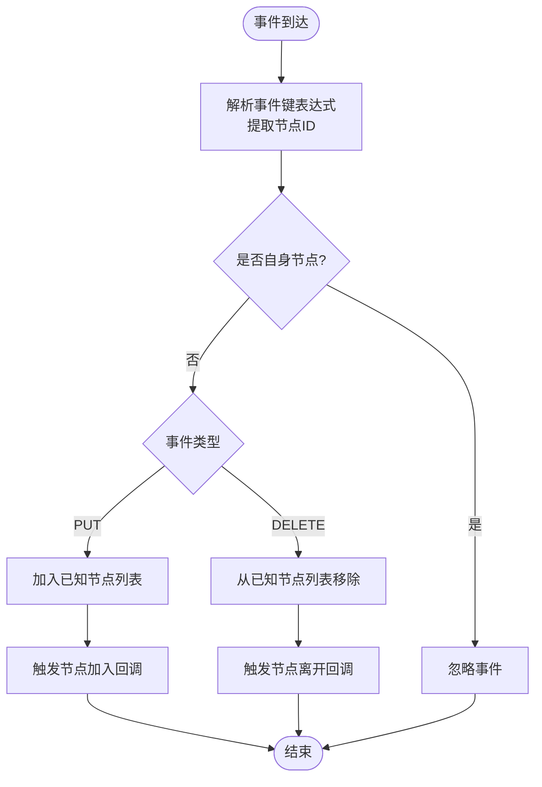
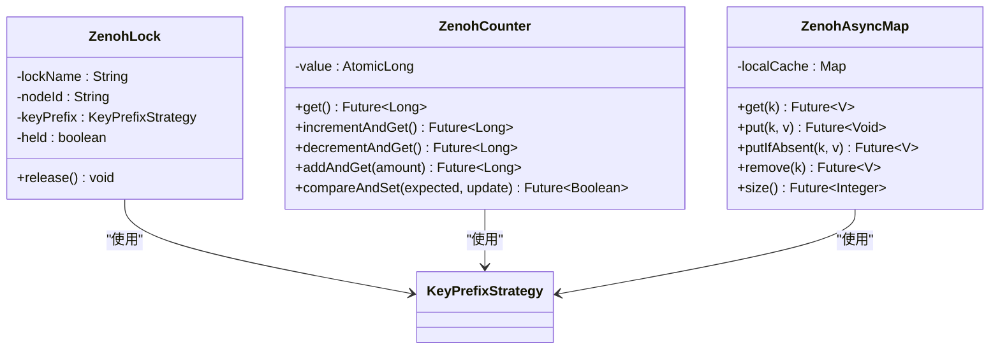
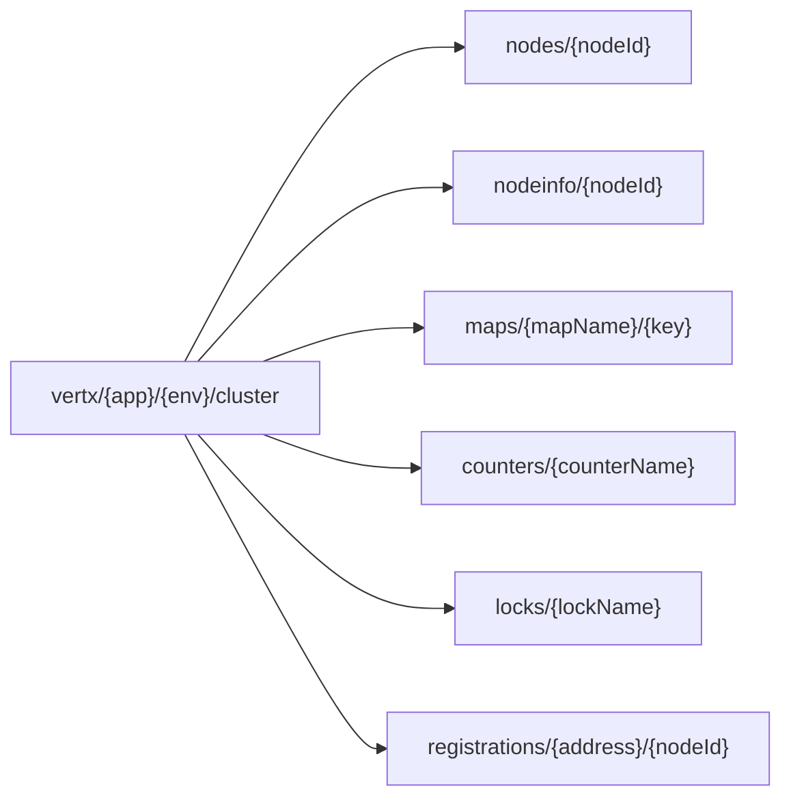
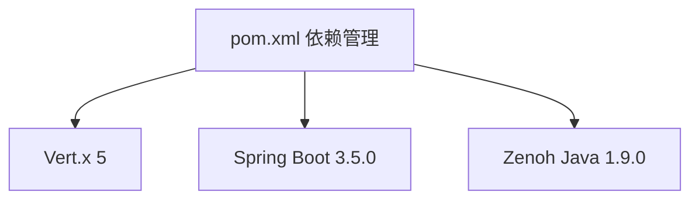

# 集群管理器实现

<cite>
**本文档引用的文件**
- [ZenohClusterManager.java](file://vertx-spring-boot-cluster-zenoh/src/main/java/com/workoss/boot/vertx/cluster/zenoh/ZenohClusterManager.java)
- [KeyPrefixStrategy.java](file://vertx-spring-boot-cluster-zenoh/src/main/java/com/workoss/boot/vertx/cluster/zenoh/KeyPrefixStrategy.java)
- [ZenohAsyncMap.java](file://vertx-spring-boot-cluster-zenoh/src/main/java/com/workoss/boot/vertx/cluster/zenoh/ZenohAsyncMap.java)
- [ZenohLock.java](file://vertx-spring-boot-cluster-zenoh/src/main/java/com/workoss/boot/vertx/cluster/zenoh/ZenohLock.java)
- [ZenohCounter.java](file://vertx-spring-boot-cluster-zenoh/src/main/java/com/workoss/boot/vertx/cluster/zenoh/ZenohCounter.java)
- [ZenohClusterAutoConfiguration.java](file://vertx-spring-boot-cluster-zenoh/src/main/java/com/workoss/boot/vertx/cluster/zenoh/ZenohClusterAutoConfiguration.java)
- [ZenohClusterProperties.java](file://vertx-spring-boot-cluster-zenoh/src/main/java/com/workoss/boot/vertx/cluster/zenoh/ZenohClusterProperties.java)
- [VertxClusterAutoConfiguration.java](file://vertx-spring-boot-autoconfigure/src/main/java/com/workoss/boot/vertx/autoconfigure/VertxClusterAutoConfiguration.java)
- [VertxAutoConfiguration.java](file://vertx-spring-boot-autoconfigure/src/main/java/com/workoss/boot/vertx/autoconfigure/VertxAutoConfiguration.java)
- [application.yml](file://example/vertx-spring-boot-example/src/main/resources/application.yml)
- [application-instance1.yml](file://example/vertx-spring-boot-example/src/main/resources/application-instance1.yml)
- [application-instance2.yml](file://example/vertx-spring-boot-example/src/main/resources/application-instance2.yml)
- [pom.xml](file://pom.xml)
</cite>

## 目录
1. [简介](#简介)
2. [项目结构](#项目结构)
3. [核心组件](#核心组件)
4. [架构概览](#架构概览)
5. [详细组件分析](#详细组件分析)
6. [依赖关系分析](#依赖关系分析)
7. [性能考虑](#性能考虑)
8. [故障排查指南](#故障排查指南)
9. [结论](#结论)
10. [附录](#附录)

## 简介
本文件为 ZenohClusterManager 的技术文档，系统阐述基于 Zenoh 的 Vert.x 集群管理器实现。内容涵盖集群管理器对 Vert.x ClusterManager 接口的实现方式、与 Zenoh 的集成策略、节点发现机制、成员管理算法、集群状态同步流程、集群事件处理（节点加入/离开/故障检测）、分布式协调机制（锁、计数器、共享数据结构）以及性能特征、扩展性、监控与调试方法，并给出故障恢复与数据一致性保障的实现要点。

## 项目结构
该模块位于 `vertx-spring-boot-cluster-zenoh`，主要包含以下关键类：
- 集群管理器：负责节点生命周期、注册表、共享数据结构提供
- 键前缀策略：统一多租户隔离的键空间规划
- 分布式数据结构：异步 Map、分布式锁、计数器
- 自动配置：Spring Boot 条件化装配，启用时自动注入集群管理器

**图表来源**
- [ZenohClusterManager.java:29-242](file://vertx-spring-boot-cluster-zenoh/src/main/java/com/workoss/boot/vertx/cluster/zenoh/ZenohClusterManager.java#L29-L242)
- [KeyPrefixStrategy.java:8-100](file://vertx-spring-boot-cluster-zenoh/src/main/java/com/workoss/boot/vertx/cluster/zenoh/KeyPrefixStrategy.java#L8-L100)
- [ZenohAsyncMap.java:15-109](file://vertx-spring-boot-cluster-zenoh/src/main/java/com/workoss/boot/vertx/cluster/zenoh/ZenohAsyncMap.java#L15-L109)
- [ZenohLock.java:14-38](file://vertx-spring-boot-cluster-zenoh/src/main/java/com/workoss/boot/vertx/cluster/zenoh/ZenohLock.java#L14-L38)
- [ZenohCounter.java:13-60](file://vertx-spring-boot-cluster-zenoh/src/main/java/com/workoss/boot/vertx/cluster/zenoh/ZenohCounter.java#L13-L60)
- [ZenohClusterAutoConfiguration.java:15-26](file://vertx-spring-boot-cluster-zenoh/src/main/java/com/workoss/boot/vertx/cluster/zenoh/ZenohClusterAutoConfiguration.java#L15-L26)
- [VertxClusterAutoConfiguration.java:13-32](file://vertx-spring-boot-autoconfigure/src/main/java/com/workoss/boot/vertx/autoconfigure/VertxClusterAutoConfiguration.java#L13-L32)
- [VertxAutoConfiguration.java:58-82](file://vertx-spring-boot-autoconfigure/src/main/java/com/workoss/boot/vertx/autoconfigure/VertxAutoConfiguration.java#L58-L82)

**章节来源**
- [pom.xml:15-22](file://pom.xml#L15-L22)

## 核心组件
- 集群管理器（ZenohClusterManager）
  - 实现 Vert.x ClusterManager 接口，提供节点信息、节点列表、注册表、异步 Map、分布式锁、计数器等能力
  - 使用 KeyPrefixStrategy 构建多租户隔离的键空间
  - 维护本地已知节点列表、节点信息映射、注册表映射
  - 提供节点加入/离开、活跃状态查询、监听器设置等能力
- 键前缀策略（KeyPrefixStrategy）
  - 规范所有集群相关键的命名空间：`vertx/{app}/{env}/cluster/...`
  - 提供节点、节点信息、异步 Map、计数器、锁、注册表等键生成方法
- 异步 Map（ZenohAsyncMap）
  - 基于本地缓存的 AsyncMap 实现，预留与 Zenoh 后端交互的扩展点
  - 支持基本的 KV 操作与 TTL
- 分布式锁（ZenohLock）
  - 基于“先写者获胜”策略的分布式锁，键值存储当前持有者节点 ID
  - 通过生命周期令牌实现崩溃自动释放
- 计数器（ZenohCounter）
  - 基于本地原子计数的 Counter 实现，预留与 Zenoh 后端交互的扩展点
  - 提供标准的原子操作接口
- 自动配置（ZenohClusterAutoConfiguration）
  - 当配置开关开启且未存在其他 ClusterManager Bean 时，自动创建 ZenohClusterManager
- Vert.x 集成（VertxClusterAutoConfiguration / VertxAutoConfiguration）
  - 在 Vert.x 5 中通过 VertxBuilder 注入 ClusterManager
  - 条件化启用集群模式并配置 EventBus 网络参数

**章节来源**
- [ZenohClusterManager.java:29-242](file://vertx-spring-boot-cluster-zenoh/src/main/java/com/workoss/boot/vertx/cluster/zenoh/ZenohClusterManager.java#L29-L242)
- [KeyPrefixStrategy.java:8-100](file://vertx-spring-boot-cluster-zenoh/src/main/java/com/workoss/boot/vertx/cluster/zenoh/KeyPrefixStrategy.java#L8-L100)
- [ZenohAsyncMap.java:15-109](file://vertx-spring-boot-cluster-zenoh/src/main/java/com/workoss/boot/vertx/cluster/zenoh/ZenohAsyncMap.java#L15-L109)
- [ZenohLock.java:14-38](file://vertx-spring-boot-cluster-zenoh/src/main/java/com/workoss/boot/vertx/cluster/zenoh/ZenohLock.java#L14-L38)
- [ZenohCounter.java:13-60](file://vertx-spring-boot-cluster-zenoh/src/main/java/com/workoss/boot/vertx/cluster/zenoh/ZenohCounter.java#L13-L60)
- [ZenohClusterAutoConfiguration.java:15-26](file://vertx-spring-boot-cluster-zenoh/src/main/java/com/workoss/boot/vertx/cluster/zenoh/ZenohClusterAutoConfiguration.java#L15-L26)
- [VertxClusterAutoConfiguration.java:13-32](file://vertx-spring-boot-autoconfigure/src/main/java/com/workoss/boot/vertx/autoconfigure/VertxClusterAutoConfiguration.java#L13-L32)
- [VertxAutoConfiguration.java:58-82](file://vertx-spring-boot-autoconfigure/src/main/java/com/workoss/boot/vertx/autoconfigure/VertxAutoConfiguration.java#L58-L82)

## 架构概览
下图展示 ZenohClusterManager 与 Vert.x、Spring Boot、Zenoh 的整体交互关系：

**图表来源**
- [ZenohClusterAutoConfiguration.java:15-26](file://vertx-spring-boot-cluster-zenoh/src/main/java/com/workoss/boot/vertx/cluster/zenoh/ZenohClusterAutoConfiguration.java#L15-L26)
- [VertxClusterAutoConfiguration.java:13-32](file://vertx-spring-boot-autoconfigure/src/main/java/com/workoss/boot/vertx/autoconfigure/VertxClusterAutoConfiguration.java#L13-L32)
- [VertxAutoConfiguration.java:58-82](file://vertx-spring-boot-autoconfigure/src/main/java/com/workoss/boot/vertx/autoconfigure/VertxAutoConfiguration.java#L58-L82)
- [ZenohClusterManager.java:29-242](file://vertx-spring-boot-cluster-zenoh/src/main/java/com/workoss/boot/vertx/cluster/zenoh/ZenohClusterManager.java#L29-L242)

## 详细组件分析

### 节点发现与成员管理
- 节点标识与初始化
  - 每个节点在构造时生成唯一节点 ID
  - 初始化阶段记录节点信息并写入本地映射
- 加入集群
  - 打开会话、声明生命周期令牌、订阅全量节点变更
  - 将自身节点 ID 加入已知节点列表，标记为活跃
- 离开集群
  - 关闭会话、移除自身节点 ID、标记为非活跃
- 节点变更监听
  - 订阅节点键空间模式，根据 PUT/DELETE 事件触发节点加入/离开回调

**图表来源**
- [ZenohClusterManager.java:124-140](file://vertx-spring-boot-cluster-zenoh/src/main/java/com/workoss/boot/vertx/cluster/zenoh/ZenohClusterManager.java#L124-L140)
- [ZenohClusterManager.java:192-235](file://vertx-spring-boot-cluster-zenoh/src/main/java/com/workoss/boot/vertx/cluster/zenoh/ZenohClusterManager.java#L192-L235)

**章节来源**
- [ZenohClusterManager.java:124-159](file://vertx-spring-boot-cluster-zenoh/src/main/java/com/workoss/boot/vertx/cluster/zenoh/ZenohClusterManager.java#L124-L159)

### 集群状态同步与事件处理
- 节点信息同步
  - 节点加入时发布节点信息到专用键空间
  - 其他节点可通过 getNodeInfo 获取对应节点信息
- 注册表同步
  - addRegistration/removeRegistration 维护本地注册表
  - getRegistrations 返回指定地址的注册信息列表
- 事件处理流程
  - 订阅节点键空间模式，解析事件来源节点 ID
  - 对于自身节点忽略，其他节点根据事件类型更新本地状态并触发回调

**图表来源**
- [ZenohClusterManager.java:211-228](file://vertx-spring-boot-cluster-zenoh/src/main/java/com/workoss/boot/vertx/cluster/zenoh/ZenohClusterManager.java#L211-L228)

**章节来源**
- [ZenohClusterManager.java:100-121](file://vertx-spring-boot-cluster-zenoh/src/main/java/com/workoss/boot/vertx/cluster/zenoh/ZenohClusterManager.java#L100-L121)
- [ZenohClusterManager.java:162-184](file://vertx-spring-boot-cluster-zenoh/src/main/java/com/workoss/boot/vertx/cluster/zenoh/ZenohClusterManager.java#L162-L184)

### 分布式协调机制
- 分布式锁（ZenohLock）
  - 锁键采用“先写者获胜”策略：PUT IF ABSENT 成功即获得锁
  - 释放时删除锁键，允许其他节点竞争
  - 结合生命周期令牌，节点崩溃时自动释放
- 计数器（ZenohCounter）
  - 本地原子计数器作为占位实现，预留与 Zenoh 后端交互的扩展点
  - 提供标准的原子操作接口，便于后续替换为分布式实现
- 异步 Map（ZenohAsyncMap）
  - 本地缓存作为占位实现，预留与 Zenoh 后端交互的扩展点
  - 支持 TTL、条件写入、批量读取等常用操作

**图表来源**
- [ZenohLock.java:14-38](file://vertx-spring-boot-cluster-zenoh/src/main/java/com/workoss/boot/vertx/cluster/zenoh/ZenohLock.java#L14-L38)
- [ZenohCounter.java:13-60](file://vertx-spring-boot-cluster-zenoh/src/main/java/com/workoss/boot/vertx/cluster/zenoh/ZenohCounter.java#L13-L60)
- [ZenohAsyncMap.java:15-109](file://vertx-spring-boot-cluster-zenoh/src/main/java/com/workoss/boot/vertx/cluster/zenoh/ZenohAsyncMap.java#L15-L109)

**章节来源**
- [ZenohLock.java:14-38](file://vertx-spring-boot-cluster-zenoh/src/main/java/com/workoss/boot/vertx/cluster/zenoh/ZenohLock.java#L14-L38)
- [ZenohCounter.java:13-60](file://vertx-spring-boot-cluster-zenoh/src/main/java/com/workoss/boot/vertx/cluster/zenoh/ZenohCounter.java#L13-L60)
- [ZenohAsyncMap.java:15-109](file://vertx-spring-boot-cluster-zenoh/src/main/java/com/workoss/boot/vertx/cluster/zenoh/ZenohAsyncMap.java#L15-L109)

### 多租户隔离与键空间设计
- 键前缀策略
  - 统一前缀：`vertx/{app}/{env}/cluster/...`
  - 支持节点、节点信息、异步 Map、计数器、锁、注册表等子域
  - 对非法字符进行转义，确保键表达式安全
- 配置驱动
  - 通过属性对象设置应用名、环境、连接/监听端点、会话模式等
  - Spring Boot 自动装配在启用时注入集群管理器

**图表来源**
- [KeyPrefixStrategy.java:12-91](file://vertx-spring-boot-cluster-zenoh/src/main/java/com/workoss/boot/vertx/cluster/zenoh/KeyPrefixStrategy.java#L12-L91)
- [ZenohClusterProperties.java:11-91](file://vertx-spring-boot-cluster-zenoh/src/main/java/com/workoss/boot/vertx/cluster/zenoh/ZenohClusterProperties.java#L11-L91)

**章节来源**
- [KeyPrefixStrategy.java:8-100](file://vertx-spring-boot-cluster-zenoh/src/main/java/com/workoss/boot/vertx/cluster/zenoh/KeyPrefixStrategy.java#L8-L100)
- [ZenohClusterProperties.java:11-91](file://vertx-spring-boot-cluster-zenoh/src/main/java/com/workoss/boot/vertx/cluster/zenoh/ZenohClusterProperties.java#L11-L91)

## 依赖关系分析
- 模块依赖
  - 项目使用 Maven 管理依赖，Vert.x 与 Spring Boot 版本由 BOM 统一管理
  - 引入 Zenoh Java SDK 以支持后端交互
- 运行时依赖
  - Spring Boot 自动配置在启用集群时注入 ClusterManager
  - Vert.x 5 通过 VertxBuilder.withClusterManager() 设置集群管理器

**图表来源**
- [pom.xml:35-107](file://pom.xml#L35-L107)

**章节来源**
- [pom.xml:35-107](file://pom.xml#L35-L107)
- [VertxAutoConfiguration.java:58-82](file://vertx-spring-boot-autoconfigure/src/main/java/com/workoss/boot/vertx/autoconfigure/VertxAutoConfiguration.java#L58-L82)
- [VertxClusterAutoConfiguration.java:13-32](file://vertx-spring-boot-autoconfigure/src/main/java/com/workoss/boot/vertx/autoconfigure/VertxClusterAutoConfiguration.java#L13-L32)

## 性能考虑
- 本地缓存优先
  - 异步 Map、计数器当前使用本地缓存，减少网络往返，提升读写性能
  - 建议在分布式实现中引入本地缓存 + 渐进式同步策略
- 键空间设计
  - 统一前缀与模式匹配有利于高效订阅与查询
  - 合理划分子域可降低热点冲突
- 生命周期令牌
  - 利用 Zenoh 生命周期令牌实现快速故障检测，降低超时等待
- 并发控制
  - 已使用并发容器维护节点列表与注册表，避免锁竞争
- 可扩展性
  - 通过配置属性支持不同部署场景（peer/client/router）
  - 多租户隔离避免跨应用干扰

## 故障排查指南
- 启动与配置
  - 确认配置开关已启用：`vertx.cluster.enabled=true`
  - 检查应用名与环境配置，确保键空间隔离正确
- 日志定位
  - 关注集群管理器日志中的节点加入/离开、会话打开/关闭、错误异常
- 常见问题
  - 无法加入集群：检查连接/监听端点与会话模式配置
  - 节点不感知：确认生命周期订阅是否成功、键空间模式是否匹配
  - 数据不一致：检查本地缓存与后端同步策略

**章节来源**
- [application.yml:16-20](file://example/vertx-spring-boot-example/src/main/resources/application.yml#L16-L20)
- [ZenohClusterManager.java:124-159](file://vertx-spring-boot-cluster-zenoh/src/main/java/com/workoss/boot/vertx/cluster/zenoh/ZenohClusterManager.java#L124-L159)

## 结论
ZenohClusterManager 通过清晰的键空间设计与 Spring Boot 条件化装配，实现了对 Vert.x 集群管理接口的完整覆盖。当前版本以本地缓存为核心，预留了与 Zenoh 后端交互的扩展点；生命周期令牌与模式订阅提供了高效的节点发现与故障检测能力。建议在生产环境中逐步替换为分布式实现，并结合监控指标与日志进行持续优化。

## 附录
- 示例配置
  - 应用级配置示例展示了如何启用集群与设置端口
- 版本信息
  - 项目统一管理 Vert.x 与 Spring Boot 版本，确保兼容性

**章节来源**
- [application-instance1.yml:1-2](file://example/vertx-spring-boot-example/src/main/resources/application-instance1.yml#L1-L2)
- [application-instance2.yml:1-2](file://example/vertx-spring-boot-example/src/main/resources/application-instance2.yml#L1-L2)
- [pom.xml:24-33](file://pom.xml#L24-L33)