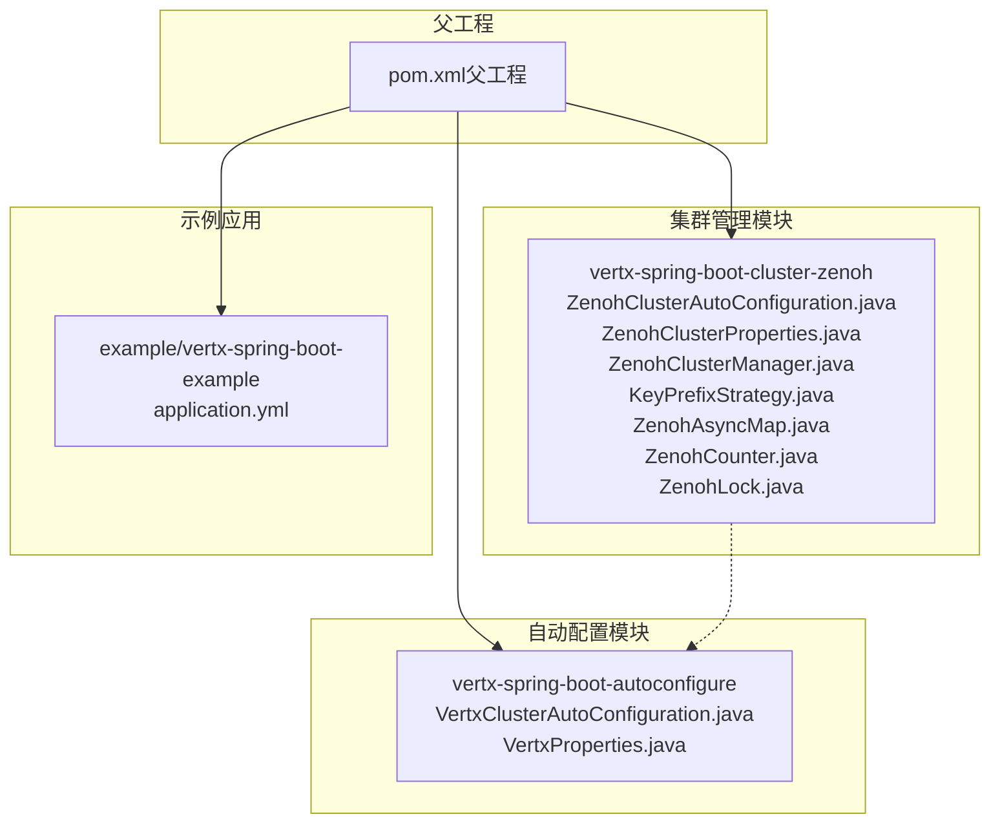
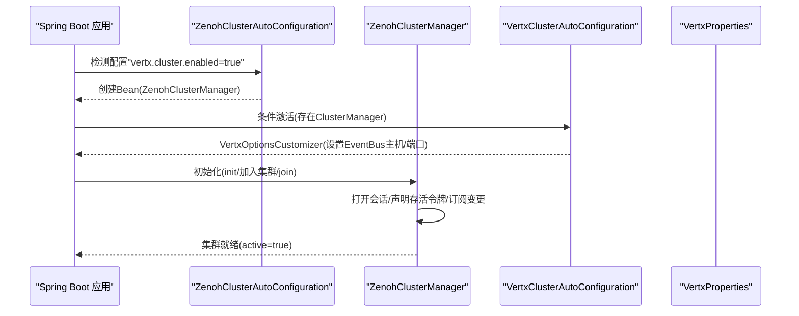
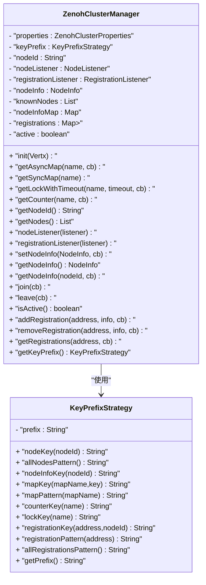
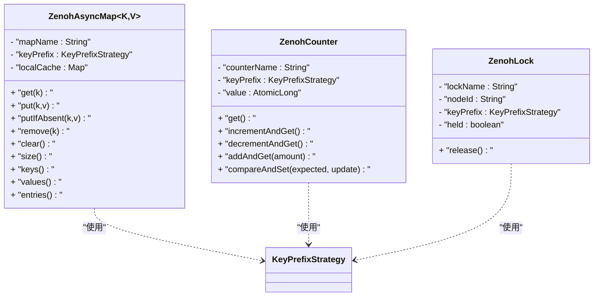
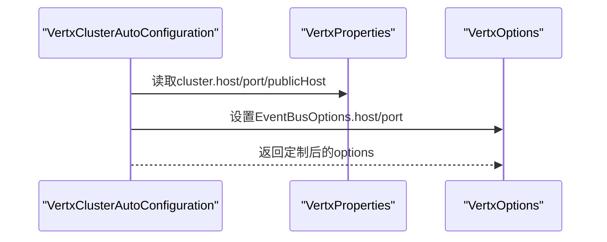
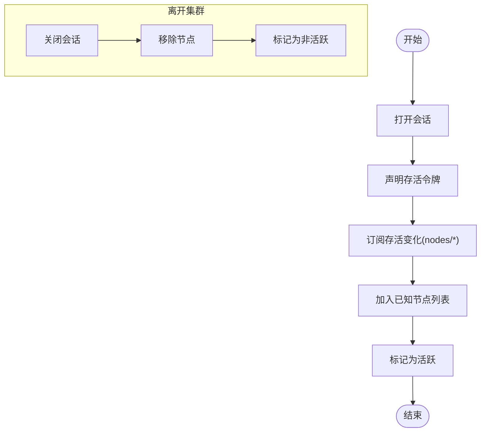
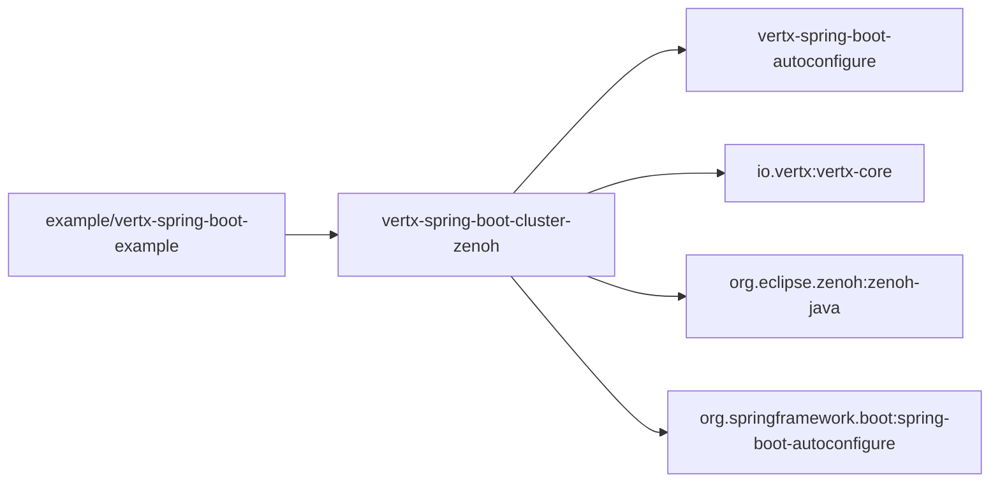

# 集群管理模块

<cite>
**本文引用的文件**
- [ZenohClusterAutoConfiguration.java](file://vertx-spring-boot-cluster-zenoh/src/main/java/com/workoss/boot/vertx/cluster/zenoh/ZenohClusterAutoConfiguration.java)
- [ZenohClusterProperties.java](file://vertx-spring-boot-cluster-zenoh/src/main/java/com/workoss/boot/vertx/cluster/zenoh/ZenohClusterProperties.java)
- [ZenohClusterManager.java](file://vertx-spring-boot-cluster-zenoh/src/main/java/com/workoss/boot/vertx/cluster/zenoh/ZenohClusterManager.java)
- [KeyPrefixStrategy.java](file://vertx-spring-boot-cluster-zenoh/src/main/java/com/workoss/boot/vertx/cluster/zenoh/KeyPrefixStrategy.java)
- [ZenohAsyncMap.java](file://vertx-spring-boot-cluster-zenoh/src/main/java/com/workoss/boot/vertx/cluster/zenoh/ZenohAsyncMap.java)
- [ZenohCounter.java](file://vertx-spring-boot-cluster-zenoh/src/main/java/com/workoss/boot/vertx/cluster/zenoh/ZenohCounter.java)
- [ZenohLock.java](file://vertx-spring-boot-cluster-zenoh/src/main/java/com/workoss/boot/vertx/cluster/zenoh/ZenohLock.java)
- [VertxClusterAutoConfiguration.java](file://vertx-spring-boot-autoconfigure/src/main/java/com/workoss/boot/vertx/autoconfigure/VertxClusterAutoConfiguration.java)
- [VertxProperties.java](file://vertx-spring-boot-autoconfigure/src/main/java/com/workoss/boot/vertx/autoconfigure/VertxProperties.java)
- [application.yml](file://example/vertx-spring-boot-example/src/main/resources/application.yml)
- [pom.xml（父工程）](file://pom.xml)
- [pom.xml（示例项目）](file://example/vertx-spring-boot-example/pom.xml)
- [pom.xml（集群模块）](file://vertx-spring-boot-cluster-zenoh/pom.xml)
</cite>

## 目录
1. [简介](#简介)
2. [项目结构](#项目结构)
3. [核心组件](#核心组件)
4. [架构总览](#架构总览)
5. [详细组件分析](#详细组件分析)
6. [依赖分析](#依赖分析)
7. [性能考虑](#性能考虑)
8. [故障排查指南](#故障排查指南)
9. [结论](#结论)
10. [附录](#附录)

## 简介
本文件面向Vert.x集群管理模块，聚焦于基于Zenoh的集群管理实现。文档从自动配置机制入手，系统阐述ZenohClusterAutoConfiguration如何在启用集群时创建并注入ZenohClusterManager；随后深入解析ZenohClusterProperties配置项，覆盖应用隔离、会话模式、连接与监听端点、以及外部配置文件等关键参数；在此基础上，详解ZenohClusterManager的实现原理，包括节点发现、成员管理、注册表维护、分布式锁与计数器等能力，并说明其与Vert.x集群API的集成方式（节点监听、状态同步、共享数据）。最后给出部署最佳实践、示例与故障恢复策略。

## 项目结构
该模块位于多模块Maven工程中，核心由以下子模块构成：
- 自动配置与核心：vertx-spring-boot-autoconfigure
- 集群管理（Zenoh）：vertx-spring-boot-cluster-zenoh
- 示例应用：example/vertx-spring-boot-example
- Web服务与客户端：vertx-spring-boot-web-server、vertx-spring-boot-web-client
- 起步依赖：vertx-spring-boot-starter

图表来源
- [pom.xml（父工程）:15-22](file://pom.xml#L15-L22)
- [VertxClusterAutoConfiguration.java:13-32](file://vertx-spring-boot-autoconfigure/src/main/java/com/workoss/boot/vertx/autoconfigure/VertxClusterAutoConfiguration.java#L13-L32)
- [ZenohClusterAutoConfiguration.java:15-25](file://vertx-spring-boot-cluster-zenoh/src/main/java/com/workoss/boot/vertx/cluster/zenoh/ZenohClusterAutoConfiguration.java#L15-L25)

章节来源
- [pom.xml（父工程）:15-22](file://pom.xml#L15-L22)
- [pom.xml（集群模块）:17-36](file://vertx-spring-boot-cluster-zenoh/pom.xml#L17-L36)
- [pom.xml（示例项目）:15-31](file://example/vertx-spring-boot-example/pom.xml#L15-L31)

## 核心组件
- 自动配置入口：ZenohClusterAutoConfiguration
  - 条件激活：当vertx.cluster.enabled=true时生效
  - 注入Bean：在缺少ClusterManager时创建ZenohClusterManager实例
- 配置类：ZenohClusterProperties
  - 多租户隔离：appName、environment
  - 会话配置：mode（peer/client/router）、connect、listen、configFile
- 集群管理器：ZenohClusterManager
  - 实现Vert.x ClusterManager SPI
  - 提供AsyncMap、Lock、Counter、节点信息与注册表管理
  - 基于KeyPrefixStrategy构建多租户键空间
- 辅助组件：
  - KeyPrefixStrategy：统一生成节点、注册表、锁、计数器、映射等键前缀
  - ZenohAsyncMap：基于本地缓存的异步Map实现（注释说明为Zenoh后备）
  - ZenohCounter：基于本地AtomicLong的计数器（注释说明为Zenoh后备）
  - ZenohLock：基于“先写获胜”键值的分布式锁（注释说明为Zenoh后备）

章节来源
- [ZenohClusterAutoConfiguration.java:15-25](file://vertx-spring-boot-cluster-zenoh/src/main/java/com/workoss/boot/vertx/cluster/zenoh/ZenohClusterAutoConfiguration.java#L15-L25)
- [ZenohClusterProperties.java:11-91](file://vertx-spring-boot-cluster-zenoh/src/main/java/com/workoss/boot/vertx/cluster/zenoh/ZenohClusterProperties.java#L11-L91)
- [ZenohClusterManager.java:29-52](file://vertx-spring-boot-cluster-zenoh/src/main/java/com/workoss/boot/vertx/cluster/zenoh/ZenohClusterManager.java#L29-L52)
- [KeyPrefixStrategy.java:8-101](file://vertx-spring-boot-cluster-zenoh/src/main/java/com/workoss/boot/vertx/cluster/zenoh/KeyPrefixStrategy.java#L8-L101)
- [ZenohAsyncMap.java:15-25](file://vertx-spring-boot-cluster-zenoh/src/main/java/com/workoss/boot/vertx/cluster/zenoh/ZenohAsyncMap.java#L15-L25)
- [ZenohCounter.java:13-23](file://vertx-spring-boot-cluster-zenoh/src/main/java/com/workoss/boot/vertx/cluster/zenoh/ZenohCounter.java#L13-L23)
- [ZenohLock.java:14-25](file://vertx-spring-boot-cluster-zenoh/src/main/java/com/workoss/boot/vertx/cluster/zenoh/ZenohLock.java#L14-L25)

## 架构总览
下图展示了从Spring Boot自动配置到Vert.x集群初始化的关键流程，以及ZenohClusterManager如何与Vert.x集群API对接。

图表来源
- [ZenohClusterAutoConfiguration.java:15-25](file://vertx-spring-boot-cluster-zenoh/src/main/java/com/workoss/boot/vertx/cluster/zenoh/ZenohClusterAutoConfiguration.java#L15-L25)
- [VertxClusterAutoConfiguration.java:13-32](file://vertx-spring-boot-autoconfigure/src/main/java/com/workoss/boot/vertx/autoconfigure/VertxClusterAutoConfiguration.java#L13-L32)
- [VertxProperties.java:105-158](file://vertx-spring-boot-autoconfigure/src/main/java/com/workoss/boot/vertx/autoconfigure/VertxProperties.java#L105-L158)
- [ZenohClusterManager.java:54-140](file://vertx-spring-boot-cluster-zenoh/src/main/java/com/workoss/boot/vertx/cluster/zenoh/ZenohClusterManager.java#L54-L140)

## 详细组件分析

### 自动配置机制：ZenohClusterAutoConfiguration
- 触发条件
  - 属性开关：vertx.cluster.enabled=true
  - 类存在性：检测到ClusterManager SPI
- Bean定义
  - 在缺失ClusterManager时创建ZenohClusterManager实例
- 作用
  - 将ZenohClusterManager作为Vert.x集群管理器注入容器，供后续初始化使用

章节来源
- [ZenohClusterAutoConfiguration.java:15-25](file://vertx-spring-boot-cluster-zenoh/src/main/java/com/workoss/boot/vertx/cluster/zenoh/ZenohClusterAutoConfiguration.java#L15-L25)

### 配置类：ZenohClusterProperties
- 多租户隔离
  - appName：应用名，用于键空间隔离
  - environment：环境标签（如dev/staging/prod），用于键空间隔离
- 会话与网络
  - mode：会话模式（peer/client/router）
  - connect：连接对端列表
  - listen：监听端点列表
  - configFile：外部JSON5配置文件路径
- 默认值与可选性
  - 字符串字段默认值合理，便于快速启用
  - configFile可选，支持外部复杂配置

章节来源
- [ZenohClusterProperties.java:11-91](file://vertx-spring-boot-cluster-zenoh/src/main/java/com/workoss/boot/vertx/cluster/zenoh/ZenohClusterProperties.java#L11-L91)

### 键空间策略：KeyPrefixStrategy
- 设计目标
  - 通过统一前缀实现多租户隔离
  - 所有集群相关键均以"vertx/{app}/{env}/cluster"开头
- 关键方法
  - 节点键/模式：nodes/*
  - 节点信息键：nodeinfo/{nodeId}
  - 映射键/模式：maps/{mapName}/{key}、maps/{mapName}/**
  - 计数器键：counters/{counterName}
  - 锁键：locks/{lockName}
  - 注册表键/模式：registrations/{address}/{nodeId}、registrations/{address}/*
- 安全处理
  - 对非法字符进行转义，避免破坏Zenoh键表达式

章节来源
- [KeyPrefixStrategy.java:8-101](file://vertx-spring-boot-cluster-zenoh/src/main/java/com/workoss/boot/vertx/cluster/zenoh/KeyPrefixStrategy.java#L8-L101)

### 集群管理器：ZenohClusterManager
- 职责边界
  - 实现ClusterManager SPI，提供节点生命周期、共享数据、注册表等能力
  - 维护已知节点列表、节点信息、注册表
- 关键流程
  - 初始化：保存Vertx实例
  - 加入集群：打开会话、声明存活令牌、订阅存活变化、标记活跃
  - 离开集群：关闭会话、移除节点、标记非活跃
  - 共享数据：AsyncMap/Lock/Counter代理到对应实现
  - 注册表：按地址聚合RegistrationInfo，支持查询与清理
- 与Vert.x API集成
  - 节点监听：通过NodeListener回调新增/离开事件
  - 注册监听：通过RegistrationListener维护路由注册
  - 节点信息：存储当前节点信息，支持按节点查询
- 可扩展点（注释说明）
  - 会话打开、存活令牌声明、订阅变更、会话关闭等均为占位实现，需结合zenoh-java完成实际交互

图表来源
- [ZenohClusterManager.java:29-188](file://vertx-spring-boot-cluster-zenoh/src/main/java/com/workoss/boot/vertx/cluster/zenoh/ZenohClusterManager.java#L29-L188)
- [KeyPrefixStrategy.java:8-101](file://vertx-spring-boot-cluster-zenoh/src/main/java/com/workoss/boot/vertx/cluster/zenoh/KeyPrefixStrategy.java#L8-L101)

章节来源
- [ZenohClusterManager.java:29-243](file://vertx-spring-boot-cluster-zenoh/src/main/java/com/workoss/boot/vertx/cluster/zenoh/ZenohClusterManager.java#L29-L243)

### 分布式共享数据组件
- 异步Map：ZenohAsyncMap
  - 本地缓存+键空间映射，注释说明未来以Zenoh put/get/delete替代
  - 支持TTL、条件put、批量操作等语义
- 计数器：ZenohCounter
  - 本地AtomicLong+CAS注释说明，未来以Zenoh原子操作替代
- 分布式锁：ZenohLock
  - 基于键值存储的“先写获胜”模式，配合存活令牌实现崩溃释放

图表来源
- [ZenohAsyncMap.java:15-109](file://vertx-spring-boot-cluster-zenoh/src/main/java/com/workoss/boot/vertx/cluster/zenoh/ZenohAsyncMap.java#L15-L109)
- [ZenohCounter.java:13-60](file://vertx-spring-boot-cluster-zenoh/src/main/java/com/workoss/boot/vertx/cluster/zenoh/ZenohCounter.java#L13-L60)
- [ZenohLock.java:14-38](file://vertx-spring-boot-cluster-zenoh/src/main/java/com/workoss/boot/vertx/cluster/zenoh/ZenohLock.java#L14-L38)

章节来源
- [ZenohAsyncMap.java:15-109](file://vertx-spring-boot-cluster-zenoh/src/main/java/com/workoss/boot/vertx/cluster/zenoh/ZenohAsyncMap.java#L15-L109)
- [ZenohCounter.java:13-60](file://vertx-spring-boot-cluster-zenoh/src/main/java/com/workoss/boot/vertx/cluster/zenoh/ZenohCounter.java#L13-L60)
- [ZenohLock.java:14-38](file://vertx-spring-boot-cluster-zenoh/src/main/java/com/workoss/boot/vertx/cluster/zenoh/ZenohLock.java#L14-L38)

### 与Vert.x集群API的集成
- 自动配置集成：VertxClusterAutoConfiguration
  - 当集群启用且存在ClusterManager时，定制VertxOptions
  - 设置EventBus的主机与端口（Vert.x 5通过VertxBuilder.withClusterManager配置集群）
- Vert.x属性：VertxProperties
  - 包含集群开关、主机、端口、公网主机等配置项
- 集成要点
  - ClusterManager由ZenohClusterManager提供
  - EventBus的网络参数仍可通过VertxProperties配置

图表来源
- [VertxClusterAutoConfiguration.java:18-32](file://vertx-spring-boot-autoconfigure/src/main/java/com/workoss/boot/vertx/autoconfigure/VertxClusterAutoConfiguration.java#L18-L32)
- [VertxProperties.java:105-158](file://vertx-spring-boot-autoconfigure/src/main/java/com/workoss/boot/vertx/autoconfigure/VertxProperties.java#L105-L158)

章节来源
- [VertxClusterAutoConfiguration.java:13-32](file://vertx-spring-boot-autoconfigure/src/main/java/com/workoss/boot/vertx/autoconfigure/VertxClusterAutoConfiguration.java#L13-L32)
- [VertxProperties.java:8-160](file://vertx-spring-boot-autoconfigure/src/main/java/com/workoss/boot/vertx/autoconfigure/VertxProperties.java#L8-L160)

### 节点发现与状态同步流程
- 加入集群
  - 打开会话（占位实现，需接入zenoh-java）
  - 声明存活令牌（用于心跳/存活）
  - 订阅存活变化（监听nodes/*，触发节点新增/离开回调）
  - 标记自身为已知节点并设置活跃
- 状态同步
  - 节点信息：setNodeInfo后缓存并在需要时返回
  - 注册表：按地址聚合注册信息，支持查询与清理

图表来源
- [ZenohClusterManager.java:124-154](file://vertx-spring-boot-cluster-zenoh/src/main/java/com/workoss/boot/vertx/cluster/zenoh/ZenohClusterManager.java#L124-L154)
- [KeyPrefixStrategy.java:19-28](file://vertx-spring-boot-cluster-zenoh/src/main/java/com/workoss/boot/vertx/cluster/zenoh/KeyPrefixStrategy.java#L19-L28)

章节来源
- [ZenohClusterManager.java:124-228](file://vertx-spring-boot-cluster-zenoh/src/main/java/com/workoss/boot/vertx/cluster/zenoh/ZenohClusterManager.java#L124-L228)

## 依赖分析
- 模块依赖
  - 集群模块依赖自动配置模块与Vert.x核心、Spring Boot自动装配、SLF4J、zenoh-java
  - 示例项目依赖集群模块与Web模块
- 版本与BOM
  - 父POM统一管理Vert.x、Spring Boot与zenoh-java版本
  - 通过BOM强制Netty版本满足Vert.x 5要求

图表来源
- [pom.xml（集群模块）:17-54](file://vertx-spring-boot-cluster-zenoh/pom.xml#L17-L54)
- [pom.xml（父工程）:35-108](file://pom.xml#L35-L108)
- [pom.xml（示例项目）:15-31](file://example/vertx-spring-boot-example/pom.xml#L15-L31)

章节来源
- [pom.xml（集群模块）:17-54](file://vertx-spring-boot-cluster-zenoh/pom.xml#L17-L54)
- [pom.xml（父工程）:35-108](file://pom.xml#L35-L108)

## 性能考虑
- 本地缓存与一致性
  - AsyncMap/Counter/Lock当前采用本地实现，建议在生产中以Zenoh put/get/cas替代，确保跨节点一致
- 键空间设计
  - 使用KeyPrefixStrategy统一前缀，避免键冲突；注意sanitize对特殊字符的处理
- 会话与订阅
  - 仅在加入集群后建立订阅，离开时及时关闭，减少网络与内存占用
- 线程模型
  - 结合VertxProperties中的线程池与虚拟线程配置，平衡吞吐与延迟

## 故障排查指南
- 启动失败
  - 检查vertx.cluster.enabled是否正确开启
  - 确认存在ClusterManager Bean（由ZenohClusterAutoConfiguration创建）
- 连接问题
  - 校验connect/listen与configFile配置是否正确
  - 确认网络可达与防火墙放行
- 节点未发现
  - 检查KeyPrefixStrategy生成的键前缀是否一致（app与env）
  - 确认订阅模式nodes/*是否匹配实际发布键
- 分布式锁/计数器异常
  - 当前实现为本地版本，需确认是否已接入zenoh-java后端
- 日志定位
  - 关注集群管理器日志输出，定位加入/离开、订阅、发布等关键步骤

章节来源
- [ZenohClusterAutoConfiguration.java:15-25](file://vertx-spring-boot-cluster-zenoh/src/main/java/com/workoss/boot/vertx/cluster/zenoh/ZenohClusterAutoConfiguration.java#L15-L25)
- [ZenohClusterManager.java:124-154](file://vertx-spring-boot-cluster-zenoh/src/main/java/com/workoss/boot/vertx/cluster/zenoh/ZenohClusterManager.java#L124-L154)
- [KeyPrefixStrategy.java:89-101](file://vertx-spring-boot-cluster-zenoh/src/main/java/com/workoss/boot/vertx/cluster/zenoh/KeyPrefixStrategy.java#L89-L101)

## 结论
本模块通过Spring Boot自动配置将ZenohClusterManager无缝注入Vert.x，借助KeyPrefixStrategy实现多租户隔离，并提供节点发现、成员管理、注册表与分布式共享数据能力。当前实现以本地缓存为主，完整功能需结合zenoh-java完成会话、订阅与原子操作。建议在生产中完善后端集成、优化键空间设计与订阅策略，并结合Vert.x线程模型进行性能调优。

## 附录

### 部署最佳实践
- 网络配置
  - 明确connect与listen端点，确保跨节点连通
  - 在NAT或云环境中配置publicHost
- 安全设置
  - 使用独立的appName与environment，避免多环境混布
  - 通过configFile集中管理高级网络与认证参数
- 性能调优
  - 合理设置EventBus主机/端口与线程池大小
  - 评估订阅粒度与键空间规模，避免过度订阅

### 配置示例片段路径
- 示例应用配置（启用集群）
  - [application.yml:16-20](file://example/vertx-spring-boot-example/src/main/resources/application.yml#L16-L20)

章节来源
- [application.yml:16-20](file://example/vertx-spring-boot-example/src/main/resources/application.yml#L16-L20)