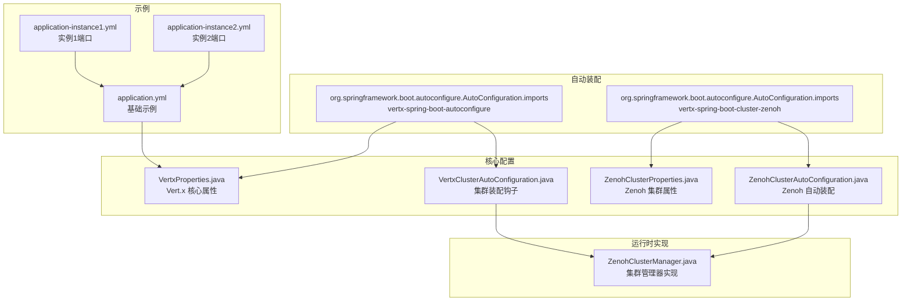
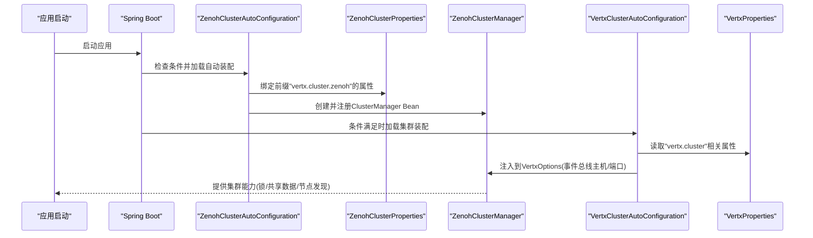
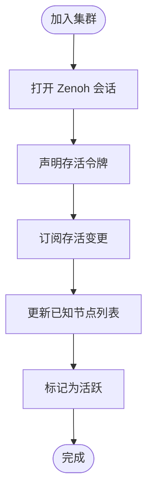
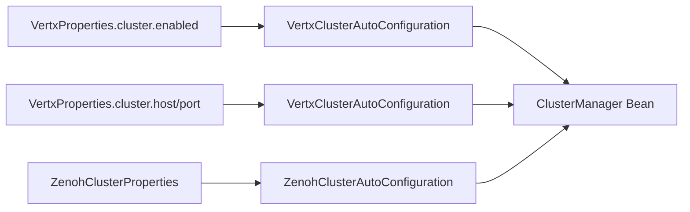

# 集群配置详解

<cite>
**本文引用的文件**
- [ZenohClusterProperties.java](file://vertx-spring-boot-cluster-zenoh/src/main/java/com/workoss/boot/vertx/cluster/zenoh/ZenohClusterProperties.java)
- [ZenohClusterAutoConfiguration.java](file://vertx-spring-boot-cluster-zenoh/src/main/java/com/workoss/boot/vertx/cluster/zenoh/ZenohClusterAutoConfiguration.java)
- [ZenohClusterManager.java](file://vertx-spring-boot-cluster-zenoh/src/main/java/com/workoss/boot/vertx/cluster/zenoh/ZenohClusterManager.java)
- [VertxProperties.java](file://vertx-spring-boot-autoconfigure/src/main/java/com/workoss/boot/vertx/autoconfigure/VertxProperties.java)
- [VertxClusterAutoConfiguration.java](file://vertx-spring-boot-autoconfigure/src/main/java/com/workoss/boot/vertx/autoconfigure/VertxClusterAutoConfiguration.java)
- [application.yml](file://example/vertx-spring-boot-example/src/main/resources/application.yml)
- [application-instance1.yml](file://example/vertx-spring-boot-example/src/main/resources/application-instance1.yml)
- [application-instance2.yml](file://example/vertx-spring-boot-example/src/main/resources/application-instance2.yml)
- [org.springframework.boot.autoconfigure.AutoConfiguration.imports](file://vertx-spring-boot-cluster-zenoh/src/main/resources/META-INF/spring/org.springframework.boot.autoconfigure.AutoConfiguration.imports)
- [org.springframework.boot.autoconfigure.AutoConfiguration.imports](file://vertx-spring-boot-autoconfigure/src/main/resources/META-INF/spring/org.springframework.boot.autoconfigure.AutoConfiguration.imports)
</cite>

## 目录
1. [引言](#引言)
2. [项目结构](#项目结构)
3. [核心组件](#核心组件)
4. [架构总览](#架构总览)
5. [详细组件分析](#详细组件分析)
6. [依赖关系分析](#依赖关系分析)
7. [性能考量](#性能考量)
8. [故障排查指南](#故障排查指南)
9. [结论](#结论)
10. [附录：配置示例与最佳实践](#附录配置示例与最佳实践)

## 引言
本文件面向使用 Vert.x 集群功能的开发者，系统性解析基于 Zenoh 的集群配置方案。重点围绕 ZenohClusterProperties 配置类展开，逐项说明其属性含义、默认值、取值范围、相互依赖与约束，并结合实际工程示例给出单机、多节点与分布式部署的完整配置模板。同时提供配置校验规则、常见错误排查方法以及不同环境下的性能调优建议。

## 项目结构
该仓库采用模块化组织，与集群配置直接相关的核心模块如下：
- vertx-spring-boot-cluster-zenoh：提供基于 Zenoh 的集群管理器实现与自动装配
- vertx-spring-boot-autoconfigure：提供 Vert.x 核心属性与集群相关属性的绑定与装配
- example/vertx-spring-boot-example：演示如何在多实例环境中启用集群与切换端口

图表来源
- [org.springframework.boot.autoconfigure.AutoConfiguration.imports:1-3](file://vertx-spring-boot-autoconfigure/src/main/resources/META-INF/spring/org.springframework.boot.autoconfigure.AutoConfiguration.imports#L1-L3)
- [org.springframework.boot.autoconfigure.AutoConfiguration.imports:1-2](file://vertx-spring-boot-cluster-zenoh/src/main/resources/META-INF/spring/org.springframework.boot.autoconfigure.AutoConfiguration.imports#L1-L2)
- [VertxProperties.java:1-160](file://vertx-spring-boot-autoconfigure/src/main/java/com/workoss/boot/vertx/autoconfigure/VertxProperties.java#L1-L160)
- [VertxClusterAutoConfiguration.java:1-34](file://vertx-spring-boot-autoconfigure/src/main/java/com/workoss/boot/vertx/autoconfigure/VertxClusterAutoConfiguration.java#L1-L34)
- [ZenohClusterProperties.java:1-92](file://vertx-spring-boot-cluster-zenoh/src/main/java/com/workoss/boot/vertx/cluster/zenoh/ZenohClusterProperties.java#L1-L92)
- [ZenohClusterAutoConfiguration.java:1-27](file://vertx-spring-boot-cluster-zenoh/src/main/java/com/workoss/boot/vertx/cluster/zenoh/ZenohClusterAutoConfiguration.java#L1-L27)
- [ZenohClusterManager.java:1-243](file://vertx-spring-boot-cluster-zenoh/src/main/java/com/workoss/boot/vertx/cluster/zenoh/ZenohClusterManager.java#L1-L243)
- [application.yml:1-21](file://example/vertx-spring-boot-example/src/main/resources/application.yml#L1-L21)
- [application-instance1.yml:1-2](file://example/vertx-spring-boot-example/src/main/resources/application-instance1.yml#L1-L2)
- [application-instance2.yml:1-2](file://example/vertx-spring-boot-example/src/main/resources/application-instance2.yml#L1-L2)

章节来源
- [org.springframework.boot.autoconfigure.AutoConfiguration.imports:1-3](file://vertx-spring-boot-autoconfigure/src/main/resources/META-INF/spring/org.springframework.boot.autoconfigure.AutoConfiguration.imports#L1-L3)
- [org.springframework.boot.autoconfigure.AutoConfiguration.imports:1-2](file://vertx-spring-boot-cluster-zenoh/src/main/resources/META-INF/spring/org.springframework.boot.autoconfigure.AutoConfiguration.imports#L1-L2)

## 核心组件
- ZenohClusterProperties：定义 Zenoh 集群管理所需的全部配置项，包括应用隔离、会话模式、连接与监听端点、外部配置文件等。
- ZenohClusterAutoConfiguration：在启用集群时自动注册 ZenohClusterManager Bean。
- VertxProperties 与 VertxClusterAutoConfiguration：提供 Vert.x 层面的集群开关、主机与端口等通用配置，并在启用集群时注入到 Vert.x 选项中。
- ZenohClusterManager：实现 Vert.x ClusterManager 接口，负责节点加入/离开、注册信息维护、锁与共享数据结构等。

章节来源
- [ZenohClusterProperties.java:1-92](file://vertx-spring-boot-cluster-zenoh/src/main/java/com/workoss/boot/vertx/cluster/zenoh/ZenohClusterProperties.java#L1-L92)
- [ZenohClusterAutoConfiguration.java:1-27](file://vertx-spring-boot-cluster-zenoh/src/main/java/com/workoss/boot/vertx/cluster/zenoh/ZenohClusterAutoConfiguration.java#L1-L27)
- [VertxProperties.java:1-160](file://vertx-spring-boot-autoconfigure/src/main/java/com/workoss/boot/vertx/autoconfigure/VertxProperties.java#L1-L160)
- [VertxClusterAutoConfiguration.java:1-34](file://vertx-spring-boot-autoconfigure/src/main/java/com/workoss/boot/vertx/autoconfigure/VertxClusterAutoConfiguration.java#L1-L34)
- [ZenohClusterManager.java:1-243](file://vertx-spring-boot-cluster-zenoh/src/main/java/com/workoss/boot/vertx/cluster/zenoh/ZenohClusterManager.java#L1-L243)

## 架构总览
下图展示了从配置到运行时的装配流程与职责边界：

图表来源
- [ZenohClusterAutoConfiguration.java:1-27](file://vertx-spring-boot-cluster-zenoh/src/main/java/com/workoss/boot/vertx/cluster/zenoh/ZenohClusterAutoConfiguration.java#L1-L27)
- [ZenohClusterProperties.java:1-92](file://vertx-spring-boot-cluster-zenoh/src/main/java/com/workoss/boot/vertx/cluster/zenoh/ZenohClusterProperties.java#L1-L92)
- [ZenohClusterManager.java:1-243](file://vertx-spring-boot-cluster-zenoh/src/main/java/com/workoss/boot/vertx/cluster/zenoh/ZenohClusterManager.java#L1-L243)
- [VertxClusterAutoConfiguration.java:1-34](file://vertx-spring-boot-autoconfigure/src/main/java/com/workoss/boot/vertx/autoconfigure/VertxClusterAutoConfiguration.java#L1-L34)
- [VertxProperties.java:1-160](file://vertx-spring-boot-autoconfigure/src/main/java/com/workoss/boot/vertx/autoconfigure/VertxProperties.java#L1-L160)

## 详细组件分析

### ZenohClusterProperties 配置类详解
- 前缀：vertx.cluster.zenoh
- 主要属性与说明
  - appName：应用名，用于多租户隔离，默认"default"
  - environment：环境标签，用于多租户隔离，默认"default"
  - mode：Zenoh 会话模式，支持 peer/client/router，默认"peer"
  - connect：连接端点列表，用于连接现有 Zenoh 网络
  - listen：监听端点列表，用于对外暴露服务以便其他节点接入
  - configFile：指向 Zenoh JSON5 配置文件路径（若提供，可覆盖上述部分属性）

- 默认值与推荐设置
  - appName/environment：建议按业务域与环境分别设置，避免跨环境冲突
  - mode：单机开发可选 peer；生产多节点需确保至少一个 router，其余 peer/client
  - connect/listen：单机模式通常无需 connect；多节点/分布式需正确填写对端地址或本机监听地址
  - configFile：优先级低于显式属性，仅在需要复杂配置时使用

- 取值范围与约束
  - mode 必须为 peer/client/router之一
  - connect/listen 为字符串列表，元素应符合 Zenoh 端点格式
  - 当提供 configFile 时，内部配置将作为补充，不强制覆盖所有字段

- 与其他配置的关系
  - 与 Vert.x 集群开关（vertx.cluster.enabled）强关联：只有启用集群时才会激活 Zenoh 自动装配
  - 与 Vert.x 事件总线主机/端口（vertx.cluster.host/port）配合：用于集群通信通道

章节来源
- [ZenohClusterProperties.java:1-92](file://vertx-spring-boot-cluster-zenoh/src/main/java/com/workoss/boot/vertx/cluster/zenoh/ZenohClusterProperties.java#L1-L92)
- [VertxClusterAutoConfiguration.java:1-34](file://vertx-spring-boot-autoconfigure/src/main/java/com/workoss/boot/vertx/autoconfigure/VertxClusterAutoConfiguration.java#L1-L34)
- [VertxProperties.java:105-158](file://vertx-spring-boot-autoconfigure/src/main/java/com/workoss/boot/vertx/autoconfigure/VertxProperties.java#L105-L158)

### ZenohClusterAutoConfiguration 自动装配
- 条件注解
  - 仅当 vertx.cluster.enabled=true 时生效
  - 仅当存在 ClusterManager 类时生效
- 行为
  - 注册 ZenohClusterManager Bean，传入已绑定的 ZenohClusterProperties
- 作用
  - 将配置类与运行时实现解耦，便于扩展其他集群后端

章节来源
- [ZenohClusterAutoConfiguration.java:1-27](file://vertx-spring-boot-cluster-zenoh/src/main/java/com/workoss/boot/vertx/cluster/zenoh/ZenohClusterAutoConfiguration.java#L1-L27)

### ZenohClusterManager 运行时实现
- 多租户隔离
  - 通过 KeyPrefixStrategy 生成前缀：vertx/{app-name}/{environment}/cluster/...
  - 不同应用/环境在同一 Zenoh 网络下完全隔离
- 节点生命周期
  - join：打开会话、声明存活令牌、订阅存活变化、标记自身为已加入
  - leave：关闭会话、移除节点、标记非活跃
- 能力接口
  - AsyncMap/Lock/Counter/注册表管理等均通过前缀策略与 Zenoh 交互
- 日志与可观测性
  - 在关键步骤输出日志，便于排障

图表来源
- [ZenohClusterManager.java:124-140](file://vertx-spring-boot-cluster-zenoh/src/main/java/com/workoss/boot/vertx/cluster/zenoh/ZenohClusterManager.java#L124-L140)

章节来源
- [ZenohClusterManager.java:1-243](file://vertx-spring-boot-cluster-zenoh/src/main/java/com/workoss/boot/vertx/cluster/zenoh/ZenohClusterManager.java#L1-L243)

### Vert.x 集群属性与装配
- VertxProperties.cluster
  - enabled：是否启用 Vert.x 集群
  - host/port：事件总线通信的主机与端口（0 表示自动分配）
  - publicHost：NAT 环境下的公网映射
- VertxClusterAutoConfiguration
  - 在启用集群时，将 host/port 写入 EventBusOptions
  - 与 ClusterManager Bean 共同工作

章节来源
- [VertxProperties.java:105-158](file://vertx-spring-boot-autoconfigure/src/main/java/com/workoss/boot/vertx/autoconfigure/VertxProperties.java#L105-L158)
- [VertxClusterAutoConfiguration.java:1-34](file://vertx-spring-boot-autoconfigure/src/main/java/com/workoss/boot/vertx/autoconfigure/VertxClusterAutoConfiguration.java#L1-L34)

## 依赖关系分析
- 自动装配依赖
  - vertx-spring-boot-autoconfigure 提供 Vert.x 核心属性与集群装配
  - vertx-spring-boot-cluster-zenoh 提供 Zenoh 实现与自动装配
- 运行时依赖
  - ZenohClusterAutoConfiguration 依赖于 ClusterManager 接口存在
  - VertxClusterAutoConfiguration 依赖于 ClusterManager Bean 存在且启用集群
- 配置依赖
  - vertx.cluster.enabled 控制是否启用集群
  - vertx.cluster.zenoh.* 控制 Zenoh 行为
  - vertx.cluster.host/port 控制事件总线通信

图表来源
- [VertxProperties.java:105-158](file://vertx-spring-boot-autoconfigure/src/main/java/com/workoss/boot/vertx/autoconfigure/VertxProperties.java#L105-L158)
- [VertxClusterAutoConfiguration.java:1-34](file://vertx-spring-boot-autoconfigure/src/main/java/com/workoss/boot/vertx/autoconfigure/VertxClusterAutoConfiguration.java#L1-L34)
- [ZenohClusterAutoConfiguration.java:1-27](file://vertx-spring-boot-cluster-zenoh/src/main/java/com/workoss/boot/vertx/cluster/zenoh/ZenohClusterAutoConfiguration.java#L1-L27)
- [ZenohClusterProperties.java:1-92](file://vertx-spring-boot-cluster-zenoh/src/main/java/com/workoss/boot/vertx/cluster/zenoh/ZenohClusterProperties.java#L1-L92)

## 性能考量
- 事件循环与线程池
  - eventLoopPoolSize：默认 0（由 CPU 核数决定），可根据负载调整
  - workerPoolSize/internalBlockingPoolSize：根据阻塞任务量适当增大
  - preferNativeTransport：优先使用 epoll/kqueue，降低延迟
- 集群通信
  - host/port 设置合理，避免端口冲突；在 NAT 环境使用 publicHost
  - connect/listen 端点尽量使用内网高带宽地址，减少跨网段开销
- 多租户隔离
  - 使用不同的 appName/environment，避免键空间冲突与竞争
- 日志级别
  - 生产环境建议提升日志级别，减少高频调试日志对吞吐的影响

## 故障排查指南
- 常见问题与定位
  - 无法加入集群：检查 vertx.cluster.enabled 是否为 true；确认 mode/connect/listen 配置正确
  - 节点未发现：确认 subscribeLivelinessChanges 的模式匹配与网络连通性
  - 锁/共享数据异常：检查 appName/environment 是否一致，避免跨租户干扰
  - 端口冲突：核对 vertx.cluster.host/port 与系统占用情况
- 验证步骤
  - 启用更详细的日志，观察 join/leave 流程
  - 使用最小化配置先验证单机模式，再逐步引入多节点
  - 在示例工程中切换实例配置，验证端口与集群行为
- 示例参考
  - 单机模式：启用集群开关，不配置 connect/listen
  - 多实例模式：为不同实例设置不同端口，共享同一 appName/environment

章节来源
- [application.yml:16-21](file://example/vertx-spring-boot-example/src/main/resources/application.yml#L16-L21)
- [application-instance1.yml:1-2](file://example/vertx-spring-boot-example/src/main/resources/application-instance1.yml#L1-L2)
- [application-instance2.yml:1-2](file://example/vertx-spring-boot-example/src/main/resources/application-instance2.yml#L1-L2)

## 结论
通过 ZenohClusterProperties 与相关自动装配模块，Vert.x 在 Spring Boot 环境中实现了灵活、可扩展的集群能力。正确理解各配置项的语义与约束，结合示例工程进行验证，是成功落地单机、多节点与分布式部署的关键。建议在生产环境优先明确 appName/environment，合理规划网络拓扑与端口，并持续优化事件循环与线程池参数以获得稳定性能。

## 附录：配置示例与最佳实践

### 单机模式（开发/测试）
- vertx.cluster.enabled=true
- vertx.cluster.zenoh.appName=dev-app
- vertx.cluster.zenoh.environment=dev
- vertx.cluster.zenoh.mode=peer
- vertx.cluster.host=0.0.0.0
- vertx.cluster.port=0

章节来源
- [application.yml:16-21](file://example/vertx-spring-boot-example/src/main/resources/application.yml#L16-L21)

### 多节点集群（同环境隔离）
- 实例1
  - server.port=8081
  - vertx.cluster.zenoh.appName=prod-app
  - vertx.cluster.zenoh.environment=prod
  - vertx.cluster.zenoh.mode=peer
  - vertx.cluster.zenoh.listen=[tcp/0.0.0.0:7001]
- 实例2
  - server.port=8082
  - vertx.cluster.zenoh.appName=prod-app
  - vertx.cluster.zenoh.environment=prod
  - vertx.cluster.zenoh.mode=client
  - vertx.cluster.zenoh.connect=[tcp/实例1IP:7001]

### 分布式部署（跨机房/云）
- 机房A
  - vertx.cluster.zenoh.mode=router
  - vertx.cluster.zenoh.listen=[tcp/0.0.0.0:7001]
  - vertx.cluster.host=routerA内网IP
  - vertx.cluster.port=5701
- 机房B
  - vertx.cluster.zenoh.mode=peer
  - vertx.cluster.zenoh.connect=[tcp/机房A路由器IP:7001]
  - vertx.cluster.host=本机内网IP
  - vertx.cluster.port=5701

### 配置验证规则
- 必填项：appName/environment 建议显式设置
- 互斥/依赖：mode 与 connect/listen 应与网络拓扑匹配
- 端口：host/port 与 connect/listen 端口不应冲突
- 文件：configFile 与显式属性不可同时覆盖同一逻辑

### 最佳实践
- 开发：peer + 本地端口 + 简化 appName/environment
- 测试：client/peer 混合 + 显式 listen/connect
- 生产：至少一个 router + peer/client 按角色划分 + NAT 下使用 publicHost
- 安全：在可信网络内使用 TCP；必要时启用传输层安全（取决于 Zenoh 配置文件）
- 观测：开启 INFO/DEBUG 日志，定位加入/离开与存活订阅问题