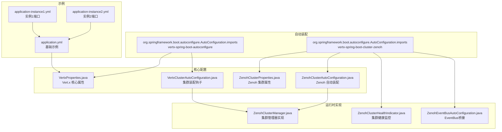
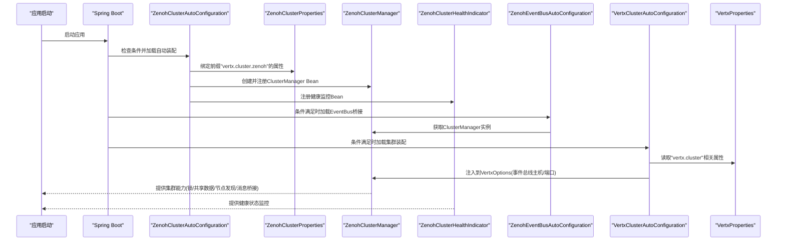
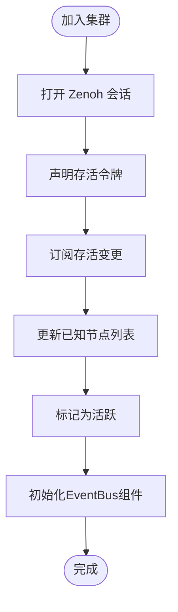
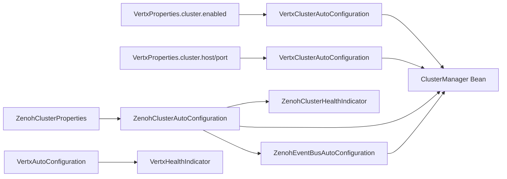

# 集群配置详解

<cite>
**本文引用的文件**
- [ZenohClusterProperties.java](file://vertx-spring-boot-cluster-zenoh/src/main/java/com/workoss/boot/vertx/cluster/zenoh/ZenohClusterProperties.java)
- [ZenohClusterAutoConfiguration.java](file://vertx-spring-boot-cluster-zenoh/src/main/java/com/workoss/boot/vertx/cluster/zenoh/ZenohClusterAutoConfiguration.java)
- [ZenohClusterHealthIndicator.java](file://vertx-spring-boot-cluster-zenoh/src/main/java/com/workoss/boot/vertx/cluster/zenoh/ZenohClusterHealthIndicator.java)
- [ZenohEventBusAutoConfiguration.java](file://vertx-spring-boot-cluster-zenoh/src/main/java/com/workoss/boot/vertx/cluster/zenoh/ZenohEventBusAutoConfiguration.java)
- [ZenohClusterManager.java](file://vertx-spring-boot-cluster-zenoh/src/main/java/com/workoss/boot/vertx/cluster/zenoh/ZenohClusterManager.java)
- [VertxProperties.java](file://vertx-spring-boot-autoconfigure/src/main/java/com/workoss/boot/vertx/autoconfigure/VertxProperties.java)
- [VertxClusterAutoConfiguration.java](file://vertx-spring-boot-autoconfigure/src/main/java/com/workoss/boot/vertx/autoconfigure/VertxClusterAutoConfiguration.java)
- [VertxAutoConfiguration.java](file://vertx-spring-boot-autoconfigure/src/main/java/com/workoss/boot/vertx/autoconfigure/VertxAutoConfiguration.java)
- [VertxHealthIndicator.java](file://vertx-spring-boot-autoconfigure/src/main/java/com/workoss/boot/vertx/autoconfigure/VertxHealthIndicator.java)
- [application.yml](file://example/vertx-spring-boot-example/src/main/resources/application.yml)
- [application-instance1.yml](file://example/vertx-spring-boot-example/src/main/resources/application-instance1.yml)
- [application-instance2.yml](file://example/vertx-spring-boot-example/src/main/resources/application-instance2.yml)
- [org.springframework.boot.autoconfigure.AutoConfiguration.imports](file://vertx-spring-boot-cluster-zenoh/src/main/resources/META-INF/spring/org.springframework.boot.autoconfigure.AutoConfiguration.imports)
- [org.springframework.boot.autoconfigure.AutoConfiguration.imports](file://vertx-spring-boot-autoconfigure/src/main/resources/META-INF/spring/org.springframework.boot.autoconfigure.AutoConfiguration.imports)
</cite>

## 更新摘要
**变更内容**
- 包名从 `com.vertx.spring.boot` 重命名为 `com.workoss.boot.vertx`
- 新增 Zenoh 集群健康指示器功能
- 新增 EventBus 自动配置和桥接机制
- 更新 Vert.x 5 架构适配和集群管理器集成
- 增强可观测性和监控能力

## 目录
1. [引言](#引言)
2. [项目结构](#项目结构)
3. [核心组件](#核心组件)
4. [架构总览](#架构总览)
5. [详细组件分析](#详细组件分析)
6. [依赖关系分析](#依赖关系分析)
7. [性能考量](#性能考量)
8. [故障排查指南](#故障排查指南)
9. [结论](#结论)
10. [附录：配置示例与最佳实践](#附录配置示例与最佳实践)

## 引言
本文件面向使用 Vert.x 集群功能的开发者，系统性解析基于 Zenoh 的集群配置方案。重点围绕 ZenohClusterProperties 配置类展开，逐项说明其属性含义、默认值、取值范围、相互依赖与约束，并结合实际工程示例给出单机、多节点与分布式部署的完整配置模板。同时提供配置校验规则、常见错误排查方法以及不同环境下的性能调优建议。

**更新** 本版本反映了包名重命名、新增健康监控和EventBus桥接等重要变更。

## 项目结构
该仓库采用模块化组织，与集群配置直接相关的核心模块如下：
- vertx-spring-boot-cluster-zenoh：提供基于 Zenoh 的集群管理器实现、自动装配和健康监控
- vertx-spring-boot-autoconfigure：提供 Vert.x 核心属性与集群相关属性的绑定与装配
- example/vertx-spring-boot-example：演示如何在多实例环境中启用集群与切换端口

**图表来源**
- [org.springframework.boot.autoconfigure.AutoConfiguration.imports:1-3](file://vertx-spring-boot-autoconfigure/src/main/resources/META-INF/spring/org.springframework.boot.autoconfigure.AutoConfiguration.imports#L1-L3)
- [org.springframework.boot.autoconfigure.AutoConfiguration.imports:1-3](file://vertx-spring-boot-cluster-zenoh/src/main/resources/META-INF/spring/org.springframework.boot.autoconfigure.AutoConfiguration.imports#L1-L3)
- [VertxProperties.java:1-173](file://vertx-spring-boot-autoconfigure/src/main/java/com/workoss/boot/vertx/autoconfigure/VertxProperties.java#L1-L173)
- [VertxClusterAutoConfiguration.java:1-34](file://vertx-spring-boot-autoconfigure/src/main/java/com/workoss/boot/vertx/autoconfigure/VertxClusterAutoConfiguration.java#L1-L34)
- [ZenohClusterProperties.java:1-92](file://vertx-spring-boot-cluster-zenoh/src/main/java/com/workoss/boot/vertx/cluster/zenoh/ZenohClusterProperties.java#L1-L92)
- [ZenohClusterAutoConfiguration.java:1-36](file://vertx-spring-boot-cluster-zenoh/src/main/java/com/workoss/boot/vertx/cluster/zenoh/ZenohClusterAutoConfiguration.java#L1-L36)
- [ZenohClusterManager.java:1-491](file://vertx-spring-boot-cluster-zenoh/src/main/java/com/workoss/boot/vertx/cluster/zenoh/ZenohClusterManager.java#L1-L491)
- [ZenohClusterHealthIndicator.java:1-47](file://vertx-spring-boot-cluster-zenoh/src/main/java/com/workoss/boot/vertx/cluster/zenoh/ZenohClusterHealthIndicator.java#L1-L47)
- [ZenohEventBusAutoConfiguration.java:1-29](file://vertx-spring-boot-cluster-zenoh/src/main/java/com/workoss/boot/vertx/cluster/zenoh/ZenohEventBusAutoConfiguration.java#L1-L29)
- [application.yml:1-35](file://example/vertx-spring-boot-example/src/main/resources/application.yml#L1-L35)
- [application-instance1.yml:1-2](file://example/vertx-spring-boot-example/src/main/resources/application-instance1.yml#L1-L2)
- [application-instance2.yml:1-2](file://example/vertx-spring-boot-example/src/main/resources/application-instance2.yml#L1-L2)

**章节来源**
- [org.springframework.boot.autoconfigure.AutoConfiguration.imports:1-3](file://vertx-spring-boot-autoconfigure/src/main/resources/META-INF/spring/org.springframework.boot.autoconfigure.AutoConfiguration.imports#L1-L3)
- [org.springframework.boot.autoconfigure.AutoConfiguration.imports:1-3](file://vertx-spring-boot-cluster-zenoh/src/main/resources/META-INF/spring/org.springframework.boot.autoconfigure.AutoConfiguration.imports#L1-L3)

## 核心组件
- **ZenohClusterProperties**：定义 Zenoh 集群管理所需的全部配置项，包括应用隔离、会话模式、连接与监听端点、外部配置文件等。
- **ZenohClusterAutoConfiguration**：在启用集群时自动注册 ZenohClusterManager Bean，并提供健康监控功能。
- **ZenohClusterHealthIndicator**：提供 Zenoh 集群状态的健康检查，包括节点数量、节点ID和活动状态。
- **ZenohEventBusAutoConfiguration**：自动配置 EventBus 桥接，通过 Zenoh 实现跨节点消息传递。
- **VertxProperties 与 VertxClusterAutoConfiguration**：提供 Vert.x 层面的集群开关、主机与端口等通用配置，并在启用集群时注入到 Vert.x 选项中。
- **ZenohClusterManager**：实现 Vert.x ClusterManager 接口，负责节点加入/离开、注册信息维护、锁与共享数据结构等，并集成 EventBus 桥接。

**更新** 新增了健康监控和EventBus桥接功能，增强了集群的可观测性和通信能力。

**章节来源**
- [ZenohClusterProperties.java:1-92](file://vertx-spring-boot-cluster-zenoh/src/main/java/com/workoss/boot/vertx/cluster/zenoh/ZenohClusterProperties.java#L1-L92)
- [ZenohClusterAutoConfiguration.java:1-36](file://vertx-spring-boot-cluster-zenoh/src/main/java/com/workoss/boot/vertx/cluster/zenoh/ZenohClusterAutoConfiguration.java#L1-L36)
- [ZenohClusterHealthIndicator.java:1-47](file://vertx-spring-boot-cluster-zenoh/src/main/java/com/workoss/boot/vertx/cluster/zenoh/ZenohClusterHealthIndicator.java#L1-L47)
- [ZenohEventBusAutoConfiguration.java:1-29](file://vertx-spring-boot-cluster-zenoh/src/main/java/com/workoss/boot/vertx/cluster/zenoh/ZenohEventBusAutoConfiguration.java#L1-L29)
- [VertxProperties.java:1-173](file://vertx-spring-boot-autoconfigure/src/main/java/com/workoss/boot/vertx/autoconfigure/VertxProperties.java#L1-L173)
- [VertxClusterAutoConfiguration.java:1-34](file://vertx-spring-boot-autoconfigure/src/main/java/com/workoss/boot/vertx/autoconfigure/VertxClusterAutoConfiguration.java#L1-L34)
- [ZenohClusterManager.java:1-491](file://vertx-spring-boot-cluster-zenoh/src/main/java/com/workoss/boot/vertx/cluster/zenoh/ZenohClusterManager.java#L1-L491)

## 架构总览
下图展示了从配置到运行时的装配流程与职责边界，包括新增的健康监控和EventBus桥接功能：

**图表来源**
- [ZenohClusterAutoConfiguration.java:1-36](file://vertx-spring-boot-cluster-zenoh/src/main/java/com/workoss/boot/vertx/cluster/zenoh/ZenohClusterAutoConfiguration.java#L1-L36)
- [ZenohClusterProperties.java:1-92](file://vertx-spring-boot-cluster-zenoh/src/main/java/com/workoss/boot/vertx/cluster/zenoh/ZenohClusterProperties.java#L1-L92)
- [ZenohClusterManager.java:1-491](file://vertx-spring-boot-cluster-zenoh/src/main/java/com/workoss/boot/vertx/cluster/zenoh/ZenohClusterManager.java#L1-L491)
- [ZenohClusterHealthIndicator.java:1-47](file://vertx-spring-boot-cluster-zenoh/src/main/java/com/workoss/boot/vertx/cluster/zenoh/ZenohClusterHealthIndicator.java#L1-L47)
- [ZenohEventBusAutoConfiguration.java:1-29](file://vertx-spring-boot-cluster-zenoh/src/main/java/com/workoss/boot/vertx/cluster/zenoh/ZenohEventBusAutoConfiguration.java#L1-L29)
- [VertxClusterAutoConfiguration.java:1-34](file://vertx-spring-boot-autoconfigure/src/main/java/com/workoss/boot/vertx/autoconfigure/VertxClusterAutoConfiguration.java#L1-L34)
- [VertxProperties.java:1-173](file://vertx-spring-boot-autoconfigure/src/main/java/com/workoss/boot/vertx/autoconfigure/VertxProperties.java#L1-L173)

## 详细组件分析

### ZenohClusterProperties 配置类详解
- **前缀**：vertx.cluster.zenoh
- **主要属性与说明**
  - appName：应用名，用于多租户隔离，默认"default"
  - environment：环境标签，用于多租户隔离，默认"default"
  - mode：Zenoh 会话模式，支持 peer/client/router，默认"peer"
  - connect：连接端点列表，用于连接现有 Zenoh 网络
  - listen：监听端点列表，用于对外暴露服务以便其他节点接入
  - configFile：指向 Zenoh JSON5 配置文件路径（若提供，可覆盖上述部分属性）

- **默认值与推荐设置**
  - appName/environment：建议按业务域与环境分别设置，避免跨环境冲突
  - mode：单机开发可选 peer；生产多节点需确保至少一个 router，其余 peer/client
  - connect/listen：单机模式通常无需 connect；多节点/分布式需正确填写对端地址或本机监听地址
  - configFile：优先级低于显式属性，仅在需要复杂配置时使用

- **取值范围与约束**
  - mode 必须为 peer/client/router之一
  - connect/listen 为字符串列表，元素应符合 Zenoh 端点格式
  - 当提供 configFile 时，内部配置将作为补充，不强制覆盖所有字段

- **与其他配置的关系**
  - 与 Vert.x 集群开关（vertx.cluster.enabled）强关联：只有启用集群时才会激活 Zenoh 自动装配
  - 与 Vert.x 事件总线主机/端口（vertx.cluster.host/port）配合：用于集群通信通道

**章节来源**
- [ZenohClusterProperties.java:1-92](file://vertx-spring-boot-cluster-zenoh/src/main/java/com/workoss/boot/vertx/cluster/zenoh/ZenohClusterProperties.java#L1-L92)
- [VertxClusterAutoConfiguration.java:1-34](file://vertx-spring-boot-autoconfigure/src/main/java/com/workoss/boot/vertx/autoconfigure/VertxClusterAutoConfiguration.java#L1-L34)
- [VertxProperties.java:118-171](file://vertx-spring-boot-autoconfigure/src/main/java/com/workoss/boot/vertx/autoconfigure/VertxProperties.java#L118-L171)

### ZenohClusterAutoConfiguration 自动装配
- **条件注解**
  - 仅当 vertx.cluster.enabled=true 时生效
  - 仅当存在 ClusterManager 类时生效
- **行为**
  - 注册 ZenohClusterManager Bean，传入已绑定的 ZenohClusterProperties
  - 注册 ZenohClusterHealthIndicator Bean，提供健康监控功能
- **作用**
  - 将配置类与运行时实现解耦，便于扩展其他集群后端
  - 提供集群状态的健康检查能力

**更新** 新增了健康监控功能，增强了集群的可观测性。

**章节来源**
- [ZenohClusterAutoConfiguration.java:1-36](file://vertx-spring-boot-cluster-zenoh/src/main/java/com/workoss/boot/vertx/cluster/zenoh/ZenohClusterAutoConfiguration.java#L1-L36)

### ZenohClusterHealthIndicator 健康监控
- **功能特性**
  - 提供 Zenoh 集群的实时健康状态检查
  - 报告节点ID、活动状态、节点数量和节点列表
  - 支持未知状态的错误处理
- **监控指标**
  - active：集群是否处于活动状态
  - nodeId：当前节点的唯一标识符
  - nodeCount：集群中的节点总数
  - nodes：所有已知节点的列表
  - error：集群不活动时的错误详情
- **集成方式**
  - 通过 Spring Boot Actuator 自动注册
  - 与 ZenohClusterManager 实例绑定
  - 在集群状态变化时自动更新

**新增功能** 为集群提供了完整的健康监控能力，便于运维和故障排查。

**章节来源**
- [ZenohClusterHealthIndicator.java:1-47](file://vertx-spring-boot-cluster-zenoh/src/main/java/com/workoss/boot/vertx/cluster/zenoh/ZenohClusterHealthIndicator.java#L1-L47)

### ZenohEventBusAutoConfiguration EventBus桥接
- **功能概述**
  - 自动配置 EventBus 桥接，通过 Zenoh 实现跨节点消息传递
  - 在启用集群时自动创建 ZenohEventBusBridge Bean
  - 与 ZenohClusterManager 实例协同工作
- **核心组件**
  - ZenohEventBusBridge：负责将 EventBus 发布操作路由到 Zenoh
  - 通过消息编解码器实现跨节点的消息序列化
  - 支持异步消息传递和节点间通信
- **架构优势**
  - 避免了传统 Vert.x 集群的额外 TCP 端口需求
  - 利用 Zenoh 的高性能发布订阅机制
  - 提供更好的跨网络拓扑的消息传递能力

**新增功能** 通过 EventBus 桥接实现了更高效的跨节点通信机制。

**章节来源**
- [ZenohEventBusAutoConfiguration.java:1-29](file://vertx-spring-boot-cluster-zenoh/src/main/java/com/workoss/boot/vertx/cluster/zenoh/ZenohEventBusAutoConfiguration.java#L1-L29)

### ZenohClusterManager 运行时实现
- **多租户隔离**
  - 通过 KeyPrefixStrategy 生成前缀：vertx/{app-name}/{environment}/cluster/...
  - 不同应用/环境在同一 Zenoh 网络下完全隔离
- **节点生命周期**
  - join：打开会话、声明存活令牌、订阅存活变化、标记自身为已加入
  - leave：关闭会话、移除节点、标记非活跃
- **能力接口**
  - AsyncMap/Lock/Counter/注册表管理等均通过前缀策略与 Zenoh 交互
- **EventBus 集成**
  - 初始化消息编解码器、发布者、发送者和订阅者组件
  - 支持跨节点的消息传递和事件广播
- **日志与可观测性**
  - 在关键步骤输出日志，便于排障
  - 提供集群状态的详细监控信息

**图表来源**
- [ZenohClusterManager.java:160-200](file://vertx-spring-boot-cluster-zenoh/src/main/java/com/workoss/boot/vertx/cluster/zenoh/ZenohClusterManager.java#L160-L200)

**章节来源**
- [ZenohClusterManager.java:1-491](file://vertx-spring-boot-cluster-zenoh/src/main/java/com/workoss/boot/vertx/cluster/zenoh/ZenohClusterManager.java#L1-L491)

### Vert.x 集群属性与装配
- **VertxProperties.cluster**
  - enabled：是否启用 Vert.x 集群
  - host/port：事件总线通信的主机与端口（0 表示自动分配）
  - publicHost：NAT 环境下的公网映射
- **VertxClusterAutoConfiguration**
  - 在启用集群时，将 host/port 写入 EventBusOptions
  - 与 ClusterManager Bean 共同工作
- **VertxAutoConfiguration**
  - 在 Zenoh 集群模式下创建非集群化的 Vert.x 实例
  - 依赖 ZenohEventBusBridge 进行跨节点通信
  - 提供 Vert.x 健康监控功能

**更新** Vert.x 5 架构适配，支持新的集群管理器集成方式。

**章节来源**
- [VertxProperties.java:118-171](file://vertx-spring-boot-autoconfigure/src/main/java/com/workoss/boot/vertx/autoconfigure/VertxProperties.java#L118-L171)
- [VertxClusterAutoConfiguration.java:1-34](file://vertx-spring-boot-autoconfigure/src/main/java/com/workoss/boot/vertx/autoconfigure/VertxClusterAutoConfiguration.java#L1-L34)
- [VertxAutoConfiguration.java:1-115](file://vertx-spring-boot-autoconfigure/src/main/java/com/workoss/boot/vertx/autoconfigure/VertxAutoConfiguration.java#L1-L115)

## 依赖关系分析
- **自动装配依赖**
  - vertx-spring-boot-autoconfigure 提供 Vert.x 核心属性与集群装配
  - vertx-spring-boot-cluster-zenoh 提供 Zenoh 实现、自动装配和健康监控
- **运行时依赖**
  - ZenohClusterAutoConfiguration 依赖于 ClusterManager 接口存在
  - VertxClusterAutoConfiguration 依赖于 ClusterManager Bean 存在且启用集群
  - ZenohEventBusAutoConfiguration 依赖于 ZenohClusterManager Bean 存在
- **配置依赖**
  - vertx.cluster.enabled 控制是否启用集群
  - vertx.cluster.zenoh.* 控制 Zenoh 行为
  - vertx.cluster.host/port 控制事件总线通信

**图表来源**
- [VertxProperties.java:118-171](file://vertx-spring-boot-autoconfigure/src/main/java/com/workoss/boot/vertx/autoconfigure/VertxProperties.java#L118-L171)
- [VertxClusterAutoConfiguration.java:1-34](file://vertx-spring-boot-autoconfigure/src/main/java/com/workoss/boot/vertx/autoconfigure/VertxClusterAutoConfiguration.java#L1-L34)
- [ZenohClusterAutoConfiguration.java:1-36](file://vertx-spring-boot-cluster-zenoh/src/main/java/com/workoss/boot/vertx/cluster/zenoh/ZenohClusterAutoConfiguration.java#L1-L36)
- [ZenohClusterProperties.java:1-92](file://vertx-spring-boot-cluster-zenoh/src/main/java/com/workoss/boot/vertx/cluster/zenoh/ZenohClusterProperties.java#L1-L92)
- [ZenohEventBusAutoConfiguration.java:1-29](file://vertx-spring-boot-cluster-zenoh/src/main/java/com/workoss/boot/vertx/cluster/zenoh/ZenohEventBusAutoConfiguration.java#L1-L29)

## 性能考量
- **事件循环与线程池**
  - eventLoopPoolSize：默认 0（由 CPU 核数决定），可根据负载调整
  - workerPoolSize/internalBlockingPoolSize：根据阻塞任务量适当增大
  - preferNativeTransport：优先使用 epoll/kqueue，降低延迟
- **集群通信**
  - host/port 设置合理，避免端口冲突；在 NAT 环境使用 publicHost
  - connect/listen 端点尽量使用内网高带宽地址，减少跨网段开销
- **多租户隔离**
  - 使用不同的 appName/environment，避免键空间冲突与竞争
- **EventBus 桥接优化**
  - 利用 Zenoh 的高效发布订阅机制，减少网络开销
  - 通过消息编解码器优化序列化性能
- **健康监控开销**
  - 健康指示器提供轻量级监控，对性能影响极小
  - 建议在生产环境启用以获得更好的可观测性

**更新** 新增了 EventBus 桥接和健康监控的性能考量。

## 故障排查指南
- **常见问题与定位**
  - 无法加入集群：检查 vertx.cluster.enabled 是否为 true；确认 mode/connect/listen 配置正确
  - 节点未发现：确认 subscribeLivelinessChanges 的模式匹配与网络连通性
  - 锁/共享数据异常：检查 appName/environment 是否一致，避免跨租户干扰
  - 端口冲突：核对 vertx.cluster.host/port 与系统占用情况
  - EventBus 消息丢失：检查 ZenohEventBusBridge 配置和网络连通性
  - 健康监控异常：验证 ZenohClusterHealthIndicator Bean 是否正确注册
- **验证步骤**
  - 启用更详细的日志，观察 join/leave 流程
  - 使用最小化配置先验证单机模式，再逐步引入多节点
  - 在示例工程中切换实例配置，验证端口与集群行为
  - 通过健康监控端点检查集群状态
- **示例参考**
  - 单机模式：启用集群开关，不配置 connect/listen
  - 多实例模式：为不同实例设置不同端口，共享同一 appName/environment
  - 健康监控：访问 /actuator/health 端点查看集群状态

**更新** 新增了 EventBus 和健康监控相关的故障排查指导。

**章节来源**
- [application.yml:29-35](file://example/vertx-spring-boot-example/src/main/resources/application.yml#L29-L35)
- [application-instance1.yml:1-2](file://example/vertx-spring-boot-example/src/main/resources/application-instance1.yml#L1-L2)
- [application-instance2.yml:1-2](file://example/vertx-spring-boot-example/src/main/resources/application-instance2.yml#L1-L2)

## 结论
通过 ZenohClusterProperties 与相关自动装配模块，Vert.x 在 Spring Boot 环境中实现了灵活、可扩展的集群能力。**更新后的版本**不仅包含了完整的集群配置功能，还新增了健康监控和 EventBus 桥接机制，显著提升了集群的可观测性和通信效率。

正确理解各配置项的语义与约束，结合示例工程进行验证，是成功落地单机、多节点与分布式部署的关键。建议在生产环境优先明确 appName/environment，合理规划网络拓扑与端口，并持续优化事件循环与线程池参数以获得稳定性能。

**更新** 包名重命名和新增功能使系统更加规范化和功能完善。

## 附录：配置示例与最佳实践

### 单机模式（开发/测试）
- vertx.cluster.enabled=true
- vertx.cluster.zenoh.appName=dev-app
- vertx.cluster.zenoh.environment=dev
- vertx.cluster.zenoh.mode=peer
- vertx.cluster.host=0.0.0.0
- vertx.cluster.port=0

**章节来源**
- [application.yml:29-35](file://example/vertx-spring-boot-example/src/main/resources/application.yml#L29-L35)

### 多节点集群（同环境隔离）
- **实例1**
  - server.port=8081
  - vertx.cluster.zenoh.appName=prod-app
  - vertx.cluster.zenoh.environment=prod
  - vertx.cluster.zenoh.mode=peer
  - vertx.cluster.zenoh.listen=[tcp/0.0.0.0:7001]
- **实例2**
  - server.port=8082
  - vertx.cluster.zenoh.appName=prod-app
  - vertx.cluster.zenoh.environment=prod
  - vertx.cluster.zenoh.mode=client
  - vertx.cluster.zenoh.connect=[tcp/实例1IP:7001]

### 分布式部署（跨机房/云）
- **机房A**
  - vertx.cluster.zenoh.mode=router
  - vertx.cluster.zenoh.listen=[tcp/0.0.0.0:7001]
  - vertx.cluster.host=routerA内网IP
  - vertx.cluster.port=5701
- **机房B**
  - vertx.cluster.zenoh.mode=peer
  - vertx.cluster.zenoh.connect=[tcp/机房A路由器IP:7001]
  - vertx.cluster.host=本机内网IP
  - vertx.cluster.port=5701

### 健康监控配置
- 启用 Spring Boot Actuator
- 配置健康检查端点暴露
- 访问 /actuator/health 查看集群状态
- 监控节点数量、节点ID和活动状态

### 配置验证规则
- **必填项**：appName/environment 建议显式设置
- **互斥/依赖**：mode 与 connect/listen 应与网络拓扑匹配
- **端口**：host/port 与 connect/listen 端口不应冲突
- **文件**：configFile 与显式属性不可同时覆盖同一逻辑
- **健康监控**：确保 Spring Boot Actuator 正确配置

### 最佳实践
- **开发**：peer + 本地端口 + 简化 appName/environment
- **测试**：client/peer 混合 + 显式 listen/connect + 启用健康监控
- **生产**：至少一个 router + peer/client 按角色划分 + NAT 下使用 publicHost + 完整健康监控
- **安全**：在可信网络内使用 TCP；必要时启用传输层安全（取决于 Zenoh 配置文件）
- **观测**：开启 INFO/DEBUG 日志，定位加入/离开与存活订阅问题 + 启用健康监控
- **性能**：利用 EventBus 桥接减少网络开销，合理配置线程池大小

**更新** 新增了健康监控和 EventBus 桥接的最佳实践指导。