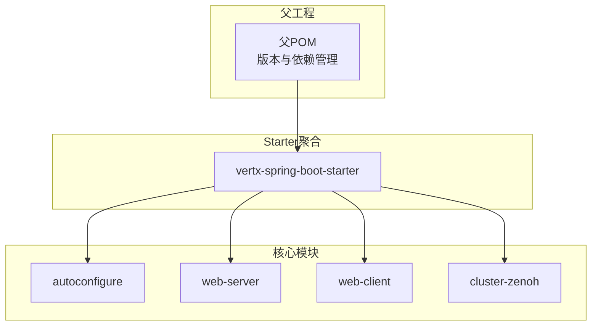
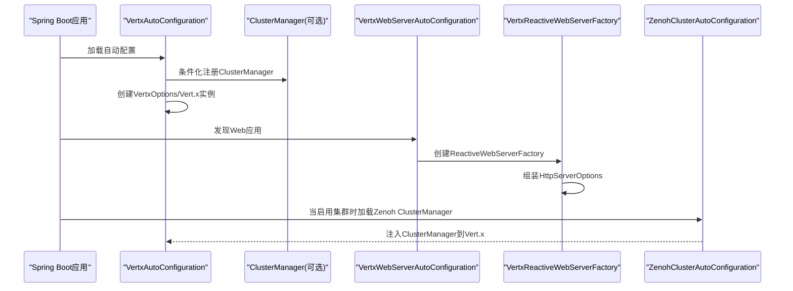
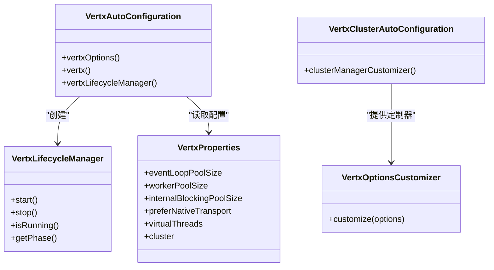
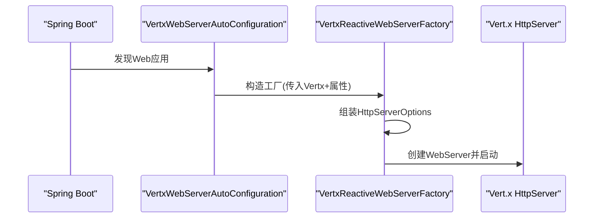
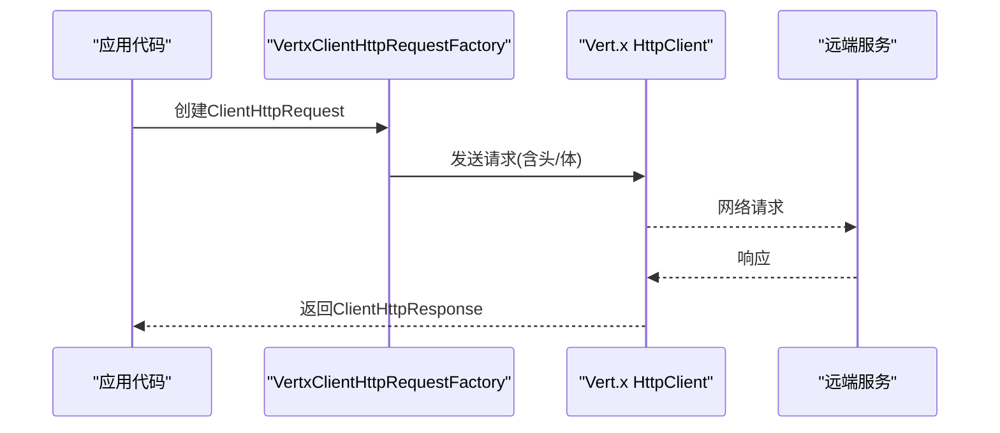
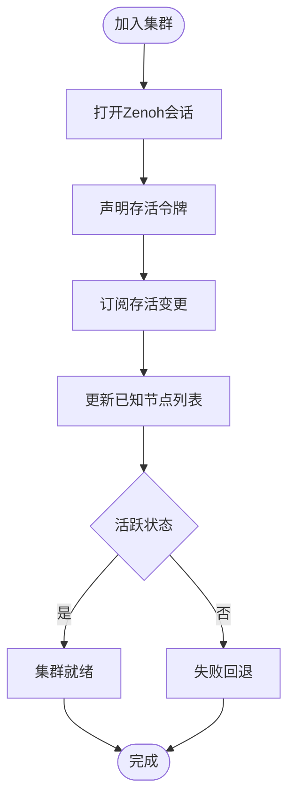
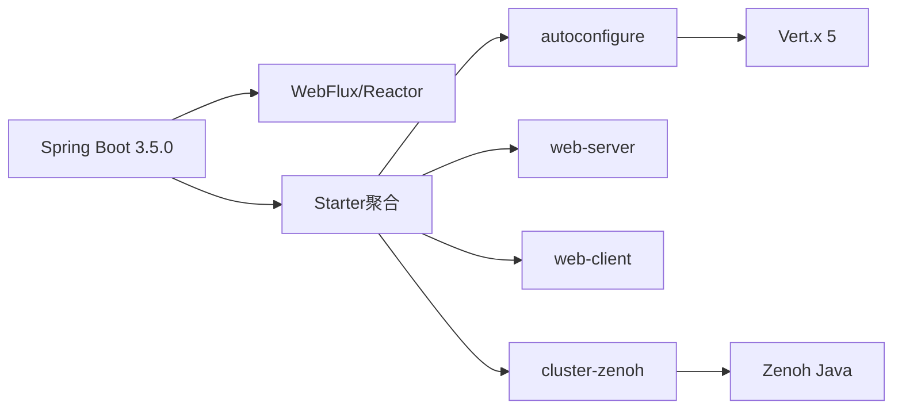

# 项目概述

<cite>
**本文引用的文件**
- [pom.xml](file://pom.xml)
- [vertx-spring-boot-starter/pom.xml](file://vertx-spring-boot-starter/pom.xml)
- [vertx-spring-boot-autoconfigure/pom.xml](file://vertx-spring-boot-autoconfigure/pom.xml)
- [vertx-spring-boot-web-server/pom.xml](file://vertx-spring-boot-web-server/pom.xml)
- [vertx-spring-boot-web-client/pom.xml](file://vertx-spring-boot-web-client/pom.xml)
- [vertx-spring-boot-cluster-zenoh/pom.xml](file://vertx-spring-boot-cluster-zenoh/pom.xml)
- [VertxAutoConfiguration.java](file://vertx-spring-boot-autoconfigure/src/main/java/com/workoss/boot/vertx/autoconfigure/VertxAutoConfiguration.java)
- [VertxClusterAutoConfiguration.java](file://vertx-spring-boot-autoconfigure/src/main/java/com/workoss/boot/vertx/autoconfigure/VertxClusterAutoConfiguration.java)
- [VertxProperties.java](file://vertx-spring-boot-autoconfigure/src/main/java/com/workoss/boot/vertx/autoconfigure/VertxProperties.java)
- [VertxLifecycleManager.java](file://vertx-spring-boot-autoconfigure/src/main/java/com/workoss/boot/vertx/autoconfigure/VertxLifecycleManager.java)
- [VertxOptionsCustomizer.java](file://vertx-spring-boot-autoconfigure/src/main/java/com/workoss/boot/vertx/autoconfigure/VertxOptionsCustomizer.java)
- [VertxWebServerAutoConfiguration.java](file://vertx-spring-boot-web-server/src/main/java/com/workoss/boot/vertx/web/server/VertxWebServerAutoConfiguration.java)
- [VertxReactiveWebServerFactory.java](file://vertx-spring-boot-web-server/src/main/java/com/workoss/boot/vertx/web/server/VertxReactiveWebServerFactory.java)
- [VertxWebClientAutoConfiguration.java](file://vertx-spring-boot-web-client/src/main/java/com/workoss/boot/vertx/web/client/VertxWebClientAutoConfiguration.java)
- [VertxClientHttpRequestFactory.java](file://vertx-spring-boot-web-client/src/main/java/com/workoss/boot/vertx/web/client/VertxClientHttpRequestFactory.java)
- [VertxClientHttpConnector.java](file://vertx-spring-boot-web-client/src/main/java/com/workoss/boot/vertx/web/client/VertxClientHttpConnector.java)
- [ZenohClusterAutoConfiguration.java](file://vertx-spring-boot-cluster-zenoh/src/main/java/com/workoss/boot/vertx/cluster/zenoh/ZenohClusterAutoConfiguration.java)
- [ZenohClusterManager.java](file://vertx-spring-boot-cluster-zenoh/src/main/java/com/workoss/boot/vertx/cluster/zenoh/ZenohClusterManager.java)
</cite>

## 目录
1. [引言](#引言)
2. [项目结构](#项目结构)
3. [核心组件](#核心组件)
4. [架构总览](#架构总览)
5. [详细组件分析](#详细组件分析)
6. [依赖分析](#依赖分析)
7. [性能考虑](#性能考虑)
8. [故障排查指南](#故障排查指南)
9. [结论](#结论)
10. [附录](#附录)

## 引言
本项目旨在为Spring Boot 3.5.0提供基于Vert.x 5的现代化嵌入式Web与集群能力集成方案，通过自动配置与模块化设计，将响应式Web服务器、HTTP客户端与分布式集群管理（以Zenoh为ClusterManager）无缝整合到Spring生态中。项目采用Java 21作为运行时，结合响应式编程范式与分布式系统特性，既适合初学者快速上手，也为有经验的开发者提供了可扩展、可定制的架构基础。

## 项目结构
项目采用多模块Maven聚合结构，核心模块包括：
- 自动配置模块：负责Vert.x实例生命周期与选项装配
- Web服务器模块：基于Vert.x的响应式Web服务器工厂
- Web客户端模块：为RestTemplate与WebClient提供Vert.x后端
- 集群管理模块：以Zenoh为ClusterManager，提供多租户隔离与分布式共享数据结构

图表来源
- [pom.xml:15-22](file://pom.xml#L15-L22)
- [vertx-spring-boot-starter/pom.xml:17-36](file://vertx-spring-boot-starter/pom.xml#L17-L36)

章节来源
- [pom.xml:15-22](file://pom.xml#L15-L22)
- [vertx-spring-boot-starter/pom.xml:17-36](file://vertx-spring-boot-starter/pom.xml#L17-L36)

## 核心组件
- Vert.x自动配置与生命周期管理
  - 提供VertxOptions与Vert.x实例的条件化Bean定义，支持集群模式与非集群模式切换
  - 通过VertxLifecycleManager确保应用关闭时优雅释放Vert.x资源
- 响应式Web服务器
  - 将Spring WebFlux的HttpHandler适配为Vert.x HttpServer，统一读取标准server.*属性与Vert.x专属属性
- HTTP客户端
  - 同时支持同步RestTemplate（ClientHttpRequestFactory）与异步WebClient（ClientHttpConnector），均基于Vert.x HttpClient
- 集群管理（Zenoh）
  - 以ClusterManager形式接入Vert.x 5，提供AsyncMap/Lock/Counter等分布式共享能力
  - 通过KeyPrefixStrategy实现多应用/多环境的完全隔离

章节来源
- [VertxAutoConfiguration.java:28-81](file://vertx-spring-boot-autoconfigure/src/main/java/com/workoss/boot/vertx/autoconfigure/VertxAutoConfiguration.java#L28-L81)
- [VertxLifecycleManager.java:12-52](file://vertx-spring-boot-autoconfigure/src/main/java/com/workoss/boot/vertx/autoconfigure/VertxLifecycleManager.java#L12-L52)
- [VertxWebServerAutoConfiguration.java:24-29](file://vertx-spring-boot-web-server/src/main/java/com/workoss/boot/vertx/web/server/VertxWebServerAutoConfiguration.java#L24-L29)
- [VertxReactiveWebServerFactory.java:36-78](file://vertx-spring-boot-web-server/src/main/java/com/workoss/boot/vertx/web/server/VertxReactiveWebServerFactory.java#L36-L78)
- [VertxWebClientAutoConfiguration.java:21-36](file://vertx-spring-boot-web-client/src/main/java/com/workoss/boot/vertx/web/client/VertxWebClientAutoConfiguration.java#L21-L36)
- [VertxClientHttpRequestFactory.java:29-54](file://vertx-spring-boot-web-client/src/main/java/com/workoss/boot/vertx/web/client/VertxClientHttpRequestFactory.java#L29-L54)
- [VertxClientHttpConnector.java:36-98](file://vertx-spring-boot-web-client/src/main/java/com/workoss/boot/vertx/web/client/VertxClientHttpConnector.java#L36-L98)
- [ZenohClusterAutoConfiguration.java:21-25](file://vertx-spring-boot-cluster-zenoh/src/main/java/com/workoss/boot/vertx/cluster/zenoh/ZenohClusterAutoConfiguration.java#L21-L25)
- [ZenohClusterManager.java:29-159](file://vertx-spring-boot-cluster-zenoh/src/main/java/com/workoss/boot/vertx/cluster/zenoh/ZenohClusterManager.java#L29-L159)

## 架构总览
下图展示了从Spring Boot启动到Vert.x Web服务器与集群管理协同工作的整体流程：

图表来源
- [VertxAutoConfiguration.java:52-75](file://vertx-spring-boot-autoconfigure/src/main/java/com/workoss/boot/vertx/autoconfigure/VertxAutoConfiguration.java#L52-L75)
- [VertxWebServerAutoConfiguration.java:24-29](file://vertx-spring-boot-web-server/src/main/java/com/workoss/boot/vertx/web/server/VertxWebServerAutoConfiguration.java#L24-L29)
- [VertxReactiveWebServerFactory.java:36-78](file://vertx-spring-boot-web-server/src/main/java/com/workoss/boot/vertx/web/server/VertxReactiveWebServerFactory.java#L36-L78)
- [ZenohClusterAutoConfiguration.java:21-25](file://vertx-spring-boot-cluster-zenoh/src/main/java/com/workoss/boot/vertx/cluster/zenoh/ZenohClusterAutoConfiguration.java#L21-L25)

## 详细组件分析

### 自动配置与生命周期管理
- VertxAutoConfiguration
  - 负责根据配置生成VertxOptions，并在集群开关开启时注入ClusterManager
  - 通过条件化Bean避免重复定义，支持外部自定义器扩展
- VertxClusterAutoConfiguration
  - 在集群启用时对VertxOptions进行补充（如EventBus地址/端口）
- VertxLifecycleManager
  - 实现SmartLifecycle，在应用停止阶段调用Vert.x关闭流程，保证资源回收
- VertxProperties
  - 提供事件循环、工作线程、原生传输、虚拟线程与集群相关配置项
- VertxOptionsCustomizer
  - 允许第三方扩展对VertxOptions进行二次定制

图表来源
- [VertxAutoConfiguration.java:28-81](file://vertx-spring-boot-autoconfigure/src/main/java/com/workoss/boot/vertx/autoconfigure/VertxAutoConfiguration.java#L28-L81)
- [VertxClusterAutoConfiguration.java:19-33](file://vertx-spring-boot-autoconfigure/src/main/java/com/workoss/boot/vertx/autoconfigure/VertxClusterAutoConfiguration.java#L19-L33)
- [VertxLifecycleManager.java:12-52](file://vertx-spring-boot-autoconfigure/src/main/java/com/workoss/boot/vertx/autoconfigure/VertxLifecycleManager.java#L12-L52)
- [VertxProperties.java:8-160](file://vertx-spring-boot-autoconfigure/src/main/java/com/workoss/boot/vertx/autoconfigure/VertxProperties.java#L8-L160)
- [VertxOptionsCustomizer.java:8-18](file://vertx-spring-boot-autoconfigure/src/main/java/com/workoss/boot/vertx/autoconfigure/VertxOptionsCustomizer.java#L8-L18)

章节来源
- [VertxAutoConfiguration.java:28-81](file://vertx-spring-boot-autoconfigure/src/main/java/com/workoss/boot/vertx/autoconfigure/VertxAutoConfiguration.java#L28-L81)
- [VertxClusterAutoConfiguration.java:19-33](file://vertx-spring-boot-autoconfigure/src/main/java/com/workoss/boot/vertx/autoconfigure/VertxClusterAutoConfiguration.java#L19-L33)
- [VertxLifecycleManager.java:12-52](file://vertx-spring-boot-autoconfigure/src/main/java/com/workoss/boot/vertx/autoconfigure/VertxLifecycleManager.java#L12-L52)
- [VertxProperties.java:8-160](file://vertx-spring-boot-autoconfigure/src/main/java/com/workoss/boot/vertx/autoconfigure/VertxProperties.java#L8-L160)
- [VertxOptionsCustomizer.java:8-18](file://vertx-spring-boot-autoconfigure/src/main/java/com/workoss/boot/vertx/autoconfigure/VertxOptionsCustomizer.java#L8-L18)

### Web服务器模块
- VertxWebServerAutoConfiguration
  - 在Web应用且缺少ReactiveWebServerFactory时，创建基于Vert.x的工厂
- VertxReactiveWebServerFactory
  - 统一读取server.port/address/ssl/compression等标准属性，同时合并vertx.http-server.*专属选项
  - 将Spring的HttpHandler适配为Vert.x的请求处理链路

图表来源
- [VertxWebServerAutoConfiguration.java:24-29](file://vertx-spring-boot-web-server/src/main/java/com/workoss/boot/vertx/web/server/VertxWebServerAutoConfiguration.java#L24-L29)
- [VertxReactiveWebServerFactory.java:36-78](file://vertx-spring-boot-web-server/src/main/java/com/workoss/boot/vertx/web/server/VertxReactiveWebServerFactory.java#L36-L78)

章节来源
- [VertxWebServerAutoConfiguration.java:24-29](file://vertx-spring-boot-web-server/src/main/java/com/workoss/boot/vertx/web/server/VertxWebServerAutoConfiguration.java#L24-L29)
- [VertxReactiveWebServerFactory.java:36-78](file://vertx-spring-boot-web-server/src/main/java/com/workoss/boot/vertx/web/server/VertxReactiveWebServerFactory.java#L36-L78)

### Web客户端模块
- VertxWebClientAutoConfiguration
  - 条件化注册ClientHttpRequestFactory与ClientHttpConnector
- VertxClientHttpRequestFactory
  - 为RestTemplate提供基于Vert.x HttpClient的请求工厂
- VertxClientHttpConnector
  - 为WebClient提供基于Reactor的响应式连接器，支持背压与流式数据

图表来源
- [VertxWebClientAutoConfiguration.java:21-36](file://vertx-spring-boot-web-client/src/main/java/com/workoss/boot/vertx/web/client/VertxWebClientAutoConfiguration.java#L21-L36)
- [VertxClientHttpRequestFactory.java:29-54](file://vertx-spring-boot-web-client/src/main/java/com/workoss/boot/vertx/web/client/VertxClientHttpRequestFactory.java#L29-L54)
- [VertxClientHttpConnector.java:36-98](file://vertx-spring-boot-web-client/src/main/java/com/workoss/boot/vertx/web/client/VertxClientHttpConnector.java#L36-L98)

章节来源
- [VertxWebClientAutoConfiguration.java:21-36](file://vertx-spring-boot-web-client/src/main/java/com/workoss/boot/vertx/web/client/VertxWebClientAutoConfiguration.java#L21-L36)
- [VertxClientHttpRequestFactory.java:29-54](file://vertx-spring-boot-web-client/src/main/java/com/workoss/boot/vertx/web/client/VertxClientHttpRequestFactory.java#L29-L54)
- [VertxClientHttpConnector.java:36-98](file://vertx-spring-boot-web-client/src/main/java/com/workoss/boot/vertx/web/client/VertxClientHttpConnector.java#L36-L98)

### 集群管理（Zenoh）
- ZenohClusterAutoConfiguration
  - 在vertx.cluster.enabled=true时注册ZenohClusterManager
- ZenohClusterManager
  - 实现ClusterManager接口，提供AsyncMap/Lock/Counter与节点发现/注册管理
  - 使用KeyPrefixStrategy按应用名与环境构建隔离键空间，实现多租户隔离

图表来源
- [ZenohClusterAutoConfiguration.java:21-25](file://vertx-spring-boot-cluster-zenoh/src/main/java/com/workoss/boot/vertx/cluster/zenoh/ZenohClusterAutoConfiguration.java#L21-L25)
- [ZenohClusterManager.java:124-159](file://vertx-spring-boot-cluster-zenoh/src/main/java/com/workoss/boot/vertx/cluster/zenoh/ZenohClusterManager.java#L124-L159)

章节来源
- [ZenohClusterAutoConfiguration.java:21-25](file://vertx-spring-boot-cluster-zenoh/src/main/java/com/workoss/boot/vertx/cluster/zenoh/ZenohClusterAutoConfiguration.java#L21-L25)
- [ZenohClusterManager.java:29-159](file://vertx-spring-boot-cluster-zenoh/src/main/java/com/workoss/boot/vertx/cluster/zenoh/ZenohClusterManager.java#L29-L159)

## 依赖分析
- 版本与运行时
  - Java 21、Spring Boot 3.5.0、Vert.x 5.0.12、Zenoh Java 1.9.0
  - 通过BOM统一管理依赖范围与版本，确保Netty与日志组件兼容
- 模块间耦合
  - starter聚合模块依赖各子模块；web-server与web-client均依赖autoconfigure
  - cluster-zenoh依赖autoconfigure并提供ClusterManager实现
- 外部集成点
  - WebFlux与Reactor用于响应式编程
  - SLF4J用于日志抽象

图表来源
- [pom.xml:35-107](file://pom.xml#L35-L107)
- [vertx-spring-boot-starter/pom.xml:17-36](file://vertx-spring-boot-starter/pom.xml#L17-L36)

章节来源
- [pom.xml:24-107](file://pom.xml#L24-L107)
- [vertx-spring-boot-starter/pom.xml:17-36](file://vertx-spring-boot-starter/pom.xml#L17-L36)

## 性能考虑
- 原生传输与事件循环
  - 默认启用原生传输（Linux/macOS epoll/kqueue），减少系统调用开销
  - 可按CPU核数与业务负载调整事件循环与工作线程池大小
- 响应式与背压
  - WebClient与Vert.x HttpClient天然支持背压与流式处理，降低内存峰值
- 连接复用与管线化
  - 客户端支持keep-alive与pipelining，提升高并发下的吞吐
- 集群与共享数据
  - AsyncMap/Lock/Counter基于分布式键值与轻量锁，避免传统共享内存的扩展瓶颈

## 故障排查指南
- 无法启动Web服务器
  - 检查是否处于响应式Web应用上下文，确认server.port与address配置
  - 排查SSL与压缩参数是否正确
- Vert.x实例未创建或未集群
  - 确认vertx.cluster.enabled开关与ClusterManager Bean存在
  - 查看VertxAutoConfiguration日志输出，定位构建过程中的异常
- 客户端请求失败
  - 检查连接超时、空闲超时与管线化设置
  - 对于WebClient，确认请求体写入与背压策略
- 集群加入失败
  - 核对appName与environment的Key前缀策略是否一致
  - 检查Zenoh网络连通性与权限配置

章节来源
- [VertxWebServerAutoConfiguration.java:17-21](file://vertx-spring-boot-web-server/src/main/java/com/workoss/boot/vertx/web/server/VertxWebServerAutoConfiguration.java#L17-L21)
- [VertxReactiveWebServerFactory.java:43-78](file://vertx-spring-boot-web-server/src/main/java/com/workoss/boot/vertx/web/server/VertxReactiveWebServerFactory.java#L43-L78)
- [VertxAutoConfiguration.java:52-75](file://vertx-spring-boot-autoconfigure/src/main/java/com/workoss/boot/vertx/autoconfigure/VertxAutoConfiguration.java#L52-L75)
- [VertxClientHttpConnector.java:50-90](file://vertx-spring-boot-web-client/src/main/java/com/workoss/boot/vertx/web/client/VertxClientHttpConnector.java#L50-L90)
- [ZenohClusterManager.java:124-159](file://vertx-spring-boot-cluster-zenoh/src/main/java/com/workoss/boot/vertx/cluster/zenoh/ZenohClusterManager.java#L124-L159)

## 结论
本项目以模块化方式将Vert.x 5与Spring Boot 3.5.0深度融合，提供响应式Web服务器、HTTP客户端与基于Zenoh的集群管理能力。通过自动配置与生命周期管理，兼顾易用性与可扩展性；借助原生传输、响应式流与分布式共享数据结构，满足高性能与可伸缩性的需求。建议在生产环境中结合监控与限流策略，进一步优化资源利用率与稳定性。

## 附录
- 快速使用场景示例（路径指引）
  - 启用集群与Web服务器：参考自动配置与Web服务器工厂的Bean定义
    - [VertxAutoConfiguration.java:52-75](file://vertx-spring-boot-autoconfigure/src/main/java/com/workoss/boot/vertx/autoconfigure/VertxAutoConfiguration.java#L52-L75)
    - [VertxWebServerAutoConfiguration.java:24-29](file://vertx-spring-boot-web-server/src/main/java/com/workoss/boot/vertx/web/server/VertxWebServerAutoConfiguration.java#L24-L29)
  - 使用WebClient发起响应式HTTP请求：参考连接器与请求工厂
    - [VertxWebClientAutoConfiguration.java:21-36](file://vertx-spring-boot-web-client/src/main/java/com/workoss/boot/vertx/web/client/VertxWebClientAutoConfiguration.java#L21-L36)
    - [VertxClientHttpConnector.java:36-98](file://vertx-spring-boot-web-client/src/main/java/com/workoss/boot/vertx/web/client/VertxClientHttpConnector.java#L36-L98)
  - 通过ClusterManager使用分布式共享数据：参考集群自动配置与管理器
    - [ZenohClusterAutoConfiguration.java:21-25](file://vertx-spring-boot-cluster-zenoh/src/main/java/com/workoss/boot/vertx/cluster/zenoh/ZenohClusterAutoConfiguration.java#L21-L25)
    - [ZenohClusterManager.java:29-159](file://vertx-spring-boot-cluster-zenoh/src/main/java/com/workoss/boot/vertx/cluster/zenoh/ZenohClusterManager.java#L29-L159)